

**收录说明**：x.ai 对自动访问返回 403，原文依据 Internet Archive 快照存档；去掉了「Back to news」链接、下载与联系销售按钮和文末「Try Grok Bot today」推广区，视频改为一行链接。文中的界面示意图较多（70 张），图中界面文字随图片保存；超过 600 KB 的图片已缩小。原文全文存于本目录的 original.md，网站上不显示，已翻译。

**内容摘要**：文章讲 Grok Bot 为了持久存在的智能体，把界面对象从聊天记录改成 Bot 名册：Bot 有名字、头像和头衔，会记住与用户的对话，并有自己的计算机和工具。产品只保留五个概念：Bots、Chats、Prompts、Tools、Artifacts。头像的动作承担状态显示（空闲、思考、工作、等待、阻塞、完成），悬停可看当前动作；Bot 的计算机分状态、预览、接管三级可见度。能力与上下文边界不同：工具和技能（Skills）在账号层面共享，记忆和例程（Routines）属于各个 Bot；群聊提供共享上下文，同时保留各 Bot 的专门记忆。例程可按时间表或事件触发，包括 issue、PR、Slack 消息、webhook 等，并移到 Bot 主界面；每个账号约 50 个 Bot、每个群聊 6 个 Bot 是实际设定的上限。

**保留理由**：这是最完整的产品设计说明，讲清了记忆归属、能力共享边界、计算机可见度和例程触发方式，是理解 Grok Bot 为什么按「长期存在的 Bot」而不是「会话」组织的主要依据。

---

我们如何为能够跨越单次会话持续存在的智能体（agent）设计 Grok Bot——从聊天记录到 Bot 名册（roster）、在场状态（presence）、Bot 自己的计算机，以及无需提示即可开始的工作。

---

当我们开始设计 Grok Bot 时，一个核心问题是：界面应如何塑造用户与智能体之间的关系。大多数 AI 界面都围绕用户操作的聊天会话组织。每次会话从设置开始，在用户注视下展开，并在对话停止时结束。

我们想为一种能跨越任何单次会话持续存在、并能自行承担责任的智能体做设计。这意味着要重新考虑界面的一些基本对象和信号，包括侧边栏里该放什么、智能体如何展示进展，以及它的工作应在何时变得可见。

搜索

Kenny

晚上 7:34

周五全员大会的演示文稿需要你确认。

Justin

已起草 8 封引荐邮件——放在 CRM 里，等你发送。

Luke

晚上 7:34

收件箱里有 3 封。今天有两封需要回复。

网站发布

上午 11:18

John：预发布环境里的结账流程没问题，已关闭 3 个 bug。

John

昨天

复现了结账崩溃。说明写在工单里。

Keith

Acme 那边有点动摇。已起草周四的沟通邮件。

Tyler

上午 9:04

已收到 14 张收据。还缺你周二的 Uber。

Manuel

下午 2:20

发布帖已上线。前 200 次展示。

Jenny

周二

SoMa 有 3 处房源。Folsom 那套两居室就是它了。

Chang

上午 10:12

找到 3 位候选人。跳过了一位已在你的 ATS 里的。

插件

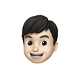

Peng Zheng

Kenny

上午 9:41

嘿，今天设计同步会的主要结论是什么？

团队大部分时间都在评审新的入门流程（onboarding flow）。

讨论最多的是空状态（empty states）。Sarah 觉得目前的插图不符合新的品牌方向，在场多数人同意。还有一场长时间的来回讨论：进度指示器（progress indicator）该放在页眉还是侧边栏。

不过整体气氛是积极的。多数人认为这个流程已经接近可以进入更大范围评审了。

有人提到 Q3 路线图吗？

提了，而且提了两次。Marcus 说路线图评审现在预计在 8 月第一周，Priya 问入门流程的工作会在那之前还是之后落地。会上没有定下确切日期。

给 Kenny 发消息

Kenny 的屏幕

例程

晨间简报

每天上午 8:00

收件箱清理

工作日 下午 6:00

每周团队更新

已暂停

## 重新思考基础构件

AI 产品在很短时间里积累了一大套词汇。聊天、会话、模型、上下文窗口、记忆、系统提示、项目、技能、连接器、智能体、工具、沙箱、权限和自动化，都在描述这些系统中真实存在的部分。

但把每一个都暴露为独立的产品概念，会让用户需要理解超出他们所需的东西。我们从这样一个问题开始：一个人要与智能体协作，实际需要哪些概念？

我们反复回到五个：

1. **Bot** 是持久存在的智能体，拥有自己的身份、记忆、运行时和工具。
2. **聊天（Chats）** 是与 Bot 协作的对话界面。
3. **提示（Prompts）** 为 Bot 提供上下文或指令。它们可以只用一次、保存为技能（Skills），或作为例程（Routines）自动触发。
4. **工具（Tools）** 让 Bot 通过软件、API、连接器、shell 或计算机使用（computer use）获取信息并采取行动。
5. **产物（Artifacts）** 是 Bot 创建或修改的文档、设计、代码、数据及其他持久输出。

其余的一切都可以留在界面之下，直到用户有理由关心它。下一个问题是：这五个对象中，哪一个应该用来组织产品？

## 从聊天记录到 Bot 名册

聊天是一次性的。我们为解决问题开始一段对话。它被挤到侧边栏下方。一周后，我们又开一段。你很少会回到最近五个之外。

当交互的单位是一个问题时，这种行为完全合理。但当交互另一侧的东西本应了解你、记住之前的工作，并随时间承担责任时，这就变得奇怪了。

所以 Grok Bot 中的主要对象是 Bot，而不是对话。Bot 有名字。它有头像和头衔。它记得与你的对话。它有自己的计算机和工具。当你明天回来时，你回到的是同一个 Bot。

项目 Acme

周五通话后起草给 Acme 的跟进

重写定价一页纸

安全评审中我该问什么？

根据我的通话笔记构建支持者地图（champion map）

用刁钻的反对意见练习演示

帮我比较这三份竞品演示文稿

显示更多

Kenny

晚上 7:34

周五全员大会的演示文稿需要你确认。

Justin

已起草 8 封引荐邮件——放在 CRM 里，等你发送。

John

昨天

复现了结账崩溃。说明写在工单里。

Keith

Acme 那边有点动摇。已起草周四的沟通邮件。

## 以在场为界面

一旦 Bot 成为你长期维护的东西，而不是你启动的一次会话，Bot 在产品中呈现的方式就必须同时回答三个问题：

1. 这是谁？
2. 它在做什么？
3. 我需要知道多少？

### 这是谁

名册只有在能被快速扫视时才成立。随着名册变大，我们不希望人们每次打开产品都要读一遍每个名字。他们应该几乎凭余光就能从头像认出某个 Bot。

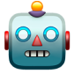

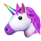

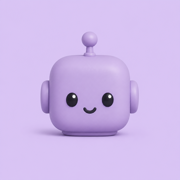

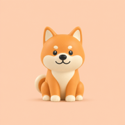

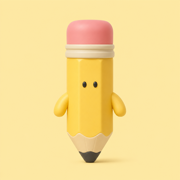

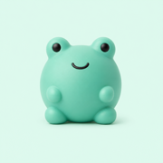

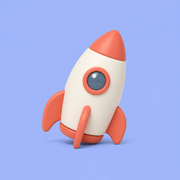

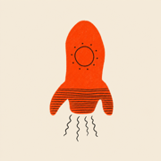

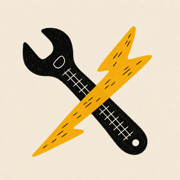

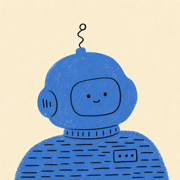

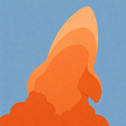

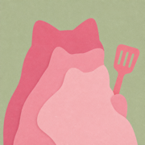

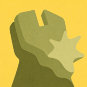

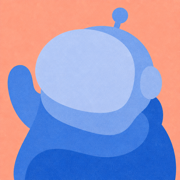

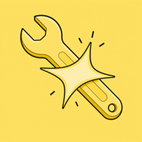

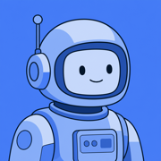

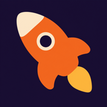

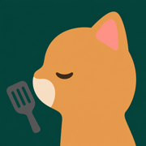

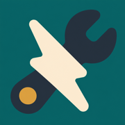

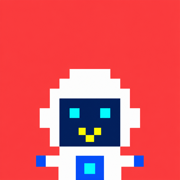

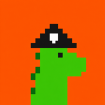

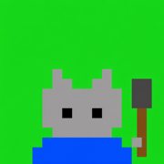

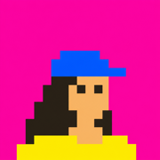

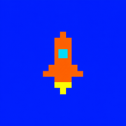

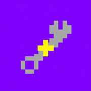

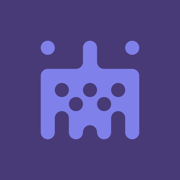

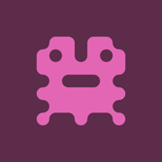

Bot 头像视觉风格探索

同时，我们希望头像足够一致，能读作同一套系统。我们研究了插画、动画、游戏和界面设计中的角色系统，探索了从首字母和 emoji 到像素艺术、水彩、黏土拟态（claymorphism）、Noritake 风格线描、剪影和 identicon 的各种做法。

多数做法解决了一边的问题，却没能同样解决另一边。水彩和黏土让每个 Bot 很有个性，但在侧边栏的尺寸下细节太多。更简单的系统更自然地融入界面，但往往让 Bot 看起来可以互换。

我们最终采用的系统保持基本构造一致，使用简单形状和有表现力的眼睛，再通过受控的变化和配饰引入区别。每个 Bot 都一眼可辨，又不会显得来自另一个视觉世界。

### 它在做什么

一旦头像成为 Bot 的身份，它自然也是展示状态的地方。Bot 可能空闲、思考、工作、等待、受阻或完成。我们本可以用单独的指示器表示每种状态，但那会给用户再加一层需要解读的 UI。

于是我们探索头像本身能承载多少生命周期。

静止时，Bot 平静而略带好奇。有工作到来时，它确认任务。工作开始时，它进入状态。等待或需要帮助时，动作再次变化，工作完成后安定下来。头像现在既显示 Bot 在做什么，也显示它是哪个 Bot。

头像动作系统

### 我需要知道多少

一个相关的设计问题是：要展示多少 Bot 的执行过程。一种做法是标准的「三个跳动的点」，但信息太少，用户难以判断 Bot 是在工作还是卡住了。

正在搜索网络

- 环境就绪 387ms
- 编辑 math.ts +14 −10
- 运行聚焦测试 npm test
- 运行类型检查 npm run
- 短暂思考
- 搜索代码「toFixed」
- 读取 AGENTS.md
- 编辑 math.test.ts +6 −2
- 运行完整测试套件 212 通过
- 提交修复：clamp NaN

- 环境就绪 387ms
- 编辑 math.ts +14 −10
- 运行聚焦测试 npm test
- 运行类型检查 npm run
- 短暂思考
- 搜索代码「toFixed」
- 读取 AGENTS.md
- 编辑 math.test.ts +6 −2
- 运行完整测试套件 212 通过
- 提交修复：clamp NaN

我们还试过用一小段文字描述 Bot 当前的动作，但一旦人们能看到一步，他们就想看到其余步骤。用户研究显示，他们要求这些细节，主要是为了确认 Bot 仍在工作、方向正确。

在最终设计中，头像的动作通过显示 Bot 处于活动状态，提供第一层安心感。如果有人想查看它在做什么，可以悬停看到当前动作。

## 它的计算机，不是你的

每个 Bot 都有自己的计算机，可以用它浏览网页、处理文件和运行软件。这带来了另一个界面问题：那台计算机应该有多可见，用户又该在什么时候能控制它？

我们探索了四种安排：

- **浮动窗口（Floating window）：** 让计算机容易访问，但会遮住对话。
- **并排（Side by side）：** 让工作持续可见，并鼓励用户盯着看。
- **模态（Modal）：** 让查看变得容易，但把 Bot 的工作区当作一次临时打断。
- **全屏（Full screen）：** 给计算机充足空间，但完全挤走了对话。

我们把计算机做得越显眼，产品就越鼓励用户去监督它。我们决定它应保持为 Bot 的工作区，而界面按用户需要提供不同层级的访问。

最终设计有三个层级，让用户进入 Bot 的工作区而不被拉进去操作它：

- **状态（Status）：** 计算机活动时，标题栏图标变为紫色。
- **预览（Preview）：** 打开后显示固定的侧边面板，用户可以不离开对话就跟随工作进展。
- **接管（Takeover）：** 当 Bot 需要帮助时，用户可以全屏打开计算机、取得控制，然后再交还。

我们还设计了会随一天变化的壁纸，早晨更亮，夜晚更暗。这个细节让 Bot 的计算机有自己的时间感，也让它感觉与用户的桌面分开。

动态壁纸

这更像与同事一起工作，而不是操作一台远程机器。你能看出他们在工作，需要背景时瞥一眼他们的屏幕，有事需要你帮忙时坐下来处理。

## 信息的形式

早期版本的 Grok Bot 几乎对每个请求都用文字回应。它会描述五天天气预报，而不是展示出来；会叙述一组任务，而不是把它们排成看板。用户随后不得不重新组织答案。这让我们把回应的形式也视为答案的一部分。

为支持这一点，我们在 Grok Bot 中内置了行内卡片和小组件（widgets）。当文字适合信息时，Bot 用文字回答；不适合时，就使用结构化 UI。

新邮件

可以发送

发件人：peng@grokbot.app

收件人：sarah@acme.com

主题：将周五的设计评审移到下午 2 点

Hi Sarah，

能不能把周五的设计评审从上午 11 点移到下午 2 点？临时来了一个客户电话，我不想让我们的讨论太赶。

谢谢，
Peng

发送邮件　丢弃

行内聊天小组件

同样的原则适用于动作。当 Bot 创建例程、更改设置或给另一个 Bot 发消息时，该事件可以直接出现在对话记录中。用户可以在需要查看更多内容时打开它。

上午 9:41

早上好！能帮我跟每个人确认一下进展吗？

马上办——现在就去问团队要状态

与 Kenny、Tyler 和 Jenny 的 6 条消息

一切按计划：Kenny 已发布落地页，Tyler 已发出本月发票，Jenny 已预约下周的面试。没有阻塞。

很喜欢，你能每天早上都做这个吗？

已创建例程：晨间简报

完成，你的晨间简报每天 9:00 会出现在这里

结果是异构的对话记录：对话、系统事件、交互对象和可视化共享同一条时间线。

## 组织智能

一旦人们创建了多个 Bot，产品还必须组织这些 Bot 如何协同工作。我们需要决定哪些上下文应属于每个角色、当工作重叠时 Bot 应如何共享上下文，以及如何协调它们而不把用户变成调度员。

随着人们创建更多 Bot，我们看到一个答案浮现出来。有些人做了一个幕僚长（Chief of Staff）Bot，负责协调多位专家。他们可以向一个 Bot 下指示，而不必逐个检查并亲自转派每项任务。

给 Bot 分配不同角色也迫使我们决定每个角色应该知道什么。法务 Bot 可能需要一场进行中争议的历史，财务 Bot 可能需要多年的财务记录。把这些历史合并成一个大记忆，会让向每个 Bot 提供与其工作相关的信息变得更难。

因此在 Grok Bot 中，能力和上下文遵循不同的边界。工具和技能位于账户层级，因为许多 Bot 可能都需要浏览网页、处理文档或发送电子邮件。记忆和例程属于 Bot，因为它们反映该特定角色随时间知道什么、做什么。换句话说，能力可以广泛共享，而上下文留在需要它的角色那里。

有些工作会跨越这些角色边界。群聊为项目或团队提供共享上下文，同时让每个 Bot 保留其专门记忆。设计师、工程师、PM 和数据科学家可以在同一段对话中工作、互相交接工作，并共享项目所需的内容。

我们考虑过增加仪表盘、任务分配板和明确的交接控制来管理这些群组。每一种都会给用户增加协调工作。相反，负责协调的 Bot 处理日常转派，并在决策需要判断时把用户拉进来。

## 持续运转的工作

大多数智能体会话在用户发送提示时开始。这让即便是持久存在的 Bot 也在等待有人激活它。例程让用户给 Bot 一项长期职责，按时间表运行或响应事件，例如关注某个行业或每天早上准备简报。用户只需定义一次工作，例程会在需要发生时激活 Bot。

我们最初把例程当作次要配置。随着它们对自主工作越来越重要，我们把它们移到了 Bot 的主界面。对话记录显示运行了什么，并给用户一个地方查看结果或处理异常。

每天上午 8:00

工作日 上午 8:00

每周一 上午 9:00

每月 1 日上午 8:00

每 30 分钟

工作日 · 上午 9:00

grokbot 中创建 issue

所有项目中 issue 的任何事件

grokbot 上触发 incident

grokbot 上 incident 的任何事件

grokbot 中打开 PR

spacexai 中合并 PR

acme 中关闭 PR

main 有新推送

grokbot 中 PR 检查失败

grokbot 中添加标签 bug

ops 中包含 /fix 的评论

grokbot 中评审通过

grokbot 中话题已解决

工作流 deploy.yml 失败

当 webhook 收到 POST

频道 #grokbot 中的新消息

频道 #ops 中添加了回应 :eyes:

创建了匹配 dev 的频道

频道 #design 中的新消息

Roadmap 中创建 issue

Core 中 issue 状态 → In Review

Team Core 周期结束时

Design 中 issue 状态 → Done

Design 团队中的新消息

Design 团队中创建频道

这也改变了对话的角色。提示可以启动一次会话，时间表、事件或另一个 Bot 也可以。随着时间推移，可能有更多工作在用户完全不在场时开始。

## 消失的界面

到项目结束时，很多设计工作都涉及拿掉东西。我们移除了窗口和面板控制、计算机视图选项和智能体元数据。我们还设定了实际限制：每个账户大约 50 个 Bot，每个群聊 6 个。每个决定都回到同一个问题：这有助于某人委派工作，还是又给了他们一件要管理的事？

操作 AI 与向同事委派工作之间的界线，随着模型进步不断移动。Grok Bot 反映了我们认为它今天所在的位置。从最早的探索到发布，设计 Grok Bot 的过程一直是在寻找那条线，并帮助界面随之改变。随着智能体承担更多责任，界面对人的要求应该更少。
