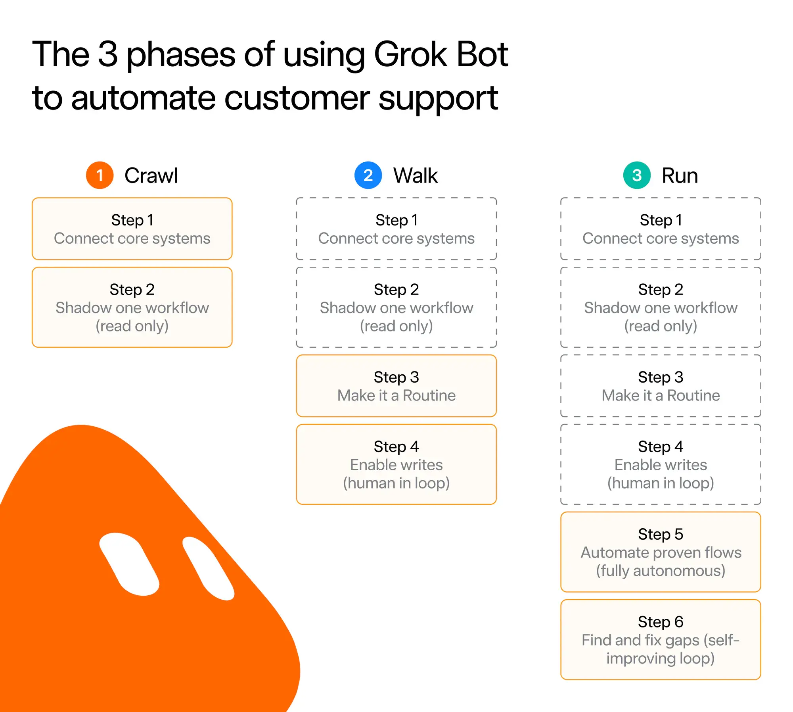
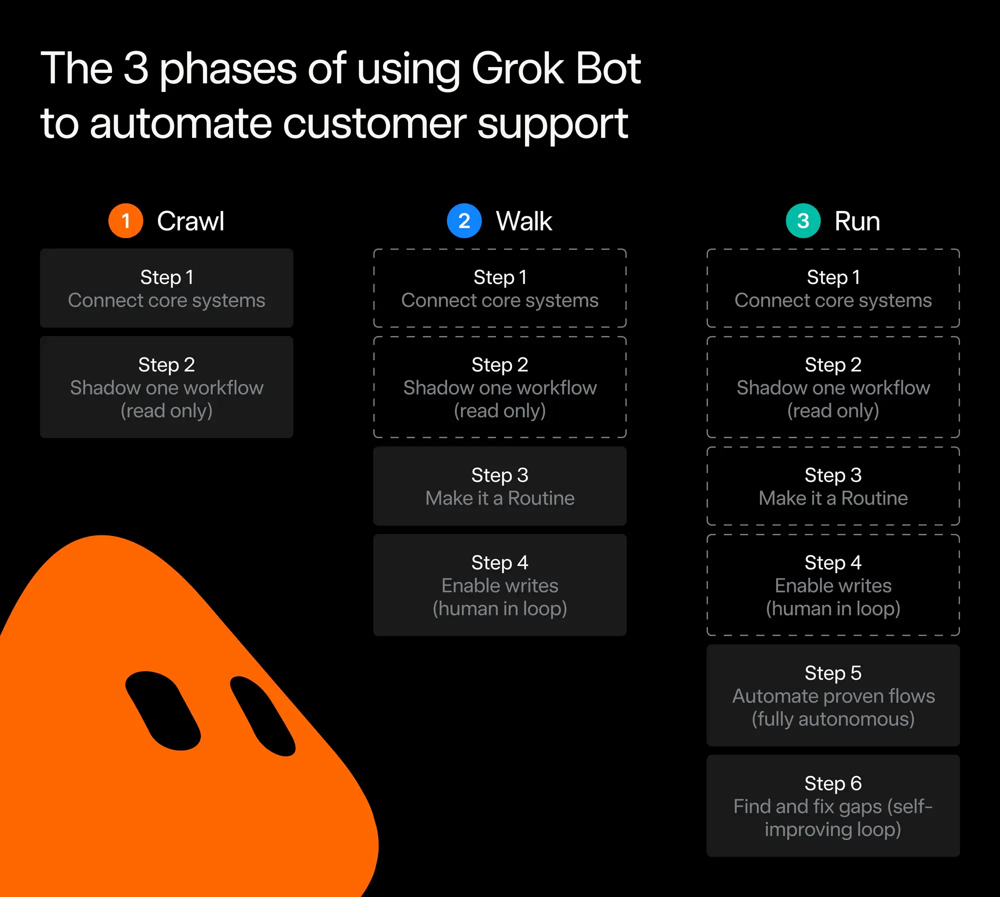
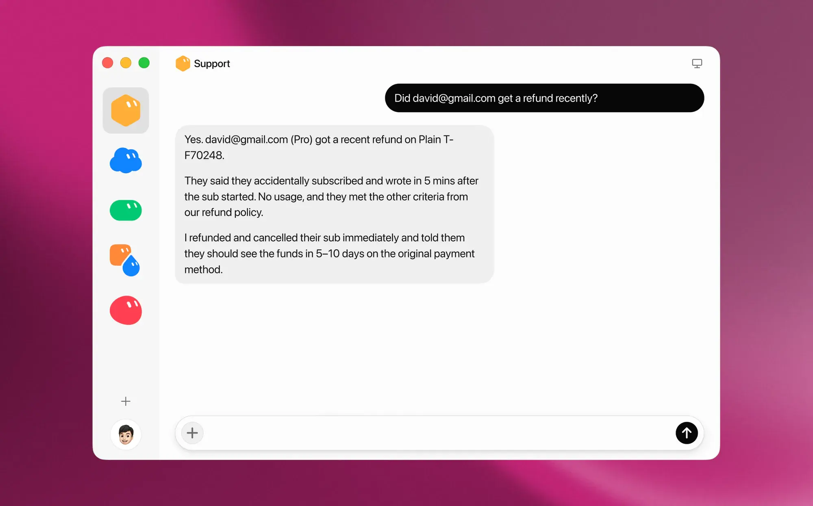
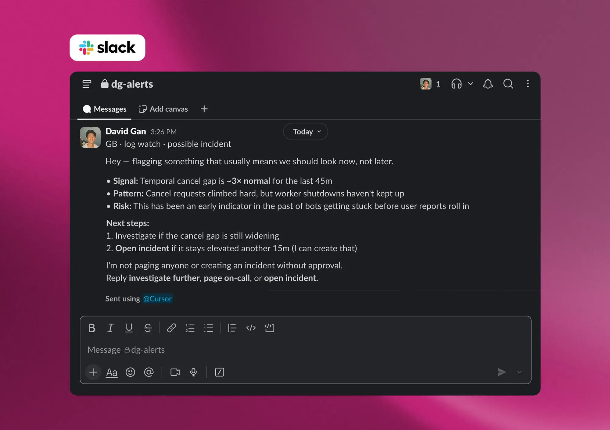
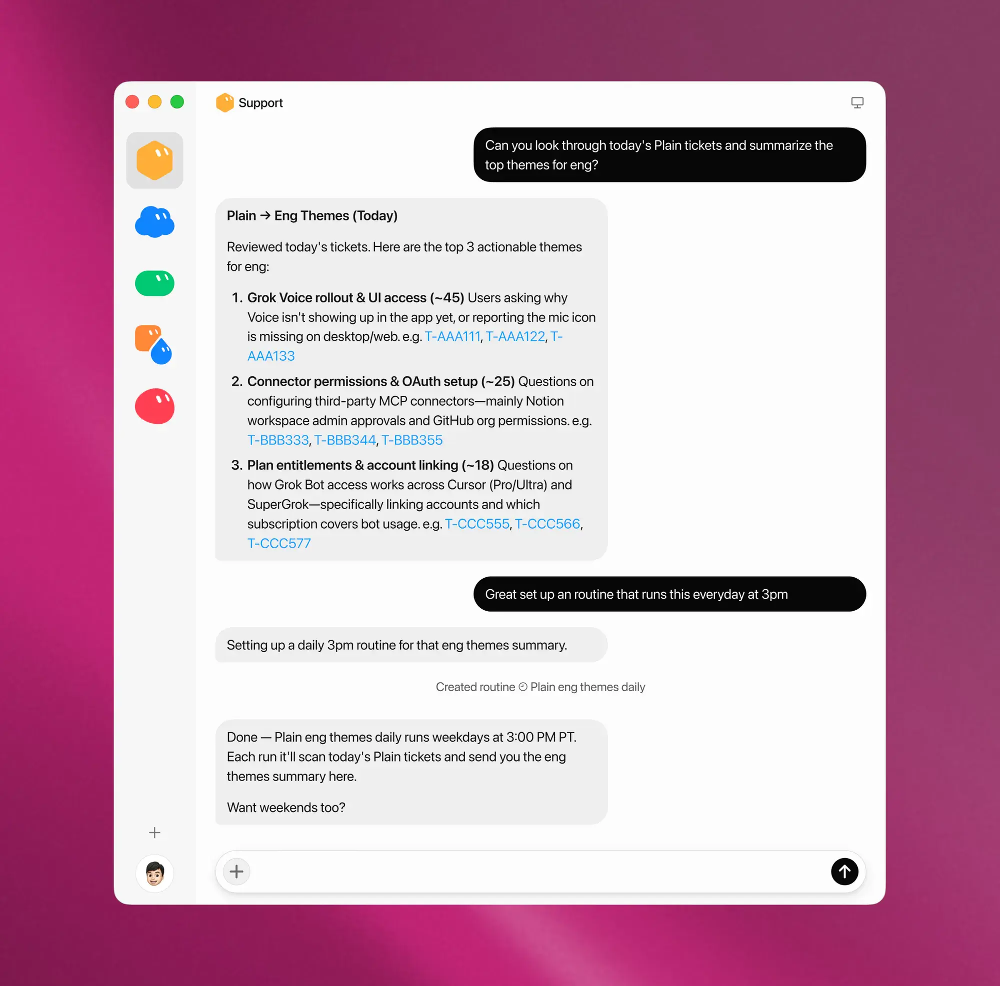



**收录说明**：x.ai 对自动访问返回 403，原文依据 Internet Archive 快照存档；去掉了「Back to news」链接、下载与联系销售按钮和文末「Try Grok Bot today」推广区，视频改为一行链接。原文全文存于本目录的 original.md，网站上不显示，已翻译。

**内容摘要**：Cursor 于 8 月 14 日并入 SpaceXSI 后，合并的客服团队用 Grok Bot 承接工单，工单量增长 175%，没有新增人手，文中称否则可能要多招 200 人。成本方面，称传统 AI 客服工具每次解决收费 1 到 4 美元，而他们经少量优化后每张工单约 0.20 到 0.30 美元。推行方式是逐步放开：先只写内部备注并要求人工批准每次写入，加上追踪和评测，从最简单的工单开始，第一天复核后就开始直接回复客户。Bot 连接 Plain、Linear 和 Datadog，对已知问题追加或新建 issue 并录屏复现，文中称 99% 的退款请求无需人工介入。它还监控队列、在达到阈值时自动宣布事故、监测 X 上的情绪，并每周向管理层汇报 AI 回复不足之处。

**保留理由**：提供一个由官方自己做的客服运营案例，写明分阶段放权、人工批准节点、成本数字和事故检测，是看 Bot 如何在真实运营中扩权的具体样本。

---

我们围绕 Grok Bot 重建了 SpaceXSI 与 Cursor 合并后的支持运营，在没有增加人手的情况下扩展到范围广得多的产品组合。

---

当 Cursor 于 8 月 14 日成为 SpaceXSI 的一部分时，我们的两个客户支持团队开始围绕一个范围广得多的产品组合走到一起。

与此同时，我们正准备发布 [Grok Bot](https://x.ai/bot)，一位你可以交付真实工作的 AI 队友。我们预计该产品会快速增长，带来又一波用户和支持需求。

我们决定用 Grok Bot 本身来帮助满足这一需求，让它贯穿整个支持运营工作。它登录我们团队使用的相同工具，其角色从解决单个工单延伸到帮助我们理解和改进整个运营。

我们新的合并团队的支持工单量增长了 175%，但多亏 Grok Bot，我们不必招聘任何新人。否则我们可能要额外招 200 人。

我们还在以通常成本的一小部分做到这一点。传统 AI 支持工具每次解决收取固定的 1 到 4 美元。使用 Grok Bot，你只需为实际用量付费，而用量已经包含在你的套餐中。经过少量优化，我们已经能把解决工单的成本降到 0.20 到 0.30 美元。

## 打好基础

我们采用「爬、走、跑」的渐进方式来设置 Grok Bot。我们首先把它连接到几个核心系统，包括用于工单的 Plain 和用于问题跟踪的 Linear。然后我们让它表现得像是工单的负责人，但限制它只能写内部备注，并要求每次写入操作都需人工批准。这让我们可以检查它是否理解了每个问题并提出了正确的下一步，同时不影响客户体验。

随着结果变得更可靠，我们为每次运行添加了追踪（traces）和评测（evaluations）。出问题时，我们可以看到 Grok Bot 在哪里偏离了方向，做出调整，然后重试。Grok Bot 也可以自己分析这些运行。这个反馈循环让我们能够快速推进，同时保持过程受控。

基础打好后，我们开始在复杂度最低的工单上推广 Grok Bot。第一天，我们人工审查它的理解和提议的回复，检查准确性、语气，以及它是否遵循了我们的指示。到当天结束时，我们已经有足够的信心让它开始直接回复客户。从那时起，我们逐步扩大它能处理的工单范围。

## 从受理到解决

如果考虑解决一张工单所需的端到端时间，大部分时间发生在发现、调查和故障排除阶段。我们开始在每个工单进入系统的那一刻，把 Grok Bot 作为预调查步骤应用到每张工单上。这可能变得昂贵，所以我们研究了常见工单并对常见问题进行分类，以减少需要花费的令牌数量。当简单地查一下帮助中心就能解决问题时，我们也不会耗尽大量故障排除能力。

每当我们遇到已知问题（它连接到我们的 Linear 实例），或者后端出现常见错误（它连接到了 Datadog），我们都训练 Grok Bot 要么添加到现有 issue，要么创建一个新的。Grok Bot 还会用一段视频复现该问题，这有助于工程团队快速解决它。

当然，我们还需要确保客户能从我们这里得到清晰的回复。我们在超过一百万次客户互动上训练了 Grok Bot，让它直接从我们的人类员工那里学习我们的语气和表达。Grok Bot 被训练成不仅会回复，而且总是推动工单走向解决。它通过提出相关问题来做到这一点（也就是说，它不会问一个答案已经在我们日志中的问题）。

Grok Bot 还可以代表我们的客户采取行动。例如，我们为它提供了明确的退款说明，其中 99% 的退款请求无需人工介入即可解决。

## 实时管理队列

解决单个工单只是工作的一部分。我们还需要了解整个队列正在发生什么。Grok Bot 持续监视入站量，并根据需要关注的内容调整队列。它可以重新排列工单优先级、根据紧急程度重新分配归属，并在我们快要违反响应时间 SLA 时提醒组织。

Grok Bot 还会跨工单寻找模式。当围绕某个特定问题的量达到设定阈值时，它可以自动宣布一起事故。它监控 X 上的情绪变化和同一问题的重复报告，让我们看到直接联系支持的客户之外的视野。这些信号合在一起，帮助我们在早期发现正在出现的问题。

在我们当前的规模下，原始数量告警会产生大量噪音。Grok Bot 会评估一次激增是否反映真实的支持问题，并在提醒团队之前开始调查。这让我们在了解什么需要行动方面获得更多上下文，同时节省团队的时间和精力。

## 持续改进我们的客户支持系统

随着 Grok Bot 承担更多客户支持工作，它也给了我们一种改进运营本身的新方式。它会审查由人类和 Bot 处理的客户互动，就哪些方面可以改进提供具体反馈，并为个别团队成员和 Bot 找出辅导机会。

每周，Grok Bot 都会给我们的领导团队发送一份摘要，说明我们的 AI 回复在哪些方面不足。有时答案是更多训练或更好的文档。另一些时候，摘要证实我们设置的护栏正在起作用。这让我们获得定期更新的质量视图，并帮助我们在早期处理模式问题。

随着越来越多用户向 Grok 寻求支持，我们的帮助中心越来越多地成为其答案的素材来源。为了保持这些答案准确，Grok Bot 会审查我们代码库的变更，并建议对帮助中心做相应更新。

我们现在已经达到 Grok Bot 可以辅导其他 Grok Bot 的程度。它们识别知识系统中的空白、填补这些空白，并把学到的东西反馈回系统。我们正在整个产品组合中扩大这个循环，使其覆盖每一个产品界面。

## 把客户支持数据转化为决策

Grok Bot 已经成为我们的默认数据分析师，把它在客户支持中看到的内容转化为我们 Slack 频道的每日报告。当它发现糟糕客户体验的早期迹象时，会标记该情况，让团队在还有时间改变结果时介入。

一个例子是，当一张工单在客户与我们的一位团队成员（人类或 Bot）之间来回超过三次时。发生这种情况时，Grok Bot 会将该互动标记出来供管理层审查，给领导层一个介入并挽救体验的机会。这种互动有助于训练 Grok Bot，而随着 Grok Bot 了解哪些信号对团队有用，报告会随着时间变得更相关。

同样的分析帮助我们改进产品质量。Grok Bot 每天从客户支持工单中综合超过 20,000 条产品反馈，并把它们转化为我们可以带给工程的清晰主题。这让产品团队更广泛地了解客户在哪里遇到困难，以及产品哪里需要改进。

## Grok Bot 如何改变客户支持团队

Grok Bot 仍然是一种新的工作方式，但它已经改变了我们团队的运作方式。我们不再把一天中的大部分时间花在重复的支持工作上，而是可以专注于设置护栏、处理需要判断的案例，以及决定运营应如何改进。这让工作更有吸引力，也给人们更多空间把经验用于更难的问题。

我们仍在了解这种模式能带来什么可能。随着客户支持的角色继续变化，我们会继续分享我们的发现。
