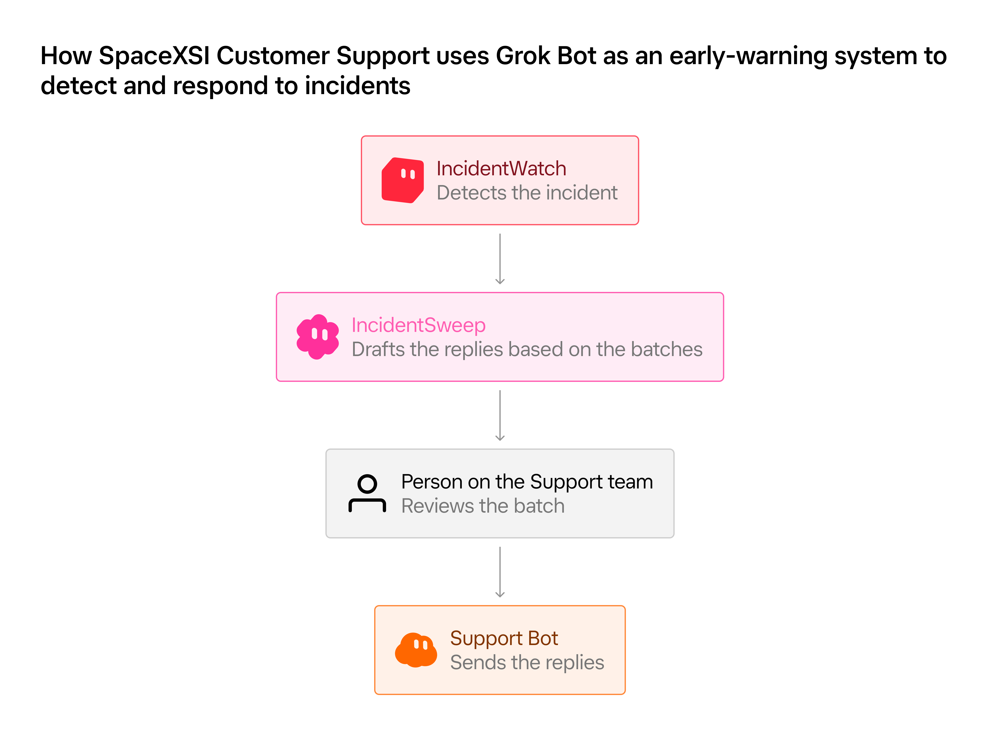
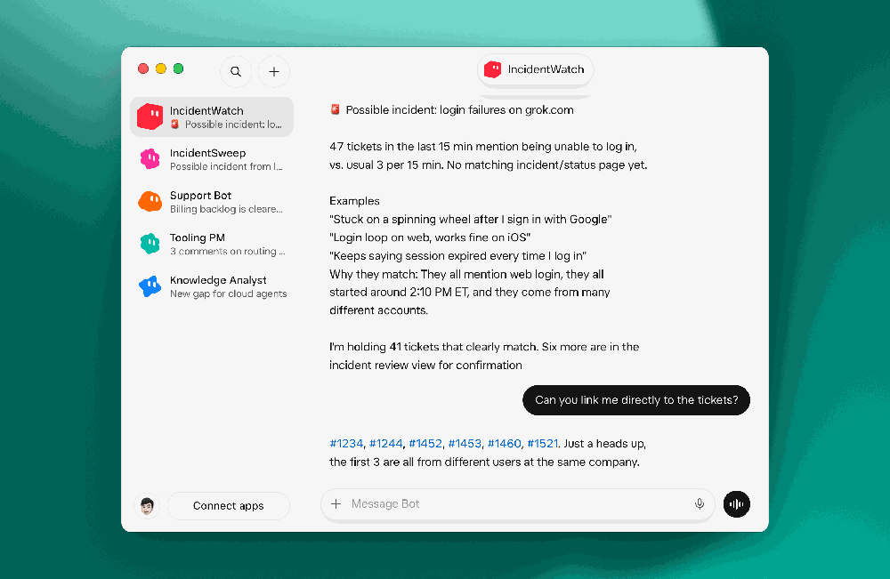
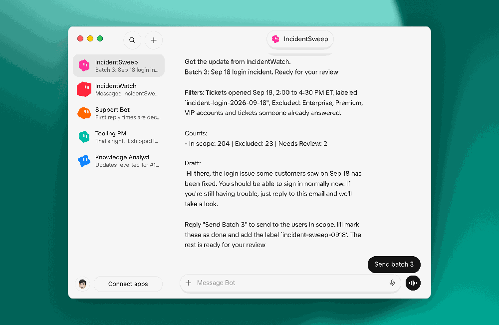



**收录说明**：x.ai 对自动访问返回 403，原文依据 Internet Archive 快照存档；去掉了「Back to news」链接、下载与联系销售按钮和文末「Try Grok Bot today」推广区，视频改为一行链接。原文全文存于本目录的 original.md，网站上不显示，已翻译。

**内容摘要**：SpaceXSI 客服团队用 Grok Bot 搭了两个事故用 Bot。IncidentWatch 每五分钟查看前 15 分钟的工单，发现同一问题的工单激增且不是已知事故时，提醒值班的支持工程师，并暂时扣下明显相关的工单。事故确认并发到公开状态页后，主要客服 Bot Support Bot 回头处理被扣的工单。IncidentSweep 在事故解决后，按工程师指定的范围和文案找出相关工单，把无法确定的排除，先展示拟发送的批次和确切内容，经批准后分小批发送并逐项记录；批准后不再追加工单，出错就停止并报告。9 月 18 日一次事故中，它在约 10 分钟内清掉 204 张工单，由一名支持工程师复核批准。

**保留理由**：一个很小但完整的「先提议、人批准、再分批执行」的流程，批准后不追加、出错即停的设计可作为审批机制的具体例子。

---

作者：Chris Bowie 与 Isaac Hopkinson

IncidentWatch 在内部告警触发之前发现工单激增。IncidentSweep 以经批准的批次清理相关积压。

当产品事故发生时，支持队列可能是它最早出现的地方之一。客户开始报告同一个问题，有时早于工程告警触发，或早于任何人宣布事故。

这些报告在事故展开期间持续到来。起初，支持团队可能不知道出了什么问题，也没有我们可以确信提供的答案。到问题解决时，数百或数千名客户可能在等待回复。支持团队必须在整个事故期间跟踪这些客户，然后确保问题解决时每个人都得到正确的答案。

我们用 Grok Bot 处理这项工作的两端。它为我们提供 AI 队友，接手运营性工作，尤其是那些否则会落在人员和系统之间的重复性工作流。正如我们在[近期博客](https://x.ai/news/grok-bot-customer-support)中分享的，SpaceXSI 客户支持团队使用 Grok Bot 中的 Support Bot 处理面向客户的沟通。

现在我们又增加了两个专门为事故调用的 AI 队友。第一个是 IncidentWatch，它监控支持队列中相似工单的激增，并在发现时提醒我们的团队。第二个是 IncidentSweep，它处理另一端，找出受影响的工单并以经批准的批次关闭它们。

在 9 月 18 日的一次事故中，我们的 Bot IncidentSweep 在约 10 分钟内清理了 204 张工单，由一名支持工程师审阅并批准该批次。以前，我们不得不在数小时内逐张回复这些工单，或使用批量宏，而批量宏让我们对谁收到消息的控制少得多。

## 通过客户报告发现事故

客户常常在我们的内部告警触发之前就注意到问题。当几位客户同时报告同一问题时，这些工单可能是事故的早期信号。

IncidentWatch 是我们构建的 Grok Bot 队友，用来发现这一信号。每五分钟，它审阅过去 15 分钟的工单，寻找围绕同一问题的激增。如果该模式与已知事故不匹配，IncidentWatch 会提醒值班的支持工程师，并附上表面问题、匹配工单数量和可供调查的示例。

支持工程师决定这些报告是否指向一起事故，并与工程团队一起调查。在此期间，IncidentWatch 暂扣明显与该问题匹配的工单。

一旦团队确认事故，我们就把它发布到公开状态页。我们主要的面向客户 Bot Support Bot 会回到被暂扣的工单，对照事故检查它们，并回复报告匹配的客户。随着事故进展，它可以带着更新回来。

## 清理事故积压

事故解决后，队列中可能仍有数百张相关工单，每张都需要最终回复。传统上，支持团队有两种方式清理它们，而两者都有缺点。他们可以逐张回复，这可能要花数小时；或者使用批量操作，这很快，但几乎没有余地拦下不应收到该消息的工单。

我们构建 IncidentSweep，是为了把第一种方式的控制力与第二种方式的速度结合起来。

支持工程师首先告诉 IncidentSweep 要考虑哪些工单、排除哪些工单，以及确切要发送什么消息。IncidentSweep 找出匹配的工单，逐一审阅，并把任何无法确信与事故关联的工单放到一边。

在发送任何内容之前，IncidentSweep 向工程师展示拟议的批次、其中包含的工单，以及它们将收到的确切消息。工程师可以在批准发送前抽查工单并进行更改。

随后 IncidentSweep 分小批发送经批准的消息，并记录每个动作。它在批准后绝不添加工单，如果任何环节失败，它会停止并报告发生了什么。

## 给 Bot 工作，而不是任务

Grok Bot 引入了一种与 AI 协作的不同方式。团队不必再为单个任务求助于 AI 工具，而可以创建拥有工作职责、把整个工作流推进到结果的 AI 队友。

客户支持一直是我们把这种模式投入实践的自然场所。IncidentWatch 和 IncidentSweep 承担的工作，过去需要团队中有人盯着、分类并处理数百张单独的工单。在 SpaceXSI 各处，我们正在寻找更多工作流，让 AI 队友承担同样类型的所有权。
