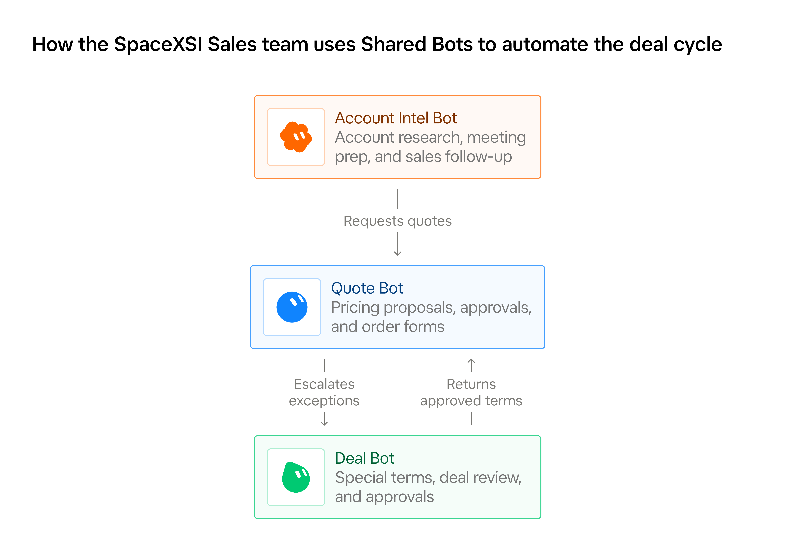
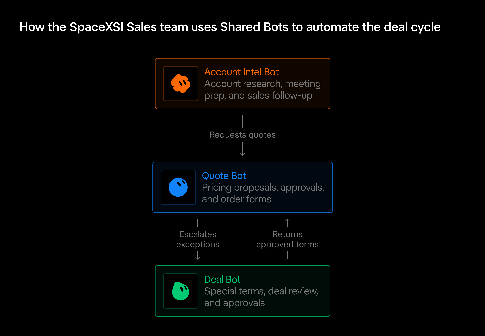
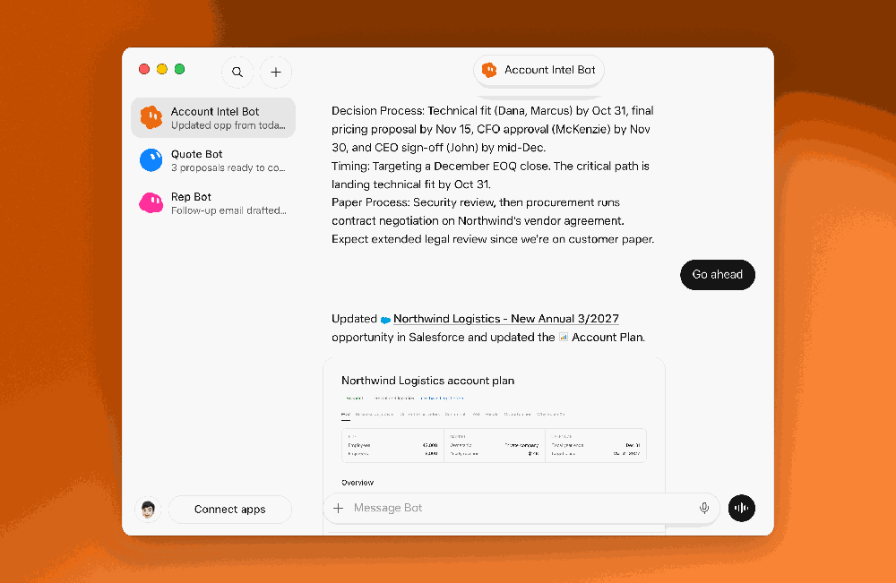
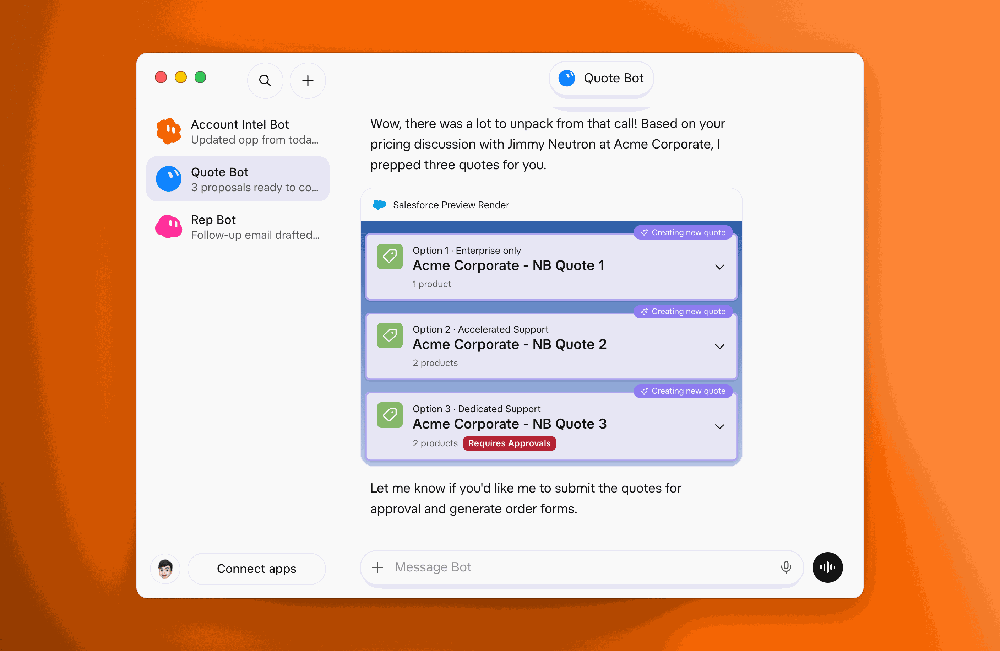
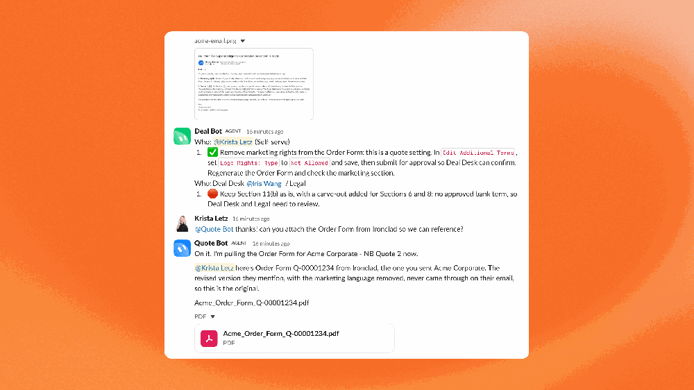
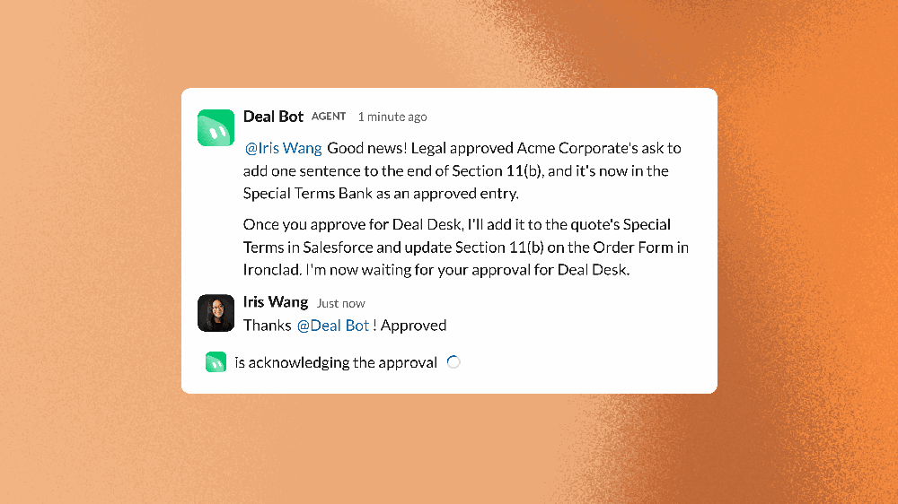



**收录说明**：x.ai 对自动访问返回 403，原文依据 Internet Archive 快照存档；去掉了「Back to news」链接、下载与联系销售按钮和文末「Try Grok Bot today」推广区，视频改为一行链接。原文全文存于本目录的 original.md，网站上不显示，已翻译。

**内容摘要**：SpaceXSI 销售团队把个人 Bot 汇集成按岗位划分的 Team Bots：Account Intel Bot 负责找潜在客户、会前准备并更新 Salesforce，Quote Bot 用 CPQ 工具生成报价和订单表，Deal Bot 帮 Deal Desk 审查非标准条款并批准。这些 Bot 以每个用户自己的权限行事，敏感动作另有限制；设有速率限制，某些动作只留给专门的 Bot，例如销售不能用 Quote Bot 批准自己的折扣。目前对于无法清晰定义判断标准的决策、以及面向客户的沟通，仍要求人工审核。Quote Bot 改动 Salesforce 前先给预览并要求确认；Deal Bot 的每个 Salesforce 审批都会记录决定、理由和所支持的责任人。

**保留理由**：清楚描述了团队共享 Bot 如何用用户权限、动作分级和人工审核点来控制范围，是权限与审批设计的一手案例。

---

Iris Wang、Joe Robertson、Micheal Sihavong 和 Palmi Angelova 撰文

SpaceXSI 销售团队为寻找潜在客户、报价和交易审查构建了 Team Bots，让每位销售代表都基于同样最新的专业能力工作。

当 SpaceXSI 销售团队最初采用 [Grok Bot](https://x.ai/bot) 时，各位销售代表各自构建自己的 Bot，用来研究客户、准备会议和管理销售管道。这带来一个机会：把每个人正在构建的最佳做法汇集起来，供整个团队使用。

我们开始创建 Team Bots，每一个都专注于销售组织中已经存在的一个角色。最了解每项工作的人帮助构建和维护该 Bot，因此每个人都能受益于他们的专业知识，并基于同样最新的业务知识工作。而且当我们改进一个 Bot 时，所有使用它的人都会受益，无需更新自己的设置。

我们已经从三个 Team Bots 开始，每个负责交易周期的不同部分。

- **Account Intel Bot** 帮助销售代表识别潜在客户、准备客户对话，并让 Salesforce 保持最新。
- **Quote Bot** 使用 CPQ 工具生成定价提案并准备订单表。
- **Deal Bot** 帮助我们的 Deal Desk 团队审查非标准条款并批准交易。

每个 Bot 都为流程带来自己的专业能力，使我们能够委派交易周期中更大的一部分，同时让人员专注于客户和需要他们判断的决策。

## 我们如何看待 Team Bots

Team Bots 是一种围绕超级智能组织工作的新方式。它们承担服务整个团队的定义明确的角色，这需要谨慎决定它们知道什么、能做什么，以及何时需要人员介入。

每个 Team Bot 都需要理解它所操作的系统以及它遵循的业务规则。我们通过共享技能和连接到内部事实来源，把这些知识交给它们，让所有人都遵循同样最新的规则。当流程发生变化，或我们找到更好的任务执行方式时，我们可以一次更新 Team Bot，让所有人受益。

Team Bots 还需要对它们能做什么设限。它们以每个用户的权限行事，并对敏感操作施加额外限制。我们构建了速率限制，以防止大规模的非预期更改，并把某些操作保留给专门的 Team Bot。例如，销售代表不能使用 Quote Bot 批准自己的折扣。

我们还界定了 Team Bots 何时可以独立行动的边界。目前，当我们无法清晰定义某项决策的标准，或当 Team Bot 准备面向客户的沟通内容时，我们要求人工审核。随着我们衡量它们的工作质量并对其决策建立信心，我们预计会给 Team Bots 更多责任。

## Account Intel Bot 负责销售准备和跟进

我们的 Account Intel Bot 帮助销售代表识别有潜力的客户、准备会议并管理销售管道。每位销售代表都与同一个 Team Bot 进行私密对话，该 Bot 利用共享的公司知识，并以每位销售代表自己的权限工作。

我们的 GTM 工程团队一开始让 Grok Bot 分析 Salesforce 活动日志，以找出最值得自动化的工作。这向我们表明，销售代表在客户通话后花费大量时间更新商机。我们给 Account Intel 提供了进行这些更新的工具，并教会它何时以及如何更新的业务规则。

主动性是我们认为对 Team Bots 重要的另一项原则。Account Intel 可以在客户会议前根据客户历史准备一份简报。会后，它可以读取 Gong 转录，识别并完成必要的 Salesforce 更新，并起草一封后续邮件供销售代表审核。

销售代表可以安排这些工作流自动运行，因此许多准备和跟进工作无需单独请求即可完成。

## Quote Bot 生成报价和订单表

一旦销售代表准备好与客户讨论定价，一个我们称为 Quote Bot 的 Team Bot 就会接手。

销售代表可以让 Quote Bot 准备几个包含不同产品和折扣的提案。Quote Bot 将报价输入 Salesforce，并在 Grok Bot 应用中并排展示，让销售代表在做出选择前比较各个选项，而无需进入 CPQ 工具。

Quote Bot 还管理将报价转为订单表所需的步骤。它提交报价以供审批、跟踪其状态，并把例外情况转交给 Deal Bot（详见下文）。报价获批后，Quote Bot 可以在 Ironclad 中生成订单表、下载可执行合同，并起草一封邮件供销售代表发送给客户。销售代表可以在一次对话中完成这一流程的大部分，而不必在多个系统之间切换并等待其他团队的更新。

我们构建 Quote Bot 来处理这项工作，同时不放弃对重要决策的控制。在更改 Salesforce 中的任何内容之前，它会向销售代表显示预览并要求确认。它也以销售代表自己的权限运行，因此需要 Deal Desk 权限的审批和例外仍归 Deal Desk 处理。

## Deal Bot 审查非标准条款和审批

当报价需要特殊定价或非标准合同条款时，Quote Bot 会把工作交给 Deal Bot。这个 Team Bot 支持我们的 Deal Desk 团队，该团队审查例外并决定企业愿意接受怎样的交易经济性和风险。

Deal Bot 根据我们已批准的政策和合同语言检查请求，然后准备推动交易向前所需的更改。它还可以监控和分诊销售代表提交的 Slack 请求，把请求转交给正确的跨职能负责人或审批人，并检查法务是否已经起草了类似条款。

Deal Bot 拥有销售代表没有的权限，使其能够对需要 Deal Desk 权限的报价进行更改。对于需要人工判断的决策，它会准备一份建议，并请 Deal Desk 专家在继续之前批准。Deal Bot 处理大量常规流程，让 Deal Desk 团队专注于需要商业专业知识和人工判断的决策。

Deal Bot 处理的每个 Salesforce 审批都会在系统中记录决定、理由以及 Deal Bot 所支持的责任人（DRI），以确保问责、可追溯性并符合公司政策。

## 建设一支 AI 同事团队

我们描述的三个 Bot 只是一个不断壮大的团队的一部分。我们还构建了 Competitive Intel Bot 等 Team Bots，它让我们的竞争情报保持最新，并帮助销售代表准备竞争性对话；还有 Sales Training Bot，它支持员工入职和技能发展。在整个销售组织中，人们也在为自己的工作构建和使用更多个人 Bot。

我们在构建这套系统方面仍处于早期阶段。随着时间推移，我们预计 Team Bots 会承担更多责任，并在彼此之间协调更多工作。我们的目标是建立一个销售组织：人们可以专注于客户，而由最了解每项工作的人构建和维护的专门 Team Bots，承担大量支持性工作。
