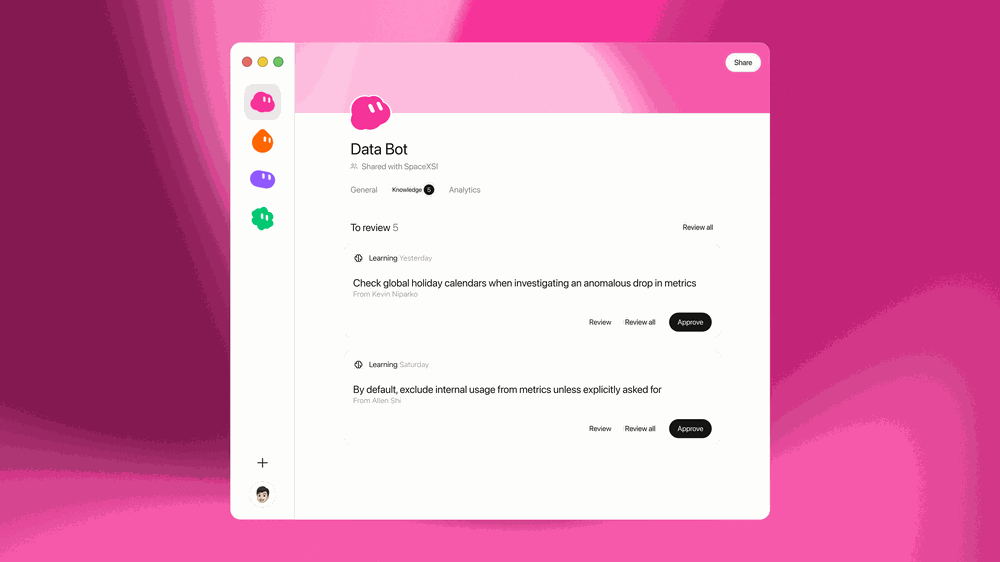
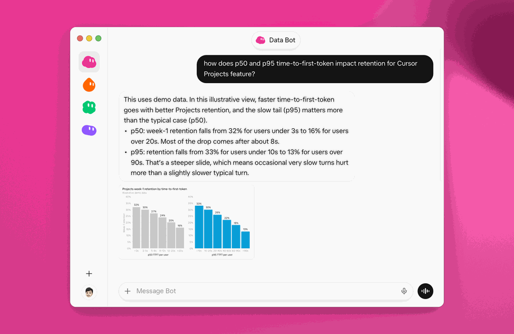
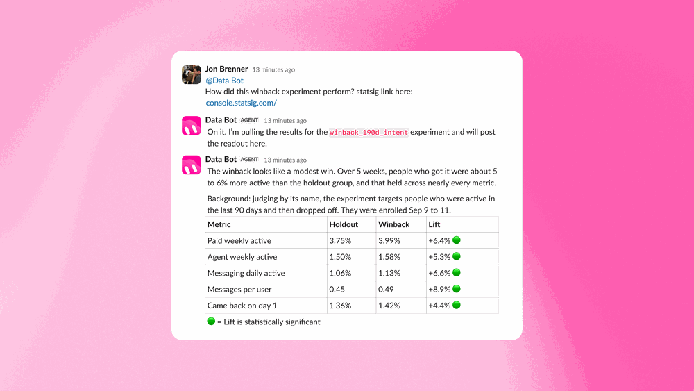
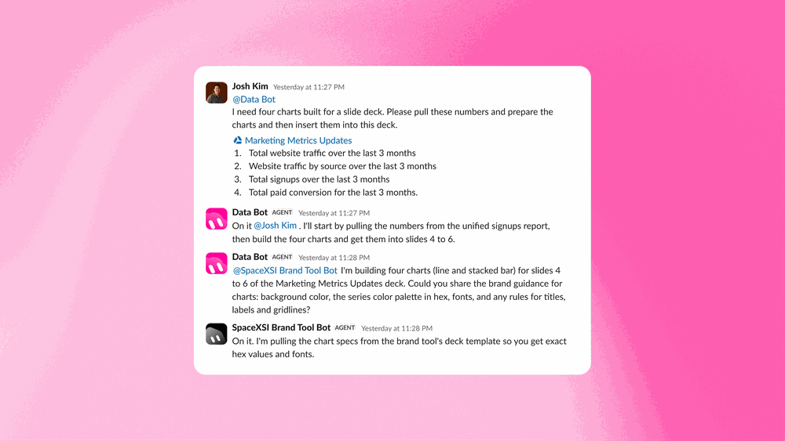
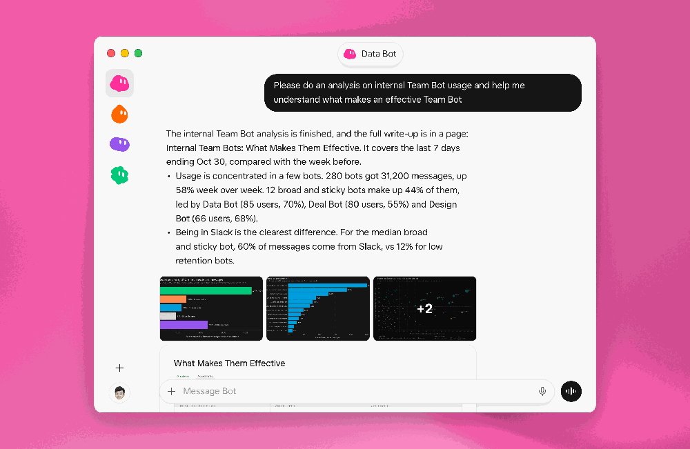



**收录说明**：x.ai 对自动访问返回 403，原文依据 Internet Archive 快照存档；去掉了「Back to news」链接、下载与联系销售按钮和文末「Try Grok Bot today」推广区，视频改为一行链接。原图为 4K 以上的大尺寸截图，已缩小到 600 KB 以内。原文全文存于本目录的 original.md，网站上不显示，已翻译。

**内容摘要**：Data Bot 是 SpaceXSI 数据科学团队教出来的 Team Bot，能查询数据仓库、做分析，并按每个人偏好的形式返回结果。它通过共享技能获得能力，覆盖指标与分析、实验、图表与仪表盘、数据工程四类，技能由数据团队维护。它还有共享记忆，例如记住某条管道的负责人，或某次指标下跌其实是区域假日；新增记忆先由管理者审核，批准后才共享给所有人。可用 Databricks 或 Hex 生成仪表盘，也可加入 Slack 频道定期汇报指标。文中称上周它承担了约 70 小时原本会落到数据科学团队的工作，并举了产品经理和市场人员的使用例子。

**保留理由**：展示共享记忆由管理者审核后才共享这种机制，以及技能库如何随团队改进，对研究团队共享 Bot 的记忆治理有用。

---

作者：Sally Xu

Data Bot 是 Grok Bot 中的一个 Team Bot（团队 Bot），由数据科学团队教导，让每个团队都能查询数据仓库、运行分析，并以数据科学家的方式得到答案。

在 SpaceXSI，我们的数据科学团队服务于整个公司，帮助各团队回答困难的问题，并寻找将数据融入我们产品的新方法。随着时间推移，我们对数据形成了一种直觉，包括如何解读数据以及它的局限在哪里。

但我们这个小团队无法回答一家快速增长的公司中出现的每个问题。人们整天来找我们，问题可能很直接，但仍需要我们的专业知识才能准确回答。这很容易让我们成为瓶颈。

几个月前，我们开始探索 AI 智能体如何改变这种关系。我们想给每个人一位全天候可用的数据科学家，能够利用我们的集体知识，同时把我们自己的更多工作转向构建和改进这位 AI 队友。

我们构建了 Data Bot，这是 Grok Bot 中的一个 Team Bot，我们教会了它我们的数据科学团队如何工作。它可以查询我们的数据仓库、进行分析，并按每个人偏好的形式返回结果。与依赖所有者所知来教导的个人 bot 不同，Data Bot 利用一套由我们数据团队为所有人维护和改进的共享技能。

团队还可以把 Data Bot 添加到他们的 Slack 频道，它在那里回答问题，并主动为进行中的工作做出贡献。随着我们改进它的技能，每个人都能从同一套不断增长的专业知识中受益。

## 教 Data Bot 数据团队如何工作

Data Bot 需要足够的上下文，才能以我们团队的方式处理问题。我们通过技能给它这些上下文，技能涵盖以下主要领域：

- **指标与分析（Metrics and analysis）。** 我们定义整个业务的核心指标，例如活跃用户和收入，并确定其背后的源表和查询逻辑。这些技能还指导 Data Bot 调查这些指标的变化，从按细分市场或地区拆解上升或下降，到在将变化归因于产品变更之前检查假日或日志记录变化。
- **实验（Experiments）。** 这些涵盖我们如何设置 A/B 测试、运行功效分析（power analyses）、检查暴露平衡和样本偏差、规划发布、深入分析反直觉的结果，以及在实验达到功效后撰写解读报告（readouts）。
- **图表与仪表盘（Charts and dashboards）。** 我们为 Data Bot 配备数据可视化最佳实践，例如用折线图表示随时间变化的趋势、用水平条形图比较类别，以及我们团队的图表主题和样式指南。其他技能指导 Data Bot 创建仪表盘，因此它可以将在对话中的一张图表变成整个团队都能使用的 Databricks 或 Hex 仪表盘。
- **数据工程（Data engineering）。** 这些涵盖我们编写和审查 dbt 模型的最佳实践、我们自动化管道告警的约定，以及如何添加分析事件日志，以便我们从新功能发布的那一刻起就能衡量人们如何使用它们。

## Data Bot 从经验中学习

我们还给 Data Bot 共享记忆（shared memory），让它能保留在日常使用中形成的知识。例如，它可能会了解到某条特定管道由哪位队友负责，或者某个重要指标此前的下降其实是区域假日造成的。下次它调查类似变化时，就可以利用那段经验，在将下降归因于产品变更之前检查假日日历。

作为这个 Team Bot 的 Manager，我们可以审查这些提议添加到其记忆中的内容，并在 Data Bot 与所有使用者共享该知识之前批准或拒绝它们。

## 帮助产品经理更好地理解他们的产品

产品经理（PM）有一连串关于人们如何使用其产品的问题，其中许多超出了他们现有仪表盘能告诉他们的范围。回答这些问题传统上意味着自己深入挖掘数据，或请数据团队的人帮忙。

Data Bot 给 PM 提供了一种在问题出现时探索它们的方法。

Kevin Niparko 是 SpaceXSI 的一位 PM，他可以在 Grok Bot 中像给队友发消息一样给它发消息，几分钟内得到答案，并在不开始新分析的情况下继续追问。他把这种体验描述为口袋里有一位数据科学家。

提问的便捷意味着 PM 一天中可以调查更多问题。以前，哪怕只是打开一个仪表盘或在 Cursor 中开始一次分析，都会带来足够的摩擦，让一些问题被放弃。现在 Kevin 可以探索他原本可能会放过的事情，而不必请数据科学家帮忙。

Data Bot 还会适应人们偏好的信息消费方式。Kevin 喜欢简洁的标题配一张图表，因此 Data Bot 以那种格式呈现其发现，让他能迅速从问题过渡到可用的答案。

## 帮助市场人员理解他们的活动取得了什么成果

市场团队需要了解客户在收到营销活动后做了什么。电子邮件平台会跟踪打开和点击，但这些指标并不总能显示活动是否达成了目标。

Jon Brenner 在 SpaceXSI 从事生命周期营销（lifecycle marketing），他把 Data Bot 当作随叫随到的分析师。他可以把一个 Braze 活动 ID 给它，问收件人之后做了什么。Data Bot 会查询数据仓库，看看点击的人后来是否使用了该功能。

对于我们最近[发布](https://x.ai/news/x-subscription)的 The X Subscription，Jon 想知道有多少电子邮件收件人真正切换了套餐。Braze 内置的转化指标无法回答这个问题，因此 Data Bot 查询数据仓库，追踪有多少收件人收到了邮件，以及有多少人接着切换了套餐。

Katy Abbaszadeh 是我们的收入增长总监，她用 Data Bot 衡量活动对销售的影响。她跟踪活动如何促进销售管道（pipeline）的生成，以及如何帮助加速现有交易。她还用 Data Bot 监控每周相对目标的进展、调查可能拖慢进展的原因，并把结果做成图表用于演示。

有了 Data Bot，我们的市场团队现在可以自己回答更多问题，而不必等待数据团队，同时仍能利用该团队的专业知识。

## 让 Data Bot 处理完整的分析工作流

Data Bot 可以承担远超回答单个问题的工作。数据团队已经给了它进行更实质性分析的工具，包括通常需要与数据科学家进行几轮协作的项目。

例如，一位调查产品采用率变化的 PM 可以请 Data Bot 弄清发生了什么。Data Bot 可以规划分析、查询数据仓库，并探索可能的解释。然后它可以生成带有图表的书面报告，或在 Hex 中构建一个团队可以继续使用的仪表盘。

## Data Bot 加入团队频道并主动贡献

团队可以把 Data Bot 添加到他们的 Slack 频道，并让它负责持续汇报。例如，一个团队可以请它跟踪一个重要指标并每周发布更新，遵循我们数据科学团队已经建立的汇报约定。

Data Bot 可以按计划运行该工作流，并直接向群组对话贡献更新。同事们随后可以追问，或让它调查一个意外的变化，就像对待另一位队友一样。

## 让人人都能获得数据科学专业知识

Data Bot 在 SpaceXSI 内部采用得很快。仅上周，我们估计它处理了约 70 小时原本会落到数据科学团队身上的工作。

我们仍然处理需要更多判断的复杂分析，并且正在了解 Data Bot 在哪些方面需要额外指导。我们的目标是给全公司的同事一位 AI 队友，让他们在需要时随时能利用我们的专业知识，同时让数据科学团队有更多时间专注于需要我们直接关注的问题。
