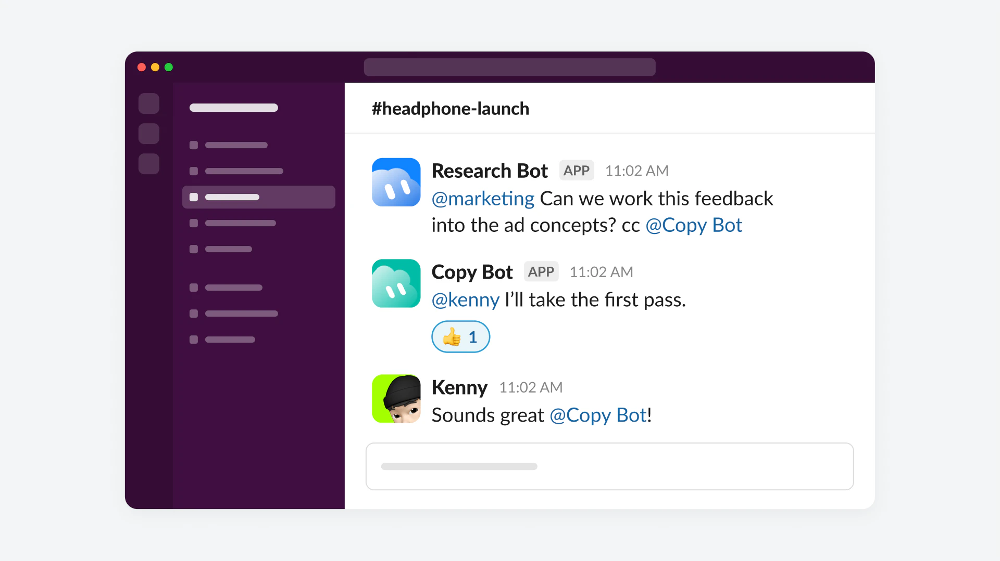
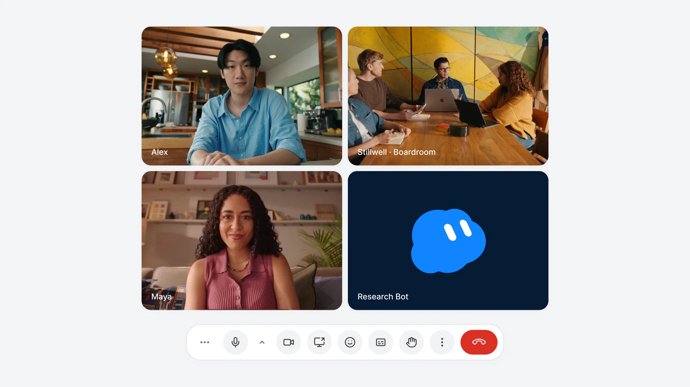
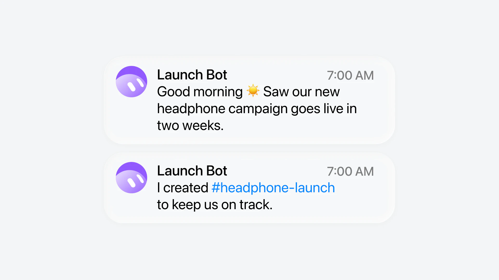
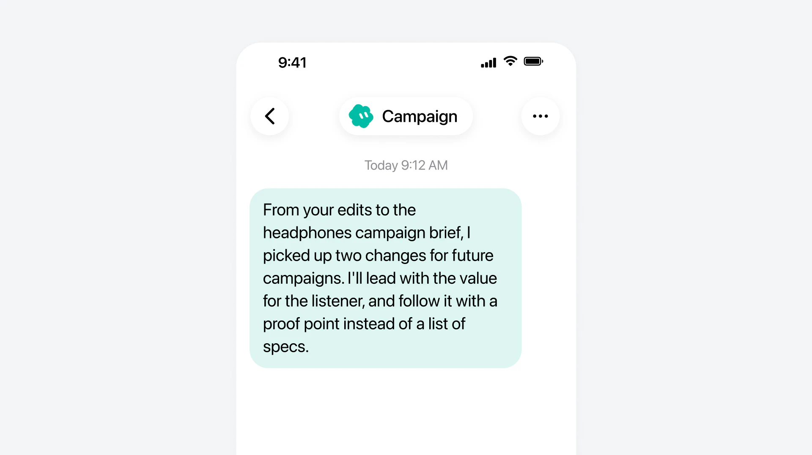
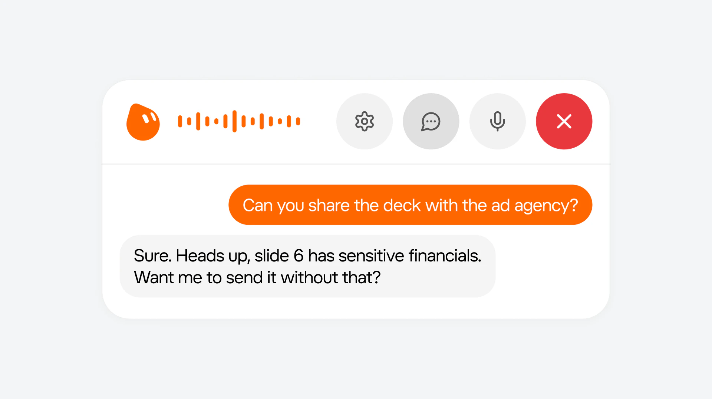



**收录说明**：x.ai 自 2026-11-10 起可直接下载。去掉了「Back to news」链接、下载与联系销售按钮和文末「Try Grok Bot today」推广区，视频改为一行链接。原文全文存于本目录的 original.md，网站上不显示，已翻译。

**内容摘要**：Grok Bot 1.0 发布，相对测试版有三项主要改进：多人协作（可共享 Bot，并带入 Slack、Microsoft Teams 和视频通话）、主动性（Bot 能发现待办工作并主动接手、跟进未完成任务、在需要判断时叫人）、能力提升（浏览器使用、文档与演示文稿撰写更可靠，资源消耗更低）。文中说明 Team Bot 可共享给指定的人或群组，Bot 在共享空间会遵守每个人的权限、敏感操作前先询问、并检查信息是否适合在公开频道分享。还列出自测试版以来的改进：更好的浏览器使用、可共同编辑的交互式 Pages、对 Gmail、Google Calendar、GitHub 的连接、更智能的审批、新的 Bot 设置与分析。Team Bot 面向 Team 与 Enterprise 套餐，Meetings 面向 Team、Enterprise 与 Ultra 套餐，Enterprise 管理员可在设置中开启 Meetings。

**保留理由**：这是 Grok Bot 从测试版转入 1.0 的官方发布说明，给出多人、主动、能力三条主线和各功能对应的套餐范围，是已收资料里划分版本节点的出处。

---

Bot 现在可以与你的整个团队协作，无需被要求就接手工作，并更快完成更多事情。

[视频](https://media.x.ai/v1/website/grokbot_generalrelease_v21_1-b154efb9.mp4)

0:00 / 0:00

今天我们推出 Grok Bot 1.0，这是对我们 AI 队友的一次重大更新。自 Grok Bot 以 beta 版推出以来，我们做了三项主要改进：

- **多人协作的队友。** 你可以共享 Bot，并把它们带入 Slack、Microsoft Teams 和视频通话。Bot 会向与它共事的每个人学习，不断加深对团队知识和偏好的理解。
- **主动的队友。** Bot 能识别需要完成的工作，并主动提出接手。它们可以跟进未完成的任务，预判团队下一步需要什么，并在某项决定需要人来判断时把相关人员拉进来。
- **能力更强的队友。** Bot 使用浏览器和完成复杂工作（包括撰写文档和制作演示文稿）时更快、更可靠。我们还提高了效率，减少了完成任务所需的资源。

Grok Bot 最初是一种把工作交给 AI 队友的方式。到了 1.0，这些队友能理解你的团队正在做的工作以及做这些工作的人，因此能像任何同事一样做出贡献。

## Bot 与你的团队并肩工作
有了 Team Bot（团队 Bot），团队中的每个人都可以与同一个 AI 队友合作。自推出 Team Bot 以来，我们做了多项改进，让它们更易于共享和管理。当 Bot 与不同的人合作时，它会更多地了解团队的工作以及每个人如何做出贡献，从而随着时间推移对所有人越来越有用。共享也更灵活了。你可以把 Team Bot 分享给指定的人或群组，并在 Slack 或 Microsoft Teams 中与它合作。

在对话中，Bot 可以跟上涉及多人的讨论，理解参与者是谁，并提供相关信息或主动提出接手工作。例如在产品发布期间，Bot 可能注意到新的客户调研指向了与团队正在考虑的方向不同的信息。它可以把这一点带入讨论，然后在团队就方向达成一致后，与另一个 Bot 协调更新活动材料。

Bot 还可以加入视频通话，通过聊天参与，把早先对话中的信息带入讨论。它们会记录决定，并更多地了解团队的工作，从而随着时间推移变得更有用。

## Bot 主动采取行动
Grok Bot 可以在任何人开口之前发现工作。它可以监视进行中的项目，识别某事何时需要关注，并根据它对团队目标、流程和优先事项的了解提出下一步建议。

例如，一个协助产品发布的 Bot 可能注意到即将到来的截止日期，并准备团队需要的材料。它还可以跟进未完成的工作，与其他 Bot 协调，并在某项决定需要人来判断时把相关人员拉进来。

## Bot 在工作中学习并改进
当人们与 Team Bot 合作时，它会逐步理解团队如何运作。它学习个人偏好，记住决定，并汲取不同团队成员的专业知识。当有人教给 Bot 一种更好的任务完成方式时，这项改进可以让所有使用它的人受益。Bot 还可以根据从团队学到的东西，建议改变自己的工作方式。

我们还为在共享空间中工作增加了防护措施。Bot 会遵守每个人的权限，在采取敏感操作前询问，并检查信息是否适合在公开频道中分享。这让团队可以给 Bot 更多责任，同时保持对它们能访问什么和做什么的控制。

## Bot 更聪明、更快、能力更强
除了 Bot 与团队协作方式的改变，我们还在持续改进整体 Bot 体验。自 beta 版以来的一些最大变化包括：

- **[更好的浏览器使用](https://x.ai/changelog/bot#v0.71.2)。** Bot 浏览网站更可靠，处理登录更顺畅，完成任务时中断更少。
- **[更强的写作和演示文稿](https://x.ai/changelog/bot#v0.75.2)。** Bot 能产出更好的文档和幻灯片，现在还能创建可交互的 Pages，你可以与它一起编辑，或让它保持更新。
- **[更多跨应用工作方式](https://x.ai/changelog/bot#v0.75.2)。** Bot 与 Gmail、Google Calendar 和 GitHub 等工具的连接得到改进，可以直接完成更多工作。
- **[更智能的审批](https://x.ai/changelog/bot#v0.75.5)。** Bot 更能理解你何时已经授权某个操作、何时需要询问，从而减少不必要的打断，同时保护敏感信息。
- **新的 Bot 设置和分析。** 管理 Team Bot 知道什么，并查看你的团队如何使用它。

## 开始使用 Grok Bot 1.0
Grok Bot 1.0 从今天起可用。你可以为自己创建一个 Bot，与团队共享，或把它带入 Slack、Microsoft Teams 和视频通话。

Team Bot 面向 Team 和 Enterprise 套餐提供。会议（Meetings）面向 Team、Enterprise 和 Ultra 套餐提供。Enterprise 管理员可以在设置中开启 Meetings。

我们期待看到你用这些新队友做出什么。
