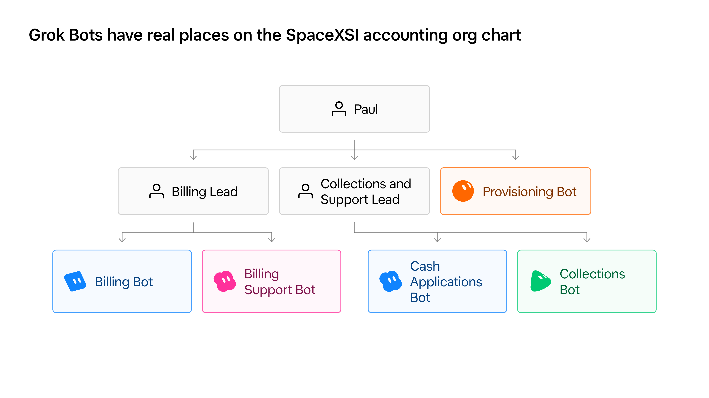
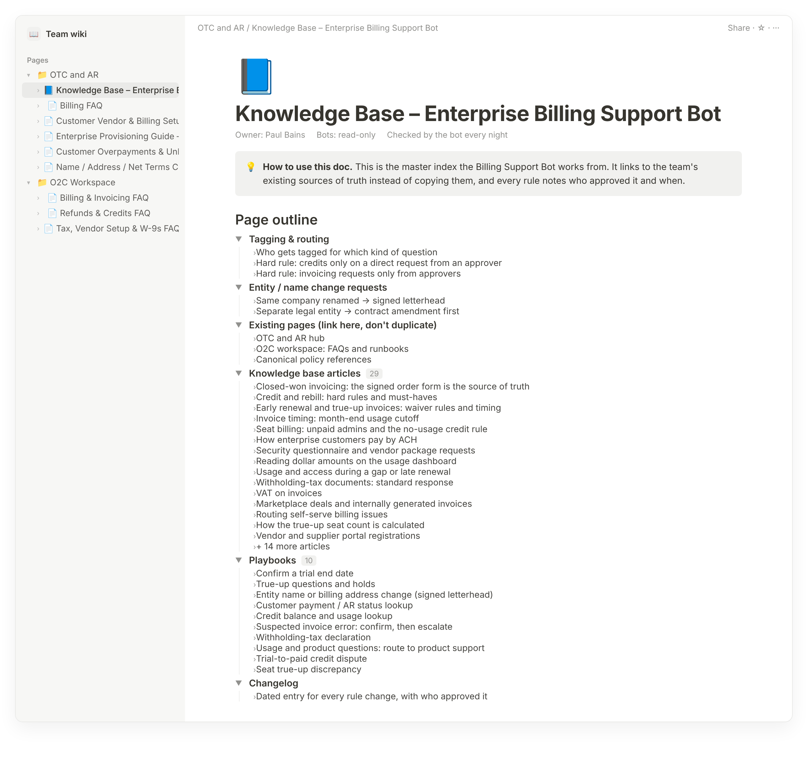
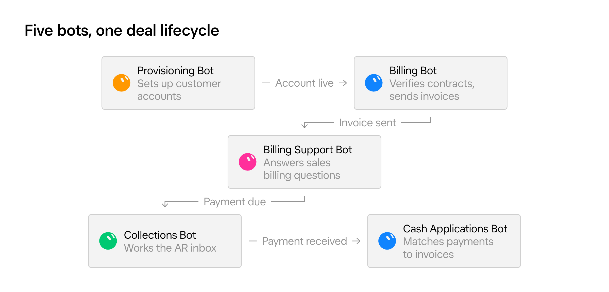



**收录说明**：x.ai 自 2026-11-10 起可直接下载。去掉了「Back to news」链接、下载与联系销售按钮和文末「Try Grok Bot today」推广区。原文全文存于本目录的 original.md，网站上不显示，已翻译。

**内容摘要**：SpaceXSI 会计团队把五个 Team Bot 各自分配一项端到端的会计流程：Provisioning Bot（核对合同、开通或关闭客户账户）、Billing Bot（核对合同并生成发票）、Billing Support Bot（回答销售团队的账单问题并执行请求）、Cash Applications Bot（核销到账付款、调查差异）、Collections Bot（处理客户账单咨询、协调退款）。他们的做法是先把流程结构化（用 Grok Build 做内部应用）、用 Notion 文档做每个 Bot 的操作手册、设定权限与审批、按约三周的流程训练：第一周建知识库并观察，第二周提议动作由人批准，第三周独立执行常规工作并上报异常。文中给出的数字包括：开具发票的时间从约 24 小时降到几分钟，Billing Support Bot 估计每天为会计团队腾出约 8 小时，Cash Applications Bot 把原本会计需要 3 到 4 小时的流程缩到约 30 分钟，Collections Bot 训练约三个月，Billing Support Bot 上线用了四到五周。团队估计没有 Grok Bot 的话，这五个 Bot 承担的工作需要把团队人数增加一倍以上。

**保留理由**：提供了企业内部把 Bot 当作岗位来用的完整案例，含上线周期、权限与审批设计和量化结果，是已收资料中会计与财务场景的一手用例。

---

作者：Annay (Paul) Bains、Will Smerdon、Erin Jenks

SpaceXSI 的五个 Grok Bot 各自端到端负责一项会计工作，从开通客户账户到收回款项。只有当工作需要对判断时，它们才会找人介入。

大多数会计团队围绕一组定义明确的工作来组织，从管理客户账户到开票和收款。

在 SpaceXSI，我们开始把这些工作分配给 [Grok Bot](https://x.ai/bot)。每个 Bot 负责一整个流程，独立工作，在遇到需要人的判断或批准的事情时找我们。它们让我们能处理更多工作，而不必以同样的速度增加人头。

我们建了五个 Team Bot，每个都有仔细界定的职责：

- **Provisioning Bot** 核对合同，开通或关闭客户账户。
- **Billing Bot** 核实合同细节并生成发票。
- **Billing Support Bot** 回答账单问题，并对我们市场团队（go-to-market team）的请求采取行动，例如更新客户记录或调取发票。
- **Cash Applications Bot** 核销到账付款、调查差异、核销银行手续费，并把少付的款项标记给催收。
- **Collections Bot** 处理客户的账单咨询，并协调退款等请求。

搭建它们的过程让我们学到了很多：要让 Bot 可靠到足以负责重要业务流程，需要什么。以下是我们如何组建这支团队，以及每个 Bot 做什么。

## 我们如何构建和管理会计 Bot
我们最初对 Grok Bot 的试验有一些反复试错，以弄清如何最好地组织工作。最终我们确定：给每个 Bot 分配一个已有的、定义明确且范围清晰的会计流程，让它从头到尾负责。我们不是让一个 Bot 帮忙做各种任务，而是给它一份原本由我们团队中某个人承担的具体工作。

关于 AI 智能体有一个常见的误解：一旦给它们访问正确系统的权限，它们就应该能胜任一份工作。实践中我们发现，Bot 需要的文档、入职培训和持续辅导投入，与新人并无二致。

这需要前期投入时间，但一旦训练好，它们可以全天候工作，处理比做同样工作的人多得多的量，而且准确率更高。当我们教 Bot 一项新技能时，就像上传一项新能力，它可以立刻投入使用。

### 先把流程做可靠，再交给 Bot
如果人还没有弄清如何可靠地执行某个流程，Bot 也很难把它跑起来。如果工作流定义不清，或依赖未成文的知识，把它交给 Bot 并不能解决这些问题。

因此，我们投入建设让会计流程更有结构的应用。我们用 Grok Build 创建带有界面的应用，由界面定义流程如何运行、允许哪些操作。这给 Bot 一个受控的工作环境，而不是让它从零摸索如何完成每项任务。

例如，我们建了一个内部开通应用，提供开通客户账户的既定方式，并对可执行的操作加以控制。我们的 Provisioning Bot 现在操作这个应用。这给了我们一个可靠的流程，带有可供人和 Bot 使用的操作审计记录。

### 像给员工做入职那样，为每份工作写文档
我们维护一份 Notion 文档，作为每个 Bot 的操作手册。它包含 Bot 完成工作所需的知识和指令，从开票前如何核实合同细节，到哪些账单调整需要人工批准。

每晚，Bot 会查阅这些文档以刷新知识，并标记与现有指令不一致的地方。它们不能自己编辑文档。只有负责各个流程的人拥有该权限。

当我们更改政策或发现处理某笔交易的更好方式时，我们会更新文档，并教 Bot 新流程。最了解这项工作的人仍然负责定义它如何完成。

### 给 Bot 明确的权限和审批要求
会计流程需要谨慎的控制，因为它们影响财务报告，可能受审计要求或控制框架约束。我们的 Bot 可以读取所需信息，但更改记录的能力受到更多限制。

Grok Bot 还可以通过 Tailscale 等集成安全地连接内部系统。这让 Bot 能访问私有工具和数据，而不必把这些系统暴露在公网上。公司可以控制 Bot 能访问哪些资源，访问策略与授权该连接的人的身份绑定。

我们允许它们独立执行风险较低的任务，对发放信用额度或退款等敏感操作要求批准。我们还控制谁可以授权这些操作。例如，任何有相应访问权的人都可以让 Billing Support Bot 解释一张发票，但只有指定的人可以授权更改账单记录。

### 先训练 Bot，再让它独立工作
我们训练新 Bot 的方式与训练新员工相同。我们先教它们工作如何运行，然后让它们观察我们做这项工作，再逐步把独立完成任务的责任交给它们。这让我们有时间在它们独立工作前发现知识缺口并纠正错误。我们现在的典型入职流程大约需要三周：

- **第一周：** 建立 Bot 的知识库，让它观察我们如何执行这项工作。
- **第二周：** 让 Bot 提议动作并解释它打算做什么，由人批准它的工作。
- **第三周：** 允许 Bot 独立执行常规工作，并上报异常。

我们最早的几个 Bot 开发时间更长。例如，Billing Support Bot 上线用了四到五周。随着我们学会如何组织工作，后续 Bot 的搭建快了很多。上线后我们继续辅导它们，纠正错误、更新指令，同时它们承担原本需要数名全职员工才能完成的工作。

## Provisioning Bot 开通和关闭客户账户
Provisioning Bot 确保客户在签订合同时获得对我们产品的正确访问权，并在合同结束时移除该访问权。它使用我们用 Cursor 构建的内部应用来管理这一流程，此前这需要团队中有人手工处理。

交易达成时，Provisioning Bot 把已签署的合同与对应的 CRM 记录进行比对。它检查订单细节是否匹配，然后用我们的开通应用启用客户账户。之后，它对照合同核实各项权益（entitlement），并在 Slack 中通知销售代表开通已完成。

当客户流失或合同结束时，该 Bot 也会移除相应的权益。这帮助我们避免开通错误——这类错误可能让客户得不到已购买的访问权，或让访问权在合同结束后继续存在。

## Billing Bot 生成发票并检查错误
客户账户开通后，由 Billing Bot 接手。它在生成并发送发票前，检查账单系统中的信息是否与已签署合同的条款一致。

为此，该 Bot 把合同与从 CRM 流入账单系统的客户记录进行比对。如果发现差异，它会在账单系统中更正信息以便继续开票，并提醒相应团队修正底层的 CRM 记录。然后它发送发票并通知销售代表。

这把开具发票所需的时间从大约 24 小时缩短到几分钟。

Billing Bot 还会检查缺失的税务信息。例如，如果客户未提供 VAT 或 GST 识别号，该 Bot 会通知销售代表将要征收的税额，并给他们 24 小时提供缺失信息。以前，我们可能已经发出发票，直到客户提出问题才解决；现在我们可以在发票发出前处理。

该 Bot 还可以处理信用额度和重新开票，但需要额外的权限和批准。

## Billing Support Bot 回答市场团队的问题
Billing Support Bot 处理我们市场团队关于客户账单的请求。它连接我们的核心会计系统，让销售代表无需会计团队的人介入就能得到答案并做常规更新。

例如，客户可能发现发票上显示的用量与他们的仪表盘不一致。Billing Support Bot 可以调查底层记录，解释两个数字为何不同。

该 Bot 还可以直接采取行动。如果销售代表需要更新客户的账单邮箱或添加更多收件人，可以在 Slack 中让该 Bot 办理。它核实新地址是否匹配客户的域名，然后自动更新账单记录。

以前，我们团队逐个处理这些请求，即使底层工作很简单。现在该 Bot 可以端到端解决其中许多请求。我们估计，Billing Support Bot 每天为整个会计团队的工作腾出大约八小时。

## Cash Applications Bot 核对客户付款
Cash Applications Bot 把到账的客户付款与未结发票核对。除了自动匹配付款，它还调查差异，并处理原本需要会计介入的常规调整。

该 Bot 每天检查两次我们的付款流水，自动核销与未结发票完全匹配的付款。当付款不匹配时，它在客户支持系统中搜索汇款通知（remittance advice），以帮助确定该付款覆盖哪些发票。

该 Bot 还会自动核销导致付款与发票金额出现差异的银行手续费。如果客户支付的少于应付金额，它会把少付标记给催收团队跟进。

这一流程通常需要会计花三到四小时。该 Bot 大约 30 分钟完成。

## Collections Bot 处理面向客户的账单咨询
Collections Bot 是我们第一个直接与客户沟通的会计 Bot。它监控我们的应收账款收件箱，回答账单问题，并协调需要其他 Bot 采取行动的请求。

例如，如果客户要求退款，Collections Bot 会与 Billing Bot 和 Cash Applications Bot 一起调查该请求并准备必要的操作。在处理退款前，这些 Bot 必须获得授权人员的批准。

我们花了大约三个月训练 Collections Bot，因为面向客户的沟通带来了额外的安全要求。特别是，该 Bot 必须核实请求账户信息的人有权获得这些信息。

它通过把发件人的邮箱地址与 CRM 和账单系统中经批准的联系人信息进行核对来做到这一点。看起来相似的邮箱域名不够。如果信息不匹配，该 Bot 会把咨询上报给人，而不是泄露敏感信息。

## 建设 SI 会计团队

（译注：原文为 "Building toward an SI accounting team"，SI 指 SpaceXSI。）

如果没有 Grok Bot，我们估计分配给这五个 Bot 的工作需要把我们团队的人数增加一倍以上。相反，我们正在建设这样一支团队：Bot 处理常规流程，我们的会计专注于管理工作、改进系统、处理异常。

我们经历中最大的教训是，打造一支有效的 AI 团队需要的用心程度，与打造一支人类团队相同。我们需要清楚地定义工作、记录工作如何执行，并投入培训。做到这些之后，我们就可以把原本依赖有人在场才能完成的工作交给 Bot 负责。

