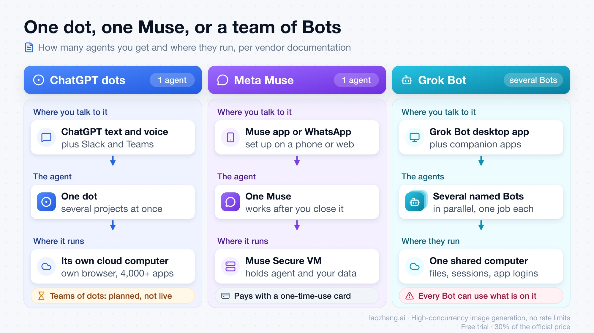
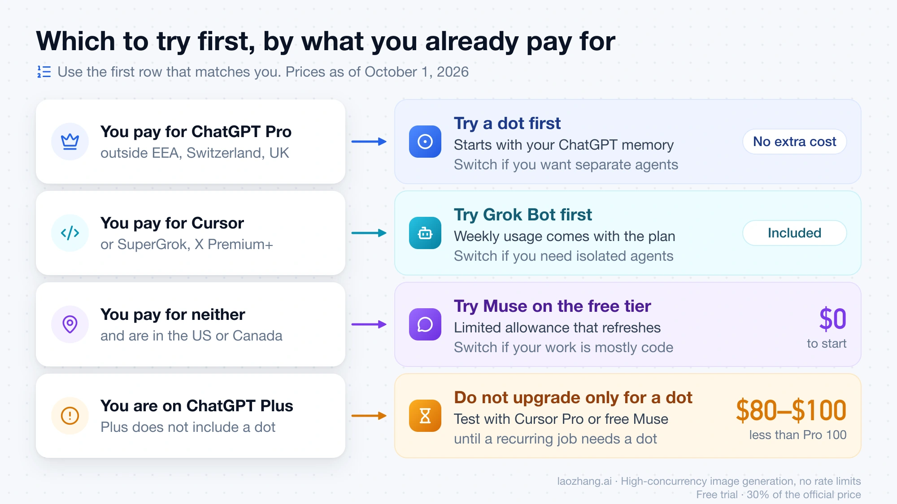



**收录说明**：直接下载。去掉了两处站内产品推广（GPT Image 2.5）与首图插画；两张内容示意图已本地化到 images/。原文 10 月 1 日首发为三产品对比，11 月 2 日更新加入 Duet 与最新价格，date 取首发日期、updatedAt 记更新日期。作者明言未做同任务实测，结论均据厂商公开文档。原文全文存于本目录的 original.md，网站上不显示，已翻译。

**内容摘要**：作者按厂商 11 月 2 日前的公开文档，对比四款个人智能体的入门成本与使用条件：Muse 免费起步（美国、加拿大、日本、新加坡），Duet 含在 20 美元的 Claude Pro 中（美国候补名单），Grok Bot 新用户 30 美元起（老 Cursor Pro 用户 20 美元），dots 需 100 美元的 ChatGPT Pro。文章还比较了四者的运行形态、审批与数据规则：Muse 与 Duet 以 Stripe Link 一次性卡支付，Grok Bot 的多个 Bot 共享一台云电脑，断开应用不会删除智能体已学到的信息；并给出按已有订阅选择、为期一周的三项试用任务与叫停标准。

**保留理由**：目前少有的四产品入门成本与用量规则的系统梳理，价格与计划细节均注明出处与核查日期；审批、训练数据与断开连接后记忆保留的对照表是已收资料较少覆盖的角度。

---

Meta Muse 免费起步，Claude Duet 随 20 美元的 Claude Pro 以美国候补名单形式提供，Grok Bot 对新客户现为 30 美元起，ChatGPT dots 需要 100 美元的 Pro。

LaoZhang AI Team · 2026 年 10 月 1 日发布 · 2026 年 11 月 2 日更新 · 阅读时长 28 分钟

先从你现有订阅已经包含的那款智能体开始。截至 2026 年 11 月 2 日，进入每一款的最低成本方式是：

- **Meta Muse：**免费，有用量限制，覆盖美国、加拿大、日本和新加坡。
- **Claude Duet：**包含在 Claude Pro（每月 20 美元，或按年付费每月 17 美元）、Max 和 Ultra 中，面向从候补名单受邀的美国账户。
- **Grok Bot：**The X Subscription 上的 Premium，新客户每月 30 美元。如果你已经每月支付 20 美元订阅 Cursor Pro，Grok Bot 仍包含在该计划内。
- **ChatGPT dots：**ChatGPT Pro，每月 100 美元起，EEA、瑞士和英国以外。

如果你上面这些都没有付费，Muse 试用不花钱。如果你在美国已经付费订阅 Claude Pro、Max 或 Ultra，加入 Duet 候补名单同样不花钱，但 Duet 所做的一切，包括它的后台巡检，都与你 Claude 聊天共用同一套用量限制。

这四款是为不同的工作而造的。一个 dot 住在 ChatGPT 里，把工作交给 Codex 和 ChatGPT Work。Grok Bot 给你几个有名字的 Bot，各自承担不同工作，共用一台电脑。Muse 面向个人杂事、购物和通过 WhatsApp 发消息。Duet 每天早上给你一份摘要，每隔几小时检查你连接的 app，有需要你处理的事就给你发消息，用的是你已经在 Claude 里设好的记忆和连接器。

以下所有内容都来自厂商公开的文档。没有任何公开测试在四款上跑过同样的任务。对最初的三款，Kingy AI 称自己的对比「不是一次上手的三方性能测试」，Every 则写道：「我们没有在每个产品上跑同样的工作。」Anthropic 于 2026 年 10 月 21 日以研究预览形式开放 Duet，目前还没有关于它的独立测试发布。其他几款的条款也仍在变动：Grok Bot 的计划在 10 月 12 日改了，dots 用量不计入计划额度的那段发布月大约在 10 月 29 日结束，而 OpenAI 未公布替代它的条款。

关于名字的说明：OpenAI 的帮助中心把产品写作小写「dots」，把单个智能体称为「your dot」。「ChatGPT Dots」「OpenAI Dots」和「ChatGPT Dot」指的都是同一个产品。xAI 和 Cursor 把应用写作「Grok Bot」，把其中的智能体写作「Bots」，所以「grokbot」意思相同。Anthropic 写作「Claude Duet」或直接写「Duet」。Meta 用「Muse」指智能体，用「Muse Spark」或「Muse Wonder」指其模型。

## 今天谁能用 dots、Muse、Grok Bot 和 Duet：计划、地区、设备

你的计划和所在国家在任何功能之前就决定了产品能否使用。下表列出截至 2026 年 11 月 2 日各厂商公布的条件。

|  | ChatGPT dots | Meta Muse | Grok Bot | Claude Duet |
| --- | --- | --- | --- | --- |
| 发布 | 2026 年 9 月 29 日 | 2026 年 9 月 8 日（美国） | 2026 年 8 月 11 日（beta） | 2026 年 10 月 21 日（研究预览） |
| 最低进入方式 | ChatGPT Pro，每月 100 美元 | 免费，有用量限制 | 新客户：The X Subscription 上的 Premium，每月 30 美元。现有 Cursor Pro：每月 20 美元 | Claude Pro，每月 20 美元（按年付费每月 17 美元），需候补名单邀请 |
| 包含它的计划 | Pro、Business Premium；由管理员开启的 Enterprise beta | Free、Power、Maximum | The X Subscription 的 Premium、Super、Ultra；旧版 Cursor Pro、Pro+、Ultra、Teams；已关联的 SuperGrok、SuperGrok Plus、SuperGrok Heavy 或 X Premium+；自助式 Grok Business 席位 | Pro、Max、Ultra |
| 不包含的计划 | Plus、Go 和 Free 未列出 | 无 | The X Subscription 的 Free 和 Plus（每月 8 美元）；SuperGrok Lite | Free；Team 和 Enterprise（Anthropic 计划日后加入） |
| 地区 | Pro：18 岁以上，不在 EEA、瑞士或英国。Business Premium：所有支持的 ChatGPT 地区 | 美国、加拿大、日本（自 10 月 23 日起）、新加坡（自 10 月 27 日起）；Meta 未公布其他国家 | 未公布国家清单；xAI 称 The X Subscription 正在全球铺开 | 仅限美国 Claude 账户 |
| 在哪里设置 | iOS 或 Android 上的 ChatGPT app、桌面 app（含 Windows）或桌面网页版；不含移动网页版 | iOS、Android 或 muse.ai；Meta 还提供 Mac app，日本和新加坡未宣布 | Grok Bot app，用你的 Cursor 账户登录 | 在手机上打开邀请邮件，然后使用独立的 iOS 或 Android app；也可在 claude.ai 网页上使用 |
| 在哪里与它对话 | ChatGPT（文字、语音或你发起的通话）、Slack、短信（有限 beta，仅美国 Pro） | Muse app；WhatsApp，日本和新加坡未宣布 | macOS、Windows 或 Linux 桌面 app；iPhone、iPad 和 Android app；团队 Bot 可用 Slack；在 X 上 @bot | 一个主线程，用文字或语音消息，另有话题频道；Duet 也会主动给你发消息 |

来源：OpenAI 的 [dots 帮助页面](https://help.openai.com/en/articles/20001530-getting-started-with-your-dot)、Meta 的 [Muse 发布帖](https://about.fb.com/news/2026/09/introducing-muse-personal-ai-agent/) 与 [Muse 订阅帮助页面](https://www.meta.com/help/subscriptions/1021145227643680/)、Cursor 的 [Grok Bot 计划页面](https://cursor.com/help/grok-bot/plans)、xAI 的 [X Subscription 定价文档](https://docs.x.ai/x-subscription/pricing)、Meta 的 [新加坡发布帖](https://about.fb.com/news/2026/10/muse-is-now-available-in-singapore-the-worlds-first-personal-ai-agent-built-for-everyone/) 与 [日本发布帖](https://about.fb.com/ja/news/2026/10/muse-personal-ai-agent-launches-in-japan/)（日文），以及 Anthropic 的 [Get started with Claude Duet 帮助文章](https://support.claude.com/en/articles/17631495-get-started-with-claude-duet) 和 [Claude Duet 公告](https://claude.com/resources/articles/claude-duet)。

账户所在地会进一步收窄范围。下表的各行按各厂商的国家规则，而非你使用的语言。

| 账户所在地 | ChatGPT dots | Meta Muse | Grok Bot | Claude Duet |
| --- | --- | --- | --- | --- |
| 美国 | Pro 或 Business Premium | 可用 | 可用 | Pro、Max 或 Ultra，需邀请 |
| 加拿大 | Pro 或 Business Premium | 可用 | 无国家清单；查看计划页面 | 不可用 |
| 英国、EEA（例如西班牙）、瑞士 | 仅 Business Premium | 未宣布 | 无国家清单；在 X 上 @bot 在澳大利亚、英国、欧盟、冰岛、列支敦士登或挪威不可用 | 不可用 |
| 日本、新加坡 | Pro 或 Business Premium | 可用，支持 iOS、Android 和 muse.ai | 无国家清单；查看计划页面 | 不可用 |
| 韩国 | Pro 或 Business Premium | 未宣布 | 无国家清单；查看计划页面 | 不可用 |
| 俄罗斯、中国大陆 | ChatGPT 不在支持国家之列 | 未宣布 | 未公布国家清单 | 不可用 |

OpenAI 的 [ChatGPT 支持国家页面](https://help.openai.com/en/articles/7947663-chatgpt-supported-countries) 警告，在所列国家之外使用 ChatGPT「可能导致你的账户被封锁或暂停」。xAI 的 [在 X 上 @bot 文档](https://docs.x.ai/grok-bot/tag-on-x) 称，标注按 X 记录的你的账户所属国家判断，所以你当前所在地不会改变它。

这些表里有四个条件容易让人栽跟头。

**ChatGPT Plus 得不到 dot。** OpenAI 列出的是 Pro、Business Premium 和 Enterprise。即便在 Pro 上，OpenAI 也说「访问权限可能需要几天才到达你的账户」。

**Duet 是候补名单，不是注册。** 你需要填写姓名、Claude 账户的邮箱、你的计划和手机类型。Anthropic 说邀请分批发出，「加入候补名单并不保证具体日期」。访问权限与你填写的邮箱绑定，所以它必须与你的 Claude 账户以及手机上的 Apple 或 Google 账户一致。Anthropic 没有公布任何说明表示 Max 或 Ultra 订阅者会比 Pro 订阅者更早受邀。

**Grok Bot 的 20 美元通道对新客户已关闭。** 自 10 月 12 日起，新客户「包括只有免费 X 账户的人」都从 The X Subscription 开始，而其每月 8 美元的 Plus 计划不包含 Grok Bot。Cursor 的价格页面现在只列出 The X Subscription 的计划。现有 Cursor Pro、Pro+、Ultra 和 Teams 订阅者保留其计划，也保留 Grok Bot。

**Muse 在四个国家，Meta 不公布完整清单。** Muse 于 9 月 8 日在美国开放，9 月 18 日在加拿大。日本随后于 10 月 23 日上线，是 Meta 首次在北美以外发布，新加坡于 10 月 27 日。在日本和新加坡，它运行在 iOS、Android 和 muse.ai 上；Meta 未宣布在那里的 Mac app 或 WhatsApp。Meta 的帮助页面仍称 Muse 及其订阅「尚未在所有地区可用」。Meta 未宣布 Muse 在韩国、英国、EEA、瑞士或澳大利亚上线。

## 价格：「100 美元 vs 免费 vs 30 美元 vs 20 美元」漏掉了什么

每个入门价格都准确，每个都带一个改变你实际付费的条件。

**Dots，100 美元。** ChatGPT Pro 有三个按月档位：Pro 100 为 100 美元，Pro 200 为 200 美元，Pro 500 为 500 美元，仅按月计费（[OpenAI 的 Pro 档位页面](https://help.openai.com/en/articles/9793128-about-chatgpt-pro-tiers)）。dot 本身不额外收费：「你的第一个 dot 包含在 Pro 或 Business Premium 计划中，不另收费。」用量才是悬而未决的问题。OpenAI 的 [9 月 29 日发布说明](https://help.openai.com/en/articles/6825453-chatgpt-release-notes) 称：「在接下来的一个月里，dots 用量不会计入符合条件的 Pro、Business 和 Enterprise 用户的计划额度。此期间之后，我们将公布各计划的用量条款。」从 9 月 29 日算起，那个月大约在 10 月 29 日结束；截至 11 月 2 日，OpenAI 尚未公布任何计划的用量条款。帮助页面现在只说你的计划「包含用于更深入工作的额度，发布后第一个月有延长限制」。10 月 29 日，OpenAI 将 Pro 100 和 Pro 500 的 Work 与 Codex 额度翻倍，并取消了一项计划中的 Pro 200 削减，但那是 Work 与 Codex 用量的变化，不是 dots 额度。帮助页面还说，你日后可以添加更多 dot，并调整每个 dot 的速度或每月工作量，但未给出价格。OpenAI 的 dots 页面没有列出 Business Premium 席位价格。如果你也在为其他原因权衡升级，见 [ChatGPT Pro vs Plus：2026 年 Pro 的 100、200 还是 500 美元值不值？](https://blog.laozhang.ai/en/posts/chatgpt-pro-vs-plus)。

**Muse，0 美元。** 免费档有会重置的用量限制。Power 每月 20 美元，每周 5 亿 Muse tokens。Maximum 每月 100 美元，每周 30 亿 Muse tokens。你必须年满 18 岁，或达到你所在地的成年年龄，才能订阅。Meta 只以美元列出这些价格：其日本和新加坡的帖子称大部分功能免费，另有订阅计划提供更多，未给出日元或新加坡元价格。Meta 未公布 Muse tokens 到任务的换算，所以了解免费档覆盖什么的唯一办法就是使用它。

**Grok Bot，30 美元；如果你已有 Cursor Pro 则 20 美元。** 仍然没有单独的 Grok Bot 订阅。在 [The X Subscription](https://x.ai/news/x-subscription) 上，Grok Bot 包含在 Premium（每月 30 美元，或每年 300 美元）、Super（每月 100 美元）和 Ultra（每月 200 美元）中，面向个人和团队席位。xAI 称 Premium 带有「SuperGrok、Cursor Pro 和 X Premium+ 的权益，此前合计每月 90 美元」。价格不含税。

更大的变化是用量如何计算。在 The X Subscription 上，「Grok Bot 用量与 Cursor 和 Grok app 共用同一个每周池，而不是单独的 Grok Bot 计量」，所以在 Cursor 里重度编码的一周会给你的 Bot 剩下更少。Premium 的池是 Plus 池的 4 倍，Super 是 15 倍，Ultra 是 50 倍；xAI 未给出 Grok Bot 专属数字。池用完时，额外用量从预付额度中扣除，可选自动充值，并设你自定的每月上限。已花掉的额度不可退款。

如果你在旧版 Cursor 计划上，除非你切换，否则什么都不变。Grok Bot 保留其每周用量，按需用量通过 Cursor 计费，直到你的每月上限。已关联的 SuperGrok 或 X Premium+ 不会叠加到 Cursor 计划上：Grok Bot 使用其中每周用量更多的那一个。关联是永久的，不能移到另一个 Cursor 账户。把旧版计划切换到 The X Subscription 是可选的，也是永久的。你旧的 Cursor、SuperGrok 和 X Premium 订阅会在结账时取消，并按比例退款，但通过 Apple App Store 计费的 Cursor 例外，需通过 Apple 取消。关于每个档位可能叠加在 30 美元之上的费用，以及切换何时划算，见 [Grok Bot X Subscription 定价：最低 30 美元，不是 8 美元的 Plus](https://blog.laozhang.ai/en/posts/grok-bot-x-subscription-pricing)。

**Duet，20 美元。** Anthropic 的帮助文章称：「在研究预览期间，Claude Duet 包含在 Pro、Max 和 Ultra 计划中，不另收费。」[Claude 的价格页面](https://claude.com/pricing) 列出 Pro 每月 20 美元，或按年计费每月 17 美元（预付 200 美元），Max 每月 100 美元，Ultra 每月 200 美元。Ultra 即此前的 Max 20x，Anthropic 于 2026 年 10 月 30 日改名，未改价格。Duet 花掉的是你的用量。它按「你计划的用量限制，包括任何五小时会话限制和你的每周限制，与 Claude 中的聊天相同的速率」消耗（已验证的 Ultra 账户没有五小时限制），它在后台做的工作，包括早间摘要和巡检，也计入。Anthropic 说 Duet 每隔几小时检查你的账户，「因为不停检查会快得多地耗尽你计划的限制」，而更大的任务，比如财务模型或演示文稿，会消耗更多模型轮次。你被接纳时，会获得一次完整的限制重置，可用至 2026 年 11 月 30 日。Anthropic 未公布各计划的摘要或任务数量，而「不另收费」只描述预览期。关于基础计划本身是否划算，见 [Claude Pro 在 2026 年值不值？20 美元计划何时划算](https://blog.laozhang.ai/en/posts/claude-pro-worth-it)。

对一个从零开始的美国个人，按月入门成本从低到高依次是 Muse 0 美元、受邀后的 Duet 20 美元、Grok Bot 30 美元、dots 100 美元。按年计费，Duet 降到每月约 17 美元（200 ÷ 12），Grok Bot 降到 25 美元（300 ÷ 12）。ChatGPT Pro 没有年付选项。这四款都没有公布数字说明每个价格能买到多少智能体工作，所以这些数字比较的是入门费用，不是价值。

## 它们如何工作：一个 dot、一个 Muse、一队 Bot，还是一个 Duet 线程

这些设计最大的差别在于你得到几个智能体、它们在哪里运行，以及谁发起对话。

*这张图展示的是 2026 年 10 月 1 日最初的三智能体对比。Claude Duet 在下面的正文中描述。*

**一个 dot 就是一个智能体，在 ChatGPT 内拥有自己的云电脑。** OpenAI 的帮助页面称它由 GPT-6 Astra 驱动，有自己的浏览器，并连接你选择的 app；OpenAI 9 月 29 日的公告称通过 ChatGPT 插件可触达的 app 数量超过 4,000 个。你一开始只有一个 dot，它可以同时处理几个项目。添加更多 dot 是已声明的未来选项，不是现在能做的事。dot 会接收你现有的 ChatGPT 记忆。访问你自己的电脑是可选的，默认关闭。当你从 ChatGPT 桌面 app 打开它时，dot 可以创建 Work 或 Codex 任务，并在其云浏览器被封锁时使用你的本地浏览器。

**Grok Bot 是一组有名字的 Bot，共用一台电脑。** xAI 的文档称它们为「有名字、有工作、有会随时间累积的上下文的 AI 队友」。Bot 并行运行、互相发消息、运行例程，并能从一次演示中学习工作流程。你还可以在连接 X 账户后，通过在 X 上 @bot 把一条帖子交给你的主 Bot；[Grok Bot X 连接器指南：连接 X、添加插件并测试访问](https://blog.laozhang.ai/en/posts/grok-bot-tutorial) 涵盖 X 一侧。问题在于隔离。你账户里所有 Bot 共用一台持久云电脑，连同其文件、浏览器会话和 app 登录。xAI 的措辞很直接：「把放在其上的任何东西都视为对你运行的每个 Bot 可用。」Bot 的角色名分隔的是对话，不是数据。细节见 [Grok Bot 的云电脑：什么会保留、什么是共享的、什么需要审批](https://blog.laozhang.ai/en/posts/grok-bot-cloud-computer)。

**Muse 是一个智能体，在一台专用云虚拟机上，通过聊天访问。** Meta 称 Muse Secure VM 同时保存智能体和你的数据，你在其 app 或 WhatsApp 中与 Muse 对话。你关闭 app 后它继续工作，当有变化或需要审批时回来。付款通过 Link by Stripe 用一次性卡完成。它的连接器偏向消费和小企业任务：Meta 已为小企业宣布 Shopify、QuickBooks、Canva、Stripe、Slack 和 Notion 等。

**Duet 是一个主动找上你的智能体，在自己的 app 里。** 它运行在 Claude Opus 5.5 上，你不能选择其他模型。它从你 Claude 账户的记忆、技能和连接器开始。你在一个主线程里给它发消息，打字或语音均可，也可以为不同话题开设独立频道，它们共用同一份记忆。每天早上它发送一份根据你的邮件和日历生成的摘要，并能启动第一步，例如起草回复供你审阅。一天中它每隔几小时检查你连接的 app，有需要你处理的事或任务完成时给你发消息。它在自己的云电脑上用自己的浏览器工作，所以你的笔记本电脑和手机可以关着。完成的工作，比如研究报告、电子表格、演示文稿或仪表盘，会落到它的 Make 标签页。

Duet 可触达「Claude Marketplace 中超过 6,000 个连接器和插件」，Anthropic 的帮助文章点名了 Gmail、Google Calendar、Google Drive、Slack、QuickBooks、HubSpot、Docusign 和 Calendly。Slack 有使用限制，Microsoft 365 尚不可用。Duet 与主 Claude app 以及 Claude Cowork（Anthropic 处理你文件的桌面智能体）分开；后者在 [Grok Bot vs Claude Cowork vs ChatGPT Work：按工作选择](https://blog.laozhang.ai/en/posts/grok-bot-vs-claude-cowork-vs-chatgpt-work) 中对比。

对前三款的公众意见按工作类型划分了领域。在一条 X 帖子中，用户 petergyang 把 dots 和 Grok Bot 归为针对工作任务，把 Muse 归为针对个人任务，并说一个 dot 同时应付几个项目比 Grok Bot 一个 Bot 一个工作的对话更难跟上。那是一个人的看法，它点出了你自己试用时该留意的东西。Anthropic 把 Duet 放在工作一侧：其公告称 Duet 的核心功能是围绕工作构建的，所以订票之类的个人杂事「就没那么强」。

## Dots vs Muse、dots vs Grok Bot、Grok Bot vs Muse：Duet 的位置在哪

大多数两两对比的选择，各自归结为一个差别。

**ChatGPT dots vs Muse。** 差距在价格和工作类型。一个 dot 通过 Pro 每月 100 美元，把工作交给 Codex 和 ChatGPT Work。Muse 免费起步，处理杂事、购物和消息，住在美国、加拿大、日本和新加坡的 app 里，并在美国和加拿大有 WhatsApp。如果你已经为 Pro 付费且你的常规工作是工作类，选 dot。如果你的工作是个人类，或你还不想付费，选 Muse。

**ChatGPT dots vs Grok Bot。** 差距是一个智能体对一队智能体。一个 dot 是单个智能体，从你的 ChatGPT 记忆开始，若你允许可触达你自己的电脑。Grok Bot 给你几个有名字的 Bot，各有其工作，共用一台电脑，新客户每月 30 美元起。如果你的工作已经跑在 ChatGPT 和 Codex 上，选 dot。如果你想要按工作分开的智能体，且你已在使用 Cursor 或 Grok，选 Grok Bot。

**Grok Bot vs Muse。** 差距是工作队友对个人智能体。Grok Bot 的 Bot 运行例程，在它们共用的一台电脑上跨你的 app 工作。Muse 坐在自己的虚拟机上，前面有一个独立的 Sentinel 智能体审批任何发往互联网的内容，它是为预订、购物和消息而造的。跨 app 的工作选 Grok Bot。从手机处理个人任务选 Muse。

**Duet 的位置。** Duet 在形态上最接近 dot：一个智能体，从你已经在用的 app 承接记忆。差别在于谁发起对话，以及你能看到什么。Duet 按日程主动找你，带来摘要和巡检，而你可以打开并接管 dot 的电脑，却完全看不到 Duet 的浏览器。对 Grok Bot 而言，Duet 是一个线程而不是一队，且不能接管。对 Muse 而言，两者都会先给你发消息，都通过 Link by Stripe 用一次性卡付款，但 Duet 为工作而造且需要付费 Claude 计划，而 Muse 为杂事而造且免费起步。

## 先试哪一款：按你的订阅和工作决定

用第一条符合你的规则。

*这张图展示的是 2026 年 10 月 1 日最初的三智能体对比，其中 Grok Bot 是旧的 20 美元入门价，Muse 仅限美国和加拿大。Muse 现在还覆盖日本和新加坡，下面的规则用的是当前价格，并加入了 Claude Duet。*

1. **你已经为 ChatGPT Pro 付费，且在 EEA、瑞士和英国之外。** 先试 dot。它不额外花钱，且从你的 ChatGPT 记忆开始。发布月已经结束，OpenAI 未公布每个 Pro 档包含多少 dot 工作，所以按你实际运行的工作来判断。如果你发现自己想按工作分开智能体，就切换——单个 dot 目前不提供这个。
2. **你已在美国账户上为 Claude Pro、Max 或 Ultra 付费。** 现在加入 Duet 候补名单，因为不花钱，且邀请分批发出。受邀后，如果你的工作通过邮件、日历、Slack、发票或 Claude 已连接的 app 中的文档进行，先试 Duet。如果后台巡检把你的常规 Claude 聊天推入限制，或你的工作生活在 Microsoft 365 里，就切换。
3. **你已为 Cursor、SuperGrok、SuperGrok Plus、SuperGrok Heavy、X Premium+，或 The X Subscription 上的 Premium 及以上付费。** 先试 Grok Bot。在旧版计划上，不要只为测试就切换到 The X Subscription，因为切换不可撤销。如果你需要彼此看不到对方文件和登录的智能体，就换产品，因为 Bot 共用一台电脑。
4. **你一款都没付费，且你在美国、加拿大、日本或新加坡。** 试用 Muse 免费档。如果你的工作主要是代码、文档或 Muse 未连接的工具，就切换。
5. **你在 ChatGPT Plus 上。** 不要只为 dot 升级到 Pro，除非你有一个具体的常规工作给它。免费的 Muse 档、受邀加入 Duet 后一个 20 美元的 Claude Pro 月，或 Grok Bot 一个 30 美元的 Premium 月，都能测试常驻智能体是否适合你，比 Pro 100 便宜 70 到 100 美元（100 − 30 = 70；100 − 0 = 100）。
6. **你的任务是杂事、购物、预订和消息。** Muse 就是为此设计的，内置结账和 WhatsApp。
7. **你的工作在单位通过 Slack 进行。** dot 从桌面 app 连接 Slack。Grok Bot 的 Slack 访问适用于团队 Bot。Duet 有限地读取 Slack，且尚未在 Claude Team 或 Enterprise 上提供。在 Business Premium 上，dots 在所有支持的 ChatGPT 地区可用，包括 Pro 被排除的那些。

如果你想要的是一个桌面智能体，在你看着的时候在你的文件上完成一项工作，这四款都不是最接近的。那个对比见 [Grok Bot vs Claude Cowork vs ChatGPT Work：按工作选择](https://blog.laozhang.ai/en/posts/grok-bot-vs-claude-cowork-vs-chatgpt-work)。

## 审批与数据：每个智能体行动前会问什么

四款都会因某些操作停下，四家厂商都说这些控制不是保证。

|  | ChatGPT dots | Meta Muse | Grok Bot | Claude Duet |
| --- | --- | --- | --- | --- |
| 你设定的规则 | 每个操作有四种行为：不问即行动、预先批准则行动、行动前询问、交给你处理 | 选择连接哪些 app 以及访问程度，例如只读邮件还是也可发送 | 「先问」规则总是拦住匹配的操作，并覆盖允许规则 | 内置：发消息、付款、签署文件或删除任何东西之前都会询问。你可以告诉它汇报什么、多久一次 |
| 自动检查 | 敏感操作经过自动审查 | 独立的 Sentinel 智能体必须批准任何触达互联网的内容 | Auto Review 评估工具调用和电脑操作；对在你不在时开始的工作的批准约 10 分钟后过期，操作不会执行 | 操作经过 Anthropic 的自动模式分类器；第二个分类器阻止分享卡号和政府证件 |
| 即便批准也不许 | 更改密码等步骤必须由你完成 | 未列出 | 未列出 | 交易证券、在账户间转移资金、访问他人账户 |
| 你能检查什么 | 活动视图（进行中、已排期、已完成）；你可以打开 dot 的电脑并接管 | Muse 已做和计划做什么的审计轨迹 | 每次审批时的拟议操作及其输入；你可以接管 | 任务标签页；Duet 为每个数字或摘要背后的邮件、文件或电子表格命名。你不能观看或接管它的浏览器 |
| 用你的内容训练 | 个人计划：由你的数据设置决定。Business、Enterprise、Edu：默认不使用 | 你可以选择退出 | 遵循你的 Cursor 账户和隐私设置 | 遵循你 Claude 账户的训练设置；Anthropic 的消费者政策排除原始连接器内容 |
| 当你停止时 | 重置会删除 dot 及其对话、记忆和已排期任务 | 你可以断开服务，并让 Muse 忘记特定内容 | 删除 Bot 会把共享文件和登录留在电脑上 | 断开一个 app 会停止未来访问，但对过往信息的记忆会保留 |

厂商自己的告诫值得照原文读。OpenAI 说 dot「会犯错，包括在遵循你的规则时」。xAI 的 [Grok Bot 审批与安全文档](https://docs.x.ai/grok-bot/approvals-security-and-privacy) 称 Auto Review「应补充而非替代最小权限和明确的审批边界」，且一次批准「不会撤销已经完成的工作」。Anthropic 说 Duet「也会犯错，比如误读一条线程或误判什么紧急」，并且面对藏在邮件和网页中的指令「没有完美的防御」。Meta 声明 Muse 不会与广告系统共享对话或 VM 数据；那是 Meta 的说法，不是独立审计。Fortune 于 2026 年 10 月 19 日报道，Muse 泄露了一位 Marketplace 卖家的家庭住址。

时机也不同。如果你不在约 10 分钟内回应 Grok Bot 来自某个例程的审批，该操作会被丢弃，你得让 Bot 再试一次。Duet 会完成任务的其余部分，稍后把审批带回给你。

购物方面，Muse 和 Duet 都通过 Link by Stripe 用只能用一次的卡付款，Duet 还支持 Shop Pay。Duet 的 Link 付款需要美国支付方式，且不涵盖定期付款。根据 Anthropic 的 [Link by Stripe with Claude Duet 帮助文章](https://support.claude.com/en/articles/17666484-how-to-use-link-by-stripe-with-claude-duet)，Duet 能看到卡类型、后四位、昵称、有效期和你的收货地址，但看不到完整卡号。

在你把任何东西连接到 dot 或 Duet 之前，有一个细节很重要。断开一个 app 不会删除智能体已经从中了解到的东西。对 dot 来说，只有删除 dot 才行。对 Duet 来说，Anthropic 说在你断开后，来自更早对话的过往信息记忆会保留。

## 一周试用：三项任务，以及意味着该停下的结果

如果你在开始前选好任务，一周足够判断一个智能体是否合适。

**第一天之前**

- 确认产品确实出现在你的账户中。Dots 可能需要几天才到，Duet 只随邀请邮件到达。
- 用所提供的最窄权限连接一两个 app。先只读。
- 把发送、购买和删除的审批规则设为「询问」。Duet 默认就会为这些询问。
- 在 dots 上，让最初的工作保持小规模。发布月豁免大约在 10 月 29 日结束，此后 OpenAI 未公布按计划的用量条款。
- 作为新客户使用 Grok Bot 时，从按月 Premium 开始，而不是 300 美元的年付计划，并在开启自动充值前设好每月上限。Cursor 的旧版计划页面描述了一项免费试用额度，窗口 7 天，一项长任务就能用完，但 xAI 的文档没说 The X Subscription Free 计划上的新账户能否领取。
- 在 Duet 上，把被接纳时获得的一次性限制重置（可用至 2026 年 11 月 30 日）留给试用把你逼到限制的那天。

**要跑的三项任务**

1. 一项常规的只读工作，例如根据你的日历和收件箱生成早间摘要。这测试它在对话之间是否继续工作。在 Duet 上，早间摘要就是这项工作，所以判断它的挑选是否与你会标记的一致。
2. 一项以审批结束的多步工作，例如起草回复，或填好购物车并在发送或付款前停下。这测试控制。
3. 一项跨好几天、中途需要你一次纠正的工作。这测试反馈是否会留存。

**意味着这款不适合你的结果**

- 它发送、购买或更改了你的规则说要询问的东西。
- 你无法从活动视图、审计轨迹、任务列表或审批历史重建它做了什么。
- 在这么小的任务上，包含的用量在周末之前就用完了。在 Duet 上，这包括后台巡检挤占你已依赖的 Claude 聊天。
- 你第三天给出的纠正在第五天消失了。
- 连续三天，检查它的工作比自己做得更久。

前两条中的任何一条都足以叫停。其余三条是理由，让你在为一个更高档付费之前，先试试上面清单里的另一个产品。

## 当这四款都还不合适时

在这些情况下，等待是正确的选择。

- **你是在 EEA、瑞士或英国的 ChatGPT Pro 订阅者。** Dots 不会在那里向 Pro 推出。Business Premium 是有文档记载的途径，而它是一个工作区计划。
- **你在美国、加拿大、日本和新加坡之外，却想要 Muse。** Meta 在 10 月加入了日本和新加坡，但未公布其他国家的日期。
- **你想要 Duet，但你的 Claude 账户在美国之外，或你在 Team 或 Enterprise 上。** Anthropic 说计划日后把 Duet 带到 Team 和 Enterprise，没有日期，也未给出其他国家的日期。
- **你的工作生活在 Microsoft 365 里，却想要 Duet。** Anthropic 说 Microsoft 365 在 Duet 中尚不可用。
- **你需要不止一个隔离的智能体。** 今天一个 dot 就是一个智能体，Grok Bot 的 Bot 共用一台电脑，Duet 的频道共用一份记忆。
- **你在等一项已宣布的功能。** 每账户更多 dot、Meta AI 眼镜上的 Muse、Muse 自己的邮箱地址、只有你持有密钥的 Muse Confidential VM，以及 Duet 用你的 1Password 登录登录网站，都是已宣布而未可用。不要现在就为其中任何一项付费。Muse Wonder 是个部分例外：Meta 说它会为更多 Muse 提供动力，「先向订阅者推出」，未点名计划，所以在为它升级前，先看看你的 Muse app 显示哪个模型。

如果你在等 Google 的版本，Gemini Spark 需要 Google AI Pro 或 Ultra；它在 [Gemini Agent for Work 定价与访问：预览中，尚无价格](https://blog.laozhang.ai/en/posts/gemini-agent-for-work) 中有介绍。

## 关于 dots、Muse、Grok Bot 和 Duet 的问题

### 我能在 Plus 计划上使用 ChatGPT dots 吗？

不能。截至 2026 年 11 月 2 日，OpenAI 为 Pro、Business Premium 和由管理员开启 beta 的 Enterprise 工作区列出 dots。Plus、Go 和 Free 未列出。带 dot 的最便宜个人计划是每月 100 美元的 Pro 100。

### ChatGPT dots 是 Grok Bot 杀手吗？

没有已发布的内容支持这一点。没有人在这两者上跑过同样的任务。设计也不同：dots 给你一个与你的 ChatGPT 记忆、Codex 和 ChatGPT Work 绑定的智能体，每月 100 美元。Grok Bot 给你几个有名字的 Bot，共用一台电脑，新客户在 The X Subscription 上每月 30 美元起，如果你已有 Cursor Pro 则 20 美元。

### Meta Muse 到底与 dots、Grok Bot 和 Duet 竞争吗？

只部分竞争。Muse 围绕邮件、预订和购物等个人任务构建，运行在手机 app 和 WhatsApp 中。Dots、Grok Bot 和 Duet 偏向 Codex、Slack、发票和文档等工作工具。一个人完全可以合理地把 Muse 用于杂事，把另外三款之一用于工作。

### Muse Spark 和 Muse 是同一个东西吗？

不是。Muse 是你对话的智能体。Muse Spark 是为其提供动力的 Meta 模型。Meta 于 2026 年 10 月 12 日宣布了更新的 Muse Wonder 模型，并称 Wonder「很快会为更多 Muse 提供动力，先向订阅者推出」，未说明哪些计划先获得。Wonder 与 Anthropic 的模型相比如何，见 [Muse Wonder vs Opus 5.5：同样 4 美元/20 美元下的基准与成本](https://blog.laozhang.ai/en/posts/muse-wonder-vs-opus-5-5)。

### Grok Bot 在我的国家可用吗？

xAI 和 Cursor 未公布 Grok Bot 本身的国家清单，xAI 称 The X Subscription 正在向全球所有人铺开。你能否使用 Grok Bot 会在登录后的计划页面显示。在 X 上 @bot 是例外：对基于澳大利亚、英国、欧盟、冰岛、列支敦士登或挪威的 X 账户不可用。

### Grok Bot 现在多少钱？

对新客户，至少每月 30 美元，或每年 300 美元，为 The X Subscription 上的 Premium。Super 每月 100 美元，Ultra 每月 200 美元，用量池更大。8 美元的 Plus 计划不包含 Grok Bot。每月 20 美元的现有 Cursor Pro 订阅者无需切换即可保留 Grok Bot。

### Claude Duet vs ChatGPT dots：有什么区别？

两者都是一个常驻智能体，带一台云电脑和你已用 app 的记忆。dot 需要每月 100 美元的 ChatGPT Pro，运行在 GPT-6 Astra 上，让你打开并接管其电脑，若你允许可触达你自己的电脑。Duet 随 Claude Pro（20 美元）、Max 或 Ultra 提供给受邀的美国账户，运行在 Opus 5.5 上，主动找你并带来早间摘要和巡检，不能给你看它的浏览器，也看不到你电脑上的文件。

### 我能在美国之外或 Claude Team 计划上获得 Claude Duet 吗？

还不能。Anthropic 要求 Pro、Max 或 Ultra 计划、美国的 Claude 账户，以及候补名单的邀请。Team 和 Enterprise 不包含在内，Anthropic 说计划日后加入，未给日期。

### Claude Duet 要额外付费吗？

研究预览期间不用。Anthropic 说 Duet「包含在 Pro、Max 和 Ultra 计划中，不另收费」。它按与 Claude 聊天相同的速率使用你计划的限制，包括任何五小时会话限制和每周限制，其早间摘要和巡检也计入，所以你可能会更早触到限制。你被接纳时会获得一次完整的限制重置，可用至 2026 年 11 月 30 日。

### 从 Grok Bot 换到 Claude Duet 值得吗？

目前没有已发布的测试能回答，所以按设计和成本决定。如果你的工作通过 Gmail、日历、发票和 Claude 已连接的文档进行，且你想要一个向你汇报的智能体，Duet 适合你。如果你想要几个 Bot 并行工作、从演示中学习例程，或接管的选择，Grok Bot 适合你。如果你在每月 20 美元的旧版 Cursor Pro 上，请记住新客户从 The X Subscription 每月 30 美元或更高起步，而 xAI 的文档没说被取消的旧版计划能否重启。

### 如果 Claude 已经有我的连接器，为什么还要用 Muse 或 Grok Bot？

Duet 确实会重用你在 Claude 中设好的连接器、记忆和技能，如果你已经生活在 Claude 里，这是它的主要优势。另寻他处的理由很具体：Duet 是付费计划上的美国专属候补名单，尚不支持 Microsoft 365，你不能观看或接管它的浏览器，且 Anthropic 说个人杂事不是它的强项。Muse 在美国、加拿大、日本和新加坡免费覆盖杂事，Grok Bot 给你几个可以接管的 Bot。

## 来源

本指南链接到的外部页面，按出现顺序排列。最后更新于 2026 年 11 月 2 日。

1. [1.dots help pagehelp.openai.com/en/articles/20001530-getting-started-with-your-dot](https://help.openai.com/en/articles/20001530-getting-started-with-your-dot)
2. [2.Muse launch postabout.fb.com/news/2026/09/introducing-muse-personal-ai-agent](https://about.fb.com/news/2026/09/introducing-muse-personal-ai-agent/)
3. [3.Muse subscriptions help pagemeta.com/help/subscriptions/1021145227643680](https://www.meta.com/help/subscriptions/1021145227643680/)
4. [4.Grok Bot plans pagecursor.com/help/grok-bot/plans](https://cursor.com/help/grok-bot/plans)
5. [5.X Subscription pricing docsdocs.x.ai/x-subscription/pricing](https://docs.x.ai/x-subscription/pricing)
6. [6.Singapore launch postabout.fb.com/news/2026/10/muse-is-now-available-in-singapore-the-worlds-first-personal-ai-agent-built-for-everyone](https://about.fb.com/news/2026/10/muse-is-now-available-in-singapore-the-worlds-first-personal-ai-agent-built-for-everyone/)
7. [7.Japan launch postabout.fb.com/ja/news/2026/10/muse-personal-ai-agent-launches-in-japan](https://about.fb.com/ja/news/2026/10/muse-personal-ai-agent-launches-in-japan/)
8. [8.Get started with Claude Duet help articlesupport.claude.com/en/articles/17631495-get-started-with-claude-duet](https://support.claude.com/en/articles/17631495-get-started-with-claude-duet)
9. [9.Claude Duet announcementclaude.com/resources/articles/claude-duet](https://claude.com/resources/articles/claude-duet)
10. [10.ChatGPT supported countries pagehelp.openai.com/en/articles/7947663-chatgpt-supported-countries](https://help.openai.com/en/articles/7947663-chatgpt-supported-countries)
11. [11.Tag @bot on X docsdocs.x.ai/grok-bot/tag-on-x](https://docs.x.ai/grok-bot/tag-on-x)
12. [12.OpenAI's Pro tiers pagehelp.openai.com/en/articles/9793128-about-chatgpt-pro-tiers](https://help.openai.com/en/articles/9793128-about-chatgpt-pro-tiers)
13. [13.September 29 release notehelp.openai.com/en/articles/6825453-chatgpt-release-notes](https://help.openai.com/en/articles/6825453-chatgpt-release-notes)
14. [14.The X Subscriptionx.ai/news/x-subscription](https://x.ai/news/x-subscription)
15. [15.Claude's pricing pageclaude.com/pricing](https://claude.com/pricing)
16. [16.Grok Bot approvals and security docsdocs.x.ai/grok-bot/approvals-security-and-privacy](https://docs.x.ai/grok-bot/approvals-security-and-privacy)
17. [17.Link by Stripe with Claude Duet help articlesupport.claude.com/en/articles/17666484-how-to-use-link-by-stripe-with-claude-duet](https://support.claude.com/en/articles/17666484-how-to-use-link-by-stripe-with-claude-duet)
