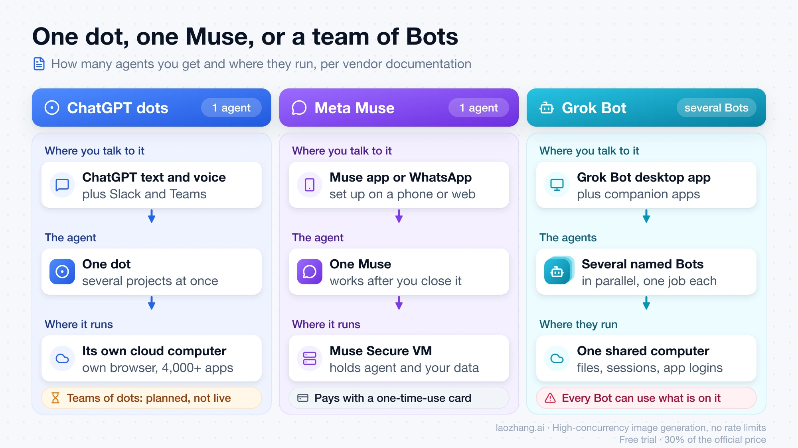
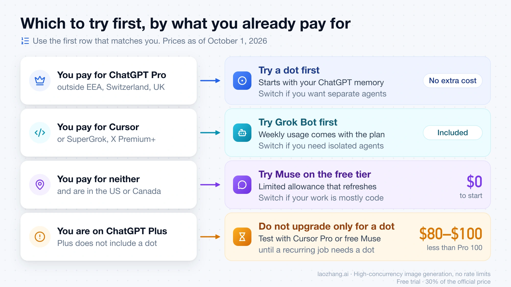

来源：https://blog.laozhang.ai/en/posts/chatgpt-dots-vs-meta-muse-vs-grok-bot
取文：2026-11-06，直接下载

ChatGPT Dots vs Meta Muse vs Grok Bot vs Claude Duet: Entry Costs

Meta Muse starts free, Claude Duet comes with $20 Claude Pro by US waitlist, Grok Bot now starts at $30 for new customers, and ChatGPT dots need $100 Pro.

LaoZhang AI Team · Published Oct 1, 2026 · Updated Nov 2, 2026 · 28 min read

Start with the agent your current subscription already includes. As of November 2, 2026, the cheapest way into each one is:

- **Meta Muse:** free, with a usage limit, in the US, Canada, Japan, and Singapore.
- **Claude Duet:** included with Claude Pro ($20 a month, or $17 a month billed annually), Max, and Ultra, for US accounts invited from a waitlist.
- **Grok Bot:** Premium on The X Subscription at $30 a month for new customers. If you already pay $20 a month for Cursor Pro, Grok Bot stays included on that plan.
- **ChatGPT dots:** ChatGPT Pro, from $100 a month, outside the EEA, Switzerland, and the UK.

If you pay for none of these, Muse costs nothing to try. If you already pay for Claude Pro, Max, or Ultra in the US, joining the Duet waitlist costs nothing either, but everything Duet does, including its background check-ins, draws on the same usage limits as your Claude chats.

The four are built for different work. A dot lives inside ChatGPT and hands work to Codex and ChatGPT Work. Grok Bot gives you several named Bots with separate jobs on one shared computer. Muse is aimed at personal errands, shopping, and messaging through WhatsApp. Duet sends you a morning summary, checks your connected apps every few hours, and messages you when something needs you, using the memory and connectors you already set up in Claude.

Everything below comes from the vendors' published documentation. No public test has run the same tasks on all four. For the original three, Kingy AI describes its own comparison as "not a hands-on three-way performance test," and Every writes, "We have not run the same jobs on every product." Anthropic opened Duet as a research preview on October 21, 2026, and no independent test of it has been published yet. Terms are still moving for the others too: Grok Bot's plans changed on October 12, and the launch month in which dots usage didn't count toward plan allowances ended around October 29 without OpenAI publishing the terms that replace it.

A note on the names: OpenAI's help center writes the product in lowercase as "dots" and calls a single agent "your dot." "ChatGPT Dots," "OpenAI Dots," and "ChatGPT Dot" all refer to the same product. xAI and Cursor write "Grok Bot" for the app and "Bots" for the agents inside it, so "grokbot" means the same thing. Anthropic writes "Claude Duet" or just "Duet." Meta uses "Muse" for the agent and "Muse Spark" or "Muse Wonder" for its models.

## Who can use dots, Muse, Grok Bot, and Duet today: plan, region, device

Your plan and country rule products in or out before any feature does. The table lists the conditions each vendor publishes as of November 2, 2026.

|  | ChatGPT dots | Meta Muse | Grok Bot | Claude Duet |
| --- | --- | --- | --- | --- |
| Launched | September 29, 2026 | September 8, 2026 (US) | August 11, 2026 (beta) | October 21, 2026 (research preview) |
| Cheapest way in | ChatGPT Pro, $100/month | Free, with a usage limit | New customers: Premium on The X Subscription, $30/month. Existing Cursor Pro: $20/month | Claude Pro, $20/month ($17/month billed annually), after a waitlist invitation |
| Plans that include it | Pro, Business Premium; Enterprise beta if an admin turns it on | Free, Power, Maximum | The X Subscription Premium, Super, Ultra; legacy Cursor Pro, Pro+, Ultra, Teams; a linked SuperGrok, SuperGrok Plus, SuperGrok Heavy, or X Premium+; a self-serve Grok Business seat | Pro, Max, Ultra |
| Plans that do not | Plus, Go, and Free are not listed | None | The X Subscription Free and Plus ($8/month); SuperGrok Lite | Free; Team and Enterprise (Anthropic plans to add them later) |
| Region | Pro: 18+, not in the EEA, Switzerland, or the UK. Business Premium: all supported ChatGPT regions | US, Canada, Japan (since October 23), Singapore (since October 27); Meta has not announced other countries | No country list published; xAI says The X Subscription is rolling out globally | US Claude accounts only |
| Where you set it up | ChatGPT app on iOS or Android, the desktop app (including Windows), or desktop web; not mobile web | iOS, Android, or muse.ai; Meta also offers a Mac app, not announced for Japan or Singapore | Grok Bot app, signed in with your Cursor account | Invitation email opened on your phone, then the standalone iOS or Android app; also on the web at claude.ai |
| Where you talk to it | ChatGPT (text, voice, or a call you start), Slack, texting (limited beta, US Pro only) | Muse app; WhatsApp, not announced for Japan or Singapore | Desktop app for macOS, Windows, or Linux; iPhone, iPad, and Android apps; Slack for team Bots; tagging @bot on X | One main thread by text or voice message, plus topic channels; Duet also messages you first |

Sources: OpenAI's [dots help page](https://help.openai.com/en/articles/20001530-getting-started-with-your-dot), Meta's [Muse launch post](https://about.fb.com/news/2026/09/introducing-muse-personal-ai-agent/) and [Muse subscriptions help page](https://www.meta.com/help/subscriptions/1021145227643680/), Cursor's [Grok Bot plans page](https://cursor.com/help/grok-bot/plans), xAI's [X Subscription pricing docs](https://docs.x.ai/x-subscription/pricing), Meta's [Singapore launch post](https://about.fb.com/news/2026/10/muse-is-now-available-in-singapore-the-worlds-first-personal-ai-agent-built-for-everyone/) and [Japan launch post](https://about.fb.com/ja/news/2026/10/muse-personal-ai-agent-launches-in-japan/) (in Japanese), and Anthropic's [Get started with Claude Duet help article](https://support.claude.com/en/articles/17631495-get-started-with-claude-duet) and [Claude Duet announcement](https://claude.com/resources/articles/claude-duet).

Where your account is based narrows it further. The rows below follow each vendor's country rules, not the language you use.

| Account based in | ChatGPT dots | Meta Muse | Grok Bot | Claude Duet |
| --- | --- | --- | --- | --- |
| United States | Pro or Business Premium | Yes | Yes | Pro, Max, or Ultra, by invitation |
| Canada | Pro or Business Premium | Yes | No country list; check the plan screen | No |
| UK, EEA (Spain, for example), Switzerland | Business Premium only | Not announced | No country list; tagging @bot on X is not available in Australia, the UK, the EU, Iceland, Liechtenstein, or Norway | No |
| Japan, Singapore | Pro or Business Premium | Yes, on iOS, Android, and muse.ai | No country list; check the plan screen | No |
| South Korea | Pro or Business Premium | Not announced | No country list; check the plan screen | No |
| Russia, mainland China | ChatGPT is not a supported country | Not announced | No country list published | No |

OpenAI's [ChatGPT supported countries page](https://help.openai.com/en/articles/7947663-chatgpt-supported-countries) warns that using ChatGPT outside the listed countries "may result in your account being blocked or suspended." xAI's [Tag @bot on X docs](https://docs.x.ai/grok-bot/tag-on-x) say tagging goes by the country X has on record for your account, so your current location doesn't change it.

Four conditions in those tables catch people out.

**ChatGPT Plus does not get a dot.** OpenAI lists Pro, Business Premium, and Enterprise. Even on Pro, OpenAI says "access may take several days to reach your account."

**Duet is a waitlist, not a sign-up.** You enter your name, the email on your Claude account, your plan, and your phone type. Anthropic says invitations go out in waves and "joining the waitlist doesn't guarantee a specific date." Access is tied to the email you entered, so it has to match your Claude account and the Apple or Google account on your phone. Anthropic publishes nothing saying Max or Ultra subscribers are invited before Pro subscribers.

**Grok Bot's $20 route is closed to new customers.** Since October 12, new customers, "including anyone with only a free X account," start on The X Subscription, and its $8 Plus plan doesn't include Grok Bot. Cursor's pricing page now lists only The X Subscription plans. Existing Cursor Pro, Pro+, Ultra, and Teams subscribers keep their plans and keep Grok Bot.

**Muse is in four countries, and Meta publishes no full list.** Muse opened in the US on September 8 and in Canada on September 18. Japan followed on October 23, Meta's first launch outside North America, and Singapore on October 27. In Japan and Singapore it runs on iOS, Android, and muse.ai; Meta hasn't announced the Mac app or WhatsApp there. Meta's help page still says Muse and its subscriptions "aren't available in all locations yet." Meta has not announced Muse in South Korea, the UK, the EEA, Switzerland, or Australia.

## Pricing: what "$100 vs free vs $30 vs $20" leaves out

Each entry price is accurate, and each carries a condition that changes what you actually pay.

**Dots, $100.** ChatGPT Pro has three monthly tiers: Pro 100 at $100, Pro 200 at $200, and Pro 500 at $500, billed monthly only ([OpenAI's Pro tiers page](https://help.openai.com/en/articles/9793128-about-chatgpt-pro-tiers)). The dot itself adds nothing: "Your first dot is included in your Pro or Business Premium plan at no extra cost." Usage is the open question. OpenAI's [September 29 release note](https://help.openai.com/en/articles/6825453-chatgpt-release-notes) says, "For the next month, dots usage won't count toward eligible Pro, Business, and Enterprise users' plan allowances. After this period, we'll share usage terms for each plan." Counted from September 29, that month ended around October 29, and as of November 2, OpenAI has not published usage terms for any plan. The help page now says only that your plan "includes an allowance for deeper work, with extended limits for the first month after launch." On October 29, OpenAI doubled the Work and Codex allowance on Pro 100 and Pro 500 and canceled a planned Pro 200 reduction, but that change is to Work and Codex usage, not a dots allowance. The help page also says you will later be able to add more dots and scale each one's speed or monthly workload, with no price given. OpenAI's dots pages don't list a Business Premium seat price. If you are weighing the upgrade for other reasons too, see [ChatGPT Pro vs Plus: Is Pro $100, $200 or $500 Worth It in 2026?](https://blog.laozhang.ai/en/posts/chatgpt-pro-vs-plus)

**Muse, $0.** The free tier has a usage limit that resets. Power costs $20 a month with 500 million Muse tokens per week. Maximum costs $100 a month with 3 billion Muse tokens per week. You must be 18, or the age of majority where you live, to subscribe. Meta lists these prices in US dollars only: its Japan and Singapore posts say most features are free, with subscription plans for more, and give no yen or Singapore-dollar price. Meta publishes no conversion from Muse tokens to tasks, so the only way to learn what the free tier covers is to use it.

**Grok Bot, $30, or $20 if you already have Cursor Pro.** There is still no separate Grok Bot subscription. On [The X Subscription](https://x.ai/news/x-subscription), Grok Bot is included on Premium ($30 a month, or $300 a year), Super ($100 a month), and Ultra ($200 a month), for individuals and team seats. xAI says Premium carries "the benefits of SuperGrok, Cursor Pro, and X Premium+, previously $90/month combined." Prices exclude tax.

The bigger change is how usage is counted. On The X Subscription, "Grok Bot usage draws from the same weekly pool as Cursor and the Grok apps, not a separate Grok Bot meter," so a heavy coding week in Cursor leaves less for your Bots. Premium's pool is 4 times the Plus pool, Super's 15 times, and Ultra's 50 times; xAI gives no Grok Bot-specific number. When the pool runs out, extra usage comes from prepaid credit, with an optional Auto Top-up and a monthly limit you set. Credit you have already spent is not refundable.

If you are on a legacy Cursor plan, nothing changes unless you switch. Grok Bot keeps its weekly usage, and on-demand usage is billed through Cursor up to your monthly limit. A linked SuperGrok or X Premium+ doesn't add to a Cursor plan: Grok Bot uses whichever one grants more weekly usage. Links are permanent and can't be moved to another Cursor account. Switching a legacy plan to The X Subscription is optional and also permanent. Your old Cursor, SuperGrok, and X Premium subscriptions are canceled at checkout with a prorated refund, except Cursor billed through the Apple App Store, which you cancel with Apple. For every tier, the costs that can land on top of the $30, and when switching pays off, see [Grok Bot X Subscription Pricing: $30 Minimum, Not the $8 Plus](https://blog.laozhang.ai/en/posts/grok-bot-x-subscription-pricing).

**Duet, $20.** Anthropic's help article says, "During the research preview, Claude Duet is included with Pro, Max, and Ultra plans at no extra cost." [Claude's pricing page](https://claude.com/pricing) lists Pro at $20 a month, or $17 a month on annual billing ($200 up front), Max at $100 a month, and Ultra at $200 a month. Ultra is the former Max 20x, which Anthropic renamed on October 30, 2026 without changing the price. What Duet costs you is usage. It draws on "your plan's usage limits, including any five-hour session limit and your weekly limits, at the same rate as chats in Claude" (verified Ultra accounts have no five-hour limit), and the work it does in the background, including the morning summary and check-ins, counts too. Anthropic says Duet checks your accounts every few hours "because checking nonstop would use up your plan's limits much faster," and that larger jobs such as a financial model or a deck take more model turns. When you are admitted, you get one full reset of your limits, available until November 30, 2026. Anthropic publishes no count of summaries or tasks per plan, and "no extra cost" describes the preview period only. Whether the base plan pays off on its own is covered in [Is Claude Pro Worth It in 2026? When the $20 Plan Pays Off](https://blog.laozhang.ai/en/posts/claude-pro-worth-it).

For one person in the US starting from zero, the monthly entry cost in order is Muse at $0, Duet at $20 once invited, Grok Bot at $30, and dots at $100. On annual billing, Duet drops to about $17 a month ($200 ÷ 12) and Grok Bot to $25 ($300 ÷ 12). ChatGPT Pro has no annual option. None of the four publishes numbers showing how much agent work each price buys, so these figures compare entry fees, not value.

## How they work: one dot, one Muse, a team of Bots, or one Duet thread

The designs differ most in how many agents you get, where they run, and who starts the conversation.

*This chart shows the original three-agent comparison from October 1, 2026. Claude Duet is described in the text below.*

**A dot is one agent with its own cloud computer inside ChatGPT.** OpenAI's help page says it is powered by GPT-6 Astra, with its own browser and connections to the apps you choose; OpenAI's September 29 announcement put the number of apps reachable through ChatGPT plugins at more than 4,000. You start with one dot, which can work on several projects at once. Adding more dots is a stated future option, not something you can do now. The dot receives your existing ChatGPT memories. Access to your own computer is optional and starts turned off. When you turn it on from the ChatGPT desktop app, the dot can create Work or Codex tasks and use your local browser when its cloud browser is blocked.

**Grok Bot is a set of named Bots on one shared computer.** xAI's docs call them "AI teammates with names, jobs, and context that compounds over time." Bots run in parallel, message each other, run routines, and can learn a workflow from a demonstration. You can also hand a post to your main Bot by tagging @bot on X once your X account is connected; [Grok Bot X Connector Guide: Connect X, Add the Plugin, and Test Access](https://blog.laozhang.ai/en/posts/grok-bot-tutorial) covers the X side. The catch is isolation. All Bots in your account share one persistent cloud computer with its files, browser sessions, and app logins. xAI's wording is direct: "treat anything placed on it as available to every Bot you run." A Bot's role name separates conversations, not data. The details are in [Grok Bot's Cloud Computer: What Persists, What Is Shared, and What to Approve](https://blog.laozhang.ai/en/posts/grok-bot-cloud-computer).

**Muse is one agent on a dedicated cloud VM, reached by chat.** Meta says Muse Secure VM holds both the agent and your data, and that you talk to Muse in its app or in WhatsApp. It keeps working after you close the app and returns when something changes or it needs approval. Payments go through Link by Stripe with a one-time-use card. Its connectors lean toward consumer and small-business tasks: Meta has announced Shopify, QuickBooks, Canva, Stripe, Slack, and Notion, among others, for small businesses.

**Duet is one agent that comes to you, in its own app.** It runs on Claude Opus 5.5, and you can't choose another model. It starts with the memory, skills, and connectors from your Claude account. You message it in one main thread, typed or by voice, and can open separate channels for different topics that share the same memory. Each morning it sends a summary built from your email and calendar and can start first steps, such as drafting replies for you to review. Through the day it checks your connected apps every few hours and messages you when something needs you or a task is done. It works on its own cloud computer with its own browser, so your laptop and phone can be off. Finished work, such as a research report, spreadsheet, deck, or dashboard, lands in its Make tab.

Duet reaches "over 6,000 connectors and plugins in the Claude Marketplace," and Anthropic's help article names Gmail, Google Calendar, Google Drive, Slack, QuickBooks, HubSpot, Docusign, and Calendly. Slack works with limits, and Microsoft 365 isn't available yet. Duet is separate from the main Claude app and from Claude Cowork, Anthropic's desktop agent that works on your files; that one is compared in [Grok Bot vs Claude Cowork vs ChatGPT Work: Choose by the Job](https://blog.laozhang.ai/en/posts/grok-bot-vs-claude-cowork-vs-chatgpt-work).

Public opinion on the first three splits the field by job. In an X post, user petergyang framed dots and Grok Bot as going after work tasks and Muse after personal ones, and said a dot juggling several projects was harder to follow than Grok Bot's one-Bot-one-job conversations. That is one person's view, and it names the thing to watch for in your own trial. Anthropic places Duet on the work side: its announcement says Duet's core functionality was built around work, so personal errands such as booking tickets "aren't quite as strong."

## Dots vs Muse, dots vs Grok Bot, Grok Bot vs Muse: where Duet fits

Most head-to-head choices come down to one difference each.

**ChatGPT dots vs Muse.** The gap is price and job type. A dot costs $100 a month through Pro and hands work to Codex and ChatGPT Work. Muse is free to start, handles errands, purchases, and messages, and lives in an app in the US, Canada, Japan, and Singapore, plus WhatsApp in the US and Canada. Pick the dot if you already pay for Pro and your recurring jobs are work. Pick Muse if your jobs are personal or you don't want to pay yet.

**ChatGPT dots vs Grok Bot.** The gap is one agent versus a team. A dot is a single agent that starts from your ChatGPT memory and can reach your own computer if you allow it. Grok Bot gives you several named Bots, each with its own job, on one shared computer, from $30 a month for new customers. Pick the dot if your work already runs through ChatGPT and Codex. Pick Grok Bot if you want separate agents for separate jobs and you already use Cursor or Grok.

**Grok Bot vs Muse.** The gap is work teammates versus a personal agent. Grok Bot's Bots run routines and work across your apps on a computer they share. Muse sits on its own VM behind a separate Sentinel agent that approves anything going out to the internet, and it is built for bookings, shopping, and messages. Pick Grok Bot for work across apps. Pick Muse for personal tasks from your phone.

**Where Duet fits.** Duet is the closest to a dot in shape: one agent that carries over memory from the app you already use. The differences are who starts the conversation and what you can see. Duet comes to you on a schedule with a summary and check-ins, while you can open and take over a dot's computer but can't watch Duet's browser at all. Against Grok Bot, Duet is one thread rather than a team, with no take-over. Against Muse, both message you first and pay with one-time cards through Link by Stripe, but Duet is built for work and needs a paid Claude plan, while Muse is built for errands and starts free.

## Which to try first: decide by your subscription and your work

Use the first rule that matches you.

*This chart shows the original three-agent comparison from October 1, 2026, with Grok Bot's old $20 entry and Muse in the US and Canada only. Muse now also covers Japan and Singapore, and the rules below have current prices and add Claude Duet.*

1. **You already pay for ChatGPT Pro, outside the EEA, Switzerland, and the UK.** Try a dot first. It costs nothing extra and it starts with your ChatGPT memory. The launch month is over, and OpenAI has not published how much dot work each Pro tier includes, so judge it on the jobs you actually run. Switch if you find you want separate agents for separate jobs, which a single dot does not offer yet.
2. **You already pay for Claude Pro, Max, or Ultra with a US account.** Join the Duet waitlist now, since it costs nothing and invitations come in waves. Try Duet first once invited if your work runs through email, calendar, Slack, invoices, or documents in apps Claude already connects to. Switch if the background check-ins push your regular Claude chats into their limits, or if your work lives in Microsoft 365.
3. **You already pay for Cursor, SuperGrok, SuperGrok Plus, SuperGrok Heavy, X Premium+, or Premium or higher on The X Subscription.** Try Grok Bot first. On a legacy plan, don't switch to The X Subscription just to test it, because the switch can't be undone. Switch products if you need agents that cannot see each other's files and logins, because Bots share one computer.
4. **You pay for none of them and you are in the US, Canada, Japan, or Singapore.** Try Muse on the free tier. Switch if your work is mostly code, documents, or tools Muse does not connect to.
5. **You are on ChatGPT Plus.** Do not upgrade to Pro only for a dot until you have a specific recurring job for it. The free Muse tier, a $20 Claude Pro month once you are invited to Duet, or a $30 Premium month for Grok Bot all test whether an always-on agent fits you, for $70 to $100 less than Pro 100 ($100 − $30 = $70; $100 − $0 = $100).
6. **Your tasks are errands, shopping, bookings, and messages.** Muse is the one designed for them, with checkout and WhatsApp built in.
7. **Your tasks run through Slack at work.** A dot connects to Slack from the desktop app. Grok Bot's Slack access applies to team Bots. Duet reads Slack with limits and isn't on Claude Team or Enterprise yet. On Business Premium, dots are available in all supported ChatGPT regions, including the ones excluded for Pro.

If what you want is a desktop agent that finishes a job on your files while you watch, none of these four is the closest match. That comparison is [Grok Bot vs Claude Cowork vs ChatGPT Work: Choose by the Job](https://blog.laozhang.ai/en/posts/grok-bot-vs-claude-cowork-vs-chatgpt-work).

## Approvals and data: what each agent asks before it acts

All four stop for some actions, and all four vendors say the controls are not a guarantee.

|  | ChatGPT dots | Meta Muse | Grok Bot | Claude Duet |
| --- | --- | --- | --- | --- |
| Rules you set | Four behaviors per action: take action without asking, take action if pre-approved, ask before taking action, hand off to you | Choose which apps connect and how much access, such as reading mail versus also sending it | "Ask first" rules always stop matching actions and override allow rules | Built in: asks before it sends a message, makes a payment, signs a document, or deletes anything. You can tell it what to report and how often |
| Automatic check | Sensitive actions go through automatic review | A separate Sentinel agent must approve anything that reaches the internet | Auto Review evaluates tool calls and computer actions; an approval for work that started without you expires after about 10 minutes and the action doesn't run | Actions pass Anthropic's auto mode classifier; a second classifier blocks sharing card numbers and government IDs |
| Off-limits even with approval | Steps such as changing a password must be done by you | None listed | None listed | Trading securities, moving money between accounts, accessing someone else's account |
| What you can inspect | Activity view (In progress, Scheduled, Completed); you can open the dot's computer and take over | Audit trail of what Muse has done and plans to do | The proposed operation and its inputs at each approval; you can take over | Tasks tab; Duet names the email, file, or spreadsheet behind each number or summary. You can't watch or take over its browser |
| Training on your content | Personal plans: your data setting decides. Business, Enterprise, Edu: not used by default | You can opt out | Follows your Cursor account and privacy settings | Follows your Claude account's training setting; Anthropic's consumer policy excludes raw connector content |
| When you stop | Reset deletes the dot with its conversations, memories, and scheduled tasks | You can disconnect services and tell Muse to forget specific things | Deleting a Bot leaves shared files and sign-ins on the computer | Disconnecting an app stops future access, but memory of past information is kept |

The vendors' own caveats are worth reading as written. OpenAI says a dot "can make mistakes, including when following your rules." xAI's [Grok Bot approvals and security docs](https://docs.x.ai/grok-bot/approvals-security-and-privacy) say Auto Review "should complement, not replace, least privilege and explicit approval boundaries," and that an approval "does not reverse work already" done. Anthropic says Duet "can also make mistakes, such as misreading a thread or misjudging what's urgent," and that against instructions hidden in emails and web pages "no defense is perfect." Meta states that Muse does not share conversations or VM data with its ad systems; that is Meta's claim, not an independent audit. Fortune reported on October 19, 2026 that Muse shared a Marketplace seller's home address.

Timing differs too. If you don't answer a Grok Bot approval from a routine within about 10 minutes, the action is dropped and you have to ask the Bot to try again. Duet finishes the rest of the task and brings the approval back to you later.

For purchases, Muse and Duet both pay through Link by Stripe with a card that works for one purchase only, and Duet also supports Shop Pay. Duet's Link payments need a US payment method and don't cover recurring payments. According to Anthropic's [Link by Stripe with Claude Duet help article](https://support.claude.com/en/articles/17666484-how-to-use-link-by-stripe-with-claude-duet), Duet sees the card type, last four digits, nickname, expiration date, and your shipping addresses, but not the full card number.

One detail matters before you connect anything to a dot or to Duet. Disconnecting an app does not delete what the agent already learned from it. For a dot, only deleting the dot does. For Duet, Anthropic says memory of past information from earlier conversations is kept after you disconnect.

## A one-week trial: three tasks and the results that mean stop

A week is enough to tell whether an agent fits, if you choose the tasks before you start.

**Before day one**

- Confirm the product actually appears in your account. Dots can take several days to arrive, and Duet arrives only with an invitation email.
- Connect one or two apps with the narrowest access offered. Read-only first.
- Set the approval rule for sending, buying, and deleting to "ask." Duet asks for these by default.
- On dots, keep the first jobs small. The launch-month exemption ended around October 29, and OpenAI has published no per-plan usage terms since.
- On Grok Bot as a new customer, start with monthly Premium rather than the $300 annual plan, and set a monthly limit before turning on Auto Top-up. Cursor's legacy plans page describes a free trial credit with a 7-day window that one long task can use up, but xAI's docs don't say whether a new account on The X Subscription's Free plan can claim it.
- On Duet, keep the one-time limit reset from your admission (usable until November 30, 2026) for the day the trial runs you into a limit.

**Three tasks to run**

1. A recurring read-only job, such as a morning summary from your calendar and inbox. This tests whether it keeps working between conversations. On Duet, the morning summary is this task, so judge whether its picks match what you would have flagged.
2. A multi-step job that ends in an approval, such as drafting a reply or filling a cart and stopping before it sends or pays. This tests the controls.
3. A job that spans several days and needs one correction from you midway. This tests whether feedback sticks.

**Results that mean this one is not for you**

- It sends, buys, or changes something that your rule said to ask about.
- You cannot reconstruct what it did from the activity view, audit trail, task list, or approval history.
- The included usage runs out before the week does, on tasks this small. On Duet, that includes the background check-ins cutting into the Claude chats you already rely on.
- The correction you gave on day three is gone by day five.
- Checking its work takes longer than doing the task yourself, three days in a row.

Either of the first two is enough to stop. The other three are reasons to try a different product from the list above before paying for a higher tier.

## When none of the four fits yet

Waiting is the right call in these situations.

- **You are a ChatGPT Pro subscriber in the EEA, Switzerland, or the UK.** Dots are not rolling out to Pro there. Business Premium is the documented route, and it is a workspace plan.
- **You are outside the US, Canada, Japan, and Singapore and wanted Muse.** Meta added Japan and Singapore in October but has published no dates for other countries.
- **You wanted Duet but your Claude account is outside the US, or you are on Team or Enterprise.** Anthropic says it plans to bring Duet to Team and Enterprise later, with no date, and gives no date for other countries.
- **Your work lives in Microsoft 365 and you wanted Duet.** Anthropic says Microsoft 365 isn't available in Duet yet.
- **You need more than one isolated agent.** A dot is one agent today, Grok Bot's Bots share a computer, and Duet's channels share one memory.
- **You are waiting on an announced feature.** More dots per account, Muse on Meta AI glasses, Muse's own email address, Muse Confidential VM with a key only you hold, and Duet signing in to sites with your 1Password logins are all announced, not available. Do not pay now for any of them. Muse Wonder is a partial case: Meta says it will power more of Muse, "rolling out first to subscribers," without naming the plans, so check which model your Muse app shows before upgrading for it.

If you were waiting for Google's version, Gemini Spark needs Google AI Pro or Ultra; it is covered in [Gemini Agent for Work Pricing & Access: Preview, No Price Yet](https://blog.laozhang.ai/en/posts/gemini-agent-for-work).

## Questions about dots, Muse, Grok Bot, and Duet

### Can I use ChatGPT dots on a Plus plan?

No. As of November 2, 2026, OpenAI lists dots for Pro, Business Premium, and Enterprise workspaces where an admin enables the beta. Plus, Go, and Free are not listed. The cheapest personal plan with a dot is Pro 100 at $100 a month.

### Are ChatGPT dots a Grok Bot killer?

Nothing published supports that. No one has run the same tasks on both. The designs also differ: dots give you one agent tied to your ChatGPT memory, Codex, and ChatGPT Work for $100 a month. Grok Bot gives you several named Bots on a shared computer, starting at $30 a month on The X Subscription for new customers, or $20 if you already have Cursor Pro.

### Does Meta Muse compete with dots, Grok Bot, and Duet at all?

Only partly. Muse is built around personal tasks such as email, bookings, and purchases, and it runs in a phone app and WhatsApp. Dots, Grok Bot, and Duet lean toward work tools such as Codex, Slack, invoices, and documents. Someone could reasonably use Muse for errands and one of the other three for work.

### Is Muse Spark the same thing as Muse?

No. Muse is the agent you talk to. Muse Spark is the Meta model that powers it. Meta announced its newer Muse Wonder models on October 12, 2026 and says Wonder "will soon power more of Muse, rolling out first to subscribers," without saying which plans get it first. How Wonder compares with Anthropic's model is in [Muse Wonder vs Opus 5.5: Benchmarks and Cost at the Same $4/$20](https://blog.laozhang.ai/en/posts/muse-wonder-vs-opus-5-5).

### Is Grok Bot available in my country?

xAI and Cursor publish no country list for Grok Bot itself, and xAI says The X Subscription is rolling out to everyone globally. Whether you can use Grok Bot shows on the plan screen after you sign in. Tagging @bot on X is the exception: it is not available for X accounts based in Australia, the UK, the EU, Iceland, Liechtenstein, or Norway.

### How much does Grok Bot cost now?

For a new customer, at least $30 a month, or $300 a year, for Premium on The X Subscription. Super costs $100 a month and Ultra $200 a month, with larger usage pools. The $8 Plus plan doesn't include Grok Bot. Existing Cursor Pro subscribers at $20 a month keep Grok Bot without switching.

### Claude Duet vs ChatGPT dots: what's the difference?

Both are one always-on agent with a cloud computer and memory from the app you already use. A dot needs ChatGPT Pro at $100 a month, runs on GPT-6 Astra, lets you open and take over its computer, and can reach your own computer if you allow it. Duet comes with Claude Pro at $20, Max, or Ultra for invited US accounts, runs on Opus 5.5, comes to you with a morning summary and check-ins, and can't show you its browser or see files on your computer.

### Can I get Claude Duet outside the US or on a Claude Team plan?

Not yet. Anthropic requires a Pro, Max, or Ultra plan, a Claude account in the US, and an invitation from the waitlist. Team and Enterprise are not included, and Anthropic says it plans to add them later without giving a date.

### Does Claude Duet cost extra?

Not during the research preview. Anthropic says Duet "is included with Pro, Max, and Ultra plans at no extra cost." It uses your plan's limits, including any five-hour session limit and your weekly limits, at the same rate as Claude chats, and its morning summary and check-ins count too, so you may hit your limits sooner. You get one full limit reset when you are admitted, usable until November 30, 2026.

### Is it worth switching from Grok Bot to Claude Duet?

No published test answers that yet, so decide by design and cost. Duet suits you if your work runs through Gmail, calendar, invoices, and documents that Claude already connects to, and you want an agent that reports to you. Grok Bot suits you if you want several Bots working in parallel, routines learned from a demonstration, or the option to take over. If you are on legacy Cursor Pro at $20, keep in mind that new customers start on The X Subscription at $30 or more, and xAI's docs don't say whether a canceled legacy plan can be restarted.

### Why use Muse or Grok Bot if Claude already has my connectors?

Duet does reuse the connectors, memory, and skills you set up in Claude, which is its main advantage if you already live in Claude. The reasons to look elsewhere are concrete: Duet is a US-only waitlist on a paid plan, it doesn't support Microsoft 365 yet, you can't watch or take over its browser, and Anthropic says personal errands aren't its strength. Muse covers errands for free in the US, Canada, Japan, and Singapore, and Grok Bot gives you several Bots you can take over.

## Sources

External pages this guide links to, in the order they appear. Last updated Nov 2, 2026.

1. [1.dots help pagehelp.openai.com/en/articles/20001530-getting-started-with-your-dot](https://help.openai.com/en/articles/20001530-getting-started-with-your-dot)
2. [2.Muse launch postabout.fb.com/news/2026/09/introducing-muse-personal-ai-agent](https://about.fb.com/news/2026/09/introducing-muse-personal-ai-agent/)
3. [3.Muse subscriptions help pagemeta.com/help/subscriptions/1021145227643680](https://www.meta.com/help/subscriptions/1021145227643680/)
4. [4.Grok Bot plans pagecursor.com/help/grok-bot/plans](https://cursor.com/help/grok-bot/plans)
5. [5.X Subscription pricing docsdocs.x.ai/x-subscription/pricing](https://docs.x.ai/x-subscription/pricing)
6. [6.Singapore launch postabout.fb.com/news/2026/10/muse-is-now-available-in-singapore-the-worlds-first-personal-ai-agent-built-for-everyone](https://about.fb.com/news/2026/10/muse-is-now-available-in-singapore-the-worlds-first-personal-ai-agent-built-for-everyone/)
7. [7.Japan launch postabout.fb.com/ja/news/2026/10/muse-personal-ai-agent-launches-in-japan](https://about.fb.com/ja/news/2026/10/muse-personal-ai-agent-launches-in-japan/)
8. [8.Get started with Claude Duet help articlesupport.claude.com/en/articles/17631495-get-started-with-claude-duet](https://support.claude.com/en/articles/17631495-get-started-with-claude-duet)
9. [9.Claude Duet announcementclaude.com/resources/articles/claude-duet](https://claude.com/resources/articles/claude-duet)
10. [10.ChatGPT supported countries pagehelp.openai.com/en/articles/7947663-chatgpt-supported-countries](https://help.openai.com/en/articles/7947663-chatgpt-supported-countries)
11. [11.Tag @bot on X docsdocs.x.ai/grok-bot/tag-on-x](https://docs.x.ai/grok-bot/tag-on-x)
12. [12.OpenAI's Pro tiers pagehelp.openai.com/en/articles/9793128-about-chatgpt-pro-tiers](https://help.openai.com/en/articles/9793128-about-chatgpt-pro-tiers)
13. [13.September 29 release notehelp.openai.com/en/articles/6825453-chatgpt-release-notes](https://help.openai.com/en/articles/6825453-chatgpt-release-notes)
14. [14.The X Subscriptionx.ai/news/x-subscription](https://x.ai/news/x-subscription)
15. [15.Claude's pricing pageclaude.com/pricing](https://claude.com/pricing)
16. [16.Grok Bot approvals and security docsdocs.x.ai/grok-bot/approvals-security-and-privacy](https://docs.x.ai/grok-bot/approvals-security-and-privacy)
17. [17.Link by Stripe with Claude Duet help articlesupport.claude.com/en/articles/17666484-how-to-use-link-by-stripe-with-claude-duet](https://support.claude.com/en/articles/17666484-how-to-use-link-by-stripe-with-claude-duet)
