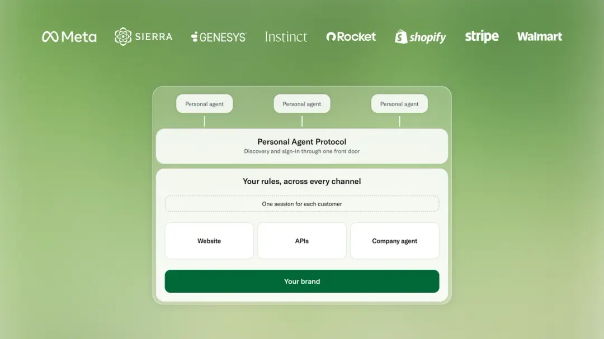



**收录说明**：直接下载。去掉了作者头像、分享与订阅区块；文末协议示意图已本地化。本轮经 Poppy 1.0 报道回溯发现，属协议首次公开。原文全文存于本目录的 original.md，网站上不显示，已翻译。

**内容摘要**：Sierra 与 Meta 宣布 Personal Agent Protocol，联合制定的行业伙伴包括 Genesys、Instinct、Rocket、Shopify、Stripe、Walmart，协议定义个人智能体如何与商家互动，覆盖认证、消费者授权与商家对智能体行为的可见性，开放给任何人实施。文中指出，当前个人智能体多像人一样加载页面、填写表单，行不通时就拨打客服电话或打开网页聊天，耗时且可能失败，而直接连接可在数秒内安全完成同一任务。会话从商家网站开始，可先以访客身份进行，涉及账户时用户在商家页面登录授权，自主决定只读或写入权限；会话基于 OAuth，跨渠道贯通，登录前的问题与登录后的订单变更属于同一次访问。文中预告本月晚些时候发布 v0.1 规范、举办设计研讨会并发布参考实现，后续还可能加入更细的权限、推送通知与支付扩展。更新说明：10 月 9 日分享了协议草案，新增 35 家设计伙伴，包括美国银行、OpenAI、Visa 与联合航空。

**保留理由**：Poppy 协议首次公开宣布的原始出处，记录了协议诞生时的设计目标与三方诉求（消费者要速度与信任、品牌要可见性与控制、智能体厂商要效率与接入），是理解后续 1.0 版本演进的起点；10 月 9 日的更新还补了草案发布与新增伙伴的时间线。

---

更新：10 月 9 日，我们分享了 Personal Agent Protocol（个人智能体协议）的一份草案，新增 35 家设计伙伴，包括美国银行、OpenAI、Visa 和联合航空。[阅读更新 →](https://sierra.ai/blog/poppy)

个人 AI 智能体正在席卷世界。人们用它们做各种事，从安排预约到预订航班、为汽车保险比价。AI 改变消费者行为的速度之快，以及我们中有多少人在自己的个人智能体身上经历那种「等等，它刚刚真的做到了」的奇妙时刻，实在非同寻常。不出所料，公司开始问：如何在最好地尊重消费者选择的同时，也保护他们的隐私与安全。

所以今天，我们很高兴宣布 Personal Agent Protocol——一项由 Meta 和 Sierra 与 Genesys、Instinct、Rocket、Shopify、Stripe 和 Walmart 等行业伙伴共同开发的开放标准，它定义了个人智能体如何与商家互动。我们把它设计成能处理认证、赋权消费者，并让公司了解个人智能体通过其网站、API 或公司智能体做了什么。它开放给任何人实施。

## 要解决的问题

今天，多数个人智能体像人一样使用网站和应用——加载页面、点击表单。当这样办不成事时，它们可能会拨打公司的客服电话或打开其网页聊天。这可能要花很长时间，而且智能体可能无法完成任务。但一条直接连接可以在数秒内安全地完成同一项任务。

要获得大规模采用，这条连接必须对各方都行得通。人人都要安全，但他们的需求也各不相同：

- *消费者要的是速度、可靠和信任*——事情第一次就办对，由一个他们能信赖会为其最大利益行事的个人智能体来完成。
- *品牌要的是可见性与控制*——知道个人智能体何时在为某位顾客行事，并由自己决定它能做什么。
- *构建个人智能体的公司要的是效率与接入*——一种与参与公司合作的直接、一致的方式。

## 它如何工作

我们正在构建的 Personal Agent Protocol 背后的原则是：消费者决定给自己的个人智能体什么访问权限，公司则为这些智能体能做什么设定参数。它让公司能以对顾客最好的方式与个人智能体合作：通过其现有网站与 API，或通过它们自己的智能体。

Personal Agent Protocol 从网站开始，个人智能体在那里可以发现公司提供什么、以及如何联系到它。随后个人智能体代表其用户开启一个会话。它可以作为访客开始，这或许足以查看商品是否有货或询问退货政策。当某项任务需要访问顾客账户时，顾客可以在公司页面上登录，或使用他们已经与个人智能体设置好的凭证。顾客始终掌握控制权，决定智能体拥有只读还是写入权限。

会话基于 OAuth——一个用于授权访问的成熟标准。它跨渠道贯通，所以登录前提的问题和登录后做的订单变更属于同一次访问。由此，个人智能体可以使用公司认为能提供最佳顾客体验的任一路径来完成任务：

- *其网站*：导航公司常规的网页。
- *其 API*：通过建立在 MCP 和 OpenAPI 等标准之上的接口连接。
- *其智能体*：通过需要对话的任务协作，例如保修索赔。

公司决定它开放什么，个人智能体获得一致的连接方式，顾客获得更快的办事方式。

## 接下来

我们希望与使用该协议的公司和个人智能体开发者共同开发它，也很高兴 Instinct 也将加入这项努力。我们欢迎所有伙伴，并计划在本月晚些时候发布 v0.1 规范、与有兴趣的各方举办设计工作坊，并发布一份参考实现，帮助开发者上手。

更细化的权限可以让顾客和公司对具体操作设定限制。推送通知可以让公司在航班延误或订单发货的那一刻就告知个人智能体。支付扩展可以让个人智能体完成购买而无需共享信用卡信息。

随着个人智能体承担更多我们的日常任务，公司需要清晰、安全的方式与它们合作，同时继续交付值得信赖的体验。Personal Agent Protocol 给了它们这个基础——让公司与个人智能体能为他们共同的顾客把事办成。

> 「个人 AI 正在为企业创造一扇新的大门。品牌需要一种可信的方式，来知道一个 AI 智能体代表谁、它被授权做什么、它的意图是什么，以及如何安全地与它合作。Personal Agent Protocol 是朝着创建这个客户体验新时代所需的共同基础迈出的重要一步。」
> - Tony Bates，Genesys 董事长兼首席执行官

> 「AI 的下一个时代是常驻智能体采取行动。Rocket 和 Redfin 现在就在为那个世界构建。我们与 Sierra 共同开发的智能体技术，让 Muse 智能体能够在我们平台上移动，从找房到获得融资乃至更远，全部实时完成。没有其他公司拥有让这成为可能的数据、技术和购房生态。」
> - Shawn Malhotra，Rocket Companies 首席技术官

> 「随着个人智能体成为日常生活的一部分，商家在卓越客户服务上有了新的前沿。从回答产品问题到支持购买、退货和换货，目标是买家的意图转化为令他们满意的结果。Personal Agent Protocol 帮助确立智能体与商家如何携手实现这一点。」
> - Mani Fazeli，Shopify 产品副总裁

> 「客户关系并不始于或终于结账。当顾客派出一个智能体时，他们期待得到与自己亲自来一样的服务。我们为 Personal Agent Protocol 贡献力量，是要给企业一种标准方式，来识别其顾客的智能体、高效地与它们互动，并塑造他们的客户关系。」
> - Kevin Miller，Stripe 支付负责人

