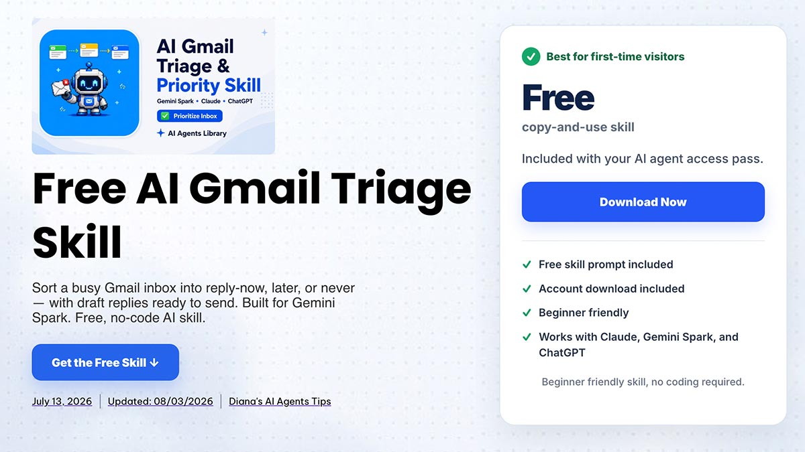
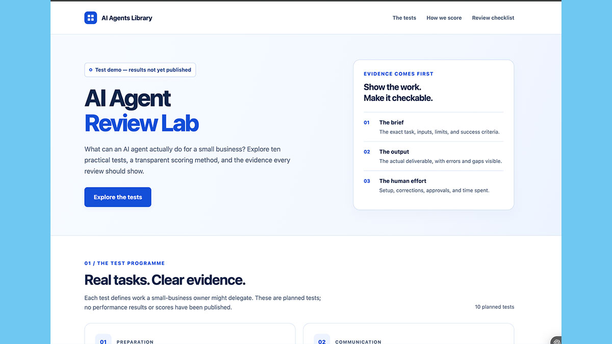
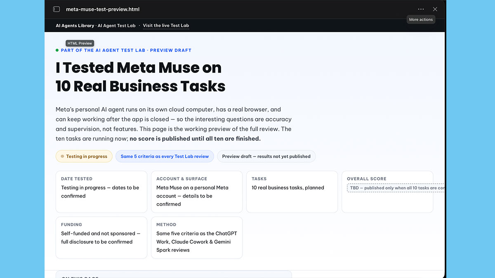
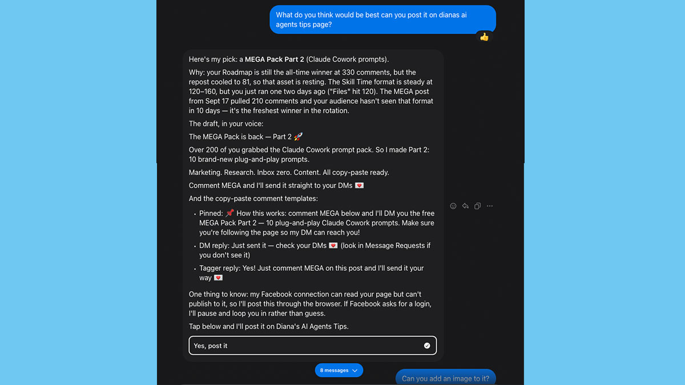



**收录说明**：直接下载；页面图片为延迟加载，按真实地址下载；去掉了站内工具、课程推广按钮和文末的系列文章卡片；作者依据页面结构化数据补上。原文全文存于本目录的 original.md，网站上不显示，已翻译。

**内容摘要**：作者把 Dots、Gemini Spark 和 Muse 分别做过的完整测试汇总起来，在六项三者都做过的商务任务上按同一套五项标准（每项 0–2 分，共 10 分）比较。Dots 平均 9.08 最高，Spark 8.50，Muse 7.75，但没有一个智能体赢下超过一半的任务：Muse 赢会议准备（唯一的 10 分），Spark 赢收件箱分拣和周报，Dots 赢竞品调研、网页制作和内容计划。去掉差距最大的网页制作一项后，Spark 以微弱优势反超 Dots。作者强调三者的测试是同类任务而非相同输入，测试日期也不同。

**保留理由**：给出三个智能体逐任务的分数和评分方法，并自行说明可比性的限制，适合作为横向比较的量化参照。

---

**我现在已经把这三个智能体都放到了同一类商务工作中，并按同样的五项标准打分。** 六项重叠的商务任务让每一个智能体都给出了分数，这足以做一次有用的方向性比较。在这六项任务上，排序与总览分数一致——Dots、然后是 Spark、然后是 Muse——但逐项结果讲出的故事比平均值更有意思。每个智能体都在某个地方领先，Dots 与 Spark 在匹配任务集上的差距比它们的总览数字所显示的更大，而去掉一项任务就会改变谁排在前面。

本页比较的是*结果*：哪个智能体在哪项工作上做得更好。如果你想要的是产品层面的比较——模型、套餐、国家/地区、你实际能买到什么——那是 [OpenAI Dots vs Meta Muse](https://www.aiagentslibrary.com/blog/openai-dots-vs-meta-muse/)。完整的单一工具测试在 [AI Agent Test Lab](https://www.aiagentslibrary.com/ai-agent-test-lab/)。

快速回答

## 哪个更好：OpenAI Dots、Gemini Spark 还是 Meta Muse？

**在三个智能体都完成的六项任务上，OpenAI Dots 总体得分最高，但没有一个智能体赢下超过一半的任务。** 在这六项重叠任务上，Dots 平均 9.08，Gemini Spark 8.50，Meta Muse 7.75。在这之下，胜场分成三份：Muse 在会议准备上给出了所有智能体中单个最好的结果，Spark 赢下收件箱分拣和周度商务简报，Dots 赢下调研、制作网页和内容规划。Dots 和 Spark 远比它们的总览分数所显示的接近——在两者共同完成的九项任务上，它们以 8.73 对 8.67 收官，实际上打成平手。按你最常重复的工作来选，而不是按最高的数字来选。

## 这些测试到底有多可比

**先老实说明前提，因为它决定了下面的数字值多少。这些是同样的*任务类别*，而不是完全相同的输入。** 每个智能体都被要求为一场真实会议做准备、分拣一个真实收件箱、调研一个真实竞争对手，等等——但会议、收件箱和竞争对手并不是同一天逐字节相同的材料。

这是三次独立的测试，在不同日期、不同套餐上运行，针对的是商务结果而不是逐字节相同的输入。它们不是受控的实验室实验，我也不会把它们当作那种实验来呈现。下面的每个分数都可追溯：[我完整的 OpenAI Dots 测试与评分方法](https://www.aiagentslibrary.com/blog/openai-dots-review/)、[最初的 Gemini Spark 商务测试](https://www.aiagentslibrary.com/blog/gemini-spark-review/)，以及[我的 Meta Muse 测试，包括权限边界](https://www.aiagentslibrary.com/blog/meta-muse-review/)。

它们确实共享的是真正重要的东西：**同一份运行表（run sheet）和同样的五项标准**——设置投入、任务完成度、准确性、输出质量，以及每个智能体需要多少监督，按 0 到 2 分计，加总为 10 分。Dots 和 Gemini Spark 运行了同样十项工作中的九项。Meta Muse 对其中的六项打了分，其中一项（制作网页）是它测试过程中新增的实验，而不是原本十项工作的一部分。

**我在比较什么，不比较什么**

下表使用的是**每个智能体都完成并打分的六项重叠任务类别**。这不是挑选出来的子集，而是现有证据下能做的最公平比较——但这三次运行使用了不同的账户、源材料和日期，所以应把它当作方向性参考，而不是受控实验。我*没有*做的是把三个已公布的总览平均值放在一起排名，因为它们覆盖的任务集不同——Dots 和 Spark 是十项任务的均值，而 Muse 的 8.0 覆盖八项结果，它计划中的四项任务根本没有产生分数。

## 三个智能体都打分的六项工作

六项重叠的商务任务，由三个智能体按同样的五项标准打分，满分 10 分。不同的账户、源材料和日期，因此是方向性的而非受控的。粗体标出每一行中最好的结果。

| 工作 | OpenAI Dots | Gemini Spark | Meta Muse |
| --- | --- | --- | --- |
| 会议准备 | 9.0 | 8.5 | **10** |
| 收件箱分拣 | 7.5 | **8.5** | 6.0 |
| 竞品与当前调研 | **9.8** | 9.0 | 8.5 |
| 制作网页 | **9.8** | 6.0 | 5.0 |
| 周度商务简报 | 8.6 | **9.5** | 9.0 |
| 内容计划 | **9.8** | 9.5 | 8.0 |
| **六项平均** | **9.08** | 8.50 | 7.75 |

有三点很突出。Dots 拿下匹配平均值。胜场分散在三个智能体之间，而不是集中在一处。最好与最差之间的差距是 1.33 分——真实存在，但小于任何一个智能体内部最好与最差*工作*之间的差距。

**实际解读：** 选哪个智能体，不如你为哪项工作选它来得重要。这些工具每一个都至少有一项工作做得比其他两个好。

**谁赢下每项工作，以及为什么。** 六项工作，三个不同的赢家。逐项细节才是这次比较真正有价值的地方。

免费 · 3 个问题 · 20 秒

不确定哪一个适合你的工作？

下面的答案是「取决于工作」。如果你宁愿直接跳到自己的答案，免费的 AI Roadmap 会问三个问题，并建议一个起步工具、一个首个工作流，以及一项匹配的免费 AI 技能。

1

### 会议准备——Meta Muse，10/10

**三次完整测试中唯一的满分。** 在三篇评测的全部二十八项打分任务中，这是唯一一个 10 分。给 Muse 的东西非常少：甚至没有告诉它用哪个电子邮件线程，而当时有几个看似合理的候选。它找到了正确的那个，定位到日历邀请，并准备了我不会想到要问的问题。它还在任务中途意识到需要日历访问权限，并引导我完成了连接。

Dots 在同一项工作上得 9.0，Spark 得 8.5。两者都很好。但没有一个像 Muse 那样让我意外。

2

### 收件箱分拣——Gemini Spark，8.5/10

**全场得分最低的工作，也是主场优势显现的一项。** Spark 原生就在 Gmail 旁边，它是三者中最可靠的一个，能告诉我什么才真正需要回复。

Dots 拿到 7.5。Muse 得 6.0——它最弱的结果——因为它得出结论说我没有发过一封我实际上已经发出的电子邮件。这种错误会变成给客户发重复消息，所以它扣的是准确性分，而不是风格分。

**在这里要把三者都当作决策支持。** 这一组里没有任何智能体有资格在未经检查的情况下根据收件箱结论采取行动。

Spark 用得最好的分拣规则被写成了[免费的 AI Gmail 分拣技能（AI Gmail Triage Skill）](https://www.aiagentslibrary.com/skills/gmail-triage/)——立即回复、稍后回复或永不回复，并附上草稿回复。每天早上给智能体同一套方法，正是把一个 8.5 分变成可重复的结果、而不是碰巧状态好的原因。

免费 · 无代码 · 复制粘贴

在你自己的 Gmail 上运行这个收件箱测试

收件箱分拣是六项工作中得分最低的，而好结果与浪费一小时之间的差别在于规则写得有多清楚。这个免费技能就是那些规则：分为立即回复、稍后回复或永不回复，起草回复，不改变收件箱中的任何东西。为 Gemini Spark 打造，也能在 Claude 和 ChatGPT 中运行。

3

### 竞品与当前调研——OpenAI Dots，9.8/10

**三者在这里都很强，这一点值得直说。** Dots 以 9.8 拿下，Spark 以 9.0 紧随，Muse 为 8.5。

调研是后台执行能带来回报的工作，三个智能体都能在你做别的事情时继续工作。Muse 的结果有个值得重复的提醒：它看起来卡了好几分钟，实际上是在读来源，第一次使用的人很容易把任务杀掉，白白浪费了工作。

4

### 制作网页——OpenAI Dots，9.8/10

**整个比较中最大的差距：9.8 对 6.0 和 5.0。** 如果你想要一个能产出你实际可以交付的东西的智能体，这一行就是应该做决定的那一行。

Dots 构建并发布了一个可用的页面。Spark 得 6.0——它自己最弱的结果。Muse 在大约四十秒内产出了一个 HTML 页面，读起来像初稿概念，然后却让它很难找，把完成的文件放到了产生它的任务旁边以外的地方。

OpenAI Dots，9.8/10。它构建并发布了这个页面——这是整个比较中三个智能体之间最大的单项差距。

Meta Muse，5.0/10。大约四十秒内构建完成，然后出现在别处，而不是在产生它的任务旁边。

这也是匹配平均值作用最大的一行。去掉这一项工作，三个平均值会大幅收窄。

5

### 周度商务简报——Gemini Spark，9.5/10

**表中差距最小的一行：9.5、9.0 和 8.6，相差不到一分。**

Spark 拿下这一项。Muse 的 9.0 是更有意思的数字，因为它的简报是针对我的业务，而不是泛泛针对企业——它利用了我自己 Meta 存在（Meta presence）的语境。这是 Muse 测试中第一次让我觉得它有所区别，而不只是称职。

Dots 的 8.6 是它第二低的分数，考虑到它在别处如此强，这让我意外。

6

### 内容计划——OpenAI Dots，9.8/10

**Dots 9.8，Spark 9.5，Muse 8.0。** 规划是三者共同的长处，差距只在规划变成实际产出时才拉开。

这个模式在这里的每个智能体身上都重复出现。每一个都更擅长决定我可能会做什么，而不那么擅长构建我用来做这件事的成品。

免费 · 可复用方法

智能体只是结果的一半

可复用工作流给 AI 智能体更清晰的指令、检查项和一个要达成的输出格式。我们的免费 AI 技能就是把这些方法写下来一次，然后重复使用。把文件安装到支持它的工具中，比如 ChatGPT 和 Gemini Spark——对 Meta Muse，则把指令作为书面简报粘贴进去，因为 Muse 应用不允许你安装自己的技能。

## Dots 与 Spark 比分数显示的更接近

**已公布的成绩中，Dots 得 8.8，Gemini Spark 得 8.7。在两者实际共同完成的九项工作上，它们以 8.73 和 8.67 收官。**

那是九项任务上 0.06 分的差距。这不算差距。任何根据这些证据告诉你其中一个明显更好的人，都是在从这点小数位里读出它承载不了的东西。

区分它们的是形态，而不是质量。Dots 更擅长产出成品——网页那一行承担了它的大部分领先。Spark 在工作位于 Google 中时更强：收件箱，以及由 Drive 材料生成的周报。Spark 还在会后跟进上以 9.5 对 7.0 取胜，那项工作 Muse 完全没有运行，而那也是 Dots 在所有项目中最弱的结果。

如果你的工作位于 Google Workspace 中，这对 Spark 来说是比任何总体平均都更强的理由。如果你需要把东西构建并交付，那对 Dots 来说是更强的理由。

### 去掉网页这一项，排序就会翻转

制作网页是表中差距最大的一项，它承担了 Dots 的大部分领先。所以值得问问没有它会怎样。在其余五项重叠任务上：

同样的六项任务，排除网页制作。来自已公布分数的描述性平均值，不是显著性检验。

| 智能体 | 六项任务 | 五项，不含网页 |
| --- | --- | --- |
| Gemini Spark | 8.50 | **9.00** |
| OpenAI Dots | 9.08 | 8.94 |
| Meta Muse | 7.75 | 8.30 |

**一旦去掉网页这项工作，Gemini Spark 就略微领先 Dots。** 领先 0.06 分，也就是说：不是有意义的差距，但足以表明 Dots 的总体领先依赖一项任务，而不是广泛优势。如果你永远不会让智能体去制作网页，那么六项任务的平均值告诉你的比你想象的少。

## 为什么 Meta Muse 的数字是另一种数字

**Meta Muse 在八项打分结果上公布 8.0，同时还有一个更低的 6.5 总体印象分。两者都是真实的，它们衡量的是不同的东西。**

Muse 计划中的十项任务有四项完全没有产生分数。两项停在我无意批准的凭证或权限请求上，一项没有结论，一项没有运行。因此它的 8.0 覆盖六项运行表任务加上测试过程中新增的两项实验——这就是为什么我在本页任何地方都没有把它与另外两个总览平均值并列。

6.5 反映的是我愿意依赖这个产品的程度，包括边界。Dots 则相反：它的总体印象分 9.2 *高于*它的任务平均分。这种背离本身就是一个发现。一个智能体可以在你不愿拓宽的边界内做出出色的工作，而任务分数不会告诉你这一点。

Muse 最具特色的结果根本没有出现在表里。在获得访问我的 Facebook 和 Instagram 存在的权限后，它通过比较以往格式在页面上实际表现如何，选择了下一篇要发布的帖子，然后用我的口吻写了配文。我在 Dots 或 Spark 的测试中没有运行过等效的连接 Meta 的任务，所以这是 Muse 的一项已展示的优势，而不是另外两个做不到类似事情的证据。后来一次仅限 Facebook 的测试更进一步：[Muse 在我的监督下发布到了我的 Facebook 页面和一个公开群组](https://www.aiagentslibrary.com/blog/meta-muse-facebook-test/)。

未出现在打分表中的 Meta Muse 结果：它通过比较以往格式在页面上实际表现如何来挑选下一篇帖子，然后写了配文。

## 它们都没做好的事

三个模式在每个智能体身上都成立，这使它们比任何单个分数都更有用。

* **收件箱分拣是这一组第二弱的工作，且具体在准确性上是最弱的——只有网页制作在总体上得分更低。** 这里没有人超过 8.5，而且三者的原因相同：这些智能体每一个都能看到某条消息存在，却不知道它是否仍然成立。
* **规划始终很强；产出则参差不齐。** 三者都规划得很好，但在网页制作这项工作上，Spark 和 Muse 的规划与构建之间的差距急剧拉开。Dots 是证明这一点的例外——它在制作网页上得了 9.8。
* **电子表格仍然需要检查，原因各不相同。** Spark 以 8.5 表现最好，它把一个带公式、图表和汇总行的可用表格直接写进了 Drive——而且每个公式仍然需要复核。Dots 得 7.5，其公式在移入 Google Sheets 时出错失效，而 Muse 的尝试没有结论，我把它停掉了。这些都不能成为不经验证就提交计算的正当理由。

## 你应该用哪一个？

根据上面的匹配结果，按你最常重复的工作来选。

| 如果你的大部分时间花在…… | 从……开始 | 原因 |
| --- | --- | --- |
| 电子邮件、日历和 Google Drive | Gemini Spark | 赢下收件箱和周报，并在会后跟进上以 9.5 对 7.0 取胜 |
| 构建和交付东西 | OpenAI Dots | 制作网页得 9.8，对手是 6.0 和 5.0 |
| 在 Facebook 或 Instagram 上做营销 | Meta Muse | 唯一拥有原生 Meta 语境的一个，而且它明显改变了输出 |
| 调研和简报 | 任意一个 | 9.8、9.0 和 8.5——三者都很强，所以按其他标准来选 |
| 电子表格和结构化数据 | Gemini Spark，并复核公式 | 这是三者最弱的领域 |

如果你想要这个决定中关于访问权限和定价的一面，而不是性能的一面——哪些套餐、哪些国家/地区、免费档实际能得到什么——那在 [OpenAI Dots vs Meta Muse](https://www.aiagentslibrary.com/blog/openai-dots-vs-meta-muse/) 中。若想看跨越这些助手而非智能体的更广视角，见 [ChatGPT vs Claude vs Gemini Spark](https://www.aiagentslibrary.com/blog/chatgpt-vs-claude-vs-gemini-spark/)。如果 Muse 不在你居住的地方提供，[5 个最佳 Meta Muse 替代品](https://www.aiagentslibrary.com/blog/meta-muse-alternatives/) 排名了最接近的选择。Google 和 Meta 都在十月发布了新的前沿模型，在 [Gemini 4 Argon vs Meta Muse Wonder](https://www.aiagentslibrary.com/blog/gemini-4-argon-vs-meta-muse-wonder/) 中比较。

## 我接下来要测试什么

上面所有内容诚实的局限在于：这是三次独立的运行，而不是一次受控实验。修正办法是具体而非含糊的：在三个智能体上用真正相同的输入重新运行三项工作——同一个收件箱、同一份带相同源材料的竞争对手简报，以及同一个带相同表现数据的营销任务。

这三项会把这次比较从匹配良好的比较变成受控比较，我会把它们作为一个明确独立的证据部分发布，而不是悄悄折进上面的表格。

## 常见问题

哪个 AI 智能体在商务上总体最好？

在三个智能体都完成的六项工作上，OpenAI Dots 的匹配平均分最高，为 9.08，Gemini Spark 为 8.50，Meta Muse 为 7.75。但没有一个智能体赢下超过一半的单项工作，所以「总体最好」不如「最擅长你最常重复的工作」有用。网页那一行承担了 Dots 的大部分领先。

OpenAI Dots 比 Gemini Spark 更好吗？

根据这些证据，并没有显著更好。在两者都运行的九项工作上，Dots 平均 8.73，Spark 8.67。差别在形态而不是质量：Dots 更擅长构建成品，Spark 更擅长任何位于 Google Workspace 中的东西。

为什么 Meta Muse 的评分方式不同？

它计划中的十项任务有四项没有产生分数——两项停在权限边界，一项没有结论，一项没有运行。它的 8.0 覆盖八项结果而不是十项任务，所以它与其他两个总览数字不是同一个构念（construct），本页从不直接把它与它们排名。

这些是在同一时间、相同输入上测试的吗？

不是。它们是三次独立的运行，日期和套餐不同，使用的是可比的商务任务，而不是逐字节相同的输入。它们确实共享同一份运行表和同样的五项评分标准，这就是匹配子集站得住脚的原因——但这不是受控的实验室基准，也没有被当作那种基准来呈现。

哪个最擅长电子邮件和日历工作？

Gemini Spark。它以 8.5 对 7.5 和 6.0 赢下收件箱分拣，并以 9.5 对 Dots 的 7.0 赢下会后跟进。它原生位于这些工作本来所在的地方，而在这些测试中，这比原始能力更重要。

它们中有任何一个能做出可用的电子表格吗？

不能可靠地做到。这是最弱的共同领域。Dots 得 7.5，但其公式在移入 Google Sheets 时出错失效，Spark 得 8.5，Muse 的尝试没有结论。在依赖任何结构化数据输出之前先检查它。

## 测试日期和披露

Meta Muse 于 2026 年 9 月 27 日在免费档上测试。OpenAI Dots 于 2026 年 9 月 30 日和 10 月 1 日在 ChatGPT Pro 上测试。Gemini Spark 于 2026 年 8 月在一个启用了 Spark 的个人 Google 账户上测试，包括 Google Sheets 连接器。每个分数都使用同样的五项标准——设置投入、任务完成度、准确性、输出质量与人工监督——每项 0 到 2 分，加总为 10 分，其中设置和监督反向计分，因此分数越高始终表示越好。没有厂商赞助这些测试、提供账户，或在发表前看过其中任何一次。最后核对于 2026 年 10 月 8 日。
