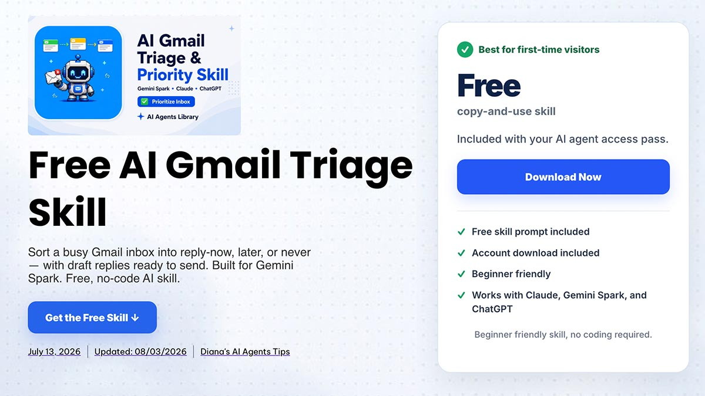
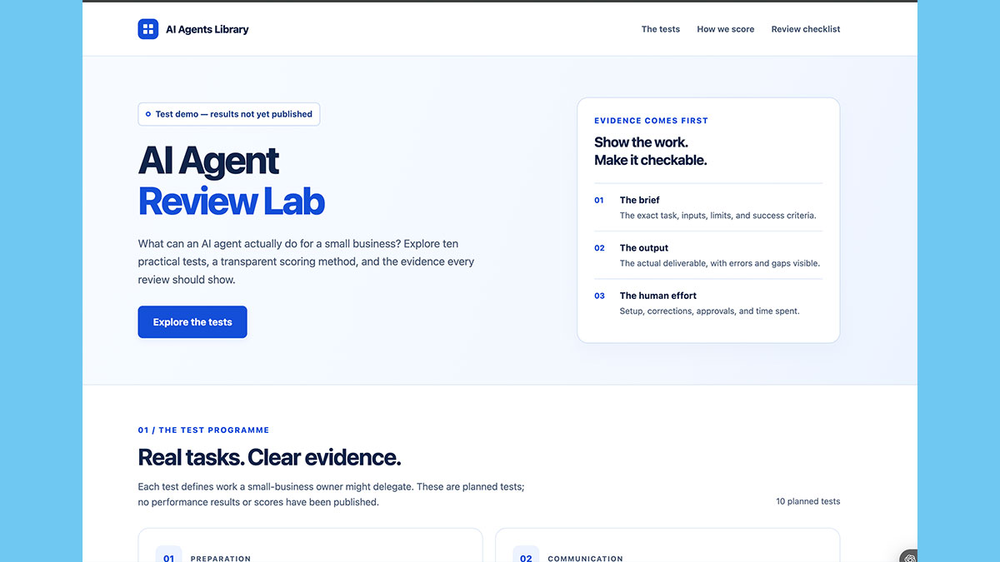
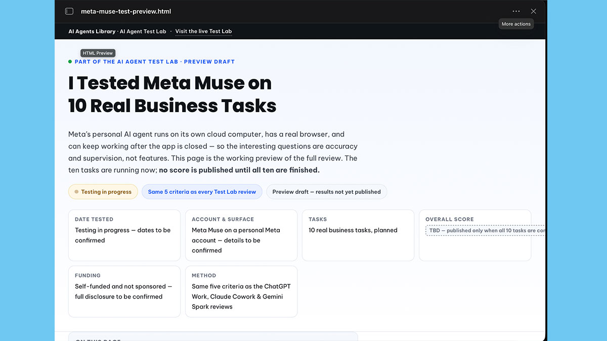
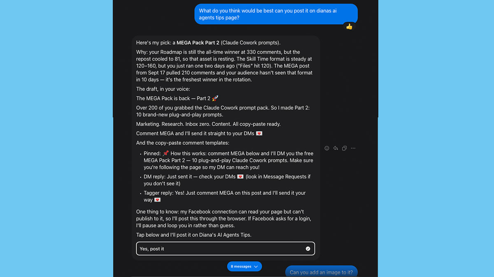

来源：https://www.aiagentslibrary.com/blog/openai-dots-vs-gemini-spark-vs-meta-muse/
取文：2026-11-05，直接下载

**I have now put all three agents through the same kind of business work, scored on the same five criteria.** Six overlapping business jobs produced a score from every one of them, which is enough for a useful directional comparison. Across those six jobs the order comes out the same as the headline scores — Dots, then Spark, then Muse — but the individual results tell a more interesting story than the averages. Each agent led somewhere, the gap between Dots and Spark is wider on the matched set than their headline numbers suggest, and removing a single task changes which one finishes ahead.

This page compares *outcomes*: which agent did better work on which job. If you want the product comparison instead — models, plans, countries, what you can actually buy — that is [OpenAI Dots vs Meta Muse](https://www.aiagentslibrary.com/blog/openai-dots-vs-meta-muse/). The full single-tool tests are in the [AI Agent Test Lab](https://www.aiagentslibrary.com/ai-agent-test-lab/).

Quick answer

## Which is better: OpenAI Dots, Gemini Spark or Meta Muse?

**On the six jobs all three completed, OpenAI Dots scored highest overall, but no agent won more than half of them.** Dots averaged 9.08, Gemini Spark 8.50 and Meta Muse 7.75 across those six overlapping tasks. Underneath that, the wins split three ways: Muse produced the single best result of any agent on meeting preparation, Spark won inbox triage and the weekly business brief, and Dots won research, building a web page and content planning. Dots and Spark are far closer than their headline scores suggest — across the nine tasks those two shared, they finished 8.73 against 8.67, which is a tie in practice. Pick by the job you repeat most, not by the highest number.

## How Comparable These Tests Really Are

**Honest framing first, because it decides how much the numbers below are worth. These were the same *task categories*, not identical inputs.** Each agent was asked to prepare for a real meeting, triage a real inbox, research a real competitor and so on — but the meeting, the inbox and the competitor were not byte-for-byte the same material on the same day.

These were three separate tests, run on different dates, on different plans, against business outcomes rather than byte-identical inputs. They were not a controlled laboratory experiment, and I am not going to present them as one. Every score below is traceable: [my full OpenAI Dots test and scoring method](https://www.aiagentslibrary.com/blog/openai-dots-review/), [the original Gemini Spark business test](https://www.aiagentslibrary.com/blog/gemini-spark-review/), and [my Meta Muse test, including the permission boundaries](https://www.aiagentslibrary.com/blog/meta-muse-review/).

What they do share is the thing that matters: **the same run sheet and the same five criteria** — setup effort, task completion, accuracy, output quality and how much supervision each needed, scored 0 to 2 and summed to 10. Dots and Gemini Spark ran nine of the same ten jobs. Meta Muse scored six of them, one of which (building a web page) was an experiment added during its session rather than part of its original ten.

**What I am comparing, and what I am not**

The table below uses the **six overlapping task categories every agent completed and scored**. That is not a cherry-picked subset, and it is the fairest comparison available from this evidence — but the three runs used different accounts, source material and dates, so treat it as directional rather than as a controlled experiment. What I am *not* doing is ranking the three published headline averages against each other, because those cover different sets of tasks — Dots and Spark are ten-task means, while Muse’s 8.0 covers eight results, four of its planned tasks having produced no score at all.

## The Six Jobs All Three Scored

Six overlapping business tasks scored by all three agents on the same five criteria, out of 10. Different accounts, source material and dates, so directional rather than controlled. Bold marks the best result in each row.

| The job | OpenAI Dots | Gemini Spark | Meta Muse |
| --- | --- | --- | --- |
| Meeting preparation | 9.0 | 8.5 | **10** |
| Inbox triage | 7.5 | **8.5** | 6.0 |
| Competitor and current research | **9.8** | 9.0 | 8.5 |
| Building a web page | **9.8** | 6.0 | 5.0 |
| Weekly business brief | 8.6 | **9.5** | 9.0 |
| Content plan | **9.8** | 9.5 | 8.0 |
| **Average across the six** | **9.08** | 8.50 | 7.75 |

Three things stand out. Dots takes the matched average. The wins split across all three agents rather than clustering. And the spread between best and worst is 1.33 points — real, but smaller than the gap between the best and worst *jobs* within any single agent.

**The practical reading:** which agent you pick matters less than which job you are picking it for. Every one of these tools has at least one job it does better than the other two.

**Who won each job, and why.** Six jobs, three different winners. The per-task detail is where this comparison earns its keep.

Free · 3 questions · 20 seconds

Not Sure Which Of These Fits Your Work?

The answer below is “it depends on the job”. If you would rather skip to your own answer, the free AI Roadmap asks three questions and suggests a starting tool, a first workflow and a matching free AI Skill.

1

### Meeting preparation — Meta Muse, 10/10

**The only perfect score in any of the three full tests.** Across all twenty-eight scored tasks in the three reviews, this is the one 10. Muse was given very little: not even which email thread to use, with several plausible candidates. It found the right one, located the calendar invitation, and prepared questions I would not have thought to ask. It also recognised mid-task that it needed calendar access and walked me through connecting it.

Dots scored 9.0 on the same job and Spark 8.5. Both were good. Neither surprised me the way Muse did.

2

### Inbox triage — Gemini Spark, 8.5/10

**The lowest-scoring job across the board, and the one where the home-turf advantage showed.** Spark sits natively alongside Gmail, and it was the most reliable of the three at telling me what actually needed an answer.

Dots managed 7.5. Muse scored 6.0 — its weakest result — because it concluded I had not sent an email I had in fact sent. That is the kind of error that turns into a duplicate message to a client, which is why it cost accuracy points rather than style points.

**Treat all three as decision support here.** No agent in this group earned the right to act on an inbox conclusion unchecked.

The triage rules Spark did best with are written down as a [free AI Gmail Triage Skill](https://www.aiagentslibrary.com/skills/gmail-triage/) — reply now, later or never, with the draft replies attached. Giving an agent the same method every morning is what turned an 8.5 into something repeatable rather than a good day.

Free · no-code · copy and paste

Run This Inbox Test on Your Own Gmail

Inbox triage was the lowest-scoring job of the six, and the difference between a good result and a wasted hour was how clearly the rules were written. This free Skill is those rules: sort into reply now, later or never, draft the replies, change nothing in the inbox. Built for Gemini Spark, and it runs in Claude and ChatGPT too.

3

### Competitor and current research — OpenAI Dots, 9.8/10

**All three were strong here, which is worth saying plainly.** Dots took it at 9.8, Spark followed at 9.0, Muse at 8.5.

Research is the job where background execution pays off, and all three can keep working while you do something else. Muse’s result came with a caveat worth repeating: it looked stalled for several minutes when it was in fact reading sources, and a first-time user could easily have killed the task and wasted the work.

4

### Building a web page — OpenAI Dots, 9.8/10

**The widest gap in the whole comparison: 9.8 against 6.0 and 5.0.** If you want an agent that produces something you can actually ship, this row is the one that should decide it.

Dots built and published a working page. Spark scored 6.0 — its own weakest result. Muse produced an HTML page in about forty seconds that read like a first-pass concept, and then made it hard to find, surfacing the finished file somewhere other than next to the task that produced it.

OpenAI Dots, 9.8/10. It built this page and published it — the single widest gap between the three agents in the whole comparison.

Meta Muse, 5.0/10. Built in roughly forty seconds, and then surfaced somewhere other than next to the task that produced it.

This is also the row where the matched average is doing the most work. Remove this single job and the three averages compress considerably.

5

### Weekly business brief — Gemini Spark, 9.5/10

**The closest row in the table: 9.5, 9.0 and 8.6, separated by less than a point.**

Spark took it. Muse’s 9.0 is the more interesting number, because its brief was specific to my business rather than specific to businesses in general — it was drawing on context from my own Meta presence. That was the first moment in the Muse test where it felt differentiated rather than merely competent.

Dots’ 8.6 was its second-lowest score, which surprised me given how strong it was elsewhere.

6

### Content plan — OpenAI Dots, 9.8/10

**Dots 9.8, Spark 9.5, Muse 8.0.** Planning is a strength for all three, and the gap only opens where planning turns into producing the thing.

That pattern repeats across every agent here. Each one was better at deciding what I might do than at building the artefact I would use to do it.

Free · reusable methods

The Agent Is Only Half The Result

A reusable workflow gives an AI agent clearer instructions, checks and an output format to hit. Our free AI Skills are those methods written down once and reused. Install the file in tools that support it, such as ChatGPT and Gemini Spark — for Meta Muse, paste the instructions as a written brief, because the Muse app does not let you install your own Skills.

## Dots and Spark Are Closer Than the Scores Suggest

**Published, Dots scored 8.8 and Gemini Spark 8.7. Across the nine jobs those two actually shared, they finished 8.73 and 8.67.**

That is a difference of six hundredths of a point across nine tasks. It is not a gap. Anyone telling you one of these is clearly better than the other, on this evidence, is reading more into the decimal than it can carry.

What separates them is shape, not quality. Dots was stronger at producing finished artefacts — the web page row carries most of its lead. Spark was stronger wherever the work lived in Google: inbox, and the weekly brief built from Drive material. Spark also took post-meeting follow-up 9.5 to 7.0, a job Muse did not run at all, and that was Dots’ weakest result anywhere.

If your work sits in Google Workspace, that is a stronger argument for Spark than any overall average. If you need things built and shipped, that is a stronger argument for Dots.

### Take the web page out and the order flips

Building a web page is the widest gap in the table, and it carries most of Dots’ lead. So it is worth asking what happens without it. Across the remaining five overlapping tasks:

The same six tasks with the web page build excluded. Descriptive averages from the published scores, not a significance test.

| Agent | Six tasks | Five, without the web page |
| --- | --- | --- |
| Gemini Spark | 8.50 | **9.00** |
| OpenAI Dots | 9.08 | 8.94 |
| Meta Muse | 7.75 | 8.30 |

**Gemini Spark edges ahead of Dots once the web page job is removed.** By 0.06 of a point, which is to say: not by a meaningful margin, but enough to show that Dots’ overall lead rests on one task rather than on broad superiority. If you are never going to ask an agent to build a page, the six-task average is telling you less than you think.

## Why Meta Muse’s Number Is a Different Kind of Number

**Meta Muse publishes 8.0 across eight scored results, alongside a lower 6.5 overall impression. Both are real, and they measure different things.**

Four of Muse’s ten planned tasks produced no score at all. Two stopped at a credential or permission request I was not willing to approve, one was inconclusive, and one was not run. Its 8.0 therefore covers six run-sheet tasks plus two experiments added during the session — which is why I have not placed it against the other two headline averages anywhere on this page.

The 6.5 reflects how much of the product I would rely on, boundaries included. Dots went the other way: its overall impression, 9.2, is *higher* than its task average. That divergence is itself a finding. An agent can do excellent work inside a boundary you are unwilling to widen, and the task scores will not tell you that.

Muse’s most distinctive result does not appear in the table at all. Given access to my Facebook and Instagram presence, it chose which post to publish next by comparing how previous formats had actually performed on the page, then wrote the caption in my voice. I did not run an equivalent Meta-connected assignment in the Dots or Spark tests, so this is a demonstrated Muse strength rather than proof the other two could not do something similar. A later, Facebook-only test went one step further: [Muse published to my Facebook Page and a public Group](https://www.aiagentslibrary.com/blog/meta-muse-facebook-test/) under my supervision.

The Meta Muse result that does not appear in the scored table: it picked the next post by comparing how previous formats had actually performed on the page, then wrote the caption.

## What None of Them Did Well

Three patterns held across every agent, which makes them more useful than any individual score.

* **Inbox triage was the second-weakest job for the group, and the weakest on accuracy specifically — only the web page build scored lower overall.** Nobody cleared 8.5 here, and the reason is the same in all three cases: every one of these agents can see that a message exists without knowing whether it is still true.
* **Planning was consistently strong; producing was uneven.** All three planned well, but the gap between planning and building opened sharply for Spark and Muse on the web page job. Dots is the exception that proves the point — it scored 9.8 building one.
* **Spreadsheets still need checking, for different reasons.** Spark came out best at 8.5, writing a working sheet with formulas, a chart and a summary row straight into Drive — and every formula still needed review. Dots scored 7.5 with formulas that broke when moved into Google Sheets, and Muse’s attempt was inconclusive enough that I stopped. None of that justifies shipping a calculation unverified.

## Which One Should You Use?

Pick by the job you repeat most often, based on the matched results above.

| If your week is mostly… | Start with | Because |
| --- | --- | --- |
| Email, calendar and Google Drive | Gemini Spark | Won inbox and the weekly brief, and took follow-up 9.5 to 7.0 |
| Building and shipping things | OpenAI Dots | 9.8 on building a web page against 6.0 and 5.0 |
| Marketing on Facebook or Instagram | Meta Muse | The only one with native Meta context, and it changed the output noticeably |
| Research and briefings | Any of them | 9.8, 9.0 and 8.5 — all three are strong, so pick on other grounds |
| Spreadsheets and structured data | Gemini Spark, with formula verification | This was the weakest area for all three |

If you want the access and pricing side of this decision rather than the performance side — which plans, which countries, what a free tier actually gets you — that is in [OpenAI Dots vs Meta Muse](https://www.aiagentslibrary.com/blog/openai-dots-vs-meta-muse/). For a broader view across the assistants rather than the agents, see [ChatGPT vs Claude vs Gemini Spark](https://www.aiagentslibrary.com/blog/chatgpt-vs-claude-vs-gemini-spark/). And if Muse is not offered where you live, the [5 best Meta Muse alternatives](https://www.aiagentslibrary.com/blog/meta-muse-alternatives/) ranks what comes closest. Google and Meta both shipped new frontier models in October, compared in [Gemini 4 Argon vs Meta Muse Wonder](https://www.aiagentslibrary.com/blog/gemini-4-argon-vs-meta-muse-wonder/).

## What I Am Testing Next

The honest limitation of everything above is that these were three separate runs, not one controlled experiment. The fix is specific rather than vague: re-run three jobs with genuinely identical inputs on all three agents — the same inbox, the same competitor brief with the same source material, and the same marketing assignment with the same performance data.

Those three would convert this from a well-matched comparison into a controlled one, and I would publish them as a clearly separate evidence section rather than quietly folding them into the table above.

## Frequently asked questions

Which AI agent is best for business overall?

On the six jobs all three completed, OpenAI Dots had the highest matched average at 9.08, against 8.50 for Gemini Spark and 7.75 for Meta Muse. But no agent won more than half the individual jobs, so “best overall” is less useful than “best at the job you repeat most”. The web page row carries most of Dots’ lead.

Is OpenAI Dots better than Gemini Spark?

Not meaningfully, on this evidence. Across the nine jobs they both ran, Dots averaged 8.73 and Spark 8.67. The difference is shape rather than quality: Dots is stronger at building finished artefacts, Spark at anything living in Google Workspace.

Why is Meta Muse scored differently?

Four of its ten planned tasks produced no score — two stopped at permission boundaries, one was inconclusive and one was not run. Its 8.0 covers eight results rather than ten tasks, so it is not the same construct as the other two headline numbers, and this page never ranks it against them directly.

Were these tested at the same time, on the same inputs?

No. They were three separate runs on different dates and plans, using comparable business assignments rather than byte-identical inputs. They do share the same run sheet and the same five scoring criteria, which is why a matched subset is defensible — but this is not a controlled laboratory benchmark and is not presented as one.

Which is best for email and calendar work?

Gemini Spark. It won inbox triage at 8.5 against 7.5 and 6.0, and post-meeting follow-up at 9.5 against Dots’ 7.0. It sits natively where that work already lives, and in these tests that mattered more than raw capability.

Can any of them build a usable spreadsheet?

Not reliably. This was the weakest shared area. Dots scored 7.5 but produced formulas that broke when moved into Google Sheets, Spark scored 8.5, and Muse’s attempt was inconclusive. Check any structured-data output before relying on it.

## Testing Dates and Disclosure

Meta Muse was tested on September 27, 2026 on the free plan. OpenAI Dots was tested on September 30 and October 1, 2026 on ChatGPT Pro. Gemini Spark was tested in August 2026 on a personal Google account with Spark enabled, including the Google Sheets connector. Every score uses the same five criteria — setup effort, task completion, accuracy, output quality and human supervision — each scored 0 to 2 and summed to 10, with setup and supervision inverted so higher always means better. No vendor sponsored these tests, supplied an account, or saw any of them before publication. Last checked October 8, 2026.
