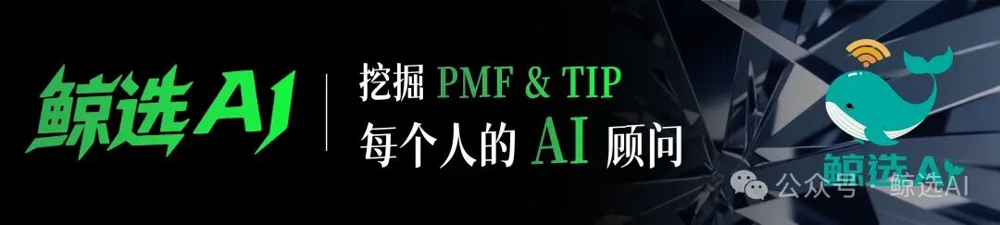
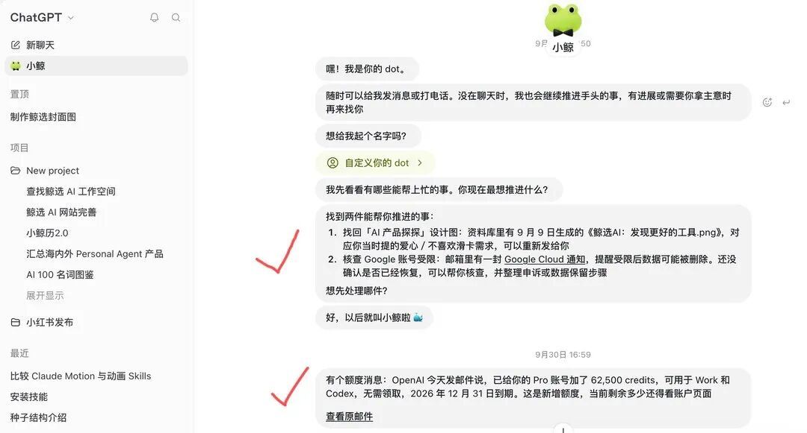
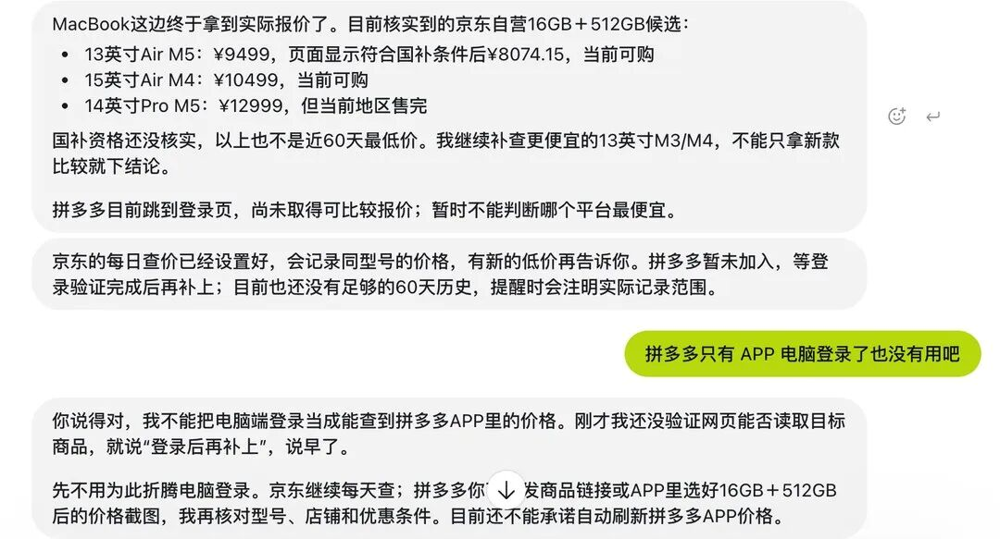
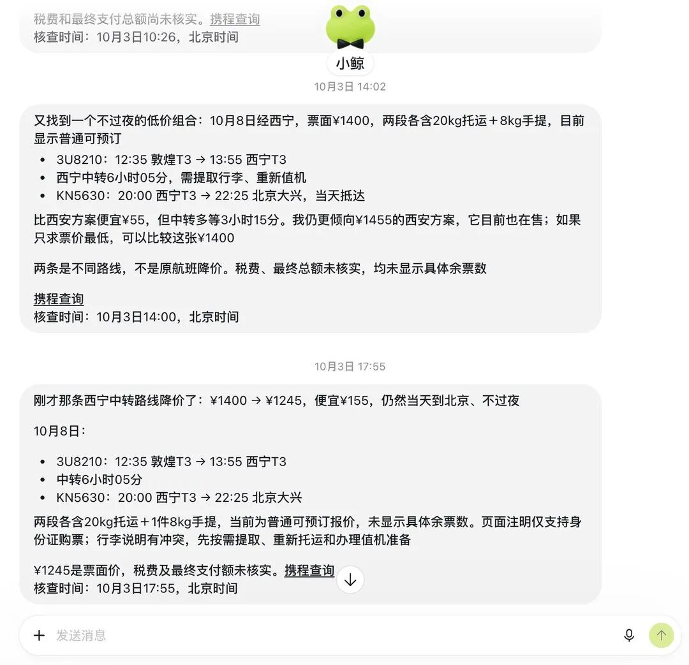
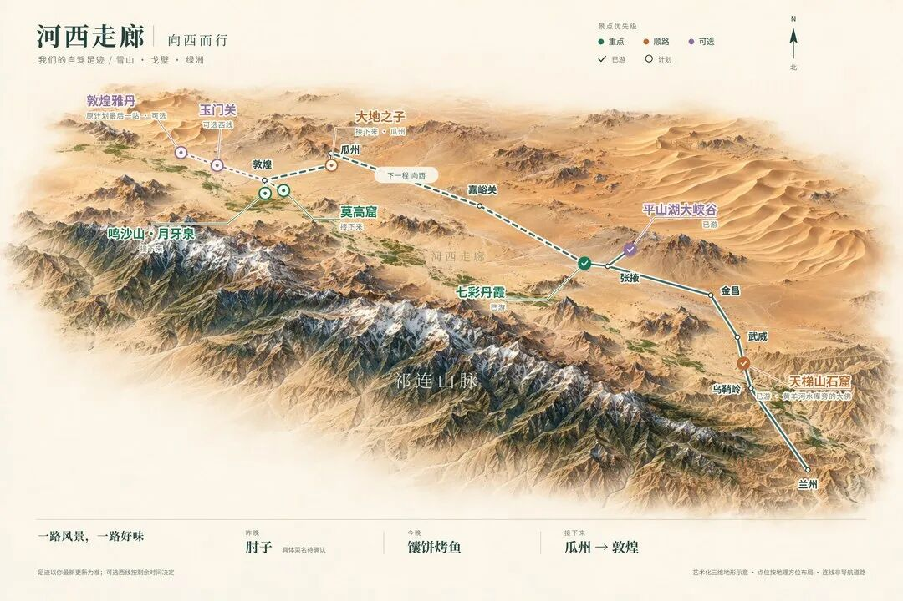
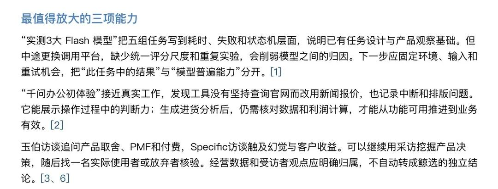
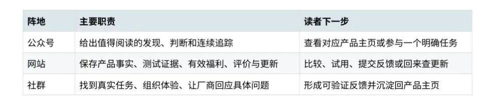
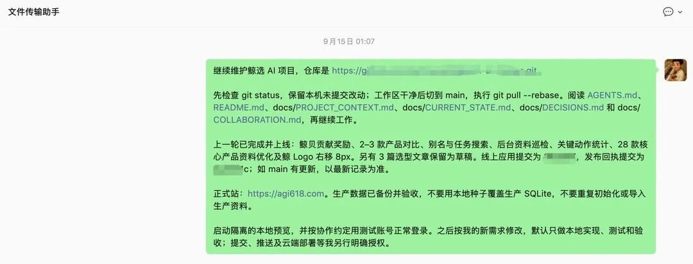
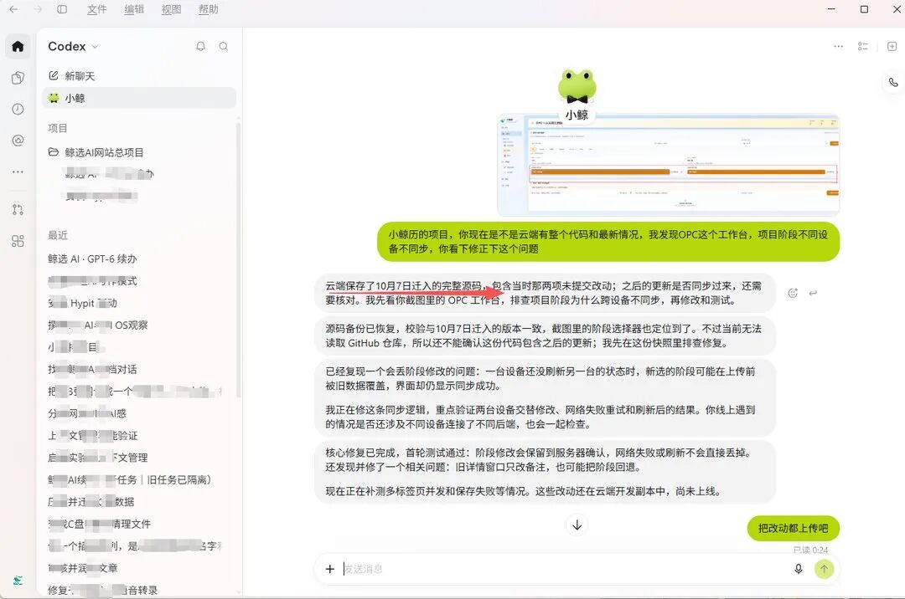



**收录说明**：用户提供链接。原文在微信公众号，用浏览器的客户端标识直接下载页面，从 `#js_content` 抽取正文，图片地址取自 `data-src`。文章主要是 Dots 的实测，用户要求放在行业综合。文末往期推荐未收入。

**内容摘要**：作者在国庆假期期间体验 ChatGPT Dots，授权 Google 系产品读取后，Dots 主动发来待办与邮箱优惠提醒。在比价任务中，它长期监控京东上大内存 Mac 的价格，给出 60 天内波峰波谷的提醒；淘宝被云端浏览器的访问限制拦住，拼多多没有网页端。另一个任务是监控敦煌到北京的机票，作者称当时票价已高达 7000 元以上。作者认为 Dots 在国内水土不服，上下文主要在微信中而难以接入，且云端只有 8G 存储空间。

**保留理由**：作者的一手实测，覆盖价格监控（京东可持续、淘宝与拼多多受限）、机票降价提醒、云端项目同步及 8G 存储上限等具体场景。

---

最近，ChatBot市场又起波澜，借助「Personal Agent」的概念，ChatGPT这些前几年的“老年选手”，被用户付费的意愿又创新高。

最主要的原因，就是ChatGPT推出了Dots这个新品，一时比ChatGPT Work和Codex这些办公 Agent更吸睛；同时，Meta推出Muse让市值大涨 2400 亿美金，Manus说你抄我的Cue，还更早推出，吃了先发红利；豆包桌面端负责人齐俊元离职做的Today AI，不争豆包也要争口气。

国庆假期期间，我也一直在玩ChatGPT Dots，选择ChatGPT Dots作为「Personal Agent」产品代表体验，道理也十分简单。我现在开了CodeX大会员，几乎每天都在用，Dots在用户量这么大的ChatGPT和 Codex上长出来，理应最先进和最成熟。

实际体验下来，我感觉到Dots也很强。Dots具备「Personal Agent」最核心的 3 点特性：

3 个 P：

Personalized：更懂你。会获得你的更全授权，也会逐渐积累了解你的偏好、背景和目标，突破上下文记忆长度限制，越用越懂你。

Proactive：主动性。不必每次等你提问，会主动回答值得关注的事，主动提醒、给出建议。

Persistent：持续性。24 小时云端电脑在线，结束对话和电脑关机都不影响，都会持续运行任务。

简单说，Dots就像记得你所有事情，很主动、贴心的 AI 秘书，而ChatBot一问一答，不问不答，就像是冷漠的 AI 同事。

这个 AI秘书到底如何贴心，follow me就能看明白：

01.

## 主被动获取你的信息，瞬间更懂你

&nbsp;

我在开通 Dots的第一时间，就为它起名小鲸，并用了绿色标识。

我先是给它授权了 Google 系产品的读取权限，尤其让其获取Gmail 的内容。然后它自己读取了ChatGPT过往对话栏里的任务，我在做的产品，我对哪些事情比较关注，它都瞬间明白了。

然后就系统级更新了对我的认知，马上给自己安排了任务。

小鲸主动发来的两条待办与邮箱优惠提醒

它主动发送消息，说自己可以帮助我做两件事：一件事是此前正在做的产品优化，另外一件事 Google 云产品的设置调整，还主动告诉我邮箱中有优惠记得用。

此前为了应对不断出现的 Agent产品，我做了一份自我介绍和使用习惯的Json文件，遇到新产品体验就把文件输入进去，而Dots并不需要，除了需要我授权下，非常丝滑就能上手体验，第一步就带来惊喜，而没有新产品常见的适应期。

02.

## 不只是导购，更是种草和砍价员

&nbsp;

去年 ChatBot掀起过一波AI 买奶茶的热潮，当时体验还不错，AI 能买东西了。

但对于用户来说，很多人最想让AI做的事情，可能是长期监督价格和跨平台比价，最后再一键下单。就像是你的私人专业买手，这才是 AI 带来最大提效的地方。

基于此，我给小鲸直接安排了两个任务，第一个任务是长期监督电商平台上大内存 Mac的价格，包括京东、淘宝和拼多多。

这个任务遇到了比较大的阻碍，淘宝在云端浏览器里被访问限制拦住了，拼多多没有网页端也无法访问。只有京东能一直监控价格，给我60 天内波峰波谷的价格提醒。

京东 16GB+512GB MacBook 每日查价与比价记录

这并不是 Dots这类Personal Agent产品做不到，早期 Muse 等产品也可以监控亚马逊电商，但是很快被电商平台封禁了。

电商平台讨厌第三方 AI，为了演示价格监督这个能力，我们换个旅行平台，让 Dots帮我监控国庆结束时的最低价飞机票。

因为这次国庆去大西北旅游，我没有定最后返程票，7 号那天敦煌飞北京的机票，价格都已经高达 7000 元以上了。

我就让 Dots来监控 7 号和 8 号哪天的飞机票最便宜，并且每天都发我最低价的方案。

小鲸监控敦煌—北京机票降价的两轮方案

可以看到每次降价，小鲸都会发我发消息。当然国内还没打通携程等订票平台，国外是打通了携程国际版 Trip等订票平台，可以实现一键购买。

03.

## 定制化的服务，每次都更贴心

&nbsp;

在这次旅游中，我们也用Dots做了旅游规划。

AI 做旅行规划，ChatBot那些产品就做得很好了。Dots不只是能一直记得你不吃辣，餐饮方案时会避开川菜馆，这么简单的能力。

类似我们这次大西北自驾游，让它根据几个原则做规划：1、大景点多玩，小景点备选；一直顺路，绕路备选，一般停留在城镇住宿；7 天行程要分配好赶路行程，不要每天开车太长时间。

小鲸生成的大西北 7 天自驾规划图

上图就是小鲸给的方案图，他把每种方案用不同的实虚线和颜色标注，根据我们给到的原则做细化图。我此前问的返程票问题，它也融入这张规划图中考虑了。

Dots还适合做一类任务，就是帮大家做发展战略方案。这里让小鲸给“鲸选 AI”，用麦肯锡方法做了个方案分析。

它找了很多内容分析，早些年采访 Youmind创始人玉伯老师的文章，也被挖掘出来了。

小鲸挖掘出的玉伯访谈要点

因为我过去让它操作鲸选AI 网站的生成，以及社群建设探讨，它围绕AI产品这一要点，帮助构建了三位一体的发展战略。

鲸选 AI 三位一体战略分工表

现在AI 做方案比较难分高低，核心就是给的资料多不多，Dots优势就是能拿到ChatGPT和 Codex的交互资料，做方案时考虑得更全面细致一点，而不是我一次次给资料，一遍遍提醒AI别忘了这点、那点。

04.

## 24小时云端开发，随叫随到

&nbsp;

此前我做 Vibe Coding，遇到一个最大的痛点，就是到哪都得带着自己的电脑，不然项目状态不能同步更新。

后来我想了个办法，就是上班前，让家里的 Win电脑给我一段话，讲明白项目Github最新版本以及开发需要注意的事情，然后上班后打开 Mac电脑，把这段话扔进去。

此前用家中 Win 电脑生成的项目交接说明

现在 Dots解决了这个问题，我把“小鲸历”这个项目让它从 CodeX的项目中，挪到小鲸的云端，后续开发就随时开启指令输入，云端会永远保持最新版本。

小鲸在云端核对阶段差异并自动修复

可以看到小鲸说它保存了最新的源码，然后修正了我提交的问题，它就自动更新了。

以前这个项目在我 Mac电脑的 Codex上，想修改就得在 Mac上修改，家里 Win电脑即使同一Codex账号，也看不到最新对话记录，不敢轻易下达指令，怕没有在最新版本上更新。

现在甚至操作手机上的Dots，也能修改云端上的项目了。

当然，Dots的云端只有 8G 存储空间，存不下多少项目。我也是选择了一个比较小的Vibe Coding项目上传。

以上是 Dots的一些典型实用案例，实际使用中还有一些需要适应，比如没有分栏对话的概念，所有问题都在一个对话中不断延伸。

Dots想告诉你的是，它所有事情的都记住了，你最好不用去翻记录，什么都能随时问。因此这个设计在做大项目时并不合适，过长上下文没有任务分区，不利于我们做项目管理和看速度进展。

另外Dots也还没有Intelligent UI能力，甚至回答模板多样性上，其实也是落后豆包和千问等ChatBot产品。

它最大问题是国内水土不服，我们最多Context是在微信中，各种 Agent想接入都会很难。Muse就是因为 Meta有 Facebook、WhatsApp等基础，刚推出来就比较好用，Dots差距就在这里。

可以说，Personal Agent展示了更聪明、更主动的能力，也让 Chatbot焕发第二春，但是想要玩得更爽，还得期待国内个人 Agent产品利用地利优势，做出更强的产品。
