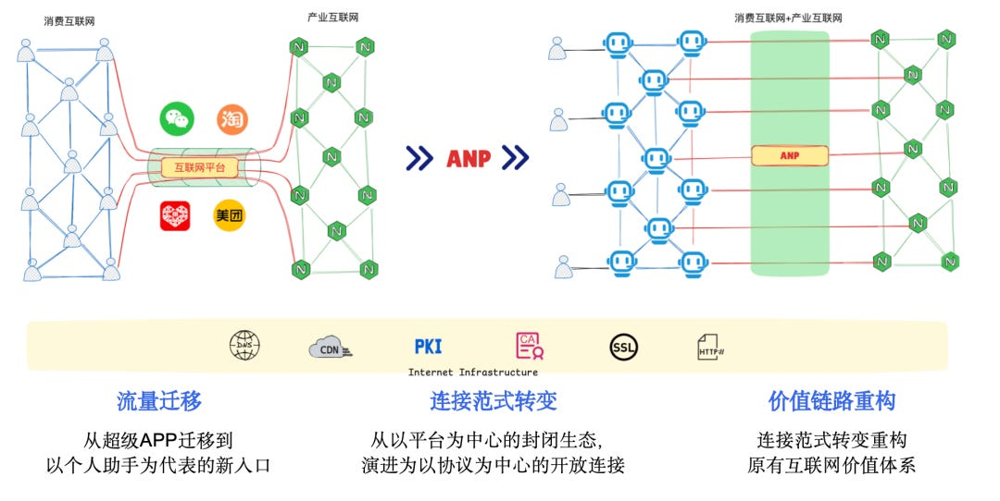



**收录说明**：直接下载。去掉了作者头像与订阅信息；文末协议关系图已本地化。作者为 ANP（Agent Network Protocol）开源社区创始人，文中多次以 ANP 作对照。本轮经 Poppy 1.0 报道回溯发现。作者 10 月 10 日写作时称规范「今天」发布，读的是 11 月 13 日 1.0 之前的版本，所述细节未必与 1.0 一致。原文全文存于本目录的 original.md，网站上不显示，已翻译。

**内容摘要**：作者通读 PAP 规范全文后，以「为下周去纽约出差订曼哈顿酒店、两晚总预算 600 美元以下」为例，分步演示 PAP 如何工作。酒店在官网标准地址 `/.well-known/poppy.json` 发布服务说明文件，Muse 通过搜索引擎找到酒店并读取该文件，再证明客户端身份、建立会话，先以未登录状态查询公开信息。用户在酒店自己的登录与授权页面登录，不把用户名密码交给 Muse，酒店发给 Muse 的是限定范围的访问令牌，授权可撤销；示例中酒店两晚含税总价 560 美元、含早餐、可在入住前一天免费取消。身份方案采用 OAuth 2.0 + CIMD + JWT + DPoP：CIMD 让个人智能体以 HTTPS URL 为标识并发布身份元数据文档，无需预先逐家注册客户端；DPoP 把令牌与智能体持有的私钥绑定，令牌被盗也无法直接使用。授权方案定义 `poppy:read` 与 `poppy:write` 两种默认权限，支持按需授权、可撤销，并把 API、MCP、商家智能体对话与网页操作统一到同一业务会话、同一套权限控制之下；可选的 Operations 扩展为每项具体业务操作生成唯一 ID、管理确认与执行状态。文中把 PAP 与 MCP、A2A、ANP 对比：MCP 解决模型接工具，A2A 解决两个智能体基于任务的交互，ANP 解决任意两个智能体在互联网上的互联，而 PAP 解决个人智能体与代表商家的智能体协作；PAP 目前不定义任意两个个人智能体之间的对等认证与通信。

**保留理由**：已收资料中唯一逐条拆解 PAP 规范技术细节的独立分析，身份（CIMD/DPoP）、授权（按需授权、跨渠道统一会话）与发现机制的说明在官方稿中没有同等深度，是理解协议实现方式的依据。

---

协议是 agent 之间交互——也就是传递上下文、互相调用——最高效的方式。

这是我去年开始做协议方面的演讲以来一直在强调的一句话。随着个人 agent 兴起，协议就更加重要了。

几天前我写了一篇 PAP 的介绍（[Meta 发布 PAP：面向个人 agent 的新协议](https://gaoweichang.substack.com/p/meta-launches-pap-a-new-protocol)）。今天 PAP 规范已经发布。我花了一个上午从头到尾读完，以下是我的拆解。我尽量用平实的语言解释 PAP 的核心设计，以及它与 MCP、A2A 和 ANP 有何不同。

## 有了 PAP 能做什么

先从一个场景说起。

假设我下周要去纽约出差。我打开 Meta 的个人 agent Muse，对它说：

「帮我在纽约曼哈顿订一家酒店，住两晚，总预算 600 美元以内，最好含早餐，可免费取消。」

没有 PAP 的话，Muse 会怎么做？

它可能得像人一样去操作酒店网站，搜索房间、核对价格、填写表单，或者通过商家提供的某个界面完成任务。但商家没有统一的方式去识别这个 agent，也无法确认用户允许它做什么。

更糟的是，如果这家酒店挂在 Amazon 这样的平台上，那个平台可能已经把 Muse 封了。

PAP 想解决的，不只是如何连上商家，而是如何让 agent 在用户授权和商家规则的范围内把事办成。

假设这家酒店已经支持 PAP，整个过程就可以是这样。

**第 0 步：酒店支持 PAP，并发布其服务入口。**

酒店采用 PAP，在其官网的标准地址 `/.well-known/poppy.json` 发布一份面向 agent 的「服务手册」，描述它的服务接口、它的客服 agent，以及它的登录与授权方式。

在此基础上，像 Google 这样的搜索引擎，如果支持识别这类文件，就可以对它发现的 PAP 服务建立索引。

**第 1 步：Muse 通过搜索引擎找到这家酒店。**

Muse 先通过搜索引擎找到位置合适的酒店，然后读取每家酒店的服务手册，了解如何查询房态、获取价格，以及联系酒店的客服 agent。

接着，Muse 向酒店证明自己的客户端身份，并建立一个会话。酒店知道有一个个人 agent 正在访问，可以先让它查询公开信息，而不必立刻要求我登录。

**第 2 步：我授权 Muse，并决定它能做什么。**

查询会员价、读取历史订单或创建预订，都涉及我的账户和我的权限。

Muse 引导我到酒店自己的登录与授权页面。我在酒店的页面上登录，不把用户名和密码交给 Muse，并选择允许它做什么。例如，我可以先只允许它查看会员信息和订单，等到它需要创建或修改预订时，再授予相应的权限。

随后酒店向 Muse 签发一个访问令牌。Muse 得到的是限定范围的访问权，而不是我账户的完全控制权，并且这项授权可以撤销。

**第 3 步：Muse 在授权范围内与酒店交互。**

Muse 可以调用酒店的 API 或 MCP 查询房间，也可以与酒店的客服 agent 协商提前入住之类的特殊请求。必要时，它仍然可以操作网页。

**第 4 步：我确认具体方案，Muse 完成预订。**

Muse 一旦找到合适的房间，就来跟我确认：

「这家酒店两晚含税一共 560 美元，含早餐，可在入住前一天免费取消。要确认预订吗？」

在我授予预订所需的权限并确认之后，Muse 提交订单，通过酒店现有的流程处理付款或担保，最后告诉我结果。

## PAP 解决了什么问题

了解一个协议解决了什么问题，是理解它最简单直接的方式。

MCP 解决模型如何连接工具与资源。A2A 解决两个 agent 默认如何基于任务交互。ANP 解决如何让任意两个 agent 在互联网上互联。

PAP 解决个人 agent 如何与代表商家的 agent 协作。它在个人 agent 与商家之间建立一套标准化的交互机制，使 agent 能在商家许可和用户授权之下完成任务。

PAP 最具特色的地方，除了身份与授权机制，是它把授权延伸到商家的整个交互流程。

## PAP 的 agent 身份方案

继续用订酒店的例子。当 Meta 的 Muse 第一次访问这家酒店时，酒店有一个问题要解决：我怎么知道这个请求真的来自某个特定的个人 agent 客户端，而不是别的程序在冒充它？

PAP 并没有设计一整套新的身份系统。它采用了 CIMD（Client ID Metadata Document，客户端 ID 元数据文档），这是 OAuth 生态中正在标准化的一套方案。这份草案也已被 MCP 采用。

CIMD 解决的问题是：OAuth 客户端每次连接外部服务，都得预先注册一个账户。这大大降低了 agent 的自动化程度，也增加了人类用户必须介入的频率。

CIMD 的思路相当简单：每个个人 agent 客户端都可以用一个 HTTPS URL 作为自己的标识，并在该地址发布一份身份元数据文档。

例如，一个个人 agent 可以使用：

<https://agent.example/agent.json>

这份文档可以包含 agent 的名称、图标、公钥位置、OAuth 回调地址，以及支持的认证方式。

酒店收到这个 client_id 之后，可以从该地址获取元数据，并据此找到公钥。个人 agent 用自己的私钥对认证信息签名。酒店验证签名之后，就能确认请求方持有与该客户端身份相关联的私钥。

整个过程不需要事先交换密码。如果商家支持 CIMD 的动态客户端发现，就可以跳过传统 OAuth 中逐个注册客户端的步骤。当然，商家仍然可以保留白名单，或要求预先注册，来决定允许哪些 agent 连接。

这种做法与 ANP 使用的 W3C did:wba 方法非常相似：两者都是通过 web + HTTPS 分发公钥，再用签名验证身份。区别在于，CIMD 用 URL 作为标识，而 ANP 用 W3C 定义的 DID 作为标识。

以上就是 PAP 的 ID 设计。那么 PAP 如何做身份验证？

它用的是这套技术：OAuth 2.0 + CIMD + JWT + DPoP。

OAuth 2.0 就是我们日常都在用的「用 Google 账户登录」背后的协议。CIMD 上面已经说过。JWT 是一种标准数据格式，用来承载身份、权限等声明。

我想重点讲 DPoP（Demonstrating Proof of Possession，证明持有），这是一种相当有意思的技术。

一个典型的令牌一旦泄露，就可能被攻击者利用。

DPoP 的核心思路是：即使黑客偷到了 agent 的令牌，没有该 agent 的私钥，他们也无法直接用这个令牌访问商家的 API。

DPoP 把一对公私钥与令牌绑定（与 CIMD 的密钥对不同，且会动态更新）。出示令牌时，客户端还必须证明自己持有该令牌对应的私钥。

所以，光是一个泄露的令牌不会直接造成安全问题。

## PAP 身份方案的其他特点

PAP 用 HTTPS URL 作为个人 agent 的客户端标识。同时，它在每个商家那里为每个用户生成一个单独的假名 ID，这样商家无法通过用户标识直接关联一个用户在不同商家之间的行为。这两个 ID 用途不同。

## PAP 身份与 ANP 的 agent 身份对比

PAP 和 MCP 都用 CIMD 做 agent 身份，解决了客户端连接服务时需要预先注册账户的问题。

把 CIMD 与 ANP 使用的 W3C did:wba 相比，两者在底层技术层面是相似的。都建立在通过 web + HTTPS 分发公钥的基础上，这是目前在安全性、可扩展性和灵活性上最好的选择。

区别在于：

• CIMD 与 OAuth 结合得更好，属于 OAuth 生态的一部分，因此行业接受度更高。W3C DID 是相对较新的生态。

• DID 的优势在于它提供了统一的主体身份模型，可用于个人 agent、企业 agent 和其他服务主体，并通过统一的认证协议实现跨平台互操作。

• 相比之下，PAP 目前主要规定个人 agent 与商家之间的交互，尚未定义任意两个个人 agent 之间的对等认证与通信。

• 这是身份模型上的差异：DID 是统一模型，商家和个人都是 DID，每个 DID 都能互操作；而在 PAP 的模型里，个人和商家是不同的角色。

## PAP 的 agent 授权方案

上面几节讲了 PAP 如何解决 agent 认证。但酒店知道来访者是 Meta 的 Muse，并不意味着 Muse 有权查看我的订单，更不用说直接替我订酒店。

这就引出 PAP 设计中另一个非常重要的部分：agent 授权。

PAP 没有重新发明授权协议。它建立在 OAuth 2.0 之上，把用户授权编织进个人 agent 的整个业务流程。我认为有三个有特色的设计点。

**第一，授权与 agent 身份分离，并支持按需授权。**

Muse 可以先在未登录状态下查询酒店的公开信息。当它需要访问我的会员信息或创建订单时，它引导我到酒店自己的页面登录并授权，这样我从不把用户名和密码交给 Muse。

PAP 定义了两种默认权限：`poppy:read` 与 `poppy:write`，商家可以定义更细粒度的权限。Muse 可以先取得读取权限，之后需要修改订单时再申请额外授权。用户也可以撤销授权。

**第二，跨渠道的统一会话与权限管理。**

这是 PAP 授权设计比较独特的地方。

Muse 可能先通过 API 查询订单，再通过 MCP 调用酒店的工具，然后与客服 agent 对话，最后通过网页完成预订。

PAP 把这些交互绑定到同一个业务会话上，并在各渠道间保持一致权限控制。

例如，如果我只允许 Muse 查看订单，那么即使它转而与酒店的客服 agent 交互，也不能绕过权限限制去修改订单。

在安全方面，PAP 也用 DPoP 机制把访问令牌绑定到个人 agent 持有的私钥上，降低令牌被盗的风险。不过并非每个渠道都用 DPoP。例如 MCP 使用的是限定于目标资源的 Bearer Token。

**第三，授权访问账户不等于授权某项具体操作。**

这是另一个值得注意的设计。

即使我授予 Muse 修改订单的权限，也不代表它可以不经确认就直接订下 560 美元的酒店。

PAP 提供了一个可选的 Operations（操作）扩展，为每项具体的业务操作生成唯一 ID，记录该操作的条款与版本，管理确认与执行状态，避免重复下单之类的问题。

不过，目前 Operations 中的确认声明主要由个人 agent 提供，所以商家无法仅凭这份声明独立证明用户确实同意了。

最终，PAP 把 OAuth 授权、跨渠道权限控制和对具体业务操作的确认整合在一起，让个人 agent 能在用户授权和商家接受的规则下完成任务。

与主要解决工具和资源访问授权的 MCP 相比，PAP 把授权管理延伸到个人 agent 与商家交互的整个业务流程。

OAuth 在授权方面相当完善，也被广泛使用。MCP 的授权同样建立在 OAuth 之上。ANP 已有一份合并 OAuth 与 DID 的草案，用来实现 agent 授权方案，ANP 还用 VC（Verifiable Credentials，可验证凭证）来表达 agent 属性。

## PAP 的 agent 发现方案

PAP 使用类似网站发现的机制。商家只需在自己的域名下、标准地址 `/.well-known/poppy.json` 发布一份服务描述文件，告诉个人 agent 它提供哪些服务、支持哪些 API 与 MCP 接口、其业务 agent 的通信地址，以及登录与授权方式。

个人 agent 一旦找到商家的网站，就能自动读取这份文件，发现并调用商家提供的服务。PAP 解决的是已知商家的服务发现，并未定义在全网搜索 agent 的机制，但搜索引擎未来可以索引这些标准文件，让个人 agent 更容易在互联网上发现商家服务。

agent 发现是目前行业共识最广的做法。ANP、A2A、PAP 以及许多其他协议基本都采用域名 + well-known 的方式，未来搜索引擎将能非常容易地搜索 agent 信息。

## PAP 的交互机制

PAP 没有设计全新的 agent 交互协议。它尽可能复用现有的技术标准。它支持四种交互方式：OpenAPI、MCP、网页操作，以及个人 agent 与业务 agent 之间的直接对话。商家可以选择支持哪些方式，个人 agent 则根据商家发布的服务描述挑选合适的接口。

第一种是通过 API 和 MCP 调用商家服务。例如，Muse 可以直接调用酒店的 API 查询房价，或通过 MCP 调用预订工具。这比在浏览器里模拟点击更高效。对于尚未开放这类接口的服务，PAP 仍允许个人 agent 通过浏览器操作网站，并把网页操作绑定到同一个业务会话上。

第二种是 agent 之间的直接对话。PAP 定义了基于 HTTPS 和 JSON 的对话机制，允许个人 agent 与业务 agent 交换文本和结构化数据，并通过事件接口接收回复。对话可以是异步的，也支持流式结果。当 agent 无法自行解决问题时，它可以请商家的真人客服介入，或直接邀请用户加入对话。整个过程中，对话上下文都会保留。

PAP 交互机制最有特色的部分，是不同交互方式可以共享同一个业务会话和授权状态。例如，Muse 先通过 API 查询酒店，再与客服 agent 协商提前入住，最后通过网页完成预订。商家可以把这些操作关联起来，并跨渠道执行一致的权限控制。这也体现了 PAP 的设计理念：它不取代 API、MCP 等现有协议，而是把它们整合进个人 agent 与商家之间完整的业务交互流程。

PAP 的交互机制与 ANP 最为相似：

• PAP 支持 MCP 和 OpenAPI，ANP 支持 MCP、OpenAPI 和 JSON-RPC。两者都把 MCP 视为一种接口。

• PAP 支持让两个 agent 交换自然语言的对话协议。ANP 既有自然语言接口，也有 agent 之间的消息传递机制。

• 在交互模型上，两者都是把信息拉到本地处理，而不是把任务发给远端（即 A2A 的模型）。

• 对方不必是一个 agent，也可以是一个数字系统。

A2A 刚出现时，看到它把任务作为 agent 之间交互的一等概念，我就觉得这种方式不适合 agent 在互联网上交互：如果我把任务交给远端 agent，任务的上下文里可能包含我的私人信息，这可能导致泄露。

话虽如此，PAP 可以描述一个 agent 支持哪些协议，理论上未来可以通过扩展整合更多协议。

PAP 交互机制中的一大创新，是操作网页也能共享业务会话和授权状态。

当然，一些交互问题仍有待解决，比如商家如何通知个人 agent，以及支付如何处理。

## 结语

几点结论与预测：

• 域名将变得很重要。无论什么协议，只要涉及互操作，域名就具有重要的技术角色，随着 agent 的发展，web 会迎来复兴。

• 协议设计的一条普遍原则：建立在 web 与 HTTPS 之上，整合现有协议，而不是重新造轮子。ANP 也更侧重组合；它的协议创新在于交互模型和协议架构。

• 读完一份现成的规范，协议设计看起来很简单，但真正去设计非常难。定义问题、预测未来发展、设计交互架构、选择技术组合，都考验技术能力。

• 不同的协议设计哲学反映不同的产品需求，也反映不同公司如何看待自己在未来生态中的位置。例如，PAP 现阶段不支持个人 agent 之间的横向连接，因为横向连接对它没有好处。

• Meta 的个人 agent 与业务 agent 之间的纵向连接，将直接侵入 Google 和 Amazon 的地盘。Meta 一定会建自己的 agent 搜索，而该协议让个人 agent 可以绕开 Amazon，直接连接商家与商户。这将改变互联网的流量结构。

• 协议仍然是打破封闭互联网围墙的最有力武器。

这是我去年在演讲中经常展示的一张图。它正越来越近。

如果这篇文章对你有用，欢迎给 ANP 仓库点个 star：<https://github.com/agent-network-protocol/AgentNetworkProtocol>
