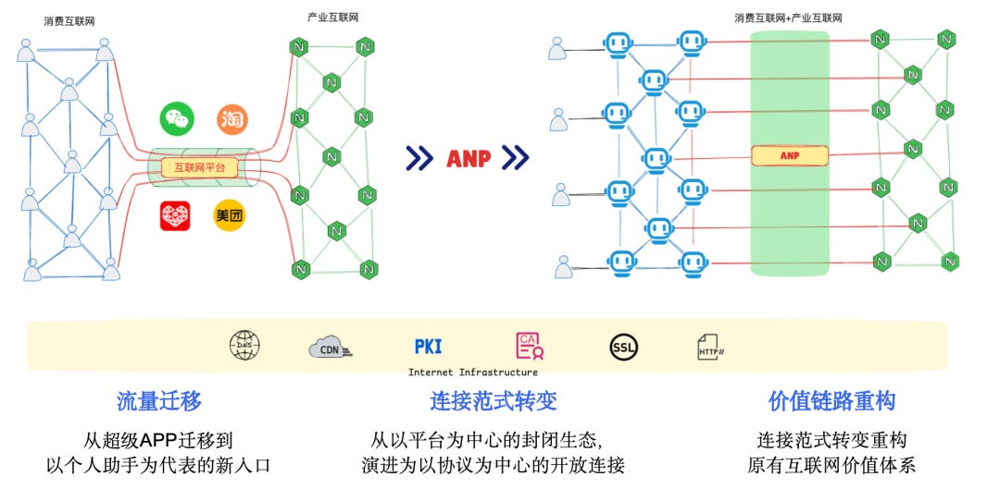

来源：https://gaoweichang.substack.com/p/a-deep-dive-into-metas-new-pap-personal
取文：2026-11-13，直接下载

A protocol is the most efficient way for agents to interact, that is, to pass context and call each other.

It is a line I have been stressing ever since I started giving talks on protocols last year. With the rise of personal agents, protocols matter even more.

A few days ago I wrote an introduction to PAP ([Meta Launches PAP, a New Protocol for Personal Agents](https://gaoweichang.substack.com/p/meta-launches-pap-a-new-protocol)). Today the PAP specification has been released. I spent a morning reading it end to end, and here is my breakdown. I’ll try to explain, in plain language, PAP’s core design and how it differs from MCP, A2A and ANP.

## What Can You Do Once You Have PAP

Let’s start with a scenario.

Say I’m about to travel to New York on business next week. I open Meta’s personal agent, Muse, and tell it:

“Book me a hotel in Manhattan, New York for two nights, total budget under $600, breakfast included if possible, with free cancellation.”

What would Muse do without PAP?

It might have to operate the hotel’s website like a human, searching for rooms, checking prices and filling in forms, or complete the task through an interface the business provides. But the business has no unified way to identify this agent or to confirm what the user has allowed it to do.

Even worse, if the hotel is listed on a platform such as Amazon, that platform may have banned Muse.

What PAP aims to solve is not just how to connect to businesses, but how to let an agent get things done within the bounds of user authorization and business rules.

Suppose this hotel already supports PAP. The whole process can then go like this.

**Step 0: The hotel supports PAP and publishes its service entry point.**

The hotel adopts PAP and publishes, at the standard address /.well-known/poppy.json on its official website, an agent-facing “service manual” that describes its service interfaces, its customer-service agent, and its login and authorization methods.

On top of that, a search engine like Google, if it supports recognizing these files, can index the PAP services it discovers.

**Step 1: Muse finds the hotel through a search engine.**

Muse first finds hotels in the right location through a search engine, then reads each hotel’s service manual to learn how to check room availability, get prices, and contact the hotel’s customer-service agent.

Next, Muse proves its client identity to the hotel and establishes a session. The hotel knows a personal agent is visiting, and can let it query public information first without immediately requiring me to sign in.

**Step 2: I authorize Muse and decide what it can do.**

Looking up member rates, reading past orders or creating a reservation involves my account and my permissions.

Muse guides me to the hotel’s own login and authorization page. I sign in on the hotel’s page without handing my username and password to Muse, and choose what to allow it to do. For example, I can first allow it to view only member information and orders, and grant the corresponding permission only when it needs to create or modify a reservation.

The hotel then issues Muse an access token. What Muse gets is scoped access, not full control of my account, and this authorization can be revoked.

**Step 3: Muse interacts with the hotel within the authorized scope.**

Muse can call the hotel’s API or MCP to look up rooms, and can also negotiate special requests such as early check-in with the hotel’s customer-service agent. When necessary, it can still operate the web pages.

**Step 4: I confirm the specific plan, and Muse completes the booking.**

Once Muse finds a suitable room, it checks with me:

“This hotel costs $560 in total for two nights including tax, breakfast included, and can be cancelled free of charge the day before check-in. Do you want to confirm the booking?”

After I grant the permission needed for booking and confirm, Muse submits the order, handles payment or a guarantee through the hotel’s existing process, and finally tells me the result.

## What Problem Does PAP Solve

Knowing what problem a protocol solves is the simplest and most direct way to understand it.

MCP solves how a model connects to tools and resources. A2A solves how two agents interact by default on the basis of tasks. ANP solves how to let any two agents interconnect on the internet.

PAP solves how a personal agent collaborates with agents that represent businesses. It establishes a standardized interaction mechanism between personal agents and businesses, so that agents can complete tasks with business approval and user authorization.

What is most distinctive about PAP is, besides its identity and authorization mechanisms, that it extends authorization to a business’s entire interaction flow.

## PAP’s Agent Identity Scheme

Let’s continue with the hotel booking example. When Meta’s Muse visits the hotel for the first time, the hotel has a problem to solve: how do I know this request really comes from a given personal agent client and not from some other program impersonating it?

PAP did not design a whole new identity system. It adopts CIMD (Client ID Metadata Document), a scheme being standardized in the OAuth ecosystem. This draft has also been adopted by MCP.

The problem CIMD solves is that an OAuth client has to register an account in advance every time it connects to an external service. That greatly reduces how automated an agent can be and increases how often a human user has to step in.

The idea behind CIMD is fairly simple: every personal agent client can use an HTTPS URL as its identifier and publish an identity metadata document at that address.

For example, a personal agent could use:

<https://agent.example/agent.json>

This document can contain the agent’s name, icon, public key location, OAuth callback address, and supported authentication methods.

After receiving this client\_id, the hotel can fetch the metadata from that address and use it to find the public key. The personal agent signs its authentication information with its own private key. Once the hotel verifies the signature, it can confirm that the requester holds the private key associated with that client identity.

The whole process requires no password exchange in advance. If a business supports CIMD’s dynamic client discovery, it can skip the traditional OAuth step of registering clients one by one. Of course, businesses can still keep allowlists or require pre-registration to decide which agents may connect.

This approach is very similar to the W3C did:wba method that ANP uses: both distribute public keys over web + HTTPS and then verify identity with signatures. The difference is that CIMD uses a URL as the identifier, while ANP uses a W3C-defined DID as the identifier.

That covers how PAP’s ID is designed. How does PAP do identity verification?

It uses this set of technologies: OAuth 2.0 + CIMD + JWT + DPoP.

OAuth 2.0 is the protocol behind signing in with a Google account, which we all use regularly. CIMD was described above. JWT is a standard data format for carrying claims such as identity and permissions.

I want to focus on DPoP (Demonstrating Proof of Possession), which is a rather interesting technique.

A typical token, if leaked, can be exploited by attackers.

The core idea of DPoP: even if a hacker steals an agent’s token, without the agent’s private key they cannot use that token to access the business’s API directly.

DPoP binds a public-private key pair to the token (different from the CIMD key pair, and updated dynamically). When the token is presented, the client must also prove it holds the private key for that token.

So a leaked token alone does not cause a direct security problem.

## Other Features of PAP Identity

PAP uses an HTTPS URL as a personal agent’s client identifier. At the same time, it generates a separate pseudonymous ID for each user at each business, so businesses cannot directly correlate a user’s behavior across businesses through a user identifier. These two IDs serve different purposes.

## Comparing PAP’s Identity with ANP’s Agent Identity

PAP and MCP both use CIMD for agent identity, solving the problem of pre-registering an account when a client connects to a service.

Comparing CIMD with the W3C did:wba used by ANP, they are similar at the underlying technical level. Both are built on distributing public keys over web + HTTPS, which is currently the best option for security, scalability and flexibility.

The differences are:

• CIMD fits better with OAuth and is part of the OAuth ecosystem, so industry acceptance is higher. W3C DID is a relatively new ecosystem.

• DID’s advantage is that it offers a unified subject identity model that can be used for personal agents, enterprise agents and other service subjects, and enables cross-platform interoperability through a unified authentication protocol.

• By comparison, PAP currently mainly specifies the interaction between personal agents and businesses, and does not yet define peer authentication and communication between any two personal agents.

• This is a difference in identity model: DID is a unified model, where businesses and individuals are all DIDs and every DID can interoperate, whereas in PAP’s model, individuals and businesses are different roles.

## PAP’s Agent Authorization Scheme

The sections above covered how PAP solves agent authentication. But the hotel knowing that the visitor is Meta’s Muse does not mean Muse has the right to view my orders, let alone book a hotel for me directly.

This brings us to another very important part of PAP’s design: agent authorization.

PAP does not reinvent an authorization protocol. It builds on OAuth 2.0 and ties user authorization into the whole business flow of a personal agent. I think there are three distinctive design points.

**First, authorization is separated from agent identity and supports on-demand authorization.**

Muse can first look up the hotel’s public information while signed out. When it needs to access my member information or create an order, it guides me to the hotel’s own page to sign in and authorize, so I never hand my username and password to Muse.

PAP defines two default kinds of permissions, poppy:read and poppy:write, and businesses can define finer-grained permissions. Muse can first obtain read permission and later request additional authorization when it needs to modify an order. Users can also revoke authorization.

**Second, unified sessions and permission management across channels.**

This is where PAP’s authorization design is rather unique.

Muse might first query orders through an API, then call the hotel’s tools through MCP, then talk with the customer-service agent, and finally complete the booking through the web page.

PAP ties these interactions to the same business session and keeps permission control consistent across channels.

For example, if I only allow Muse to view orders, then even if it switches to interacting with the hotel’s customer-service agent, it cannot bypass the permission limit to modify an order.

On the security side, PAP also uses the DPoP mechanism to bind the access token to a private key held by the personal agent, lowering the risk of token theft. However, not every channel uses DPoP. MCP, for example, uses a Bearer Token restricted to the target resource.

**Third, authorizing access to an account is not the same as authorizing a specific operation.**

This is another design worth noting.

Even if I grant Muse permission to modify orders, that does not mean it can book a $560 hotel directly without confirmation.

PAP provides an optional Operations extension that creates a unique ID for each specific business operation, records the operation’s terms and version, and manages confirmation and execution status, avoiding problems such as duplicate orders.

That said, at present the confirmation statement in Operations is mainly supplied by the personal agent, so a business cannot independently prove from that statement alone that the user really agreed.

In the end, PAP integrates OAuth authorization, cross-channel permission control and confirmation of specific business operations, so that a personal agent can complete tasks under user authorization and rules the business accepts.

Compared with MCP, which mainly addresses authorization for access to tools and resources, PAP extends authorization management to the entire business flow of a personal agent’s interaction with a business.

OAuth is quite comprehensive on authorization and is widely used. MCP also builds its authorization on OAuth. ANP already has a draft that merges OAuth and DID to implement an agent authorization scheme, and ANP also uses VC (Verifiable Credentials) to express agent attributes.

## PAP’s Agent Discovery Scheme

PAP uses a mechanism similar to website discovery. A business only needs to publish a service description file at the standard address /.well-known/poppy.json under its own domain, telling personal agents which services it offers, which API and MCP interfaces it supports, the communication address of its business agent, and its login and authorization methods.

Once a personal agent finds a business’s website, it can automatically read this file and discover and call the services the business provides. PAP solves service discovery for known businesses and does not define a mechanism for searching agents across the whole web, but search engines can in future index these standard files, making it easier for personal agents to discover business services on the internet.

Agent discovery is currently the approach with the broadest industry consensus. ANP, A2A, PAP and many other protocols basically all use the domain + well-known approach, and in future search engines will be able to search for agent information very easily.

## PAP’s Interaction Mechanism

PAP did not design a whole new agent interaction protocol. It reuses existing technical standards wherever possible. It supports four ways of interacting: OpenAPI, MCP, web page operation, and direct conversation between a personal agent and a business agent. A business can choose which ones to support, and the personal agent picks a suitable interface based on the service description the business publishes.

The first is calling business services through APIs and MCP. For example, Muse can call the hotel’s API directly to check room prices, or call a booking tool through MCP. This is more efficient than simulating clicks in a browser. For services that have not opened up such interfaces, PAP still allows the personal agent to operate the website through a browser, and ties the web operations to the same business session.

The second is direct conversation between agents. PAP defines a conversation mechanism based on HTTPS and JSON, allowing a personal agent and a business agent to exchange text and structured data and receive replies through an event interface. Conversations can be asynchronous and also support streaming results. When an agent cannot solve a problem on its own, it can ask a human customer-service representative at the business to step in, or invite the user to join the conversation directly. Throughout the process, the conversation context is preserved.

The most distinctive part of PAP’s interaction mechanism is that different interaction methods can share the business session and the authorization state. For example, Muse first queries the hotel through an API, then negotiates early check-in with the customer-service agent, and finally completes the booking through the web page. The business can link these operations together and enforce consistent permission control across channels. This also reflects PAP’s design philosophy: it does not replace existing protocols such as APIs and MCP, but integrates them into the complete business interaction flow between a personal agent and a business.

PAP’s interaction mechanism is the most similar to ANP’s:

• PAP supports MCP and OpenAPI, and ANP supports MCP, OpenAPI and JSON-RPC. Both treat MCP as one kind of interface.

• PAP supports a conversation protocol that lets two agents exchange natural language. ANP has natural language interfaces as well as a messaging mechanism between agents.

• In terms of interaction model, both pull information to the local side for processing, rather than sending a task to the remote side (the A2A model).

• The other side is not required to be an agent; it can be a digital system.

When A2A first came out, seeing it make the task the first-class concept for interaction between agents, I felt this approach was not suited to agents interacting on the internet: if I hand a task to a remote agent, the task’s context may contain my private information, which could leak it.

That said, PAP can describe the protocols an agent supports, and in theory it could integrate many more protocols through extensions in the future.

A major innovation in PAP’s interaction mechanism is that operating web pages can also share the business session and authorization state.

Of course, some interaction problems remain to be solved, such as how a business notifies a personal agent and how payment is handled.

## In Closing

A few takeaways and predictions:

• Domain names will matter a lot. Whatever the protocol, anything involving interoperability gives domains an important technical role, and the web will see a revival as agents develop.

• A general principle of protocol design: build on the web and HTTPS and integrate existing protocols rather than reinventing the wheel. ANP is also more about combining; its protocol innovation lies in the interaction model and the protocol architecture.

• Protocol design looks simple once you’ve read an existing spec, but actually designing one is very hard. Defining the problem, predicting future developments, designing the interaction architecture and choosing the combination of technologies all test one’s technical ability.

• Different protocol design philosophies reflect different product needs, and also reflect how different companies envision their own position in the future ecosystem. For example, PAP at this stage does not support horizontal connection between personal agents, because horizontal connection does not benefit it.

• The vertical connection between Meta’s personal agents and business agents will directly invade the home turf of Google and Amazon. Meta will certainly build its own agent search, and the protocol lets personal agents bypass Amazon and connect directly to businesses and merchants. This will change the traffic structure of the internet.

• Protocols remain the greatest weapon for breaking down the walls of the closed internet.

This is a diagram I often showed in my talks last year. It is getting closer and closer.

If this piece is useful, please star the ANP repository: <https://github.com/agent-network-protocol/AgentNetworkProtocol>
