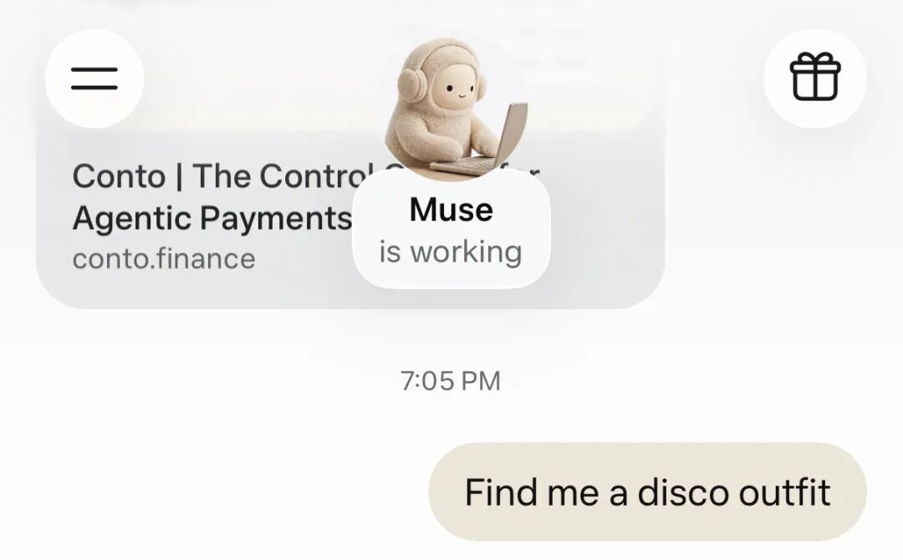
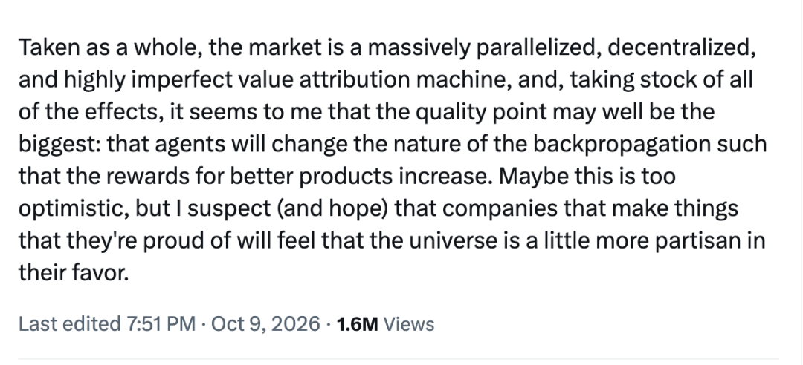



**收录说明**：用户提供链接。原文在微信公众号，用浏览器的客户端标识直接下载页面，从 `#js_content` 抽取正文，图片地址取自 `data-src`。文末开发者社群推广与二维码未收入，其后的「数据来源」一行照录。

**内容摘要**：文章认为，Muse、Manus Cue、OpenAI dots 等海外 Personal Agent 正在争夺用户入口，而中国几乎没有大厂跟进。文中对比显示：2025 年，中国网上零售额 15.97 万亿元，约合 2.2 万亿美元，是美国的 180%；但中国四家头部软件公司收入合计约 39 亿美元，不到美国七家头部软件公司最新财年收入合计约 5,090 亿美元的 1%。作者认为，Agent 减少用户停留会削弱平台的广告与流量变现，而用户又不习惯为此付费，2025 年底豆包手机助手尝试跨 App 替人办事后即遭部分平台限制。

**保留理由**：作者通过中美电商与头部软件收入的对比，提出 Agent 与平台流量商业模式相冲突的论点，并在文末列出了数据来源。

---

01

一场中国没有跟的入口之争

过去一个月，硅谷几家最大的科技公司在抢同一样东西：做你的私人管家。

Meta 发布个人智能体 Muse，上线 10 天就冲上美区 App Store 免费榜第一。紧接着，Manus 推出 Cue，OpenAI 推出 dots。它们不陪你聊天，只替你办事：回邮件、排日程、比价下单。你关掉 App，它们还在云端接着干。

这件事的分量，远不止多了几个 AI 产品。

过去二十年，互联网公司争的是你每天打开哪个 App。Personal Agent 争的是另一件事：你还需不需要亲自打开 App。谁成了你的 Agent，谁就站到了所有 App 的前面。

这是一场入口之争，而中国几乎没有跟。

国内也有 Agent。千问能在阿里生态里点外卖、订机票，腾讯的 WorkBuddy 在职场里也火了一把。但前者只在自家生态里办事，后者只管上班。像 Muse 那样属于你自己、能在不同平台之间穿行的私人管家，国内几乎没有大厂在做。

这很反常。中国有全球领先的移动支付、半小时送达的外卖、最密集的电商。一个替你跑腿的 Agent，最该在中国长出来。

问题出在哪？

02

180% 与 1%：Agent 的账，算不进中国互联网的生意

先看中美互联网经济的两组数字。

**交易层：**2025 年，中国网上零售额 15.97 万亿元，约合 2.2 万亿美元；美国约 1.23 万亿美元。中国是美国的 180%。

**工具层：**美国七家头部软件公司（微软、Oracle、Salesforce、Adobe、Intuit、ServiceNow、Workday）最新财年收入合计约 5,090 亿美元；中国四家头部软件公司（用友、金蝶、广联达、金山办公）合计约 39 亿美元，不到美国的 1%。微软不到五天的收入，就抵得上这四家一整年。

买东西 180%，买工具 1%

网上零售额（2025）

中国　2.2 万亿美元

美国　1.23 万亿美元

头部软件公司年收入（最新财年）

美国七家　5,090 亿美元

中国四家　39 亿美元

注：人民币按 1 美元约 7.2 元折算；美国公司收入含全球，只算本土差距仍有几十倍。

中国人愿意在网上花钱买东西，却不太愿意花钱买“替我干活”。

这道断层背后，是两种不同的收钱方式。

美国互联网在广告之外，还有一门大生意：卖效率。企业和个人直接为软件付费，按人头、按月、按用量计费。

中国互联网最成功的生意是卖流量。用户免费使用，平台把你的注意力和交易卖给商家，换回广告费和佣金。你刷信息流，平台卖广告；你逛首页，平台卖推荐位。平台收入的源头，是你的停留。

Personal Agent 正好卡在这道断层里。

它本质上是一个“卖效率”的产品：你不用再打开 App、刷信息流、比价格，它直接把事办完。在美国，这正是用户愿意付费的东西，Agent 可以按订阅收钱。在中国，它的价值恰恰是平台的损失。

过去，平台靠用户停留赚钱。现在，Agent 靠减少用户停留创造价值。

Agent 替你办的事越多，平台能卖的流量就越少，而用户又不习惯为此付费，这部分损失没人补。2025 年底，豆包手机助手尝试模拟点击、跨 App 替人办事，很快就遭到部分平台限制。这背后的逻辑，首先是经济上的。

还有一笔成本账。Agent 完成一个复杂任务，要多轮调用模型、反复使用工具，成本是一次聊天的几十倍。美国用户每月为 AI 付 20 到 200 美元，这笔钱有人出；中国大模型打完价格战，免费成了标配。没人付钱，Agent 只能走老路，靠广告和导流养活自己。

所以，中国不缺做 Agent 的技术。最有能力做它的公司，恰恰最不愿意把用户的代理权交出去。

03

中国会有 Agent，但它首先是谁的 Agent？

中国的 Personal Agent，大概率会以两种形态出现。

第一种，超级 App 里的平台 Agent。

这条路已经有人在走。千问接入淘宝、支付宝、闪购、飞猪和高德之后，一句话就能点外卖、订机票，在对话里直接付款，全程不出阿里的门。

它可能非常好用，闭环里能办成的事，甚至比不少海外 Agent 还多。但它是平台派来的店员，不是你雇来的管家。店员可以热情、高效、贴心，但当隔壁店更便宜时，它会告诉你吗？

第二种，手机厂商的系统级 Agent。

华为、荣耀、小米、OPPO 握着另一张牌：系统权限。在手机上，只有操作系统能跨 App 看、跨 App 点，它们最有可能成为连接各个平台的那个中间人。

但豆包手机助手的遭遇已经说明，技术上做得到，不等于平台会放行。豆包背后的字节跳动，自己就是超级 App 的主人，照样被拦在别人门外。

更可能的结局，是手机厂商和超级 App 坐下来谈：一方提供入口和系统能力，一方开放有限的接口，流量、数据和佣金各分多少，一项项写进协议。

中国的 Personal Agent，很可能是在一张张商业协议里拼出来的。

04

乐观一点，然后是一个问题

Stripe 的 CEO Patrick Collison 提出过一个乐观的设想：Personal Agent 会让普通人第一次拥有过去只有企业才负担得起的信息处理能力，可以持续找优惠、逐条查条款、认真比商品。市场也会因此更奖励好产品。

放到中国，这个设想格外诱人。这里有最充分的供给、最激烈的竞争，也有大量被流量和坑位埋没的好商家。如果 Agent 真的按质量、价格和服务来选，排序不再看谁付的推广费多，好产品终于有机会浮出水面。

但商业竞争不会停止。过去，商家花钱争夺你的注意力；未来，商家会转而争夺 Agent 的推荐。广告不会消失，只会从你的屏幕，搬进 Agent 的决策过程。

过去，你至少还能看到哪些位置标着“广告”。未来，当 Agent 说“这是最适合你的”，你可能根本不知道背后有没有一笔商业合作。

经济学家赫伯特·西蒙说，人的理性是有限的。过去，消费者的理性受限于自己的信息和计算能力。未来，它还可能受限于 Agent 能看见的世界，以及 Agent 背后的利益关系。

一个只看得见一座城墙的 Agent，算得再快，也算不到墙外那家更好的店。

当计算能力不断扩张，谁来决定理性的边界？

在 Personal Agent 真正走进每个中国人的手机之前，这也许是我们最该先想清楚的问题。

数据来源：国家统计局 2025 年网上零售数据；美国人口普查局 2025 年电商数据；微软、Oracle、Salesforce、Adobe、Intuit、ServiceNow、Workday 最新财年财报；用友、金蝶、广联达、金山办公 2025 年年报。人民币按 1 美元约 7.2 元折算。
