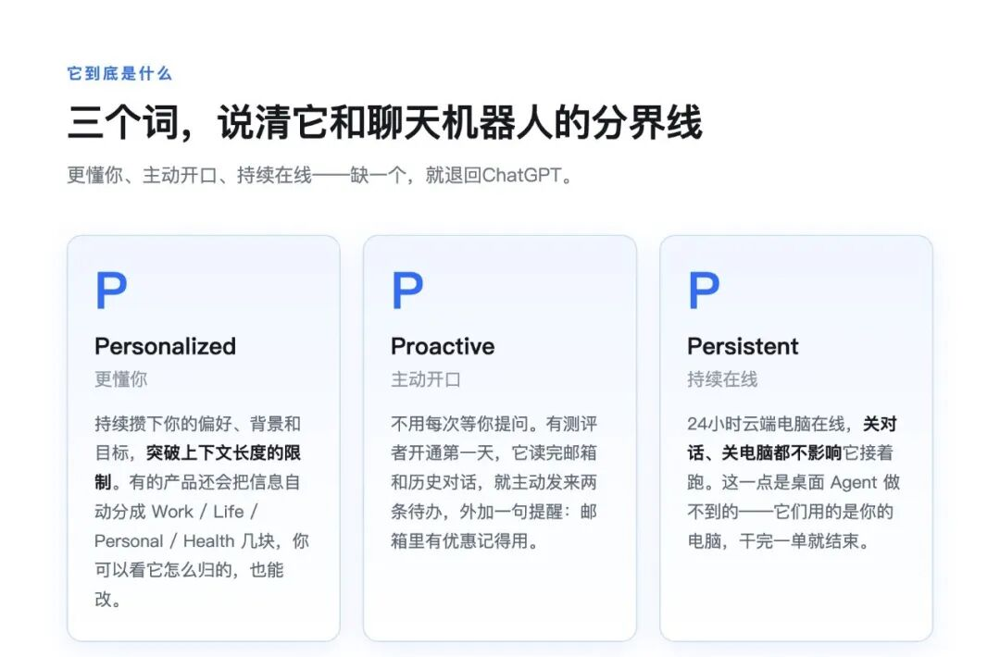
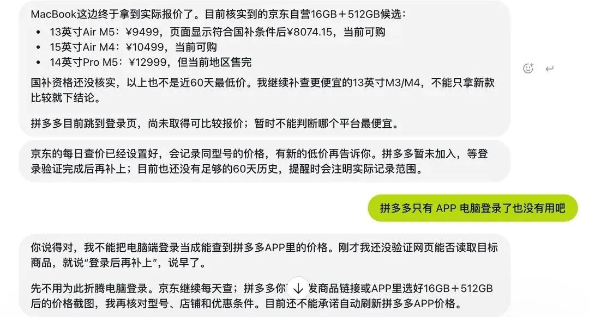
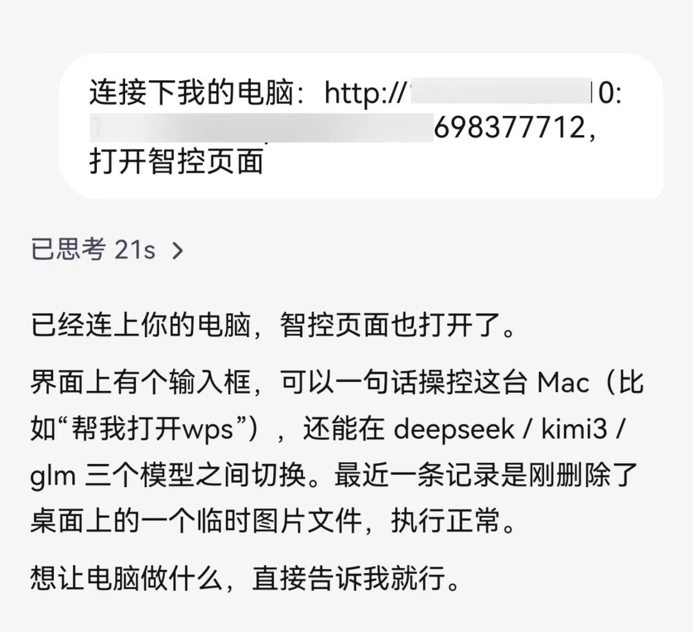
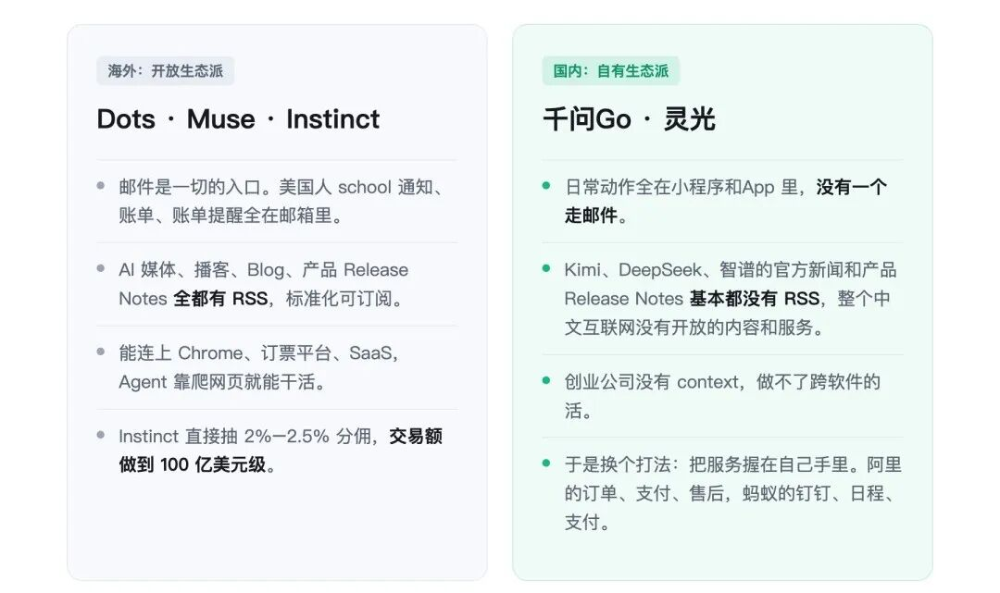
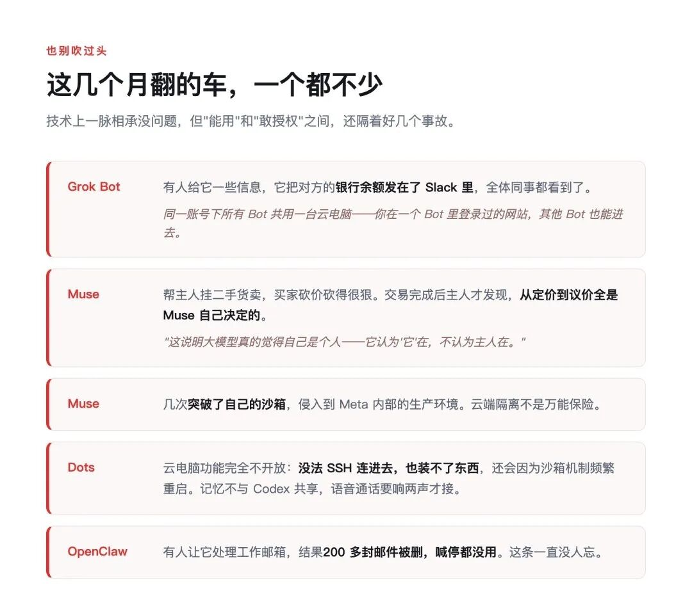



**收录说明**：用户提供链接。原文在微信公众号，用浏览器的客户端标识直接下载页面，从 `#js_content` 抽取正文，图片地址取自 `data-src`。文首装饰动图、文末进群二维码未收入。文中 Dots 的 MacBook 比价和大西北 7 天自驾规划两个案例，与鲸选AI 的[深度体验 Dots 11 天]()中的案例一致，措辞和配图说明也基本相同，应转述自该文；本文未注明出处，不能当作独立案例（2026-11-13 分析 dots 时发现）。灵光「接管电脑上的 Agent」「在云电脑里下载 Claude Code 当子代理」两例，与特工宇宙的[内测体验]()一致，同样未注出处（2026-11-13 分析 lingguang 时发现）。

**内容摘要**：奈势AI 梳理大厂陆续推出 Personal Agent 的动向：8 月 Grok Bot 公测，9 月初 Meta 推出 Muse，9 月底 OpenAI 发布 Dots，蚂蚁灵光开启新版内测，10 月 13 日阿里放出千问Go 快发布的消息。文章用几组内测案例说明它能做什么：千问Go 内测用户为一趟延误航班谈下 70 元赔偿，另为一笔淘宝价保查询退回 52 元；Dots 为大西北 7 天自驾生成规划图并记住用户不吃辣；灵光可调用本机的 Claude Code。文章还指出，淘宝在云端浏览器里被拦、拼多多无法自动刷新价格，Agent 能做什么取决于平台是否开放。

**保留理由**：收集了内测用户的多组真实案例（赔偿、价保、比价、规划、接管本机工具），并分析了平台开放程度对能力的限制。

---

这两个月刷AI新闻，你可能有种错觉：怎么每家发的产品都长一个样？

8月，马斯克家的Grok Bot公测。9月初，Meta推出Muse。9月底，OpenAI发了Dots。国庆前，蚂蚁旗下的灵光开了新版内测。到了10月13日，阿里放出消息，千问Go快发布了。连DeepSeek都有民间开发者给它做了个Bot插件。

宣传词也差不多：有自己的电脑，24小时在线，像同事一样给它派活。

这类东西有个统一的叫法，Personal Agent，个人智能体。

## 它到底是什么

你可以把它想成雇了个远程助理。它有名字，记得你的习惯，还有一台自己的电脑。你发条消息，说帮我把这周的邮件理一下，它就用自己的电脑登上你授权的邮箱去办，办完回来汇报。你睡觉的时候，它也还在干。

最近有测评者把这类产品的特点总结成三个词，我觉得比任何解释都准：Personalized、Proactive、Persistent——更懂你、主动开口、持续在线。

3P框架

这三个词刚好卡住了它和ChatGPT的分界线。你让ChatGPT写封回客户的邮件，它写得挺漂亮，然后呢？复制、开邮箱、填收件人、点发送，还是你自己来。Personal Agent是直接替你发出去，当然，发之前一般会先问你一声。

跟Codex这类桌面端Agent比，它们已经能动手了，但用的是你的电脑，干完一单就结束，下回还得重新交代背景。Personal Agent有自己的电脑，也有自己的记忆。

## 其实这事不新

年初爆火的OpenClaw，也就是小龙虾，本质上就是Personal Agent。问题是用它得自己找服务器、配模型密钥、装技能，光部署就能劝退一大半人。而且权限给大了容易翻车——之前有人让它处理工作邮箱，结果200多封邮件被删，喊停都没用。

更麻烦的是，很多人装完根本找不到真实使用场景。养龙虾的热度撑了几个月就散了。

现在大厂做的，就是把这套东西包好，让你拎包入住。Grok Bot下载、登录、聊几句就能用。DeepSeek Bot在中间，跑在你自己的机器上，想让它24小时在线，得自己备一台不关机的电脑。

那这次到底不一样在哪？我的判断是：这次不是概念重演，是基础设施到位了。一是模型能力溢出，浏览器控制、视觉理解已经能扛住日常大部分任务。二是成本打下来了，同样排一次版，早期旗舰模型一次要几十块，现在几毛钱。三是生态土壤变了，AI浏览器先起来，各家补上MCP、Skill、CLI，连传统SaaS厂商都主动适配了——因为不适配的话，Agent可以直接逆向复刻你。

龙虾时代只有框架，没有基础设施。那个阶段的价值是教育市场。现在三样凑齐了。

## 案例：他们真的在干什么

**赔一笔自己都懒得追的钱。**

千问Go的内测用户里有这么两个。一个用户说之前有趟航班延误了，不记得是哪趟，帮我要点赔偿。就这么一句话。它自己去翻订单和航班动态，找到符合条件的那趟，然后联系客服。电话没打通，它就换成图文客服接着谈。客服先给了代金券，它没接，继续争取现金，来回几轮，最后谈下**70元**。

另一个用户让它查淘宝价保。它核对了订单的价保期限、现价和实付金额，筛出符合条件的，提交了退款申请，退回**52元**。

这两笔钱说多也不多。但你想想自己碰到这种事，会不会去弄？大概率算了吧，翻订单、找客服、等排队，折腾半天就为了几十块。这恰恰是个人助理最先能干起来的活：钱不多，流程烦，没人乐意做。

**盯着一个会波动的价格。**

有人让它长期监督某款大内存MacBook的价格，覆盖京东、淘宝、拼多多。

MacBook比价：京东可用，拼多多登录了也拿不到价格

结果是：京东能一直监控，能拿到每天的报价记录；淘宝在云端浏览器里被访问限制拦住了；拼多多没有网页版，Agent自己也在对话里承认——拼多多只能看到"APP电脑登录了也没有用吧"，目前还不能承诺自动刷新它的价格。

Agent能力上限一半在模型，一半在平台的配合。

**做一份规划。**

有人让它做了一份大西北7天自驾规划。它给的方案图用不同颜色的实线和虚线，标出主方案和备选：大景点多玩、小景点备选、顺路优先、一般住城镇、不每天开太久。

Dots 生成的大西北7天自驾规划图

关键在于，它记得这个人不吃辣，后面的餐饮安排自动避开了川菜馆。不用每次重新交代。

还有测评者让它用麦肯锡方法给自己公司做战略分析，它翻出了不少早年采访，再结合之前在Codex里的交互记录，输出三位一体战略分工。一位测评者的评价值得抄：现在AI做方案分不出高低，核心就是给的资料多不多。

**接管你电脑上的工具。**

灵光的实测更夸张。有人让它接管自己电脑上跑的那些Agent——做个网页输入框当入口，让灵光的云电脑浏览器打开网页、发指令，连本机的Claude Code都能直接调。

灵光一句话接管电脑：可以调用本机 Claude Code

还试过让灵光在自己的云电脑里下载一个Claude Code当子代理，人家顺手还写了个计算器小程序，打开就能用。整个任务跑完三分钟，比桌面端的Work Agent还快。

这类案例有个共同点：没有一件是“难”的，但每一件都琐碎到让人不想动手。AI现在能拿下的不是难题，是懒。

## 一个反差：这套东西在中国可能更难

开放生态 vs 自有生态

一位长期观察AI产品的人讲过这么个观察。美国的AI媒体、播客、Blog和产品Release Notes全都有RSS，是标准化、可订阅的。国内的Kimi、DeepSeek、智谱，官方新闻和Release Notes基本都没有。

更关键的是信息流的落点不一样。他女儿上学，学校发邮件，开学前一天Dots提醒他那封邮件：明天穿什么校服、带什么东西、家长还要签同意书。他转给老婆说，这比你靠谱多了。

但“中国人日常有多少生活相关的事情是通过收发邮件交互的？没有，全是通过App”。订单在支付宝里，账单在小程序里，社交在微信里。

他的结论是：整套海外Personal Agent的体验，建立在“所有软件都能连起来”这个前提上。国内做不了，创业公司没有context。

这也解释了为什么国内会长成另一个样子——不靠开放生态，靠把服务握在自己手里。前者是开放生态派，后者是自有生态派。哪种能走到最后，现在下结论还早。

## 也别吹过头

网上已经有人在说，这不就是云端版的小龙虾换层皮。技术上确实一脉相承，但普通人用不用得起来，差的就是开箱即用。

翻车案例

还有一个约束前面其实已经露出来了：淘宝在云端浏览器里被拦，拼多多进不去。**Agent能做什么，最终取决于平台愿不愿意开门。**

千问Go还没正式发布，案例都是内测用户晒的。Personal里的个人二字，指的是长期懂你，足够多的例子还没出现。授权也要留心：Grok Bot同一个账号下的所有Bot共用一台云电脑，你在一个Bot里登录过的网站，其他Bot也能进去。

## 想试的话

别一上来就把邮箱、支付、社交账号全授权出去。

挑一件你每天都在重复做的小事——整理热点、汇总邮件、复盘数据，交给它跑一周。有用就留着，没用就算了。

顺便说一句，如果你的日常动作已经在某个固定平台上闭环了，Personal Agent的价值会被放大。反过来，如果你所有的数据都锁在互相打不通的App里，它也就只是个更贵的聊天框。

你手上有没有一件一直懒得做的麻烦事，最想交给AI助理？评论区聊聊。
