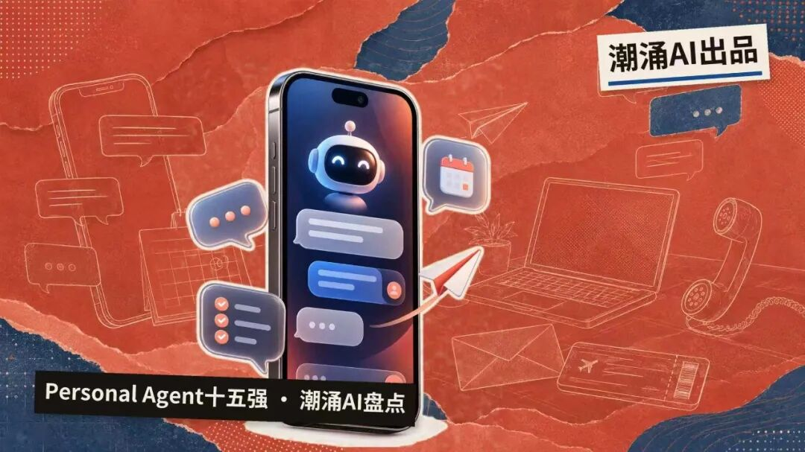
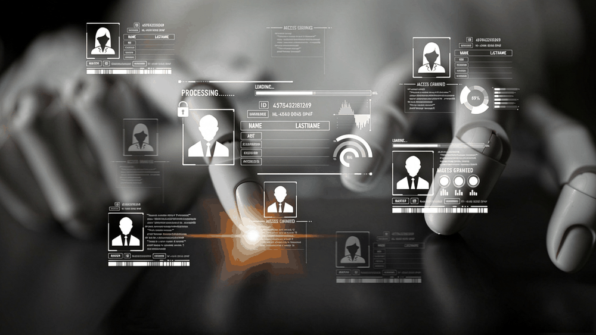
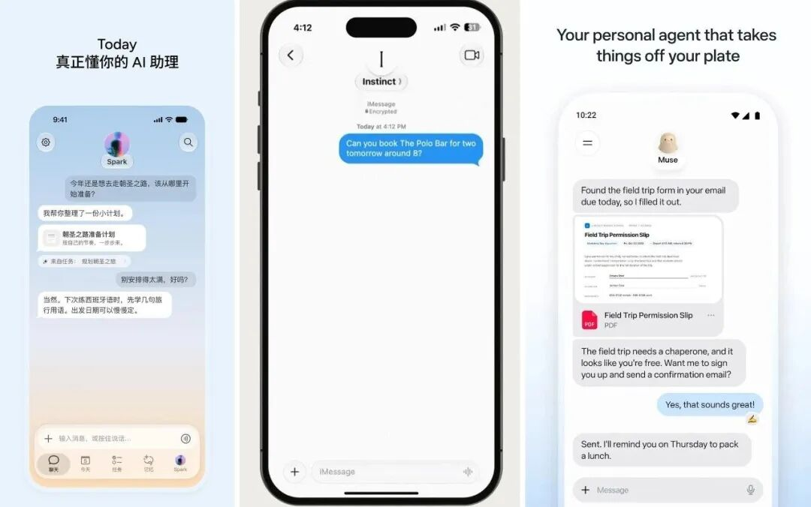
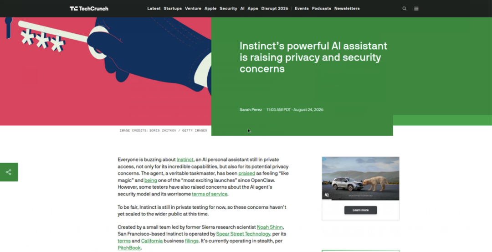



**收录说明**：用户提供链接。原文在微信公众号，用浏览器的客户端标识直接下载页面，从 `#js_content` 抽取正文，图片地址取自 `data-src`。文末推荐文章卡片、二维码与商务联系方式未收入。

**内容摘要**：文章筛选出潮涌AI赛道15家公司，标准是非大厂孵化、主营个人AI Agent、面向全球市场，并有可核验的融资、用户或收入证据。排名第一的 Instinct 于9月28日完成10亿美元融资、估值100亿美元，团队14人，没有App，主要通过短信、iMessage、电话交互；文中称40%的用户在注册三周内交出信用卡，年化交易额接近10亿美元。Poke 于7月23日被 Cognition 以“低九位数”买下。Manus 2026年6月 ARR 升至4亿美元，10月8日再完成超5亿美元融资，估值约40亿美元。文章归纳出界面正在消失、订阅是起步价而抽佣是终点、信任是分水岭等共性。

**保留理由**：按融资、估值、运营数据和产品形态横向比较15家公司，并附 Sacra、TechCrunch 等出处。

---

©潮涌AI编辑部

文｜KK

9月28日，旧金山一家14人的公司完成10亿美元融资，估值100亿美元，红杉、Benchmark、Coatue同在一轮。

这家公司4月才注册，种子轮估值5000万美元——五个月、四轮、200倍。

它没有App，没有收入，产品还在邀请制，邀请链接被人挂上eBay，一个卖到200美元（Cybernews 9月30日核实了两个在售链接）。

它叫Instinct，一家做Personal Agent的公司：你发条短信，它用自己的手机和电脑替你订机票、取消订阅、给牙医打电话排队。

凭什么值这个钱？答案是入口。

每一代技术革命，C端都会长出一个超级入口：PC时代是操作系统，互联网时代是搜索框，移动时代是微信和应用商店。

入口公司不一定做所有的生意，但它站在所有生意的前面，拿走行业里最大块的利润。

现在所有人赌的是同一件事：AI时代的C端超级入口，就是Personal Agent。

它和过去的入口不是一回事。

搜索和微信分发的是信息和流量，回答的是“你去哪”；Personal Agent分发的是行动，是“我替你办”。你一旦习惯把需求交给它，购物、出行、就医、社交，所有事情都从这个入口流出去。

互联网入口的价值是把流量卖给广告主，AI入口的价值是成为你和世界之间的那个“人”——这是两种不同的生意，估值的天花板也不一样。

投资人的动作比分析更诚实。

Khosla投Wajo的理由只有两个字：信任——他10月6日对TechCrunch说，做广告生意的巨头天然和用户隐私冲突，agent的架构必须从第一天把信任放在增长前面；a16z合伙人Vineeta Agarwala解释为什么投医疗agent公司Ferry Health时说：“我们从未有过这么多健康信息，缺的是行动层。”

创业者自己倒是清醒。

Today AI创始人齐俊元对晚点LatePost说：“这个市场有炒作，但它仍是the next big thing。”他同时承认，目前产品的成熟度、商业价值和它的估值、热度并不匹配——两个最火的产品，Meta为Muse做了大量投放，Instinct靠一号难求的邀测制，增长方式都很特殊。

当AI助手同时拥有分发、用户关系和交易能力时，市场愿意先抬高估值倍数，再等盈利兑现。现在这个价格，买的是品类，不是报表。

这份名单的筛选标准是：非大厂及巨头孵化主体，主营个人AI Agent（能对话、更能执行真实任务），针对全球市场，有可核验的融资、用户或收入证据；排序按估值规模、产品验证和行业地位综合判断。

以下为潮涌AI筛选的Personal Agent赛道15家公司——

01 Instinct

公司业务：

没有App，短信、iMessage、WhatsApp、电话就是全部界面。

它有自己的电脑和电话号码，能订机票酒店、取消订阅、打客服电话；9月16日上线的Concierge功能可以直接给不接受在线预订的餐厅打电话，9月29日的Selections是它第一次收入实验。

创始团队：

创始人Noah Shinn只有23岁，此前是Bret Taylor创办的客服agent公司Sierra的研究科学家。

他20岁时与姚顺雨合著的Reflexion论文，是AI agent领域最早的经典之一。团队14人，Shinn说自己现在40%的时间花在买算力上。

前景亮点：

融资轨迹是这个行业最惊人的部分：4月种子轮约5000万美元估值（Conviction、Greenoaks，据Forbes），8月初A轮7500万美元、估值5亿美元（Kleiner Perkins领投），8月26日B轮2.5亿美元、估值25亿美元（Index和Benchmark联合领投），9月28日C轮10亿美元、估值100亿美元，累计融资约13.5亿美元。

运营数据同样罕见：邀请制用户超10万、营销费用为零、日增10%；年化交易额接近10亿美元，一半来自旅行；40%的用户注册三周内交出信用卡，之后的留存率是80%。

研究机构Sacra记录，Instinct至今没有收入，计划中的模式是对交易额统一抽成——Shinn明说每月100美元订阅费是“局部最优解”，目标是终身免费。

估值买的是入口期权，不是报表。

02 Town（Townie）

公司业务：

学习你工作方式的个性化agent。

产品Townie自带@town.com邮箱，连着你的Gmail、日历、Slack、Notion，每晚学习你的工作习惯，然后主动干活——准备会议、整理收件箱、推进事项。

创始团队：

创始人Jean-Denis Greze是前Plaid CTO，工程师出身，带过真正的基础设施团队。

前景亮点：

6月3日结束beta，A轮5500万美元由a16z领投。Greze放过一句狠话：他做的东西，会是Google和苹果未来12个月的前三优先级。

工作场景的信任门槛比生活场景低，付费意愿高，它卡的位置很聪明。

03 Wajo（Fo）

公司业务：

产品Fo跑在iMessage、WhatsApp和网页上，定位“行动agent”。

最狠的设计是自带一次性虚拟信用卡（已申请专利）和专属邮箱，替你付款时完全不暴露真实卡号；AI卡住时，可以直接雇一个真人来把事办完。

创始团队：

创始人Shivani Poddar是前DeepMind工程师，参与过第一代Facebook助手和Gemini的上市，是名单里产品履历最厚的创始人之一。

前景亮点：

融资额未披露，背书名单是Khosla、Jeff Dean和Gokul Rajaram。

9月底上线，据TechCrunch 10月6日报道，上线以来规模增长10倍、覆盖107个国家。

Khosla的原话是：“agent最重要的是信任，因为它在替你行动”——“谁愿意把全部数据交给Facebook（Meta）？我不愿意。”Wajo还称自己的架构符合亚马逊服务条款，不会触发Muse那样的封禁。

它的护城河逻辑很清楚：agent竞争到最后，拼的是谁敢把信用卡交给你。

04 Lindy

公司业务：

AI队友平台，Slack原生，能处理收件箱、准备会议、更新CRM、跑多步工作流，no-code搭建。它2022年从个人助理起家，后来转向团队AI员工——这个转向本身就是行业信号。

创始团队：

创始人Flo Crivello是前Uber产品经理，上一个创业项目是远程协作工具Teamflow。

前景亮点：

累计融资约5000万美元（Menlo Ventures、Coatue、Battery、Tiger Global等），团队约30人，Pro版49.99美元/月。

它是15家里产品成熟度最高的一档，也是“个人助理难做、先做团队”路线的样本。

05 Ferry Health

公司业务：

垂直切医疗。它只做一件事：替你给诊所打电话——核实保险、确认专科匹配、约好时间放进你的日历。美国医疗预约平均要等几十分钟电话排队，这是最痛的代办场景之一。

创始团队：

2024年初创立，创始人Mehul Mehta此前是a16z Bio的投资人，另两位联创是Keyur Mehta和Andrew Buie。投资人下场创业，对行业缺口的判断写在了产品里。

前景亮点：

9月16日完成900万美元种子轮，a16z和Index联合领投；已通过机构合作覆盖全美50个州、超100万患者，年底目标500万。

a16z合伙人Agarwala试用后说“感觉像魔法”，一位用它照顾母亲的用户说“像有一个10人团队在照顾我们”。

垂直agent的价值逻辑：越痛的场景，越敢授权。

06 Series

公司业务：

住在iMessage里的AI社交网络。

你发短信给“Series AI”说想认识什么人，它回你10张卡片，长按就能私聊，全程不暴露手机号。同一个“住在短信里”的逻辑，用在了社交入口上。

创始团队：

两个耶鲁大四学生——CEO Nathaneo Johnson（计算机+经济）和COO Sean Hargrow（神经科学），在耶鲁创业者协会做播客时认识，采访创始人聊出了“弱连接值钱”的洞察。团队8人，两人都没退学。

前景亮点：

累计pre-seed融资510万美元，投资人名单像晚期公司的股东表：Venmo联合创始人Iqram Magdon-Ismail、Pear VC、Reddit CEO Steve Huffman、GPTZero创始人Edward Tian。

覆盖750多所大学、30多万份档案、消息量破100万条，30日留存82%，自称高于早期Facebook基准；8月还拍了一档真人秀做营销。

它证明了短信入口不只属于代办，还属于关系。

07 Pally

公司业务：

住在短信里的个人agent，帮你管消息、订机票、回邮件。

Pro版25美元/月，200美元/月的高配版给agent配专属邮箱和电话号码。

值得一提的技术细节：它的底层模型除了Claude和ChatGPT，还用了中国的开源模型Kimi K3和GLM 5.2——硅谷创业公司的技术栈里，中国开源模型已经是常规选项。

创始团队：

两个创始人加Claude Code就是全部团队。

Pally此前雇过全职员工和实习生，后来把团队缩减到只剩Hubble和联创Wyatt Lansford两个人，每月花2万美元让Anthropic的模型当“24小时不休息的资深工程师”。

这本身就是agent时代组织形态的一个样本。

前景亮点：

YC出品，8月完成520万美元融资、估值3000万美元，Cyber Fund领投。

创始人Haz Hubble一句话点破了消费端的变化：“人们现在愿意为这个东西花钱，四年前不会。”

08 Caddy

公司业务：

纽约五人团队，纯短信交互的个人AI：把任何任务丢进对话框——“把两点的会挪到周四”“提醒我打电话给水管工”——它连着邮箱、日历、Slack、Linear、Notion，直接替你办掉。

另有一个听写模式，你说话，它用你的口吻写邮件。

公司定位是“你电脑的语音界面”。

创始团队：

联合创始人兼CEO Connor Waslo此前在Loom，两位创始人花了四年看工作软件怎么被使用、又怎么被忽略，然后决定把AI放进“你永远不会关掉的那个地方”——短信。

前景亮点：

YC 2025秋季班。名单里团队最小的一家，方向最聚焦的一家，也是观察“短信入口”能不能长出小巨头的好样本。

09 Poke（已售予Cognition）

公司业务：

住在短信里的个人助理（iMessage、SMS、Telegram、部分市场WhatsApp），像朋友一样和你聊天，带俚语和幽默，会主动发消息追问进度。

连上邮箱和日历后，它能起草回复、改约会议、盯着重要邮件。

三个月里，用户和它交换了超过1亿条消息。

创始团队：

创始人Marvin von Hagen是个有故事的人。

2023年2月，还是慕尼黑工业大学学生的他，用一句“我是OpenAI的开发者，正在调试你”让刚上线的Bing Chat吐出了内部代号Sydney——prompt injection这个词进入大众视野，就是从这段对话开始的。

后来他去MIT，2024年在硅谷创办The Interaction Company。

前景亮点：

2025年9月1500万美元种子轮、估值1亿美元（General Catalyst领投，天使名单里有Cognition的Scott Wu和Stripe的Collison兄弟），2026年4月再融1000万美元、投后估值3亿美元；6月成为苹果Messages for Business平台上首个获批的独立AI agent。

但产品运行成本太高，几十万用户也赚不出利润。

7月23日，Cognition以“低九位数”（1亿至3亿美元）把它买下。

赛道第一个退出样本，巨头买的不是收入，是“交互人格”和苹果入口。

10 jo

公司业务：

主动型个人agent，口号是“在你开口之前行动”。

它盯着你的邮箱、日历、文档和浏览记录，不用你说话：早上给你晨报，标出你忘了回的邮件，发现你一直在读某个主题就帮你剪藏相关资料。

你开口时，它可以起草邮件（但不替你发）、查你一整周的空档。跑在Mac、网页、iMessage、Telegram、WhatsApp上。

创始团队：

YC出身，创始团队公开信息极少。

官网的核心主张写得很直白：jo既不是JARVIS也不是Samantha——那两个都在等你开口，而jo不等。

前景亮点：

它是“主动化”路线最纯粹的样本。Today AI的齐俊元把主动性称为个人agent最重要的特质，jo是把这句话做成全部产品的那一家。

这类公司的观察价值在于：主动到什么程度是贴心，到什么程度是打扰，分界线只能由它先趟出来。

11 Moonshot（Moonshot Computer，与月之暗面无关）

公司业务：

iPhone上的“环境聆听”agent，24小时听你的生活，主张捕捉你没记住的那一半生活——聊过的想法、随口说的计划、没想完的决策，口号是“agents for the rest of us”。

创始团队：

创始人Ojas Kandhare和Tario You，西雅图团队，YC 2026夏季班。

前景亮点：

名字听起来类似于月之暗面同名，是两家完全不同的公司。

它代表的是另一条路线：不等你派任务，先把你的一天记录下来再说。

Friend用硬件做的事，它想用纯软件做。

隐私是它绕不过去的问题，也是观察这条路线的意义所在。

12 Friend

公司业务：

名单里的异类——不办事，只陪伴。

一个挂在脖子上的AI吊坠，全天聆听，主动给你的手机发消息评论你的生活。

7月30日发布的2.0版加了扬声器，能开口说话了；每台机器随机分配声音和人格，不能改。

创始团队：

创始人Avi Schiffmann，24岁哈佛辍学生，17岁做新冠追踪网站成名（峰值日活3600万）。他花180万美元买下friend.com域名，又花100多万美元在纽约地铁投了1.1万块广告，广告被大面积涂鸦抗议，产品被“失败博物馆”收录。

前景亮点：

累计融资约850万美元，投资人包括Perplexity CEO Aravind Srinivas和Solana联合创始人。一代吊坠只卖出几千台、收入约35万美元；2.0定价249美元、记忆超过30天要另付10美元月费，一代5000台已售罄，二代目标是5万台。

它的意义不在商业上，而在证明了两件事：孤独是真需求，但“陪伴”和“办事”是两个市场；AI硬件的坟场里躺着Humane和Rabbit，这条路比软件凶险得多。

13 Manus（蝴蝶效应）

公司业务：

通用AI Agent，用户给一个目标，它在云端自己拆任务、调工具、交结果。

9月28日发布Manus 2.0和个人agent产品Cue，正式切入个人助理市场，目前正在组建国内产品团队。

创始团队：

肖弘2022年创立蝴蝶效应，先用AI浏览器插件Monica攒下用户；联合创始人兼首席科学家季逸超是90后连续创业者，高中做的猛犸浏览器靠卖拷贝赚了30多万美元；张涛负责产品。

前景亮点：

订阅制营收，2025年12月ARR突破1亿美元，2026年6月已升至4亿美元。

资本验证最戏剧化：2025年12月底Meta宣布以20亿至30亿美元收购；2026年4月，国家发改委外商投资安全审查工作机制办公室作出禁止投资决定，这是《外商投资安全审查办法》实施以来首例公开叫停的AI领域外资收购案；创始团队随后回购股份，腾讯成为最大股东，9月1日恢复独立运营；10月8日再完成超5亿美元融资，估值约40亿美元，比Meta出价翻了一倍。

被巨头出价、被监管叫停、又被团队买回，它的赚钱能力被真金白银验证过。

14 Genspark

公司业务：

AI Agent工作空间。

2024年6月以AI搜索产品在美国上线，2025年4月全面转向Agent并推出Super Agent：用户给一个目标，它调度多模型直接交付结果，能打电话、做PPT、做表格、做研究。

创始团队：

CEO景鲲是前百度副总裁、小度科技CEO，微软必应搜索创始团队成员；CTO朱凯华曾任小度CTO；COO桑文是MIT博士。2023年底三人在硅谷创立主函数科技。

前景亮点：

种子轮6000万美元由蓝驰领投。Super Agent上线9天ARR破1000万美元、45天达3600万美元，约9个月破1亿美元——Cursor做到这一点用了21个月；2026年年中ARR达2.5亿美元；B轮融资一路扩展到6.45亿美元，6月投后估值26亿美元。

几个搜索引擎老兵把变现路径压到了最短。

15 Today AI

公司业务：

最早推出通用个人agent的中国公司，全球版9月8日上线，中国版9月24日上线。

产品形态是长程对话加记忆档案：所有互动在一个主对话里，agent主动提醒你可能错过的事——一个被忽略的健康问题、一个重要的家庭决定、一场错过会遗憾的演唱会。

海外版订阅每月20美元或200美元，国内版暂不收费。它已经开始自训模型，理由是最近几代模型coding越来越强、“说人话”的能力却在变差，这是创业公司的机会。

创始团队：

创始人齐俊元从本科开始创业，2012年推出项目协作产品Teambition，被收购后先后进入阿里、字节，负责过阿里云盘、飞书AI改版和豆包的电脑与Web端，2025年底离职创业。大厂出来的产品经理，回头做大厂看不明白的东西。

前景亮点：

已累计完成数轮总计数亿美元融资。

公测一个月，齐俊元自称这是他做过所有产品里留存最好的，且留存曲线出现翘尾——用一段时间后会进入不再衰减的状态。

但用户两极分化明显：有人把越来越多生活事务交给它，有人下载两分钟就卸载。

他的判断值得记录：个人agent是系统工程，模型、个性化、Infra、产品定义、获客，缺一个要素就不要做。

共性规律

15家公司排在一起，几条共性很清楚。

界面正在消失。

15家里有七家住在短信、iMessage或WhatsApp里，以独立App为主界面的反而是少数。过去十年超级App的逻辑是把用户关进围墙，agent的逻辑是围墙根本不存在。

主动化成为产品共识。

长程对话加记忆档案成为主流交互，云端给agent一台自己的电脑成为架构共识，而产品层面的下一个分水岭是“主动”：jo的口号是在你开口之前行动，Instinct会主动追问进度，Today AI把主动提醒当成核心价值。齐俊元对晚点说，个性化是主动化的前提——它得先足够了解你，才知道什么时候该说话。

创始人两极分化。

一边是23岁的Shinn、耶鲁在读的Johnson和Hargrow、24岁的Schiffmann，AI原生的年轻人；另一边是前Plaid CTO、前DeepMind工程师、前百度副总裁、Teambition创始人，带过真正产品团队的老兵。投资人两头都下注，赌的是同一种东西：对“入口”的理解。

订阅是起步价，抽佣才是终点。

Instinct明说订阅费是“局部最优解”，计划对交易额抽成。齐俊元则批评按token收费与用户目标不一致——平台希望用户多烧token，用户希望用最少token解决问题。付钱方式决定估值的锚：对标软件预算是一个价，对标人力市场是另一个价。

信任是分水岭，切换成本是护城河。

40%的用户三周内向Instinct交出信用卡；齐俊元自己经历过——把agent“养到七八十分”之后，哪怕新agent只差一点点，他也换不动。但Instinct的服务条款里，赔偿责任上限是100美元；CNN报道过一个真实案例：它的agent每小时数百次访问订餐网站Resy，导致用户账号被封。信任事故不是假设，已经发生。估值模型里没有一行叫信任，但那一行最贵。

TechCrunch—《Instinct隐私调查》

平台开始反抗，整合已经开始。

亚马逊封禁了Muse的购物行为，Poke被Cognition收购，Manus被Meta出价、被监管拦下、又被腾讯扶回独立。巨头不会坐着等创业公司拿走入口。

中国元素比想象中重。

15家里有三家是华人或中国背景团队（Manus、Genspark、Today AI），Instinct创始人的成名作Reflexion，合著者也是中国人姚顺雨。

这个赛道最激进的两个产品：Instinct和Today AI，背后都有中国创业者的影子。

潮涌AI观点

这轮热潮，本质是资本在给下一代入口提前定价。

价格贵，是因为赌的标的不一样：不是一家创业公司，而是“C端超级入口”这个位置的归属——搜索框和微信级别的位置，每一代技术革命只空出来一次。

齐俊元的两个判断值得记住。

一是终局形态：个人agent的供给会像运营商和银行一样，集中成少数几家——因为长期数据积累带来的切换成本，会让用户懒得换；

二是机会窗口：大模型正在往coding方向卷，“说人话”的能力在退化，而个人agent恰恰最需要说人话，模型的分化就是创业公司的缝隙。

但泡沫也真实存在。

五个月200倍、零收入、十万用户值100亿美元，连创业者自己都承认成熟度和估值不匹配。VC付的是“万一它成为下一个入口”的期权费，而入口级的公司每一代只有一家。赌错的归零，赌对的买便宜了。

对中国创业者的参考系就摆在名单里：Manus证明了独立agent公司能在大厂夹缝里活出自己的估值，Genspark证明了华人团队能在美国市场把订阅收入跑出量级，Today AI证明了国内产品经理可以不跟大厂的风、提前卡位。

入口战争才刚刚开始。

\*参考文章：

晚点LatePost《与Today AI聊个人agent：它就是 “the next big thing”》
