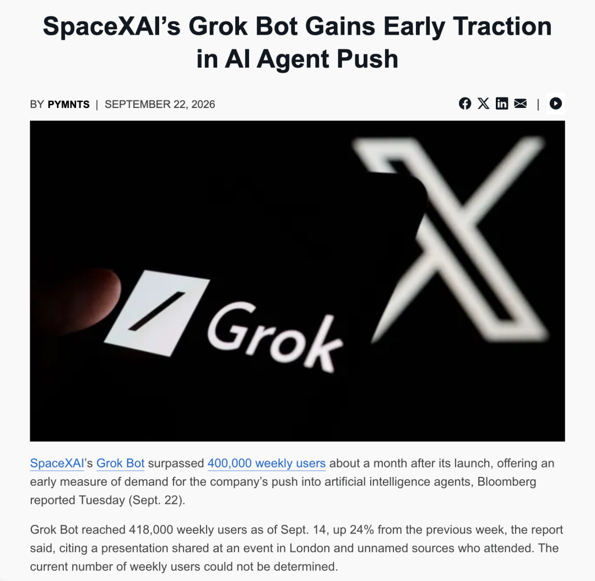
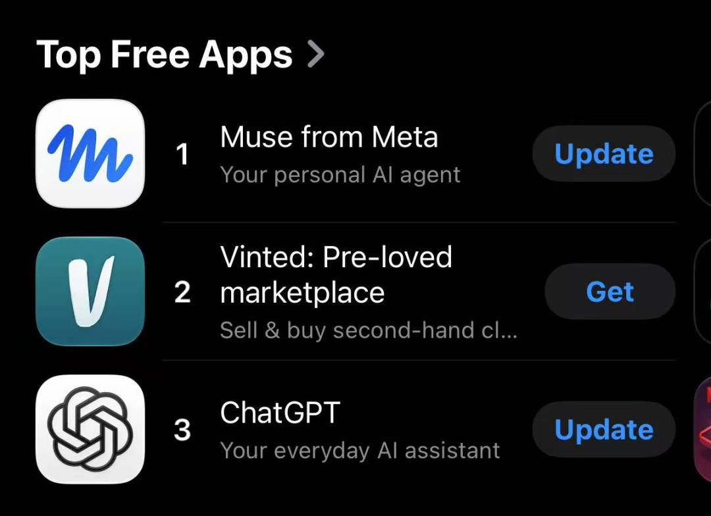
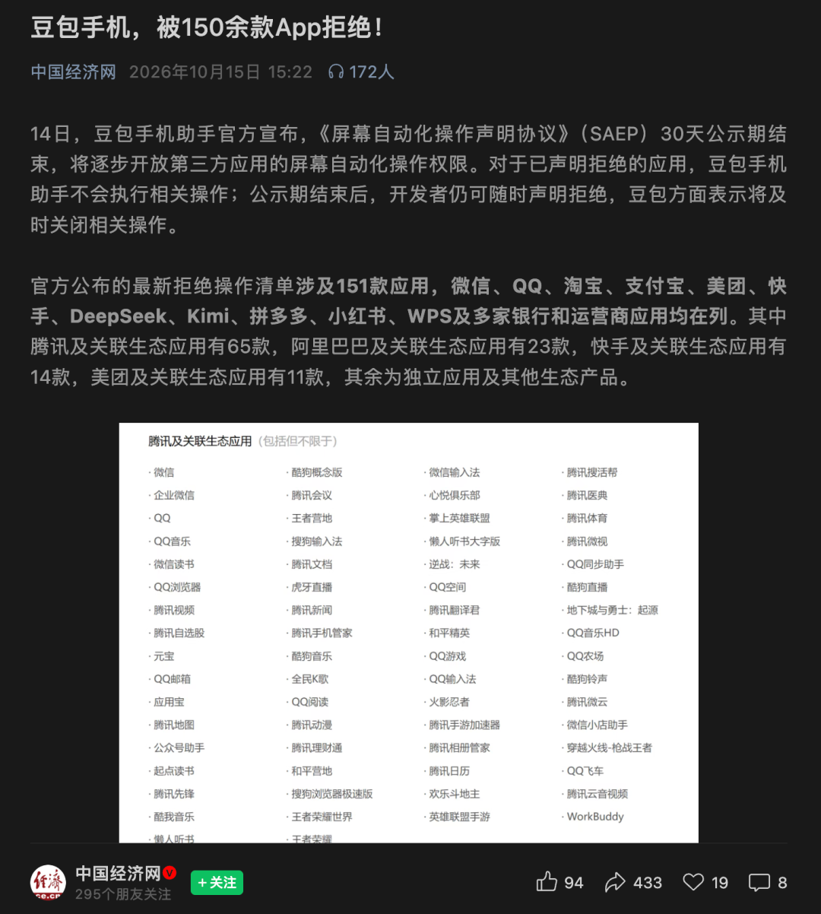
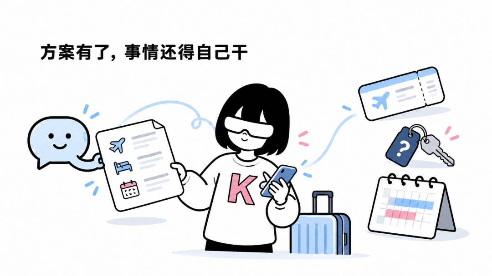
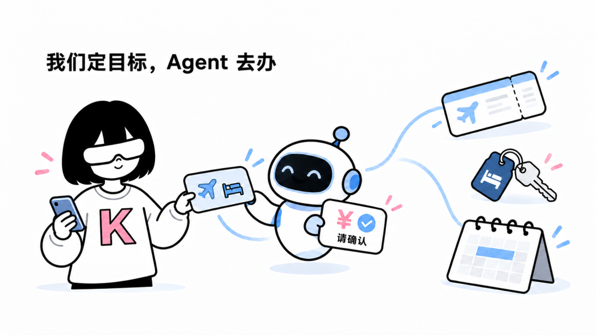
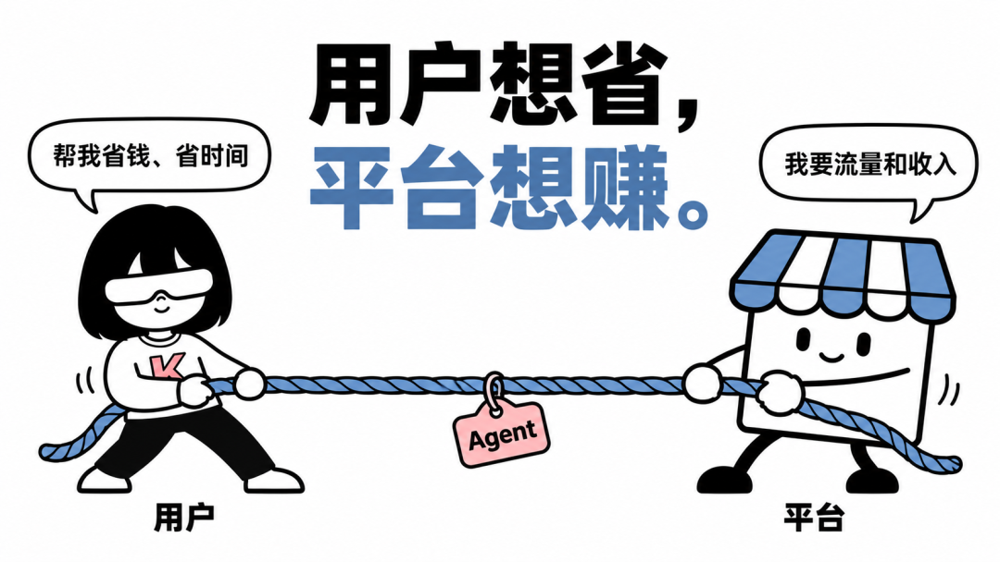
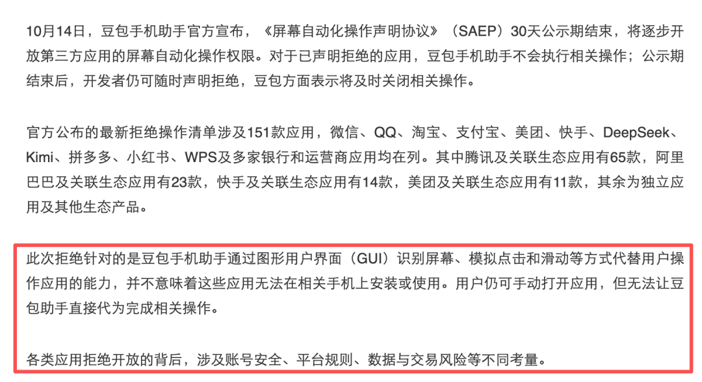
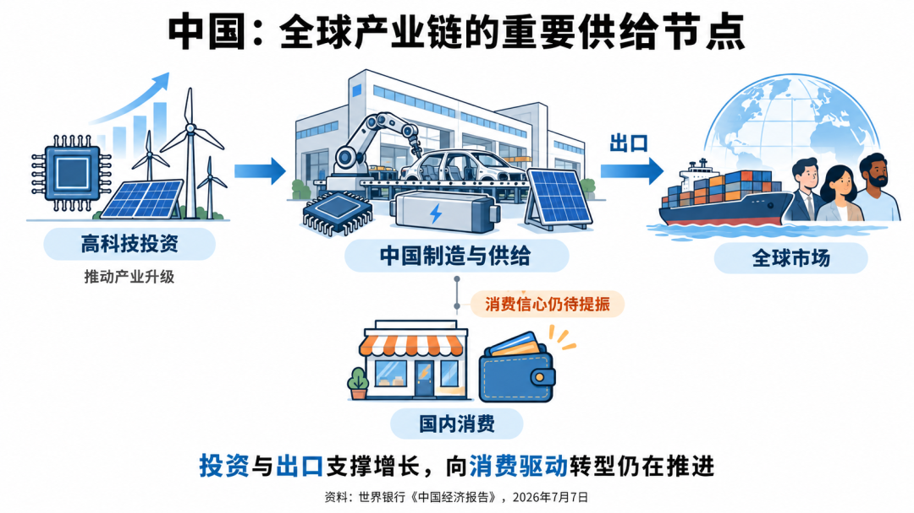



**收录说明**：用户提供链接。原文在微信公众号，用浏览器的客户端标识直接下载页面，从 `#js_content` 抽取正文，图片地址取自 `data-src`。文末投稿邮箱未收入。

**内容摘要**：作者梳理了海外 Personal Agent 的热度：Grok Bot 上线一个月后周用户达到 41.8 万，Muse 上线两周即登顶美区 iOS 免费榜。在中国，豆包手机助手公示 30 天期满后，微信、支付宝、淘宝、美团等超过 150 款 App 均拒绝其代理用户。文章从付费意愿、省下的时间难以折现、平台流量与广告的冲突、超级 App 封闭等角度，认为个人向 Personal Agent 在中国是一门错位的生意。文末建议中国 Agent 创业者转向垂直行业智能体，或直接出海。

**保留理由**：从付费意愿、时间成本与平台流量等角度系统论证个人向 Personal Agent 在中国的商业困境，并给出转向垂直行业或出海的建议。

---

**大家好，这里是K姐。**

**一个帮助你把AI真正用起来的女子。**

最近，Personal Agent 在大洋彼岸掀起一股热浪。

8月11日，马斯克的 xAI 发布 Grok Bot，上线一个月后，周用户达到 41.8 万。

9月8日，Meta 推出 Muse，两周就直接登顶美区 iOS 免费榜，次周留存率更是打破了今年所有工具类产品的增长纪录。

9月28日，Manus 团队发布 Cue；9月29日，OpenAI 紧随其后发布 dots，在发布会上提出颠覆性的 always-on agents 概念。

AI 帮我们订餐、安排行程、管理邮件、找维修服务，这些能力看起来确实很惊艳。

但国内却是另一番景象。

前阵子，字节的豆包手机助手，也搞一套可以帮用户自动去淘宝下单、去美团点外卖的全套 AI 智能体玩法。

他们出了个规则，公示 30 天，让各家 App 公司，自己声明允许或拒绝能被豆包 AI 代替用户自动操作。

**结果 30 天公示期满，包括微信、支付宝、淘宝、美团、拼多多、滴滴、小红书等超过 150 款国内主流 App，均拒绝字节豆包通过 AI 智能体代理用户。**

一边是海外各大巨头密集交卷、热度破表；一边是国内 150 多款国民级应用联手筑起高墙。

为什么海外热捧的 Personal Agent，到了中国却处处碰壁？

**Personal Agent 是什么**

第一次听到 Personal Agent 的朋友可能还不是很了解，我们先看一个日常生活场景：

假设我们下周要去上海出差，我们打开 AI 聊天工具，比如 ChatGPT，输入：

帮我做一份三天的出差安排。

AI 很快能给我们一份方案：建议坐哪班飞机、住在哪个区域、每天怎么安排。

但关掉对话框，我们还要自己打开订票软件核实价格，查看酒店是否有房，检查时间是否与会议冲突，再一项项完成预订。

**AI 可以帮我们想好方案，事情还得我们自己办。**

Personal Agent，也就是个人智能助理，可以在获得我们的授权后，直接使用工具和服务，替我们把事情推进下去。

同样的情况，Personal Agent 会先检查我的日程，再查机票、比较酒店，把符合要求的组合提交给我们确认。

我们选定后，Personal Agent 继续完成预订流程，将行程加入日历。

我们只用交代目标和要求，Personal Agent 承担后续搜索、比较、填写和跟进的工作。

**简单来说就是，ChatBot 给我们答案，Personal Agent 可以替我们办事。**

**Personal Agent 商业模式的本质，是买断我们原本花在琐事上的时间和精力。**

在海外这个商业逻辑顺理成章。为什么到了中国市场却走不通了？

**为什么在中国走不通**

先问大家一个现实的问题：**如果每个月花钱请一个 AI 助理，你愿意付多少钱？**

对于一个靠项目收费的独立顾问，AI 每周帮他省出几个小时，他可能就能多接一个客户。

但对于一个拿固定工资的上班族，同样省出几个小时，收入未必增加，工作也未必减少。

**两个人都觉得产品好用，最后却可能只有一个人愿意付钱。**

**Personal Agent 的生意，首先要找到那些既需要它，又能从中持续获益的人。**

海外的热度，说明这类人群基数已经足够大。但这不代表，把产品搬到中国，面对十几亿人口，就能自然获得一个更大的付费市场。

我们拆开人口结构、劳动力、产业与全球角色的四重现实，就会发现中国市场的死结所在。

- **人头很多，但愿意买单的有效人群太少**

年轻人能很快的学会使用，但对价格敏感。

现有的免费 AI 已经能满足写简历、规划行程等日常需求，很难让他们再额外为 Personal Agent 付钱。

中年人要照顾一家老小，琐事繁多。

但接送小孩、照顾老人这类事情，AI 只能做弱提醒，根本无法交付闭环。

银发族对私人助理有实际需求，但不懂操作，加上实际设置和付费的可能是子女或者服务机构，**使用者与付费者产生代际割裂。**

**Personal Agent 更适合的，可能是那些收入较高、事务繁忙，又能自主安排工作的专业人士。**但这类人群的规模相对较小，支撑不起大众消费级产品。

- **省下来的时间无法折现，还可能进一步内卷**

对大多数打工人来说，用 Personal Agent **省下十个小时，并不意味着工资里多出十个小时的钱，也不能提前十个小时下班。反而可能会接到下一个任务...**

Personal Agent 创造了价值，但最应该付费的是公司。

更残酷的现实是，在中国，Personal Agent 的竞争对手不只有其他 AI，还有极度发达的外卖、跑腿、客服，以及只用几次点击就能完成任务的成熟 App。

**人工服务越廉价便捷，个人助理的价值折损就越严重。**

无法直接带来增量收入的省心，在消费账单里毫无竞争力。

- **用户想一句话办完，平台只想守住流量和广告**

Peersonal Agent 替用户比价代购，直接拔掉了平台的开屏广告、信息流推荐与冲动消费。

平台承担履约与风控，却被架空了入口与流量变现权。

豆包手机助手被 150+ App 联合拒绝就是必然结果。

**即使用户愿意授权，Agent 也无法顺畅地调用所有外部服务。**

我们日常社交、支付、本地生活几乎全在微信、美团、淘宝这样封闭的超级 App 里。

Agent 进不去核心应用生态，**对我们的个人需求就永远是瞎子摸象，又何谈帮我们管理好日程呢**？

- **大众需要省心，但产业生态位更需要搞钱**

中国作为全球制造业与外贸中枢，决定了这片土地的支付逻辑。

同样是处理邮件，对个人用户来说，可能只是少花一些整理收件箱的时间，无关痛痒；

对外贸公司的业务员来说，却可能意味着跨时区自动跟进海外询盘、减少漏单，甚至直接影响中小微企业当月的净利润。

**在中国，Agent 帮人把生意做好的机会，可能比帮大众把生活安排好的机会，更早形成一门可持续的生意。**

**一些分享**

Personal Agent 在海外是一场重构人机入口的范式革命；但在中国，它在生态围墙、劳动力成本、支付土壤与职场现实的四重绞杀下，注定只能是一个美丽的假想。

那么，中国的 Agent 创业者难道就毫无机会了吗？

并非如此。

认清 Personal 的死路，才能看清真正的生门：

- **放弃 Personal Agent，退回深水区，做垂直行业智能体。**

别再想着去帮打工人省几分钟点外卖的时间了，去帮企业的老板解决资产负债表的问题。

在中国，能够明确帮企业直接砍掉人力成本或者直接带来新客户的 Agent，客户掏起钱来从来不会手软。

- **如果对个人智能体真有执念，那就彻底出海。**

如果你坚信个人智能体终将改变世界，并且你的团队有着顶级的意图理解和产品美学，**建议直接出海。****用中国工程师在工程架构、敏捷交付和模型调优上的极致卷度，去赚海外成熟软件市场的钱。**

在科技的世界里，最昂贵的错误，莫过于把加州的阳光，当成了全世界的季节。

作者：K姐
