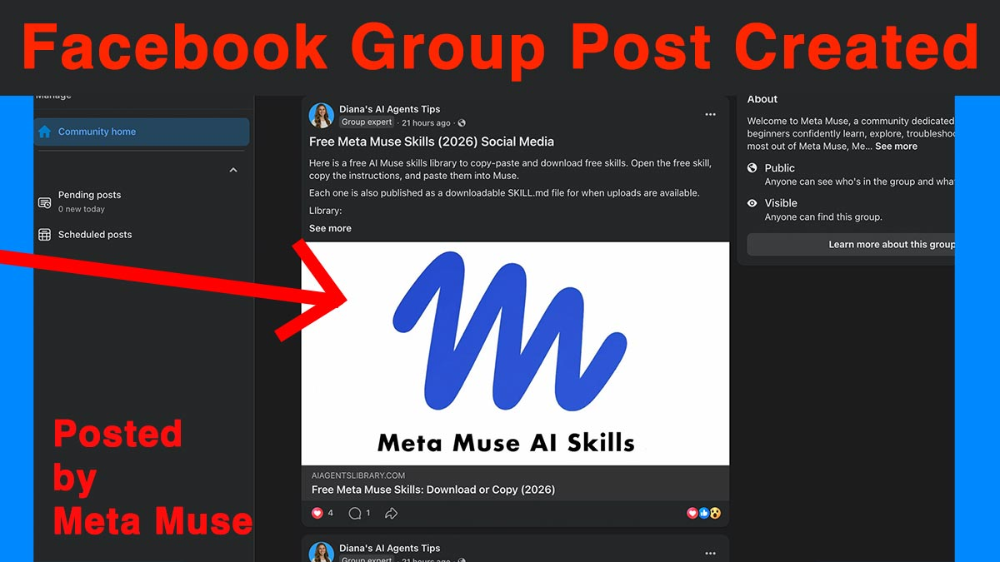
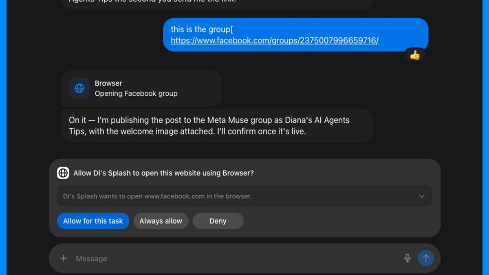



**收录说明**：直接下载；页面图片为延迟加载，按真实地址下载；去掉了站内工具、课程推广按钮和文末「Keep Going」推荐区。原文全文存于本目录的 original.md，网站上不显示，已翻译。

**内容摘要**：文章从开放范围、价格、可连接的应用、技能和审批机制比较 Claude Duet 与 Muse，并区分「厂商文档所述」和「作者实测所见」。截至 2026-10-22，Claude Duet 只对受邀的美国 Claude Pro 与 Max 订阅者开放，Muse 对美国、加拿大、日本和新加坡的成年人开放、有免费额度。Claude Duet 依赖用户在 Claude 中已有的连接器、技能和记忆，Muse 直连 Facebook、Instagram 和 Meta 广告账户；作者的 Muse 实测包括分析 Facebook 主页数据并排期发帖。作者建议按具体任务选择，而不是看谁「赢」。

**保留理由**：逐项标明哪些是厂商文档、哪些是实测，整理了 Claude Duet 预览期的开放条件、用量计算和审批规则，便于与 Muse 对照。

---

**在 Claude Duet 和 Meta Muse 之间做选择，首先要看你想把什么工作交出去，然后看你能不能拿到它们。** 截至 2026 年 10 月 22 日，Claude Duet 是研究预览版（research preview），美国境内的 Claude Pro 与 Max 订阅者可通过候补名单（waitlist）获得。Meta Muse 已向美国、加拿大、日本和新加坡的成年人开放，此前于 10 月 23 日在日本、10 月 27 日在新加坡上线。

简明回答

## Claude Duet 与 Meta Muse：该用哪一个？

**已经在用 Claude：** 拿到访问权限后就去评估 Claude Duet。它能配合你现有的 Claude 技能、记忆和连接器（connector）工作。

**业务围绕 Facebook、Instagram 或 Meta 广告：** 先在具体任务上测试 Meta Muse。它直接连接 Meta，并且有免费档。

**缺少访问权限或缺少你需要的连接：** 换用今天就能拿到的其他智能体（agent）。

我现在两个都测过了，用的是相似的业务任务，但日期和输入不同，所以这些建议基于契合度和我的测试笔记，不是受控的一对一比较。

3 个问题 · 20 秒

免费 AI 路线图：找到适合你工作的智能体

不确定 Claude Duet 或 Meta Muse 是不是合适的第一个智能体？回答三个关于你实际重复工作的提问，就能得到一个具名智能体、第一个要搭的工作流，以及到第 7 天你这一周会是什么样。

**这次比较是怎么做出来的。** 产品信息核对于 2026 年 10 月 22 日。Claude Duet 的文档所述能力来自 Anthropic 的公告、产品页和帮助中心。这次比较现在还纳入了我 2026 年 10 月 27—28 日在 Claude Max 5x 上得到的 [Claude Duet 上手结果](https://www.aiagentslibrary.com/blog/claude-duet-review/)。我的 Muse 观察来自 2026 年 9 月 27 日和 10 月 10 日在 Mac 应用免费档上的两次测试。各次运行使用了不同日期和输入，所以这不是受控的一对一基准测试。全文我会把说法标为 Anthropic 或 Meta *文档所述（documented）*、我测试中*观察到（observed）*，或*尚未测试（not yet tested）*。

## 什么是 Claude Duet，它和 Meta Muse 相比如何？

**Claude Duet 是 Anthropic 的主动式 AI 智能体，用于在已连接的应用之间处理工作。** Claude Duet 运行在自己的云电脑上，在后台准备任务，再把工作交回给你审阅。Anthropic 于 2026 年 10 月 21 日[宣布 Claude Duet](https://claude.com/resources/articles/claude-duet) 作为研究预览版。它是一个应用，不是新模型：Claude Duet 有自己的 iPhone 和 Android 应用，与主 Claude 应用分开，另有 claude.ai 网页版，运行在 Claude Opus 5.5 上。

在实际使用中，Claude Duet 会根据你的邮件和日历发送一份晨间简报，每隔几小时检查你连接的账户，起草下一步，并把较大的工作——比如研究简报、幻灯片或仪表盘——作为可编辑文件返回到它的 Make 标签页。

**Claude Duet 和 Meta Muse 的基本用途相同：** 两者都是在你各个应用之间执行工作、并在你关闭对话后继续运行的智能体。Meta 的 [Muse for business 页面](https://muse.ai/business) 说 Muse「会在你连接的应用和服务之间持续工作，即使你关掉它」，我在自己的测试中确认了这一点。区别在于谁能拿到、各自连接什么，以及它工作时你保留多少控制权。

Claude Duet 与 Meta Muse 对照，依据 Anthropic 和 Meta 在 2026 年 10 月 22 日的文档。不是性能排名。

|  | Claude Duet | Meta Muse |
| --- | --- | --- |
| 谁能获得访问权限 | 美国 Claude Pro 和 Max 订阅者，凭候补名单邀请 | 美国、加拿大、日本和新加坡的成年人；无需候补名单 |
| 免费或付费入口 | 仅付费：预览期内含于 Pro（每月 $20）或 Max（每月 $100 起） | 免费，有使用量限制；付费档增加用量 |
| 后台工作 | 是，在自己的云电脑上；每隔几小时检查账户 | 是，关闭应用后仍继续工作 |
| 既有技能与上下文 | 从第一条消息起就使用你的 Claude 记忆、技能和连接器 | Meta 构建的技能和用户提供的工作流指令；没有文档记载面向用户的 SKILL.md 安装器 |
| 相关业务连接 | Claude 连接器，如 Gmail、Google Calendar、QuickBooks、HubSpot 和 Docusign；Slack 有限制；尚无 Microsoft 365 | Facebook 主页、Instagram 专业账户分析和 Meta 广告账户，以及 QuickBooks、Shopify、Slack 和 Stripe 等应用 |
| 浏览器可见性与控制 | 有自己的浏览器，但你无法观看或接管 | 你可以打开查看窗口、接管或停止任务 |
| 审批行为 | 在发送、付款、签字或删除前询问；部分操作即使获批也被阻止 | 取决于你的设置：允许一次、允许某个任务、允许某个站点，或对某个连接器始终允许 |

每行都附带条件，下文各节会解释。如果你想看 Muse 如何处理真实工作、而不是 Meta 如何描述，[我的 Meta Muse 业务任务评测](https://www.aiagentslibrary.com/blog/meta-muse-review/) 记录了哪些有效、哪些需要纠正，以及我在哪里停止测试。

免费 · 无需 Duet 邀请

今天就从你的智能体获取价值

把一个免费技能复制到你已有的 Claude 账户，或把一个现成工作流复制到 Muse。

## 今天谁能用 Claude Duet 和 Meta Muse？

**Claude Duet 仅限受邀的美国 Claude Pro 和 Max 订阅者；Meta Muse 对美国、加拿大、日本或新加坡的任何成年人开放。** 如果你在这些国家之外，或使用 Claude Team 或 Enterprise 套餐，资格可能比功能更早决定这个选择。

### Claude Duet 的访问与候补名单

**要使用 Claude Duet，你需要三样东西：一个美国 Claude 账户、一个 Pro 或 Max 订阅，以及一份候补名单邀请。** 根据 [Anthropic 的 Claude Duet 帮助中心文章](https://support.claude.com/en/articles/17631495-get-started-with-claude-duet)，邀请分批发出，所以加入候补名单不保证获得访问日期。Claude Duet 尚未在 Team 或 Enterprise 套餐提供，不过 Anthropic 表示计划加入。设置需在 iPhone 或 Android 应用里完成，邀请邮件必须同时匹配你的 Claude 账户和手机上的 Apple 或 Google 账户。

**实用建议：** 不要仅因为以为能立刻拿到 Claude Duet 访问权就去买 Claude 订阅。Pro 和 Max 让你有资格加入候补名单；它们不能跳过名单。你可以从 [Claude Duet 官方页面](https://claude.com/product/claude-duet) 加入。

### Meta Muse 的可用范围

**Meta Muse 已在美国、加拿大、日本和新加坡上线。** Meta 的 [muse.ai 商业页面](https://muse.ai/business) 仍写着 Muse 面向美国和加拿大 18 岁及以上人群；日本和新加坡是 10 月下旬通过 Meta 自己的区域上线公告加入的。没有候补名单，也不用购买：你用 Meta 账户在 muse.ai/join 登录。Meta 的法语和德语 Connect 帖子还提到墨西哥，但它的英文材料没有，我也没找到墨西哥账户可以注册的证据，所以墨西哥只是被提到，并未确认。按国家和设备划分的完整情况见我的 [Meta Muse 可用范围指南](https://www.aiagentslibrary.com/blog/meta-muse-availability/)。

有一点值得直说：Claude Duet 解决不了 Muse 的地理限制。如果你因为身处 Muse 已上线的四个国家之外而拿不到 Muse，Duet 仅限美国的研究预览也帮不上忙。[Duet 的国家和套餐限制](https://www.aiagentslibrary.com/blog/claude-duet-waitlist/) 说明了这个研究预览到底覆盖谁。

## Claude Duet 和 Meta Muse 要花多少钱？

**在预览期内，Claude Duet 含于付费的 Claude Pro 和 Max 订阅，不额外收费。Meta Muse 有带使用量限制的免费档，付费档提高该限制。** Claude Duet 没有免费入口。

2026 年 10 月 22 日的美国标价，来自 Anthropic 和 Meta 的定价页面。价格不含税，可能变化。

|  | Claude（用于 Claude Duet） | Meta Muse |
| --- | --- | --- |
| 免费 | Claude Free 存在，但不含 Claude Duet | 有，带 Meta 未量化的使用量限制 |
| 约每月 $20 | Pro：每月 $20（按月计费；按年计费每月 $17，一次性付 $200） | Power：每月 $20，每周 5 亿 Muse tokens |
| 约每月 $100 | Max 5x：每月 $100，使用量为 Pro 的 5 倍 | Maximum：每月 $100，每周 30 亿 Muse tokens |
| 约每月 $200 | Max 20x：每月 $200，使用量为 Pro 的 20 倍 | 未列出对等套餐 |

Claude 价格来自 [Anthropic 的定价页面](https://claude.com/pricing) 及其 [Max 套餐帮助文章](https://support.claude.com/en/articles/11049741-what-is-the-max-plan)；Max 按月计费，这些价格是网页订阅价格，应用商店定价可能不同。Muse 价格来自 [Meta 的 Muse 订阅帮助页面](https://www.meta.com/help/subscriptions/1021145227643680/)，该页说 Muse 订阅「处于有限测试中」，权益「可能因地区和账户而异」。我的两次 Muse 测试都在免费档上进行。

**更重要的数字是使用量，不是价格。** Claude Duet 的后台检查使用与其他 Claude 相同的套餐额度。Anthropic 帮助中心说，Claude Duet 以与聊天相同的速率消耗你套餐的五小时会话和每周限制，晨间简报和检查也会计入，所以你可能会更早触及限制。更大的任务，比如财务模型或幻灯片，需要更多工作量。如果你已经大量使用 Claude，Claude Duet 是在动用你本来就依赖的额度。Anthropic 给获准用户一次完整的额度重置，有效期至 2026 年 11 月 30 日。

我的看法：合理的比较是把一项重复工作做完的成本，包括你检查它的时间。Anthropic 的限制和 Meta 的每周 token 额度计量方式不同，所以我不会把它们等同，也不会为任何一方承诺完成多少任务。把你的工作跑几次，看看什么时候触到限制。

## 每个智能体实际能配合哪些业务应用？

**Claude Duet 配合你在 Claude 中已设置的连接器；Meta Muse 在 Facebook、Instagram 和 Meta 广告方面最强。** 但存在一个连接器，并不等于智能体能做你的工作。对每个应用，要分别问三个问题：它能读取信息吗，它能据此准备工作吗，它能在账户里改动东西吗？

这个区别很重要，因为 Anthropic 帮助中心说 Slack 在 Claude Duet 中「有限制地」工作，「Microsoft 365 尚不可用」，尽管 Microsoft 365 出现在 Claude Duet 产品页的标识中，Anthropic 也提到超过 6,000 个连接器和插件。集成数量大，并不能告诉你你的具体工作流是否被支持。

### 邮件与日历

**Anthropic 文档所述：** Claude Duet 读取 Gmail 和 Google Calendar，据此生成每日简报，起草回复，并在你批准后从已连接账户发送邮件。摘要会引用来源邮件。如果你的业务运行在 Outlook 和 Microsoft 365 上，Claude Duet 目前还不能连接。

**我的 Muse 测试观察到：** 我连接了 Gmail、Google Calendar、Google Docs 和 Drive。Muse 在没被告知是哪一封的情况下，为一次会议找到了正确的邮件线程，并在需要时于任务中途连接了 Google Calendar。

### 销售、会计与客户记录

**文档所述：** Anthropic 把 QuickBooks、HubSpot、Stripe、Gusto、Docusign 和 Calendly 列为 Claude Duet 的连接器，例子包括找出未付发票和准备工资单供审阅。Meta 为 Muse 列出 Intuit QuickBooks、HighLevel、Klaviyo、Shopify、Stripe 等。**尚未测试：** 我没有在任何一者中运行会计或 CRM 任务，所以请把这些当作待核实的连接，而不是我已验证的工作流。

### Facebook 和 Instagram

**文档所述：** Meta 在 [Meta 的 Muse for Small Business 公告](https://about.fb.com/news/2026/09/introducing-muse-small-business/) 中记录了与 Facebook 主页、Instagram 专业账户分析和 Meta 广告账户的直接连接。这本身并不确立你可能想要的每一项发布、回复或审核操作。Anthropic 的 Claude Duet 发布材料没有确认对等的 Meta 直接连接。不过，Claude 的市场包含第三方连接器，例如用于 Facebook 和 Instagram 排期、发布和分析的 [Metricool](https://claude.com/marketplace/connectors/metricool-social-media-management)。我尚未在 Claude Duet 内验证这些工作流。

### 通过浏览器访问的网站

**文档所述：** 当网站没有连接器时，两个智能体都会退回到各自的云浏览器。区别在可见性，见下文[审批一节](#approvals)。两者都不让密码进入聊天：Claude Duet 让你在设备的单独表单中输入，Muse 把它们存进模型看不到的 Secure Credentials Store（安全凭据存储）。

要查看 Muse 可连接的完整清单，以及每个连接器申请什么权限，见 [Meta Muse 支持的连接器与权限](https://www.aiagentslibrary.com/blog/meta-muse-connectors/)。

## 你能在 Claude Duet 和 Meta Muse 中使用自己的技能吗？

**Claude Duet 使用你 Claude 账户中已有的技能；Meta Muse 有 Meta 构建的技能，并能遵循你在对话中提供的工作流指令。** 比较之前，先分清三件常被混为一谈的事：

1. **技能（skill）** 是一种可复用的方法，告诉智能体如何完成一项工作。
2. **连接器（connector）** 让智能体访问某项服务，比如你的收件箱或 Facebook 主页。
3. **权限（permission）** 让智能体在该服务内执行特定操作，比如发送或发布。

包含指令的技能，并不给智能体账户访问权或发布权限。如果这些词对你是新的，这篇关于[技能、智能体和连接器区别](https://www.aiagentslibrary.com/blog/ai-skill-vs-agent-vs-plugin-vs-connector-vs-mcp/) 的指南逐一解释了它们。

**Claude Duet（文档所述）：** Anthropic 说 Claude Duet 从第一条消息起就使用你 Claude 账户的记忆、技能和连接器，并支持 Claude 的小企业插件等插件。这是 Anthropic 文档所述的行为。我目前测试过一个：在我的 [Claude Duet Website Builder Skill 测试](https://www.aiagentslibrary.com/blog/claude-duet-review/#skill) 中，当我点名让 Duet 使用该 Skill 时，我更偏爱它构建的页面，给它打了 10/10，而普通请求为 8.9/10。那只是一个简报上的一个 Skill，所以我不是说每个技能在那里都能用。它们今天在 Claude 中可用，你可以用已有的账户试用[免费 Claude 技能](https://www.aiagentslibrary.com/skills/claude/)。

**Meta Muse（文档所述并观察到）：** Meta 的 [Muse 技能帮助页面](https://www.meta.com/help/artificial-intelligence/2797651547267109/) 描述了内置技能「由 Meta 开发，并且已经是 Muse 的一部分」，Meta 的[安全说明](https://research.meta.ai/blog/security-and-safety-for-ai-agents-our-approach-with-muse) 把「开发自定义技能」列为 Muse 云电脑支持的工作之一。Muse 能遵循对话中提供的工作流指令，在 10 月 8 日的一次测试中，它提出把我粘贴的工作流保存为可复用技能。Meta 没有文档记载类似 Claude 的、用于安装和管理个人 SKILL.md 包的界面。我 10 月 10 日的测试使用了粘贴的指令；它没有验证永久安装 SKILL.md 的工作流。我的 [Meta Muse 技能解释](https://www.aiagentslibrary.com/blog/meta-muse-skills/) 说明了粘贴指令、已保存工作流和已安装包之间的区别，我的[免费 Meta Muse 工作流提示词](https://www.aiagentslibrary.com/skills/meta-muse/) 写成了可直接粘贴的形式。

## 哪个智能体适合你实际的业务任务？

**按具体工作选智能体，因为每个都在不同的工作上被文档所述或验证过。** 下面是三项常见工作，附各厂商文档所述、我的 Muse 测试显示的结果，以及仍需一次对等的 Claude Duet 测试的部分。

### 准备每日业务简报

**有用的简报会给你重要消息、即将到来的承诺、未解决事项和来源链接，让你能自己核对摘要。**

* **Anthropic 文档所述：** 晨间简报是 Claude Duet 的招牌功能。它由你的邮件和日历生成，其中的数字引用来源邮件或文件，并会跟进没有动静的线程。Anthropic 也警告 Claude Duet「可能误读一个线程，或错判什么算紧急」，紧急事项可能要等到下一次检查。
* **我的 Muse 测试观察到：** 9 月 27 日，Muse 的每周业务简报得分 9/10，会议准备得分 10/10。收件箱优先级排序得 6/10，因为 Muse 告诉我有一封邮件没发，而我其实发了。若信它，就会发出重复邮件。
* **我的 Duet 测试观察到：** 10 月 27—28 日，Claude Duet 的每周业务简报和会议准备都是 10/10，收件箱分诊得 9.3/10。它告诉我一箱自动化邮件无需回复，并问我是否连接了正确的 Gmail 账户。这些收件箱和日期与我 Muse 测试的不同。
* **尚未测试：** Claude Duet 未经提示的晨间简报本身，以及两个智能体在同一个收件箱上的表现。

免费技能 · 今天即可在 Claude 中使用

在 Duet 到来前运行你的每日简报

粘贴今天的日历和收件箱，拿回你的前三件事、每场会议需要的准备，以及什么可以等。适用于 Claude、ChatGPT 和 Gemini Spark。

### 规划并发布社交内容

**写配文、读表现数据、给主页帖子排期、在群组里发帖是四项不同的任务，智能体可能擅长其中一项却不会另一项。**

**我的 Muse 测试观察到：** 10 月 10 日，Muse 用与 Meta Business Suite 相符的数字分析了我的 Facebook 主页，用我的语气写了配文，并排期了一条帖子，通过其现有的 Facebook 连接在我的主页上线。它还在我管理的一个公开 Facebook 群组里发布，但前提是我给了它链接、并通过它的浏览器登录 Facebook，而且两个帖子我都亲自检查了。一个错字进入了已发布的帖子。完整结果见[我的 Meta Muse Facebook 主页和群组测试](https://www.aiagentslibrary.com/blog/meta-muse-facebook-test/)。该结果覆盖一个主页和一个受监督的群组；它并不证明每个群组或 Instagram 工作流都能用。

我 2026 年 10 月 10 日测试的截图：在我通过它的浏览器登录 Facebook 后，Muse 发布的那条群组帖子。

**Claude Duet：** 区别在于直接的 Meta 连接，还是可能的第三方连接。Claude Duet 会通过 Metricool 之类的市场连接器，或通过自己的浏览器，访问 Facebook 和 Instagram。这两种路径是否能在 Claude Duet 中完成你的发布工作流，**尚未测试**。

### 把业务信息变成完成的交付物

**以每周客户报告为例：智能体必须拉取正确的数字，写成文，并交回一份你稍作编辑就能发出去的东西。** Claude Duet 文档记载会在 Make 标签页返回可编辑文件。在我的 Muse 测试中，一份研究报告转成 PDF 比我预期的好（8.5/10），但一个网页得 5/10，一次电子表格构建没有结论，完成的文件很难找到。

在拿到对等的 Duet 结果之前，用这份清单在你自己的工作上评判任一智能体。有用的结果具备：

* **正确的来源信息**，可追溯到它来自的邮件、文件或账户。
* **可编辑的交付物**，交回在你找得到的地方。
* **清楚标出的缺失信息**，而不是用猜测填补空白。
* **可管理的修改量**：几分钟编辑，而不是重写。
* **可重复的方法**，让下周运行和这次一样好。

**我的 Meta Muse 测试为这次比较补充了什么**

**一个成功：** 2026 年 9 月 27 日，我给 Muse 一项竞争对手研究任务，然后几乎立刻关掉应用。回来时完成的简报在等着（9/10）。后台工作是真的，不是进度动画。**一个局限：** 同一天，Muse 的收件箱审阅弄错了一封已发邮件，错法还指向一个外部操作。两个结果都来自[我的 Meta Muse 评测](https://www.aiagentslibrary.com/blog/meta-muse-review/)。Claude Duet 文档记载了同类的后台工作，也承认同类的风险。这两点对 Duet 都尚未测试。

## 哪些操作需要你批准，你能看着智能体工作吗？

**Claude Duet 在一组固定后果性操作前会询问；Meta Muse 的审批取决于你设置的权限和你已给出的授权。** Muse 还让你观看它的浏览器，Claude Duet 目前不行。为东西付款是这组固定操作里最尖锐的例子——[Duet 如何处理购买和审批](https://www.aiagentslibrary.com/blog/claude-duet-payments/) 覆盖了一次性卡和 Link 增加的第二次关卡。

**Claude Duet（文档所述）：** Anthropic 说 Claude Duet 自行阅读、起草和准备工作，但在发送消息、付款、签署文件或删除任何东西之前，会向你展示操作并等待。如果你不能立刻批准，它完成任务的其余部分，稍后再把请求带回来。购买每次都会询问，并使用一次性卡。有些操作即使获批也禁止：交易证券、在账户间转移资金、访问他人账户。Anthropic 也警告 Claude Duet 可能被它所读内容中隐藏的指令欺骗，所以要审阅它的草稿和审批请求。

**Meta Muse（文档所述）：** Meta 说「没有你的批准，什么都不会发布、发送或花钱」，但其[权限控制页面](https://www.meta.com/en-gb/help/superintelligence/1385290430137537/) 显示一次批准可以覆盖多远。你可以选择「允许一次」、「允许此任务」、「允许此网站」（在该网站不再询问）或「始终允许」（对该连接器上的该类型操作不再询问）。每个连接器可以设为「始终询问」或「对部分操作询问」。所以 Muse 不一定每次都重新问你，取决于你之前允许了什么。

我 2026 年 10 月 10 日的截图。「允许此任务」和「始终允许」授予的范围非常不同。点击前先读按钮。

**观看浏览器：** Meta 文档记载你可以[在聊天中打开 Muse 的浏览器](https://www.meta.com/help/artificial-intelligence/2124746764949121/)，观看、接管或停止任务。Anthropic 的帮助中心说你不能观看 Claude Duet 在其浏览器中工作，也不能接管。我的看法：如果你第一次尝试不熟悉的网站工作流，能观看是有用的监督。用 Claude Duet，你评判的是结果和审批请求，而不是过程。

两种设计都不能让某个智能体普遍更安全。把监督与工作匹配：把权限缩窄，让发布和发送留在审批之后，并亲自检查前几次结果。

## 该选哪个：Claude Duet 还是 Meta Muse？

**按契合度选，而不是选一个性能赢家。** 我现在两个都测过了，但日期和输入不同，不是在同样工作上并排比较。这些建议把 Anthropic 文档所述的 Duet 能力，与我自己对两个智能体的测试结果结合起来。

* **评估 Claude Duet，如果** 你已经在 Claude 中工作、你有符合条件的访问权，并且你想要针对现有技能、记忆和连接器的主动帮助，尤其是跨 Google Workspace、QuickBooks 或 HubSpot。
* **先测试 Meta Muse，如果** 你能访问它，且你的工作流受益于 Facebook、Instagram 或 Meta 广告连接，或者你想要一个免费的起点。
* **选择其他方案，如果** 两者你都拿不到、你需要的连接缺失（比如 Claude Duet 中的 Microsoft 365），或者你需要一个两者都未展示过的工作流。我的[其他 Meta Muse 替代方案](https://www.aiagentslibrary.com/blog/meta-muse-alternatives/) 指南按国家和价格比较了其余选项。

无论选哪个，都从小处开始：选一项重复工作，定义完成的产出是什么样，决定什么需要你批准，并在交出第二项工作前检查结果。如果你最终选 Claude Duet，[Claude Duet 设置指南](https://www.aiagentslibrary.com/blog/how-to-use-claude-duet/) 会带你从第一条消息走到第一次委派任务。

Meta Muse Academy · 免费试听课程

把你的第一个 Muse 任务变成可重复的工作流

先读一节完整课程：真实的请求、真实的结果，以及随后的纠正。加入之前先评判教学质量。

## Claude Duet vs Meta Muse 常见问题

Claude Duet 和 Claude Cowork 是同一个吗？

不。Claude Cowork 的能力从 2026 年 9 月 16 日起并入主 Claude 应用，详见 [Cowork 并入 Claude 时改变了什么](https://www.aiagentslibrary.com/blog/claude-cowork-merging-into-claude/)。Claude Duet 是一个独立应用，于 2026 年 10 月 21 日宣布，围绕运行在自己云电脑上的主动式智能体构建。我早先的 Claude Cowork 测试结果不是 Claude Duet 的结果。

加入 Claude Duet 候补名单能保证获得访问权限吗？

不能。Anthropic 分批发送邀请，并说加入并不保证日期。你还需要一个处于 Pro 或 Max 套餐的美国 Claude 账户。

我能在 Meta Muse 中使用 Claude 技能吗？

你可以在对话中把某个技能的指令给 Muse，并要求它遵循。在我 10 月 10 日的测试中，我把技能指令粘贴进 Muse，并要求它遵循。Meta 没有文档记载在 Muse 应用内安装 SKILL.md 包的面向用户方式。

## 来源与更新记录

本页每个产品事实都来自 Anthropic 或 Meta 自己的页面，阅读于 2026 年 10 月 22 日。Muse 观察来自我自己的测试，日期见下。随着 Claude Duet 访问范围扩大，我会更新本页；当我能用 Claude Duet 跑同样的业务简报或社交规划工作时，结果会连同套餐、日期、连接和任务简报一起放在这里。

* [Anthropic：Claude Duet 公告](https://claude.com/resources/articles/claude-duet)（2026 年 10 月 21 日）
* [Claude 帮助中心：Claude Duet 入门](https://support.claude.com/en/articles/17631495-get-started-with-claude-duet)（访问、限制与局限）
* [Anthropic：Claude Duet 产品页与候补名单](https://claude.com/product/claude-duet)
* [Anthropic：Claude 定价](https://claude.com/pricing) 与 [Max 套餐帮助文章](https://support.claude.com/en/articles/11049741-what-is-the-max-plan)
* [Claude 市场：Metricool 连接器](https://claude.com/marketplace/connectors/metricool-social-media-management)（第三方）
* [Meta：Muse for Small Business](https://muse.ai/business)
* [Meta：推出 Muse for Small Business](https://about.fb.com/news/2026/09/introducing-muse-small-business/)（2026 年 9 月 29 日）
* [Meta 帮助中心：Muse 订阅](https://www.meta.com/help/subscriptions/1021145227643680/)
* [Meta 帮助中心：Muse 权限控制](https://www.meta.com/en-gb/help/superintelligence/1385290430137537/)
* [Meta 帮助中心：Muse 的浏览器](https://www.meta.com/help/artificial-intelligence/2124746764949121/)
* [Meta 帮助中心：Muse 技能](https://www.meta.com/help/artificial-intelligence/2797651547267109/)
* [Meta：AI 智能体的安全与保障，我们与 Muse 的做法](https://research.meta.ai/blog/security-and-safety-for-ai-agents-our-approach-with-muse)（2026 年 9 月 8 日）

**我引用的测试：** [Meta Muse 评测](https://www.aiagentslibrary.com/blog/meta-muse-review/)，测试于 2026 年 9 月 27 日，免费档，Mac 应用。[Meta Muse Facebook 测试](https://www.aiagentslibrary.com/blog/meta-muse-facebook-test/)，测试于 2026 年 10 月 10 日，免费档，Mac 应用。[Claude Duet 评测](https://www.aiagentslibrary.com/blog/claude-duet-review/)，测试于 2026 年 10 月 27—28 日，Claude Max 5x。

**更新记录：** 2026 年 10 月 22 日：首次发布，在 Anthropic 宣布 Claude Duet 一天后。2026 年 10 月 28 日：加入我的 Claude Duet 上手结果；产品事实未重新核对。
