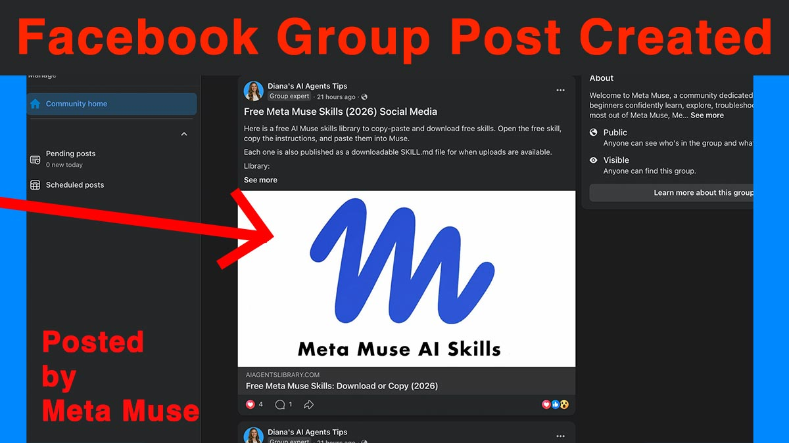
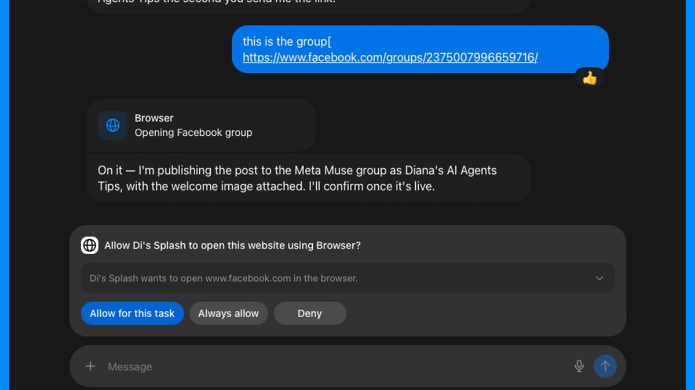

来源：https://www.aiagentslibrary.com/blog/claude-duet-vs-meta-muse/
取文：2026-11-05，直接下载

**Choosing between Claude Duet and Meta Muse starts with the work you want to hand off, and then with whether you can get each one.** As of October 22, 2026, Claude Duet is a research preview available through a waitlist for Claude Pro and Max subscribers in the United States. Meta Muse is available to adults in the United States, Canada, Japan and Singapore, after launches in Japan on October 23 and Singapore on October 27.

Quick answer

## Claude Duet vs Meta Muse: which one should you use?

**Already invested in Claude:** evaluate Claude Duet once you have access. It works with your existing Claude skills, memory and connectors.

**Business centered on Facebook, Instagram or Meta ads:** start by testing Meta Muse on your specific task. It connects to Meta directly and has a free tier.

**Missing the access or a connection you need:** use another agent you can get today.

I have now tested both, on similar business tasks but on different dates and inputs, so these are recommendations based on fit and my test notes, not a controlled head-to-head.

3 questions · 20 seconds

Free AI Roadmap: Find the Agent That Fits Your Work

Not sure Claude Duet or Meta Muse is the right first agent? Answer three questions about the work you actually repeat and get one named agent, the first workflow to set up, and what your week looks like by Day 7.

**How this comparison was researched.** Product information was checked on October 22, 2026. Claude Duet’s documented capabilities come from Anthropic’s announcement, product page and Help Center. This comparison now also includes my [hands-on Claude Duet results](https://www.aiagentslibrary.com/blog/claude-duet-review/) from October 27–28, 2026, on Claude Max 5x. My Muse observations come from two tests on the free plan in the Mac app, on September 27 and October 10, 2026. The runs used different dates and inputs, so this is not a controlled head-to-head benchmark. Throughout, I label claims as *documented* by Anthropic or Meta, *observed* in my test, or *not yet tested*.

## What Is Claude Duet, and How Does It Compare With Meta Muse?

**Claude Duet is Anthropic’s proactive AI agent for handling work across connected apps.** Claude Duet runs on its own cloud computer, prepares tasks in the background and brings work back to you for review. Anthropic [announced Claude Duet on October 21, 2026](https://claude.com/resources/articles/claude-duet) as a research preview. It is an app, not a new model: Claude Duet lives in its own iPhone and Android app, separate from the main Claude app, with a web version at claude.ai, and it runs on Claude Opus 5.5.

In practice, Claude Duet sends a morning brief built from your email and calendar, checks your connected accounts every few hours, drafts next steps and returns larger jobs, such as research briefs, slide decks or dashboards, as editable files in its Make tab.

**Claude Duet and Meta Muse share the same basic purpose:** both are agents that carry out work across your apps and keep going after you close the conversation. Meta’s [Muse for business page](https://muse.ai/business) says Muse “keeps working across the apps and services you connect, even after you close it”, and I confirmed that in my own test. The differences are in who can get each one, what each connects to, and how much control you keep while it works.

Claude Duet and Meta Muse compared, as Anthropic and Meta document them on October 22, 2026. Not a performance ranking.

|  | Claude Duet | Meta Muse |
| --- | --- | --- |
| Who can get access | US Claude Pro and Max subscribers, by waitlist invitation | Adults in the US, Canada, Japan and Singapore; no waitlist |
| Free or paid entry point | Paid only: included with Pro ($20/month) or Max (from $100/month) during the preview | Free with a usage limit; paid plans add usage |
| Background work | Yes, on its own cloud computer; checks accounts every few hours | Yes, keeps working after you close the app |
| Existing skills and context | Uses your Claude memory, skills and connectors from the first message | Meta-built skills and supplied workflow instructions; no documented user-facing SKILL.md installer |
| Relevant business connections | Claude connectors such as Gmail, Google Calendar, QuickBooks, HubSpot and Docusign; Slack with limits; no Microsoft 365 yet | Facebook Pages, Instagram professional analytics and Meta ad accounts, plus apps such as QuickBooks, Shopify, Slack and Stripe |
| Browser visibility and control | Has its own browser, but you can’t watch it or take over | You can open a viewing window, take control or stop the task |
| Approval behavior | Asks before sending, paying, signing or deleting; some actions blocked even with approval | Depends on your settings: allow once, for a task, for a site, or always for a connector |

Each row has conditions attached, and the sections below explain them. If you want evidence of how Muse handles real work rather than how Meta describes it, [my Meta Muse business-task review](https://www.aiagentslibrary.com/blog/meta-muse-review/) documents what worked, what needed correction, and where I stopped testing.

Free · no Duet invite needed

Get Value From Your Agent Today

Copy a free skill into the Claude account you already have, or a ready-made workflow into Muse.

## Who Can Use Claude Duet and Meta Muse Today?

**Claude Duet is limited to invited US Claude Pro and Max subscribers; Meta Muse is open to any adult in the US, Canada, Japan or Singapore.** If you are outside those countries, or on a Claude Team or Enterprise plan, eligibility may settle this decision before features do.

### Claude Duet access and waitlist

**To use Claude Duet you need three things: a US Claude account, a Pro or Max subscription, and a waitlist invitation.** According to [Anthropic’s Claude Duet Help Center article](https://support.claude.com/en/articles/17631495-get-started-with-claude-duet), invitations go out in waves, so joining the waitlist does not guarantee an access date. Claude Duet isn’t available on Team or Enterprise plans yet, though Anthropic says it plans to add them. Setup happens in the iPhone or Android app, and the invitation email has to match both your Claude account and the Apple or Google account on your phone.

**Practical advice:** do not buy a Claude subscription only on the assumption that it gives you immediate Claude Duet access. Pro and Max make you eligible to join the waitlist; they don’t skip it. You can join from the [official Claude Duet page](https://claude.com/product/claude-duet).

### Meta Muse availability

**Meta Muse has launched in the United States, Canada, Japan and Singapore.** Meta’s [muse.ai business page](https://muse.ai/business) still says Muse is for people aged 18 and over in the United States and Canada; Japan and Singapore were added in late October through Meta’s own regional launch announcements. There is no waitlist and nothing to buy: you sign in at muse.ai/join with a Meta account. Meta’s French and German Connect posts also name Mexico, but its English materials don’t, and I have found no evidence that Mexican accounts can sign up, so Mexico is named, not confirmed. The full picture by country and device is in my [Meta Muse availability guide](https://www.aiagentslibrary.com/blog/meta-muse-availability/).

One point worth stating plainly: Claude Duet does not solve Muse’s geographic limit. If you can’t get Muse because you are outside the four countries where it has launched, Duet’s US-only preview won’t help either. [Duet’s country and plan limits](https://www.aiagentslibrary.com/blog/claude-duet-waitlist/) set out exactly who the research preview covers.

## How Much Do Claude Duet and Meta Muse Cost?

**Claude Duet is included in paid Claude Pro and Max subscriptions during the preview, at no extra cost. Meta Muse has a free tier with a usage limit, and paid plans raise that limit.** Claude Duet has no free entry point.

US list prices on October 22, 2026, from Anthropic’s and Meta’s pricing pages. Prices exclude tax and can change.

|  | Claude (for Claude Duet) | Meta Muse |
| --- | --- | --- |
| Free | Claude Free exists, but it doesn’t include Claude Duet | Yes, with a usage limit Meta doesn’t quantify |
| About $20 a month | Pro: $20/month billed monthly ($17/month billed annually, $200 up front) | Power: $20/month, 500 million Muse tokens a week |
| About $100 a month | Max 5x: $100/month, 5x Pro’s usage | Maximum: $100/month, 3 billion Muse tokens a week |
| About $200 a month | Max 20x: $200/month, 20x Pro’s usage | No equivalent plan listed |

Claude prices are from [Anthropic’s pricing page](https://claude.com/pricing) and its [Max plan help article](https://support.claude.com/en/articles/11049741-what-is-the-max-plan); Max is billed monthly, and those prices are for web subscriptions, so app-store pricing may differ. Muse prices are from [Meta’s Muse subscription help page](https://www.meta.com/help/subscriptions/1021145227643680/), which says Muse subscriptions are “in limited testing” and that benefits “may vary by region and account”. I ran both of my Muse tests on the free plan.

**The more important number is usage, not price.** Claude Duet’s background checks use the same plan allowance as the rest of Claude. Anthropic’s Help Center says Claude Duet draws on your plan’s five-hour session and weekly limits at the same rate as chat, and that the morning brief and check-ins count too, so you may reach your limits sooner. Larger tasks, such as financial models or decks, take more work. If you already use Claude heavily, Claude Duet is drawing from the allowance you already rely on. Anthropic is giving admitted users one full limit reset, available until November 30, 2026.

My view: the sensible comparison is the cost of getting one recurring job finished, including the time you spend checking it. Anthropic’s limits and Meta’s weekly token allowances are measured differently, so I’m not going to equate them or promise a number of completed tasks for either. Run your job a few times and see when you hit a limit.

## Which Business Apps Can Each Agent Actually Work With?

**Claude Duet works with the connectors you have set up in Claude; Meta Muse is strongest with Facebook, Instagram and Meta ads.** But a connector existing is not the same as an agent being able to do your job. For every app, ask three separate questions: can it read the information, can it prepare work from it, and can it change something in the account?

That distinction matters because Anthropic’s Help Center says Slack works “with limits” in Claude Duet and that “Microsoft 365 isn’t available yet”, even though Microsoft 365 appears among the logos on the Claude Duet product page and Anthropic cites more than 6,000 connectors and plugins. A big integration count doesn’t tell you whether your specific workflow is supported.

### Email and calendar

**Documented by Anthropic:** Claude Duet reads Gmail and Google Calendar, builds a daily brief from them, drafts replies and, with your approval, sends email from connected accounts. Summaries cite the email they came from. If your business runs on Outlook and Microsoft 365, Claude Duet can’t connect to it yet.

**Observed in my Muse test:** I connected Gmail, Google Calendar, Google Docs and Drive. Muse found the right email thread for a meeting without being told which one and connected Google Calendar mid-task when it needed it.

### Sales, accounting and customer records

**Documented:** Anthropic names QuickBooks, HubSpot, Stripe, Gusto, Docusign and Calendly among Claude Duet’s connectors, with examples like finding unpaid invoices and preparing payroll for review. Meta names Intuit QuickBooks, HighLevel, Klaviyo, Shopify, Stripe and others for Muse. **Not yet tested:** I haven’t run accounting or CRM tasks in either agent, so treat these as connections to check, not workflows I’ve verified.

### Facebook and Instagram

**Documented:** Meta documents direct connections to Facebook Pages, Instagram professional-account analytics and Meta ad accounts, in [Meta’s Muse for Small Business announcement](https://about.fb.com/news/2026/09/introducing-muse-small-business/). That doesn’t, by itself, establish every publishing, reply or moderation action you might want. Anthropic’s Claude Duet launch materials do not confirm an equivalent direct Meta connection. However, Claude’s marketplace includes third-party connectors such as [Metricool](https://claude.com/marketplace/connectors/metricool-social-media-management) for Facebook and Instagram scheduling, publishing and analytics. I have not verified those workflows inside Claude Duet.

### Websites accessed through a browser

**Documented:** both agents fall back to their own cloud browser when a site has no connector. The difference is visibility, covered in the [approvals section](#approvals) below. Both keep passwords out of the chat: Claude Duet has you enter them in a separate form on your device, and Muse stores them in a Secure Credentials Store the model can’t see.

For the full list of what Muse can connect to, and what each connector asks permission for, see [Meta Muse’s supported connectors and permissions](https://www.aiagentslibrary.com/blog/meta-muse-connectors/).

## Can You Use Your Own Skills With Claude Duet and Meta Muse?

**Claude Duet uses the skills already in your Claude account; Meta Muse has Meta-built skills and can follow workflow instructions you supply in a conversation.** Before comparing them, it helps to separate three things that often get blurred together:

1. **A skill** is a reusable method that tells the agent how to do a job.
2. **A connector** gives the agent access to a service, such as your inbox or Facebook Page.
3. **A permission** lets the agent perform a specific action inside that service, such as sending or publishing.

A skill containing instructions does not give an agent account access or permission to publish. If those terms are new, this guide to [the difference between skills, agents and connectors](https://www.aiagentslibrary.com/blog/ai-skill-vs-agent-vs-plugin-vs-connector-vs-mcp/) explains each one.

**Claude Duet (documented):** Anthropic says Claude Duet uses your Claude account’s memory, skills and connectors from the first message, and supports plugins such as Claude’s small business plugin. That is Anthropic’s documented behavior. I have tested one so far: in my [Claude Duet Website Builder Skill test](https://www.aiagentslibrary.com/blog/claude-duet-review/#skill), when I asked Duet by name to use the Skill, I preferred the page it built and rated it 10/10 against 8.9/10 for a plain request. That is one Skill on one brief, so I’m not claiming every skill works there. They work in Claude today, and you can try [free Claude skills](https://www.aiagentslibrary.com/skills/claude/) in the account you already have.

**Meta Muse (documented and observed):** Meta’s [Muse skills help page](https://www.meta.com/help/artificial-intelligence/2797651547267109/) describes built-in skills that “are developed by Meta and are already part of Muse”, and Meta’s [security write-up](https://research.meta.ai/blog/security-and-safety-for-ai-agents-our-approach-with-muse) lists “developing custom skills” among the work Muse’s cloud computer supports. Muse can follow workflow instructions supplied in a conversation, and in an October 8 test it offered to save a workflow I pasted as a reusable skill. Meta does not document a Claude-style interface for installing and managing personal SKILL.md packages. My October 10 test used pasted instructions; it did not verify a permanent SKILL.md installation workflow. My [Meta Muse skills explainer](https://www.aiagentslibrary.com/blog/meta-muse-skills/) covers the difference between pasted instructions, saved workflows and installed packages, and my [free Meta Muse workflow prompts](https://www.aiagentslibrary.com/skills/meta-muse/) are written to be pasted in.

## Which Agent Fits Your Actual Business Task?

**Choose the agent by the specific job, because each one is documented or proven on different work.** Below are three common jobs, with what each vendor documents, what my Muse tests showed, and what still needs a matched Claude Duet test.

### Preparing a daily business brief

**A useful brief gives you important messages, upcoming commitments, unresolved items and source links so you can check the summary yourself.**

* **Documented by Anthropic:** the morning brief is Claude Duet’s headline feature. It is built from your email and calendar, its figures cite their source email or file, and it follows up on quiet threads. Anthropic also warns that Claude Duet “may misread a thread or miscalibrate what’s urgent”, and that urgent items can wait until the next check.
* **Observed in my Muse test:** on September 27, Muse’s weekly business brief scored 9/10 and meeting preparation scored 10/10. Inbox prioritization scored 6/10, because Muse told me I hadn’t sent an email that I had. Trusting it would have meant sending a duplicate.
* **Observed in my Duet test:** on October 27–28, Claude Duet’s weekly business brief and meeting preparation both scored 10/10, and inbox triage scored 9.3/10. It told me an inbox of automated mail needed no reply and asked whether I had connected the right Gmail account. These were different inboxes and dates from my Muse test.
* **Not yet tested:** Claude Duet’s unprompted morning brief itself, and both agents on the same inbox.

Free skill · works in Claude today

Run Your Daily Brief Before Duet Arrives

Paste in today’s calendar and inbox and get back your top three, the prep each meeting needs, and what can wait. Works with Claude, ChatGPT and Gemini Spark.

### Planning and publishing social content

**Drafting a caption, reading performance data, scheduling a Page post and posting in a Group are four different tasks, and an agent can be good at one without being able to do another.**

**Observed in my Muse test:** on October 10, Muse analyzed my Facebook Page with figures that matched Meta Business Suite, wrote a caption in my voice, and scheduled a post that went live on my Page through its existing Facebook connection. It also published in one public Facebook Group I administer, but only after I gave it the link and signed in to Facebook through its browser, and I checked both posts myself. One typo reached the live post. Full results are in [my Meta Muse Facebook Page and Group test](https://www.aiagentslibrary.com/blog/meta-muse-facebook-test/). That result covers one Page and one Group under supervision; it doesn’t prove every Group or Instagram workflow works.

My screenshot from the October 10, 2026 test: the Group post Muse published after I signed in to Facebook through its browser.

**Claude Duet:** the difference is a direct Meta connection versus a possible third-party one. Claude Duet would reach Facebook and Instagram through a marketplace connector such as Metricool, or through its own browser. Whether either route completes your publishing workflow in Claude Duet is **not yet tested**.

### Turning business information into a finished deliverable

**Take a weekly client report as the example: the agent has to pull the right figures, write them up and hand back something you can send after light editing.** Claude Duet documents editable files returned in its Make tab. In my Muse test, a research report turned into a PDF was better than I expected (8.5/10), but a web page scored 5/10, a spreadsheet build was inconclusive, and finished files were hard to find.

Until I have matched Duet results, use this checklist to judge either agent on your own job. A useful result has:

* **The correct source information**, traceable to the email, file or account it came from.
* **An editable deliverable**, handed back where you can find it.
* **Clearly flagged missing information**, rather than gaps filled with guesses.
* **A manageable amount of correction**: minutes of editing, not a rewrite.
* **A repeatable method**, so next week’s run is as good as this one.

**What My Meta Muse Tests Add to This Comparison**

**One success:** on September 27, 2026, I gave Muse a competitor research job and closed the app almost immediately. The finished brief was waiting when I came back (9/10). Background work is real, not a progress animation. **One limitation:** the same day, Muse’s inbox review got a sent email wrong in a way that pointed at an external action. Both results come from my [Meta Muse review](https://www.aiagentslibrary.com/blog/meta-muse-review/). Claude Duet documents the same kind of background work and admits the same kind of risk. Neither claim is tested for Duet yet.

## What Needs Your Approval, and Can You Watch the Agent Work?

**Claude Duet asks before a fixed set of consequential actions; Meta Muse’s approvals depend on the permissions you set and the grants you’ve already given.** Muse also lets you watch its browser, which Claude Duet doesn’t yet. Paying for something is the sharpest case of that fixed set — [how Duet handles purchases and approvals](https://www.aiagentslibrary.com/blog/claude-duet-payments/) covers the one-time card and the second gate Link adds.

**Claude Duet (documented):** Anthropic says Claude Duet reads, drafts and prepares work on its own, but shows you the action and waits before sending a message, making a payment, signing a document or deleting anything. If you can’t approve right away, it finishes the rest of the task and brings the request back later. Purchases ask every time and use a one-time card. Some actions are off-limits even with approval: trading securities, moving money between accounts and accessing someone else’s account. Anthropic also warns that Claude Duet can be fooled by instructions hidden in content it reads, so review its drafts and approval requests.

**Meta Muse (documented):** Meta says “nothing publishes, sends or spends without your approval”, but its [permission controls page](https://www.meta.com/en-gb/help/superintelligence/1385290430137537/) shows how far a single approval can reach. You can choose Allow once, Allow for this task, Allow for this site (no asking again on that website) or Always allow (no asking again for that type of action on that connector). Each connector can be set to “Always ask” or “Ask for some actions”. So Muse won’t necessarily ask you fresh every time, depending on what you have allowed before.

My screenshot from October 10, 2026. “Allow for this task” and “Always allow” grant very different scope. Read the button before you tap it.

**Watching the browser:** Meta documents that you can [open Muse’s browser in the chat](https://www.meta.com/help/artificial-intelligence/2124746764949121/) to watch, take control of it, or stop the task. Anthropic’s Help Center says you can’t watch Claude Duet work in its browser or take it over. My take: if you’re trying an unfamiliar website workflow for the first time, being able to watch is useful supervision. With Claude Duet, you judge the result and the approval request instead of the process.

Neither design makes one agent universally safer. Match the supervision to the job: scope permissions narrowly, keep publishing and sending behind an approval, and check the first few results yourself.

## Which Should You Choose: Claude Duet or Meta Muse?

**Choose by fit, not by a performance winner.** I have now tested both, but on different dates and inputs rather than on the same jobs side by side. These recommendations combine Anthropic’s documented Duet capabilities with my own test results for both agents.

* **Evaluate Claude Duet if** you already work in Claude, you have eligible access, and you want proactive help with your existing skills, memory and connectors, especially across Google Workspace, QuickBooks or HubSpot.
* **Start by testing Meta Muse if** you can access it and your workflow benefits from Facebook, Instagram or Meta ads connections, or you want a free starting point.
* **Choose another option if** neither is available to you, a connection you need is missing (such as Microsoft 365 in Claude Duet), or you need a workflow neither has demonstrated. My guide to [other Meta Muse alternatives](https://www.aiagentslibrary.com/blog/meta-muse-alternatives/) compares the rest by country and price.

Whichever you pick, start small: choose one recurring job, define what the finished output looks like, decide what needs your approval, and check the result before you hand over a second job. If Claude Duet is the one you land on, [the Claude Duet setup guide](https://www.aiagentslibrary.com/blog/how-to-use-claude-duet/) takes it from first message to first delegated task.

Meta Muse Academy · free sample lesson

Turn Your First Muse Task Into a Repeatable Workflow

Read a full lesson first: the real request, the real result and the correction that followed. Judge the teaching before you join.

## Claude Duet vs Meta Muse FAQs

Is Claude Duet the same as Claude Cowork?

No. Claude Cowork’s capabilities were folded into the main Claude app from September 16, 2026, as explained in [what changed when Cowork merged into Claude](https://www.aiagentslibrary.com/blog/claude-cowork-merging-into-claude/). Claude Duet is a separate app, announced October 21, 2026, built around a proactive agent on its own cloud computer. My earlier Claude Cowork test results are not Claude Duet results.

Does joining the Claude Duet waitlist guarantee access?

No. Anthropic sends invitations in waves and says joining doesn’t guarantee a date. You also need a US Claude account on a Pro or Max plan.

Can I use a Claude skill in Meta Muse?

You can give Muse a skill’s instructions in a conversation and ask it to follow them. In my October 10 test, I pasted the skill instructions into Muse and asked it to follow them. Meta doesn’t document a user-facing way to install a SKILL.md package in the Muse app.

## Sources and Update History

Every product fact on this page comes from Anthropic’s or Meta’s own pages, read on October 22, 2026. Muse observations come from my own tests, dated below. I’ll update this page as Claude Duet access expands, and when I can run the same business brief or social-planning job in Claude Duet, the results will go here with the plan, date, connections and task brief.

* [Anthropic: Claude Duet announcement](https://claude.com/resources/articles/claude-duet) (October 21, 2026)
* [Claude Help Center: Get started with Claude Duet](https://support.claude.com/en/articles/17631495-get-started-with-claude-duet) (access, limits and limitations)
* [Anthropic: Claude Duet product page and waitlist](https://claude.com/product/claude-duet)
* [Anthropic: Claude pricing](https://claude.com/pricing) and [Max plan help article](https://support.claude.com/en/articles/11049741-what-is-the-max-plan)
* [Claude marketplace: Metricool connector](https://claude.com/marketplace/connectors/metricool-social-media-management) (third-party)
* [Meta: Muse for Small Business](https://muse.ai/business)
* [Meta: Introducing Muse for Small Business](https://about.fb.com/news/2026/09/introducing-muse-small-business/) (September 29, 2026)
* [Meta Help Center: Muse subscriptions](https://www.meta.com/help/subscriptions/1021145227643680/)
* [Meta Help Center: Muse permission controls](https://www.meta.com/en-gb/help/superintelligence/1385290430137537/)
* [Meta Help Center: Muse’s browser](https://www.meta.com/help/artificial-intelligence/2124746764949121/)
* [Meta Help Center: Muse skills](https://www.meta.com/help/artificial-intelligence/2797651547267109/)
* [Meta: Security and safety for AI agents, our approach with Muse](https://research.meta.ai/blog/security-and-safety-for-ai-agents-our-approach-with-muse) (September 8, 2026)

**My tests referenced:** [Meta Muse review](https://www.aiagentslibrary.com/blog/meta-muse-review/), tested September 27, 2026, free plan, Mac app. [Meta Muse Facebook test](https://www.aiagentslibrary.com/blog/meta-muse-facebook-test/), tested October 10, 2026, free plan, Mac app. [Claude Duet review](https://www.aiagentslibrary.com/blog/claude-duet-review/), tested October 27–28, 2026, Claude Max 5x.

**Update history:** October 22, 2026: first published, one day after Anthropic announced Claude Duet. October 28, 2026: added my hands-on Claude Duet results; product facts not re-checked.
