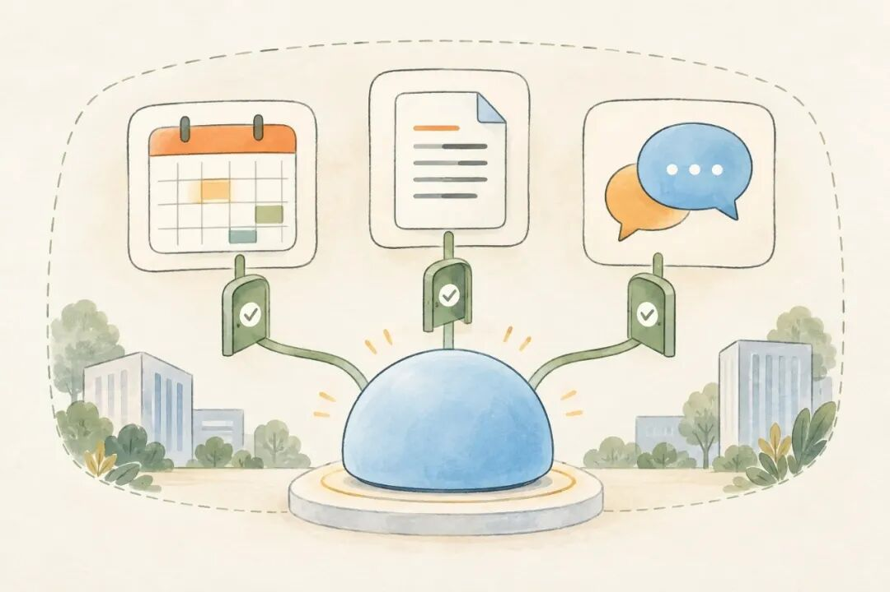
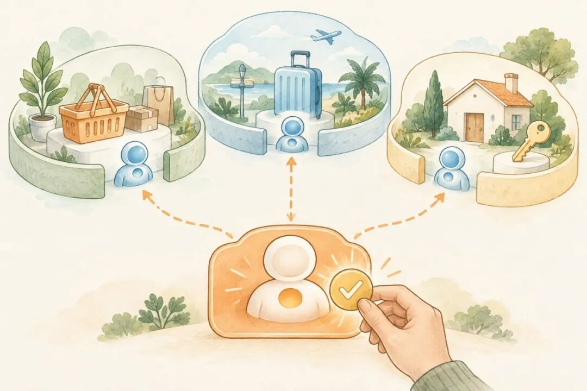



**收录说明**：用户提供链接。原文在微信公众号，用浏览器的客户端标识直接下载页面，从 `#js_content` 抽取正文，图片地址取自 `data-src`。

**内容摘要**：文章比较国内外 Personal Agent 的发展：国外 Meta 的 Muse、Grok Bot 以及 Claude 刚推出的 Duet 都在走向个人 Agent，国内办公 Agent 却更容易做起来，因为飞书、企微、钉钉等平台开放了接口。个人生活要跨购物、外卖、出行等多类平台，作者以豆包手机为例，称按 10 月 14 日的公开报道，当时已有 150 多款应用明确拒绝屏幕代操作，其中包括微信、淘宝、支付宝、美团、拼多多。作者认为短期内平台不太会把底层服务开放给外部助手随意调用，可能转向 Agent 之间协作，并提出授权共享模型额度或通用 Token 额度两种付费设想。

**保留理由**：从国内办公 Agent 与个人 Agent 的对比切入，列出了屏幕代操作被拒绝的具体应用，并给出两种费用设想。

---

## 为什么 Personal Agent 在中国很难火起来？

最近看国外的一些产品，比如 Meta 的 Muse、Grok Bot，还有 Claude 刚推出的 Duet，你会发现，国外越来越多的 AI 大厂开始往个人 Agent 这个方向走，希望做一个能长期跟着你、主动帮你处理事情的助手。

反过来看国内，当然也有公司再做。只是从我看到的产品和讨论来看，这类个人助手，好像还没有形成同样的热度。

可如果换成办公 Agent，情况就很不一样了。

国外有 Cowork、Codex，国内有 WorkBuddy、豆包工作、千问办公。除此之外，还有很多其他的办公类产品，不少模型厂商也都推出了面向工作的 Agent。你想找一个工具，帮你整理资料、处理表格、写方案，其实有不少选择。

那为什么办公 Agent 可以做起来，到了个人 Agent，就明显更难？

## 办公 Agent，先有可接入的服务

我个人觉得，一个很重要的原因，是我们日常用的这些软件，愿不愿意把能力开放出来。

比如在办公场景里，国内的飞书、企微、钉钉这些平台，都有自己的开放接口。以飞书为例，创建一个企业应用，拿到应用 ID，再把需要的权限配好、完成授权，就有了把 Agent 接进来的基础。消息、日历、文档这些能力，可以按需要接进去。

再把企业内部的业务系统做好权限管理，再对接到合适的 Agent， 大部分的办公场景就已经够用了。

## 个人生活，难在跨平台把事情串起来

可个人生活不一样。我们每天的场景太多了：购物、外卖、买菜、打车、导航、订机票酒店，还有运动、睡眠记录、医院挂号、缴水电费、收快递、预约家政，甚至家里的智能设备。

每一类事情，可能都要用不同的软件。一件看起来很简单的事，背后就涉及好几家公司。如果这些企业不开放，就没有办法对接到agent系统。

豆包手机，其实就是一个很直接的例子。

很早就在尝试，让 AI 直接帮用户操作手机。早期的技术预览版出来后，就遇到了一些应用的风控和限制，部分能力也做了调整。

后来，搭载豆包手机助手消费者版的努比亚 NaviX Ultra 推出来，又有了一套让应用声明操作边界的规则。

简单说，就是这个 App 允许 AI 操作哪些地方，不允许操作哪些地方，开发者可以声明。明确拒绝的应用，助手就不能替你操作。

按 10 月 14 日的公开报道，当时已经有 150 多款应用明确拒绝这种屏幕代操作。微信、淘宝、支付宝、美团、拼多多，这些日常高频应用都在里面。

也不是完全没有能用的，像京东、携程、铁路 12306 等应用，当时已有媒体实测可以操作。但很多日常离不开的平台仍然接不进去，想靠一个助手把事情串起来，就很容易中途卡住。

比如我要买东西，我希望它能帮我看看京东、淘宝、拼多多，比较一下价格、规格和评价。我要出去旅行，希望它能连接地图、交通、酒店。平时的运动和健康数据，我也希望能接进来，帮我一起考虑。

这些事情，对我来说是连在一起的。但对软件来说，是分在不同平台里的。

我想要的是，通过自己的个人 Agent，把这些事情安排好。可如果它只能连接其中一小部分，其他地方又进不去，那很多事情做着做着，还是得交回给我。

所以，国内想做一款好用的个人 Agent 还是很难。

## 另一种可能：让 Agent 与 Agent 协作

那以后呢？这些平台会不会慢慢开放？

说实话，从我个人的角度看，短期内没有那么乐观。直接把底层服务开放给外部助手随意调用不太会。但会不会换一种形式，比如通过 A2A，让双方的 Agent 来对接？

比如我是一家电商平台，我未必愿意把所有底层能力都开放出来，让别人的助手随意调用。但我可以做一个自己的 Agent，专门负责提供购物服务。

你有需求，就让你的个人 Agent 来找我的 Agent。商品怎么查、订单怎么处理，由我这边按照自己的规则来完成。

我觉得，未来国内有可能更偏向这种方式：平台保留自己的服务边界，Agent 之间再进行协作，也就是大家说的 Agent to Agent。

比如我想买一件东西，我只跟自己的助手说预算、需求和偏好。它再去找不同平台的 Agent，让它们各自查询、推荐，把结果拿回来。

最后，我的助手把信息汇总到一起，告诉我有哪些选择、各自有什么区别，再由我来做决定。需要继续下单，就在授权范围里往下执行。

这样，用户还是可以有一个统一入口，只是背后由很多公司的 Agent 分别完成一部分事情。

## 服务接通之后，费用怎么算？

但如果真变成这样，我又想到一个问题：费用怎么算？

假设 A 公司有一个 Agent，要订阅；B 公司也有一个 Agent，也要订阅。我自己还需要一个个人助手，又是一份订阅。

那我只是想完成一件事，是不是就得先买三份会员？以后接的服务越来越多，我要管理的订阅会不会也越来越多？

所以我在想，未来有没有可能出现两种形式？

第一种，是我订阅的模型额度，可以授权给不同的 Agent 使用。

假设我订阅了 DeepSeek，我自己的个人 Agent，还有它要对接的 A、B 两个 Agent，在厂商和应用都支持的情况下，都可以经过我的授权，使用这份订阅里的模型额度。

这样，至少在模型这部分，我就不用在三个地方重复购买。我的个人 Agent 去协调其他 Agent 办事，模型用量统一从我的账户里扣。

第二种，是大家能不能认可一种通用的 Token 额度。

因为就算不订阅，改成按量付费，也可能很麻烦。我还是得在这个平台充一点，那个平台再买一点，最后到处都有余额，到处都要管理。

那有没有可能，我只买一份通用额度，去不同平台调用 Agent 时，都能用它来支付？各家可以有自己的价格，背后再按共同认可的规则结算。

这样，按量付费还在，但我不用到处充值。它可能就会形成一种围绕 Agent 服务的 Token 结算方式。

所以回到最开始的问题，为什么我觉得个人 Agent 在国内很难真正火起来？

因为它最后要面对的，是我们每天都在使用的那些软件和服务。模型能力可以不断进步，但如果关键的服务始终接不上，用户就很难把完整的事情交给它。

对于一款好用的个人 Agent，我还是挺期待的，因为对于生活中一些琐事的决策，其实我是挺不愿意去花精力去做的。我觉得应该有很多人跟我一样如果说有这么一款好用的 Agent 助理，其实是可以帮助人解决很多问题的。
