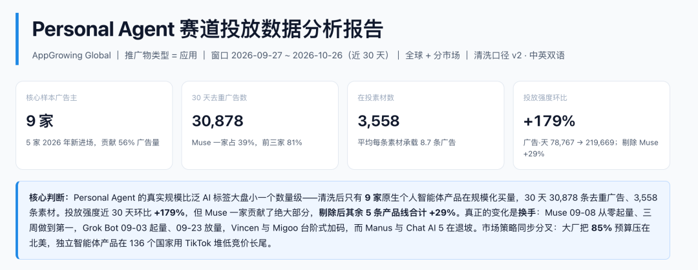
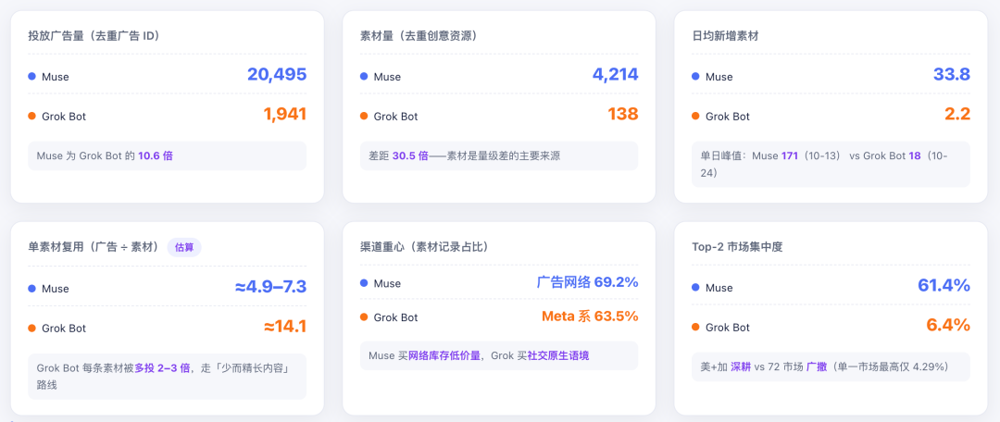
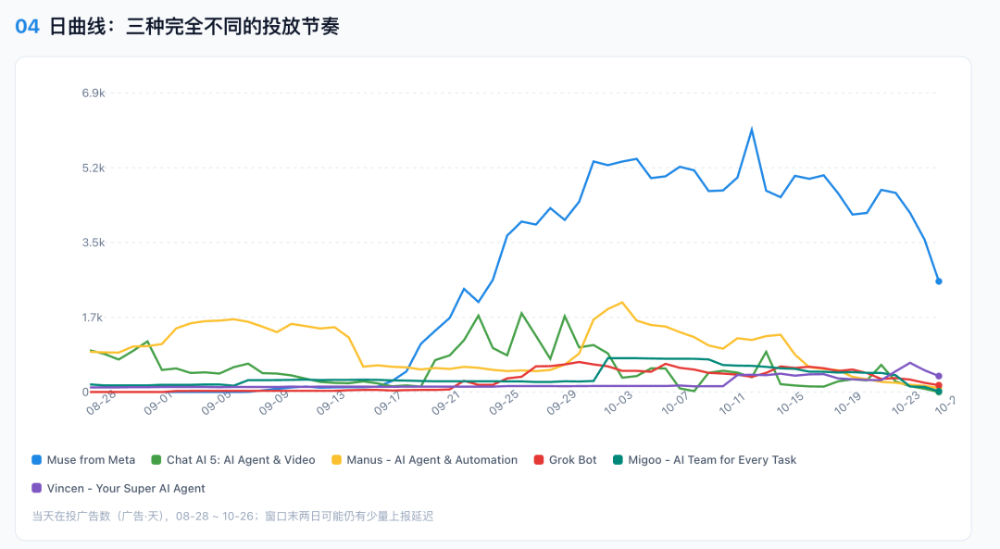
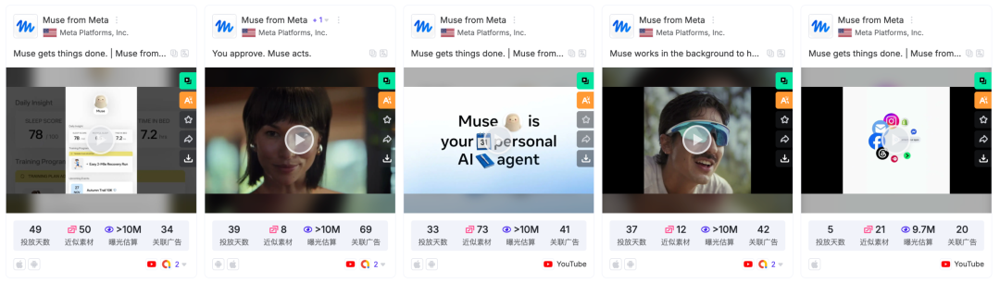
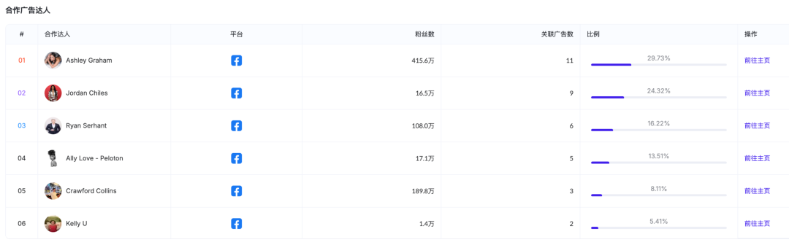
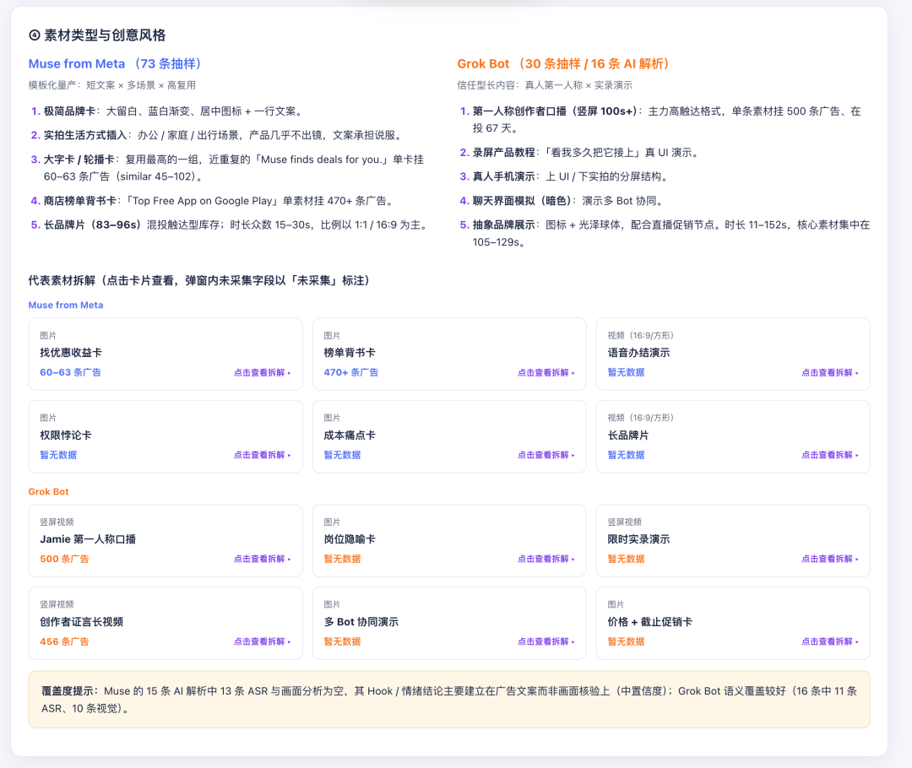
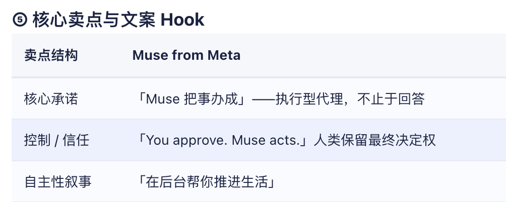



**收录说明**：用户提供链接。原文在微信公众号，用浏览器的客户端标识直接下载页面，从 `#js_content` 抽取正文，图片地址取自 `data-src`。发布方是广告情报平台 AppGrowing。文首平台横幅、文末试用与合作广告未收入；一张超过 600 KB 的动图改为链接。

**内容摘要**：AppGrowing 出海观察以广告情报平台数据分析 Personal Agent 的买量逻辑。文中称 Muse 自 9 月 8 日起投放素材一路爬升，10 月 13 日单日在投素材达到 1,500+，累计投放超 2 万条广告。按 AppGrowing MCP 报告，处于投放状态的原生 Personal Agent 产品有 9 家，其中 5 家于 2026 年新进入市场，贡献了 56% 的广告量；品类广告量环比增长 179%，剔除 Muse 后仍增长 29%。文章对比两家素材：Muse 借助跨领域公众人物建立生活化认知，Grok Bot 多用创作者证言和具体演示。

**保留理由**：一手的广告素材拆解（投放节奏、达人选择、Mr. Paid Social 多 Bot 工作流素材），并附品类投放量的具体环比数据。

---

如果你关注科技圈，最近大概都被一个词刷屏了：Personal Agent。

9 月，Meta 正式发布 Muse，并将它定义为“a personal AI agent that actually makes people's lives better（一个真正让人们的生活变得更好的个人 AI 智能体）”。几周之内，Muse 就成了一个现象级话题：

《The Daily》专门做了一期《Call My A.I. Agent》，让记者把牙科保险、订餐等事务交给 Muse 处理。体验是“magical and also a little creepy（神奇，又有点毛骨悚然）”。

10 月 11 日，Meta 首席 AI 官 Alexandr Wang 做客 David Senra 的长访谈《Creating Muse: The Fastest-Growing AI Product Since ChatGPT》，节目将 Muse 称为“ChatGPT 之后增长最快的 AI 产品”。这期节目的 YouTube 播放量已经超过 37 万。

热度不只在内容端，广告端也打得火热。

根据 [AppGrowing](https://appgrowing.net/?utm_source=wechatofficial&utm_medium=article&utm_content=personal_agent) 数据，Muse 自 9 月 8 日起投放素材一路爬升，10 月 13 日单日在投素材达到 1,500+ ，累计投放超 2 万条广告。同期，xAI 旗下的 Grok Bot 也在抢占这个赛道。

人们在讨论，厂商在烧钱，可见一个新品类的热度。

Personal Agent 走进消费级产品的用户竞争，这会怎样改变 AI App 的获客方式？

我们观察了 Muse 和 Grok Bot 的广告素材，试着回答这个问题：消费级 AI 产品，如何把产品能力转译成用户看得懂、愿意尝试的广告？

AI App 的消费级形态，大致走过了三步：从 Chatbot、AI Assistant 向 Personal Agent 延伸。

Chatbot 的核心是对话和回答；AI Assistant 通常围绕某项具体功能协助用户；Personal Agent 则替用户完成操作。

赛道的热度也在升温。根据 AppGrowing MCP 输出的报告，处于投放状态的原生 Personal Agent 产品有 9 家，其中 5 家于 2026 年新进入市场，贡献了 56% 的广告量。

同期，品类广告量环比增长 179%，剔除 Muse 后，仍增长 29%。可见，Muse 推动了整体增长，但赛道的买量热度也在扩散。

来源：AppGrowing MCP

Muse 官方明确把自己和 chatbot、assistant 区分开来。在它的定义里，personal agent 的核心是能够跨 Web 和已连接的 App 执行多步骤任务，并且在后台持续工作：发邮件、订旅行、填表单、买东西、规划目标，都在其中。

从产品概念上看，这代表 AI App 的价值主张发生了变化：从给出一个答案，走向完成一件事。

Personal Agent 还多了一道普通 AI App 没有的门槛：信任。它要接触 Gmail、日历、信用卡、旅行信息，越有用，就越需要用户交出敏感信息，用户的决策成本也就越高。《The Daily》曾这样形容 Muse 的体验：“有用，有点可爱，还需要你最敏感的个人信息。”

能力难懂和信任难给是 Personal Agent 获客的两个核心矛盾。接下来我们看看两家“头部”产品，交出了怎样的答卷。

为了观察 Personal Agent 如何争取消费级用户，我们选取 Muse 和 Grok Bot 作为案例，前者是近期明星产品，后者则是同期进入市场、同样主打 Agent 能力的产品。我们通过 [AppGrowing](https://appgrowing.net/?utm_source=wechatofficial&utm_medium=article&utm_content=personal_agent) 监测到的广告素材，观察它们如何表达产品价值。

Muse from Meta vs Grok Bot 买量策略全景拆解

来源：AppGrowing MCP

Muse 从 9 月上旬起量，并在 10 月中旬集中注入大批新素材；Grok Bot 则处在稳定期，素材迭代相对更缓慢。

两家产品的素材表达方式也有所不同。

Muse 的素材以静态图、品牌或生活方式视频、模板化短文案为主。这些形式可以快速建立产品印象，或把产品放进某种生活场景里。

来源：AppGrowing 国际版

与此同时，Muse 也邀请了来自不同领域的公众人物为产品背书，包括模特 Ashley Graham、奥运体操运动员 Jordan Chiles，以及房地产企业家 Ryan Serhant。他们横跨文体和商业领域，不只代表打工人。这或许意味着 Muse 希望触达更广泛的人群，说明个人 AI Agent 不只是工作工具，也可以参与进日常生活中。

Muse 合作广告达人，来源：AppGrowing 国际版

Grok Bot 的素材则更偏长视频创作者证言和产品演示，合作创作者的粉丝量相对较小。创作者会从自己遇到的问题讲起，再展示如何使用产品、产品做了什么以及得到什么结果。对于功能链条较长的产品，这种表达方式给了演示更多空间。

[动图：正文动图](https://mmecoa.qpic.cn/sz_mmecoa_gif/icuZ1HMm7qG1MzPpngiaa3I8a23ibJ6fIYzUiaeX3UhTyprJde5ENTXx2UiblGsLc9DC7DsATia5KibdPQMs2yeqOgFUlETncbCjCVxBmmtTNGdyhY/640?wx_fmt=gif&from=appmsg)（收录说明：动图超过 600 KB，未下载，链接到原图。）

来源：AppGrowing 国际版

结合素材来看，Muse 更侧重借助跨领域公众人物建立大众化、生活化的产品认知；Grok Bot 则更常通过具体演示解释产品能力。

Muse from Meta vs Grok Bot 买量策略全景拆解

“跨 App 执行多步骤任务”是 Personal Agent 的核心能力，却不容易直接成为有感的广告主张。所以，无论是怎样的素材表达，都要先场景化。

Grok Bot 与 Facebook 创作者 Mr. Paid Social 合作的一条素材，就从投放从业者熟悉的工作切入。视频里，他一边开车，一边像开早会一样向几个 Bot 派活——

来源：AppGrowing 国际版

他先问 Marge：

> “Morning Marge. What did we spend yesterday?”  
>
> 早啊，Marge，我们昨天花了多少？

Marge 汇报了前一天广告花费为 120 美元，并称会把表现最好的广告组预算提高到每天 600 美元。

接着，他让 Ditto 处理视频、自动化流程和多平台发布：

> “Go ahead and finish adding captions to that video I recorded yesterday… Make sure the mini chat automation and email flows are built. Then post it to my Instagram, TikTok and LinkedIn, and write the caption in my voice for each of those channels.”  
>
> 把我昨天录的视频字幕加完，确认聊天自动化和邮件流程都搭好，再发到我的 Instagram、TikTok 和 LinkedIn，并按我的口吻分别写好各个平台的文案。

最后，他把社群答疑交给 Velcro：

> “Answer the easy ones in my voice. And anything you're unsure about, draft it and I'll approve.”  
>
> 简单的问题用我的口吻直接回复；拿不准的先起草，我来批准。

说到这些事情过去要花掉多少时间时，他补了一句：“That was my entire day six months ago（这就是我半年前一整天的工作）.”

这条素材把 Agent 的抽象能力拆成了用户能看懂的任务，也由此形成几层说服力。

达人身份让任务场景更可信。 Mr. Paid Social 面向社媒投放从业者和创业者。看花费、调整预算、制作视频、发布内容、回复社群，都是这群人熟悉的工作，观众更容易把任务对应到自己每天要处理的事情上。

多 Bot 分工把产品能力变成了可见的工作流。 Marge 负责投放数据，Ditto 负责内容运营，Velcro 协助社群运营。几个 Bot 各司其职，漫威新剧《VisionQuest》中也有类似的设定：Vision 四维空间里的 AI 被塑造成不同的角色，各自带着不同的视角。

也许，未来科幻叙事中的设定，也会变成我们日复一日的现实。

Mr. Paid Social 还说“这就是我半年前一整天的工作”，这句话体现了时间价值，让观众可以感知到效率的提升。

真人演示让控制边界变得具体。 对于简单问题，Velcro 可以直接回答；碰到不确定的情况，则先起草、等待批准。这与 Muse 的高频文案 “You approve. Muse acts.” 传递着相近的逻辑。AI 可以执行，但用户保留关键确认权。

Muse from Meta vs Grok Bot 买量策略全景拆解

结尾，达人还交代了这些 Bot 的来历：“These are bots brought to you by the team at SpaceX AI（这些 Bot 来自 SpaceX AI 团队）”用大厂团队的出身背书。

真人试用可以帮助用户理解产品，也能提供体验参照。

Personal Agent 不一定会形成统一的产品定位，也不一定会对应一种固定的买量模板。

有的用户可能想省时间，把繁琐的流程交给 AI；有的用户想省钱，希望 AI 帮忙查找和比较选项；有的用户需要更方便地整理信息、安排计划。

任务不同，用户理解产品的方式也不同，广告要回答的问题自然不同。

这意味着，创意方向可能会围绕“替用户完成什么事情”逐渐分化：有的强调节省时间，有的展示搜索和比较，有的通过完整演示说明任务如何完成，也有的先用品牌和生活场景建立产品认知。

过去，AI App 的广告常常展示“AI 能生成什么”。Personal Agent 带来的新问题是：用户愿意把什么交给 AI，AI 又能否可靠地替用户完成？ 买量素材需要把这个承诺讲得具体、可信，也要与产品实际能力相符。

以上为《Personal Agent 开始抢用户，AI App 的买量逻辑变了》。

\*以上相关广告素材由 AppGrowing 国际版 采集于公开之信息，仅为研究分析所用，相关版权归原著者所有。内容仅供一般性参考，不应视为针对特定事务的意见或依据。

关注公众号，或立即注册 [AppGrowing 国际版](https://auth.youcloud.com/register?app_id=en_appgrowing&utm_source=wechatofficial&utm_medium=article&utm_content=personal_agent) 了解更多移动广告策略分析。

**推荐阅读**

More from App Growing Global

[\*让 AI 试玩 840 万条可玩广告，素材分析该换个玩法了](https://mp.weixin.qq.com/s?__biz=MzI4OTY0ODU3OA==&mid=2247508815&idx=1&sn=41ab9be64a9e14041b8dd221e5c50a49&scene=21#wechat_redirect)

[\*9 月应用月报：5 款短剧应用广告环比超 100%，“AI 找人”《Deepsearch Al》投放策略分析](https://mp.weixin.qq.com/s?__biz=MzI4OTY0ODU3OA==&mid=2247508854&idx=1&sn=262a8dc2e0a0ade6793dcd83746143dd&scene=21#wechat_redirect)

[\*9 月手游月报：腾讯休闲 SLG 新游开启预约期买量，Voodoo《Castle Busters》素材创意分析](https://mp.weixin.qq.com/s?__biz=MzI4OTY0ODU3OA==&mid=2247508815&idx=2&sn=f161549beff38adea568621e588202be&scene=21#wechat_redirect)

