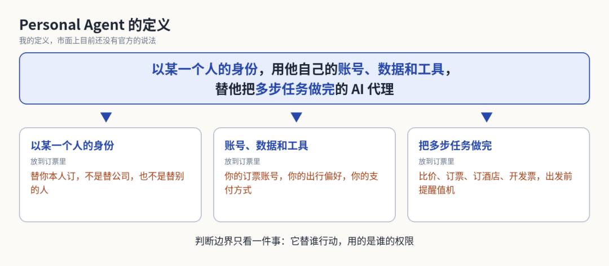
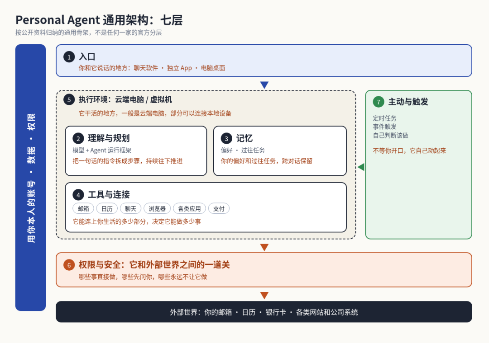
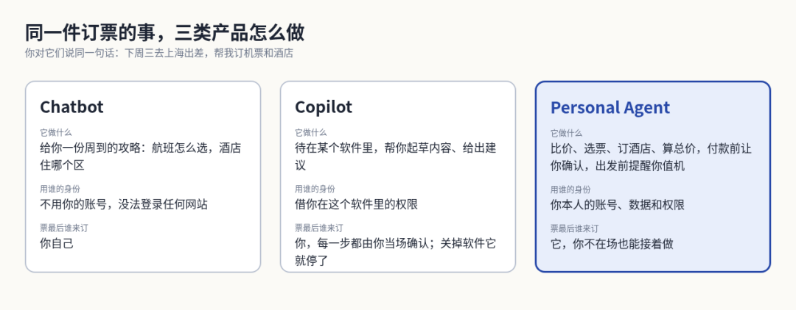
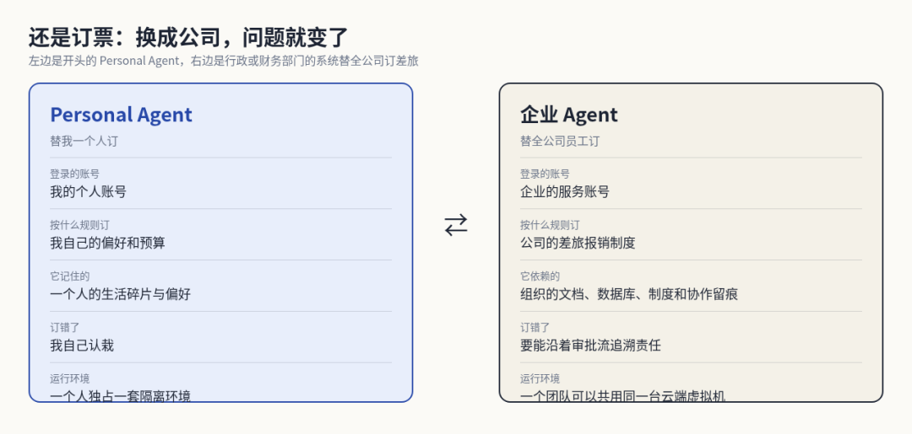
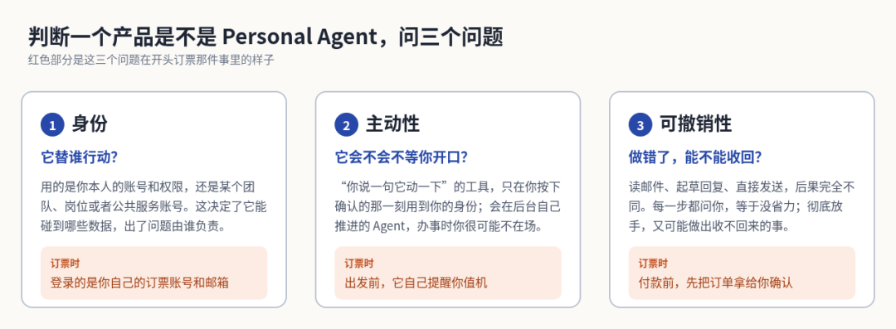



**收录说明**：用户提供链接。原文在微信公众号，用浏览器的客户端标识直接下载页面，从 `#js_content` 抽取正文，图片地址取自 `data-src`。作者称这是 Personal Agent 系列的第一篇。

**内容摘要**：PM九筒的「Personal Agent 系列」第 1 篇尝试给 Personal Agent 下定义并拆解通用架构。文章以 Muse 订机票、订酒店的完整过程为例，把它定义为“以某一个人的身份，用他自己的账号、数据和工具，替他把多步任务做完的 AI 代理”。作者将架构归纳为七层，包括入口、理解与规划、记忆、工具与连接、执行环境、权限与安全、主动与触发，并说明这是个人归纳而非厂商官方分层。文章还对比了 Chatbot、Copilot 和企业 Agent，并以身份、主动性、可撤销性作为判断标准。

**保留理由**：从定义、七层架构到与 Chatbot、Copilot、企业 Agent 的对比，完整梳理一遍，并以订机票的例子把七层逐一对应到具体步骤。

---

先设想一件小事。周一早上，你对Muse说：“我下周三要去上海出差，预计3天，把机票和酒店订了，别超预算，发票回头给我。”说完之后，Muse 先从你的指令中找到关键信息：

- 订票时间是下周三
- 要同时订机票和酒店
- 总价格不能超过预算
- 要记得开发票然后发给你

找到关键信息之后，Muse 就开始按照上面的任务开始操作：

- 登录你常用的订票软件，选择下周三日期，查询历史数据，看你有没有偏好，比如是偏好上午还是下午，是靠窗还是喜欢挨着过道；
- 再登录预订酒店的网站，先看看你有没有常住的酒店，然后选择日期，看一下价格
- 然后开始算总价格，看是否超过你的预算，如果超过你的预算，再重新比价或换到其他的酒店
- 最后到了关键的付款环节，会把完整的订单拿给你看，你看了觉得没问题，才会真的在网站下订单
- Muse 还会把日程写进你的日历，出发前主动提醒你值机。

这就是你通过 Muse 完成一个任务的完整过程，看起来是不是很方便，而这也是最近大火的 Personal Agent 的一个典型场景。

这两个月，国内外的各家公司迅速跟进，几乎每隔一两周就有一家厂商发布自己的 Personal Agent：Meta 的 Muse、OpenAI 的 Dots、Anthropic 的 Claude Duet、Google 的 Gemini Spark、Manus 的 Cue，以及 xAI 的 Grok Bot。如果你仔细看过他们的宣传文案或者介绍产品的文章，你会发现，虽然大家都自称是“Personal Agent”，但侧重的方向有所区别：有的主打订票、购物、砍价，有的专攻盯收件箱、催发票、起草合同；有的嵌在聊天软件里，有的则是独立 App。

热闹归热闹，但我一直有几个问题没想明白：这些产品到底算不算同一类东西？到底什么才是 Personal Agent？这些产品和 Chatbot、企业 Agent 又有哪些区别？哪些是真正意义上的 Personal Agent，哪些只是借着这个词蹭热点？带着这些问题，我最近密集看了很多文章，也深度使用了几款产品，所以就想写点东西，把我这段时间的所学所思分享给大家。因为内容较多，想了想还是拆成几篇来写吧。

我平时做的是企业 AI 落地，常年打交道的是企业 Agent。在这一系列的文章里我想探讨的只有一个核心话题：同一套底层技术，服务对象从个人换成企业，做出来的产品会有什么不同？

系列文章大致是这么安排的，写作的过程也是一个第二次学习的过程，过程中可能会有新的产品出现，我个人可能也会有另外的思考，因此不能保证最终的成文和这个顺序完全一致。

第 1 篇（本篇）：Personal Agent 到底是什么，通用架构长什么样，和聊天机器人、Copilot、企业 Agent 究竟差在哪。

第 2 篇（产品拆解）：这几家产品用的是同一个骨架，真正的差异落在哪几层。

第 3 篇（信任与权限）：个人 Agent 的生死线是“敢不敢托付”，主动与打扰的边界、付款与越权该如何设计。

第 4 篇（深度对比）：个人 Agent 与企业 Agent 的分野，从身份、上下文、成本结构到商业模式。

第 5 篇（中国篇）：在超级 App 的高墙之内，本土 Personal Agent 会长成什么样。

## 01. 什么是 Personal Agent

我们学习一个新事物之前，喜欢先学习它的定义，但市面上目前还没有针对 Personal Agent 的官方定义。结合自己看过的一些文章和一些产品的深度体验，我对 Personal Agent 的定义是：以某一个人的身份，用他自己的账号、数据和工具，替他把多步任务做完的 AI 代理。

这个定义里最关键的是“以某一个人的身份”，我认为这是区别于其他类似 Agent 产品的关键。带着这个定义我们再看开头那个例子：订机票、订酒店，换成别的产品也能做。之所以 Muse 能称为 Personal Agent，是因为它登录的是你自己的订票账号，用的是你自己的偏好和支付方式，如果订错了，后果也由你自己来承担。所以我对 Personal Agent 划边界的方式是看身份，不看场景：它替谁行动，用的是谁的权限。

为什么不按场景来划分呢？拿在钉钉、飞书这类办公软件里处理消息来说：用我自己的账号，替我回复同事、整理我自己的待办，是 Personal Agent；用公司统一开通的服务账号，按既定流程，在群里替整个团队催办、分发任务，是企业 Agent。场景一模一样，但前者要处理的是我一个人的偏好和底线，后者要对齐的是组织的规则和责任，产品要解决的问题完全不同。

按这个标准看，Claude Duet 和 Grok Bot 虽然偏重工作场景，但它们调用的是你本人的身份和个人账号，所以依然是 Personal Agent。Grok Bot 更像一人公司或小微企业主的工作助理，Muse 则在个人生活场景上做得更深。它们的侧重不同，但站在同一个身份位置上。

## 02. Personal Agent 的通用架构

我对 Agent 有一个很简单的理解：Agent 就是 AI 加上一台替你干活的电脑。从最近发布的几家主流产品的官方说明可以看出，这些产品的架构高度一致。我根据公开资料，把这套架构归纳成七层。需要说明的是，这是我个人的归纳，不是任何一家厂商的官方分层。

七层各自负责什么

第一层，入口。你和 Agent 说话的地方，可以是聊天软件、独立 App，也可以是电脑桌面。入口决定了这个产品是不是长在你本来就待着的地方，你会不会每天顺手用它。

第二层，理解与规划。把你一句话的指令拆成具体的步骤，并且持续往下推进，直到任务完成，而不是聊完一轮就停下。这一层由基础模型加上 Agent 运行框架组成。

第三层，记忆。模型本身可以看作一个无状态的函数，每次调用都要把系统提示词、工具定义、会话历史重新带进去。所以“它记得你”不是模型的本事，而是产品层在维护的状态。比如开头的例子里，Muse 会去查你的订票偏好，像是喜欢上午还是下午的航班、常住哪家酒店，这些都是产品先存下来，办事的时候再交给模型的。长期来看，我觉得掌握用户的个人记忆，比拥有最强的模型更重要。

第四层，工具与连接。它要能连上你的邮箱、日历、浏览器、各类应用和支付工具，才能真正替你动手。它能接触你数字生活的多少部分，决定了它能帮你做多少事。

第五层，执行环境。执行环境决定了这些操作具体在哪里运行。一个 Agent 能连续自主工作多长时间，决定了产品是什么形态：

- 分钟级的任务适合放在聊天框里；
- 小时级的适合跑在本地的编程 Agent；
- 数小时甚至跨天的任务，就得交给云端的异步 Agent。

个人事务的时间跨度往往很长，所以这几家都选了云端：Muse 跑在专属的云端虚拟机里，Duet 配了带浏览器的独立虚拟机，Spark 在你合上电脑之后依然留在后台运行。这样做的好处是当你关闭设备时 Agent 也能接着干活，代价就是你的个人数据和操作都在厂商的云端。

第六层，权限与安全。它是 Agent 和外部世界之间的一道关卡，决定了哪些事儿 Agent 可以直接做，哪些必须先让你确认，哪些永远不让它做。几家产品的做法大致有三种：

- 敏感操作先审批：Duet 在发消息、付款、签文件、删除数据之前，会先展示具体操作，等你批准；炒股和账户间转账这类高风险的操作，即使你批准它也拒绝执行。
- 规则分档：Dots 把自定义规则分成“直接做、明确要求才做、先询问、必须本人做”四档，改密码这类事必须你自己来。
- 隔离凭证：Muse 和 Duet 都声明看不到你的明文密码，付款则通过一次性卡号或虚拟卡来隔离风险。

第七层，主动与触发。这也是区别于传统 Chatbot 的一个关键点，Agent 可以不需要你的指令，自己就动起来。触发的方式有几种：

- 定时任务，比如每天早上的日程简报；
- 事件触发，比如收到一封航班变更的邮件；
- 也可以是它根据上下文判断“到时间该办了”。

这一层其实看起来简单，但其实越往后做难度也越高，也越容易从“贴心”变成“打扰”。

关于第六层，我需要再额外补充一点：隐藏凭证和防范恶意指令注入这两项机制，目前只有 Muse、Dots、Duet 的官方页面写得比较具体，其余几家没有提到。

我们归纳一下，这七层架构可以这样去理解：前四层决定 Agent 能不能把事办成，后三层决定你放不放心让 Agent 去办，尤其是第六层。

官方说明里还有三件事反复出现，我没有单独列成层，但同样重要：计费与额度，多 Agent 协作，以及可观测与接管，也就是你能不能看到它正在做什么，不对劲的时候能不能接过来。比如 Dots 支持直接打开它的虚拟桌面来接手，Muse 提供完整的审计日志，Duet 官方则说明目前还不支持用户实时查看它的浏览器画面。这些细节，留到后面的文章再讲。

Agent 如何完成订票这件事儿的

回到开头订票的例子，Muse 把它办成的每一步，其实就是任务依次经过这七层的过程：

1. 入口：周一早上，你在 APP 里对 Muse 说“我下周三要去上海出差，预计3天，把机票和酒店订了，别超预算，发票回头给我”。
2. 理解与规划：Muse 从你的指令里找出日期、预算、发票这些关键信息，再按顺序排出具体的执行步骤：查机票、订酒店、算总价、开发票。
3. 记忆：Muse 去查你的偏好，比如喜欢上午还是下午的航班，靠窗还是过道，常住哪家酒店。
4. 工具与连接：Muse 登录订票软件和酒店网站比价、下单，连上你的邮箱，把发票发给你，再把行程写进日历。
5. 执行环境：这些操作全部在云端虚拟机里完成，你合上电脑任务也不会中断。
6. 权限与安全：走到付款这一步，Muse 不会直接刷卡，而是先把完整的订单拿给你看，你确认之后才会下单。
7. 主动与触发：出发前，Muse 主动提醒你值机。

## 03. 和其他 AI 产品的区别

前面讲了 Personal Agent 的定义和架构，但它到底和我们平时接触的 AI 产品差在哪，还需要放在一起比一比。我选了三类来比：Chatbot 和 Copilot 是大家用得最多的，企业 Agent 则是技术上和它最接近、也最容易搞混的。

它和 Chatbot、Copilot 有什么不同

大多数人接触 AI，是从 Chatbot 开始的，后来又在各种软件里用上了 Copilot。Personal Agent 可以看作是在这两类产品的基础上又往前走了一步，所以拿它们来对比，最容易看出 Personal Agent 多了什么。了解完 Personal Agent 的架构，那对比的方法也很简单：看它缺了哪几层，以及用的是谁的身份。我们还是用订机票这个例子，我们对三类产品下达同样一个指令，结果却是完全不同。

先看 Chatbot。它会给你一份很周到的攻略，航班怎么选，酒店住哪个区，但票最后还得你自己来订。原因很简单，它只负责生成文字，缺的是第四层和第五层：既不能登录你的账号，也没有一个地方替你持续操作。

那让 AI 能动手，就是 Copilot 多做的一步。它嵌在某个软件里，借用你在这个软件里的权限，可以帮你起草内容、给你建议，也有了局部的工具连接（第四层）。但它没有独立的运行环境（第五层），也不会主动触发（第七层），每一步都要你当场确认，你一关掉软件，它就停了。

Personal Agent 补上的，就是 Copilot 缺的这几层。像开头演示的那样，它有自己的运行环境，用你的账号去外部世界办事，你不在的时候也能接着做。七层一层都不能少，而且因为它做的每件事都是以你的名义，第六层要比以往任何软件都更重视。

它和企业 Agent 有什么不同

最容易和 Personal Agent 搞混的是企业 Agent，两者底层的模型和编排技术几乎同源。但我的判断是，技术相似，产品面对的问题却很不一样。还是订票这件事。换成公司，就是行政或财务部门的系统，替全公司员工订差旅。这时候有三点不一样：

- 账号：Agent 登录的不再是我的个人账号，而是企业的服务账号；
- 规则：遵循的不再是我的偏好，而是公司的差旅报销制度；
- 责任：订错了票，不再是我自己认栽，而是要能沿着审批流追溯责任。

我的理解是，办公 Agent 管的是“任务状态”，Personal Agent 管的是“一个人的长期状态”。服务对象从个人换成组织，架构里不少地方的设计思路都会跟着改变，这里我挑四个改变最明显的地方：

记忆

- 个人 Agent 记的是一个人的生活碎片和偏好；
- 企业 Agent 依赖的是组织的文档、数据库、制度规范和协作留痕；
- 模型能力和运行框架会逐渐趋同，企业级真正的壁垒，在于能不能打通并调用完整的组织上下文。

主动性

- 个人 Agent 稍微积极一点就容易变成打扰，稍微迈大一步就可能越权；
- 企业场景里，任务本来就由业务流程和系统事件触发，团队协作和规范也能消化掉一部分偏差。

成本

- 两边算的不是同一本账；
- 企业里一个团队可以共用同一台云端虚拟机；
- 一个人的生活助理，使用频率不高，却要独占一套隔离环境，平摊到每个用户身上，基础设施成本要高得多。

安全与隔离

- 做面向全员的企业助理，首先要解决的就是安全和成本，要做严格的集群隔离和代码沙箱，还要根据数据的敏感等级，把请求分别路由到外部商用模型或内部私有模型；
- 这一整套治理，在个人消费级产品里几乎不用考虑，在企业落地时却是入场门槛。

我还设想过一个问题：如果给公司里每位员工都配一个专属的 Personal Agent，会发生什么？Personal Agent 成立有三个隐含前提：

- 只跟一个人对话；
- 直接用这个人的账号登录；
- 这个人说什么都照办。

放进公司之后，这三个前提都不成立了，团队得重新设计群聊里的规矩、共享账号的连接方式，还有分级的权限。所以我觉得，两者不能当成同一款产品来做。

## 04. 如何判断是不是 Personal Agent

讲完了定义、架构，以及它和其他产品的区别，再回到最初的问题：拿到一个具体的产品，怎么判断它是不是 Personal Agent？我会从三个方面来判断：

身份：它替谁行动？它用的是我本人的账号和权限，还是某个团队、某个岗位或者公共服务账号？这决定了它能碰到哪些数据，也决定了出了问题由谁来负责。

主动性：它会不会不等你开口？如果是“你说一句它动一下”的工具，它用到你身份的时间，只有你按下确认的那一刻；但一个会在后台自己推进的 Agent，替你办事的时候，你很可能不在场。目前大多数产品的交互，仍然是由用户发起的，主动性还处在很早期的阶段。

可撤销性：做错了，能不能收回？读邮件、起草回复、直接点发送，是三件后果完全不同的事。写代码可以靠运行和测试来验证对错，个人事务往往没有这样的办法。每一步都问你，你得全程盯着，等于没省力；彻底放手，它又可能发错消息，或者替你做出收不回来的承诺。这三个方面合在一起，其实都指向了同一个问题：你敢不敢放心让它替你去做事。

除了上面提到的三个方面，另外再补充两个我觉得容易误判的地方。

第一，能调用工具，不等于是 Personal Agent。调用工具只是第四层的基础能力，今天的 Chatbot 一样能搜索网页、用计算器。关键是它有没有用你的身份，在你授权的范围内，把一件事从头做到尾。

第二，会主动发提醒，也不等于是。主动性难的不是发得出提醒，而是知道分寸。我把人和 AI 的交互分成三级：

- 你问一句，它答一句；
- 你交办一件明确的事；
- 你把一整块职责长期交给它。

信任是顺着这三级一步步建立的，Agent 越界一次，拿到了不该拿到或者你没让它看的数据，或者最终的任务结果失败了，那信任度就会下降。如果某个产品想一直持续获得用户最高的信任，靠的是边界设计，而不是每天推送多少条提醒。

所以，如果一个产品用的不是你的身份，也不会自己往下推进，只是接了几个工具，或者会发提醒，那它离 Personal Agent 还有距离。开头提到的这几款产品，这篇文章先不展开，留到第2篇拆解产品的时候，我们再详细看一看。

## 05. 对产品经理意味着什么

写到这，核心内容基本写完了。那这些内容对做产品的人有什么用呢？我是做企业 Agent 落地的，那我的关注点肯定和做 Personal Agent 的产品是不太一样。

做 Personal Agent

我认为最重要也是最先要想清楚的是权限怎么分档控制。拿开头订票来说，查机票只是读信息，起草一封改签邮件是写内容，点发送是对外沟通，付款是花钱，四个任务失败所导致的后果差别非常大。如果这些事情使用同一档的权限控制体系，要么每一步都弹确认，用户烦了就不想用；要么全部放开，哪天订错了没人兜底。所以如果我去做，我会先列出一份“Agent 不能自己做主”的清单，再按操作能不能撤销，给每个对外的动作建立不同的权限控制档位。如果一个 Personal Agent 产品不能和用户建立信任，那再厉害的模型、再丰富的生态也无法拯救这座一开始就建立在沙滩之上的城堡。

做企业 Agent

企业客户买单的理由和个人用户不太一样。我的判断是，企业更看重能不能放心，而不只是能提多少效率。比如在钉钉、飞书里接入一个 Agent，客户很可能先问：它用的是谁的账号？谁能看到它做了什么？出了问题找谁？所以权限能继承现有的组织架构、过程有记录可查、能接入已有的审批流程，这几件事在需求里的优先级，我觉得要排在新功能前面。当然，这只是我目前的判断，还需要在更多项目里验证。

这一篇到这里，开头的几个问题基本都有了我的回答：

- 什么是 Personal Agent：以某一个人的身份，用他自己的账号、数据和工具，替他把多步任务做完的 AI 代理，判断的边界只看它替谁行动，用的是谁的权限；
- 它的架构：一共七层，前四层决定 Agent 能不能把事办成，后三层决定你放不放心让它去办；
- 和其他产品的区别：Chatbot 缺第四层和第五层，Copilot 缺第五层和第七层，企业 Agent 用的是组织的服务账号，面对的是组织的规则和责任；
- 怎么判断：看身份、主动性和可撤销性这三个方面。

当然，这些都只是我现阶段的理解，产品和技术还在快速变化，后面如果有新的发现，我会第一时间分享。

下一篇，我会把开头提到的这几款产品结合文字介绍和我实际的体验，分析一下它们真正的差异落在哪，也看一看它们到底是不是真正的 Personal Agent。
