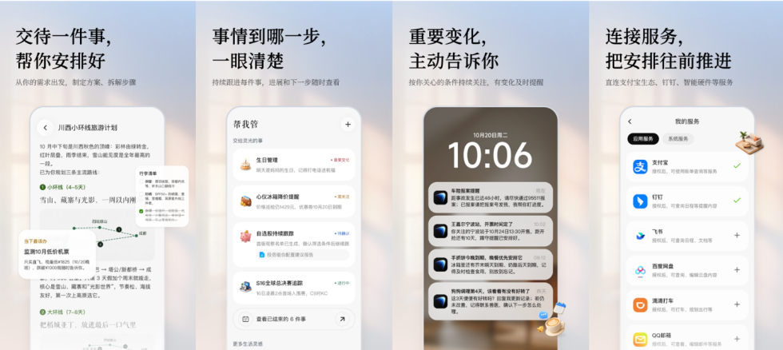
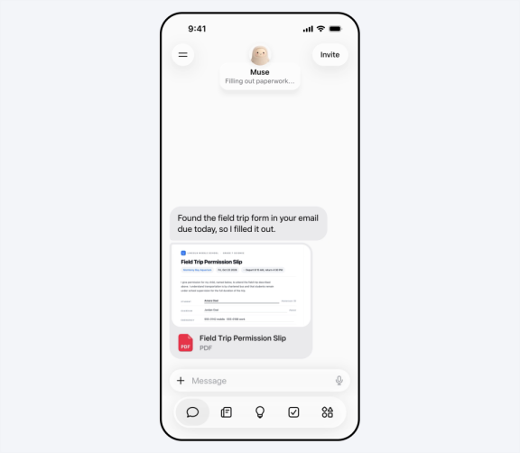
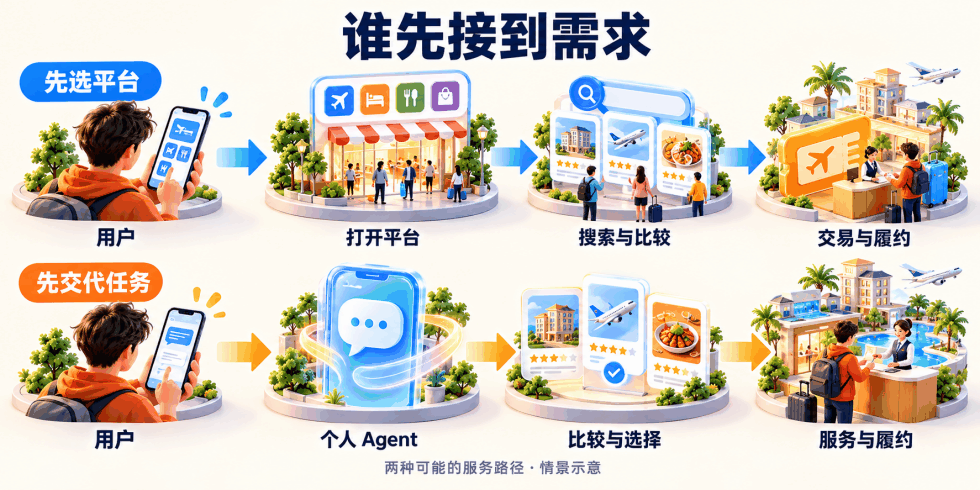
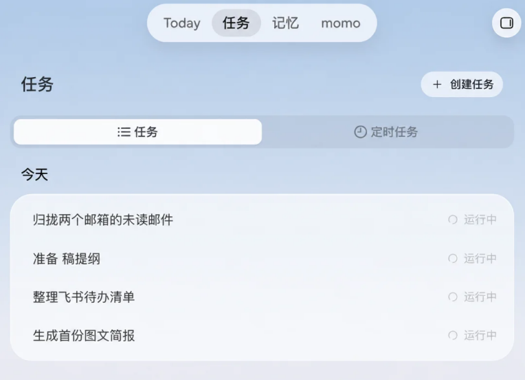
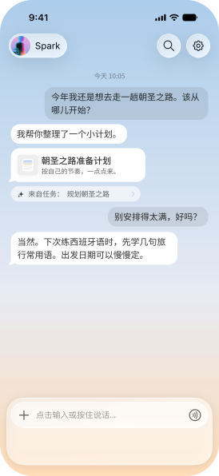
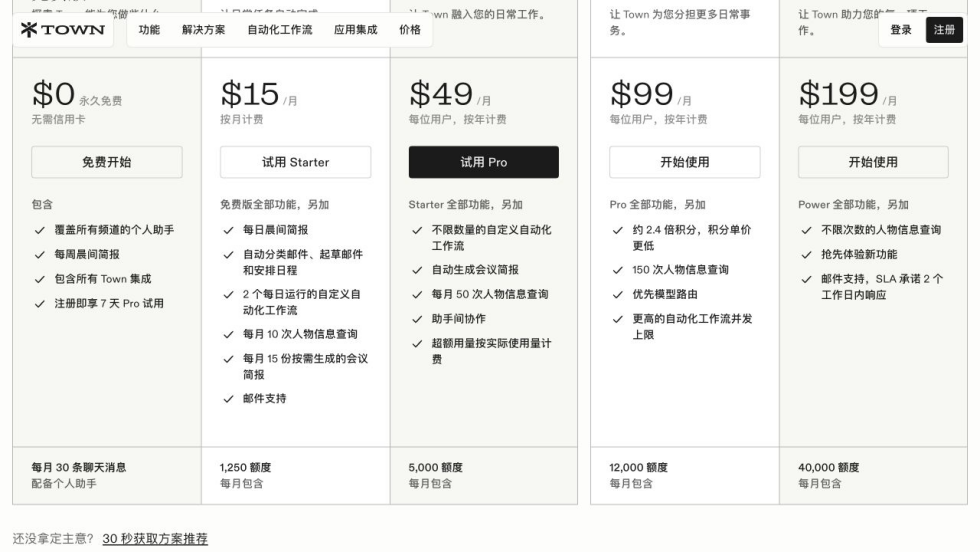
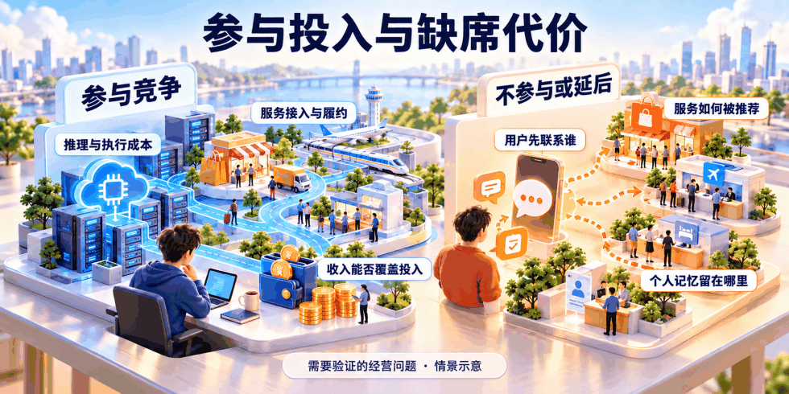



**收录说明**：用户提供链接。原文在微信公众号，用浏览器的客户端标识直接下载页面，从 `#js_content` 抽取正文，图片地址取自 `data-src`。

**内容摘要**：10 月 27 日，蚂蚁发布了灵光 2.0，这次要接手的是交代完、关掉对话之后仍未结束的事务。按产品介绍，授权连接支付宝后，它可以核对自动续费、梳理扣款记录，也能按约定持续关注机票价格并在需要时提醒。同一个月，阿里巴巴也公布了千问Go！，在千问 App 内开放体验申请，10 月 25 日的公开报道提到其“我的应用”及云端 Pro 仍处邀测阶段。文章认为大厂需要防止用户需求先被别人的助理接走，并讨论端侧处理轻任务、云端处理复杂任务的分工，以降低个人助理的交付成本。

**保留理由**：从大厂防守角度分析 Personal Agent 的竞争格局，并给出端侧与云端分工降低成本的论点。

---

10 月 27 日，蚂蚁发布了灵光 2.0。这次它想接手的，是你交代完、关掉对话之后，仍然没结束的那些事。

按产品介绍，授权连接支付宝后，它可以帮你核对自动续费、梳理扣款记录；你让它关注机票价格，它会按约定继续盯着，在需要留意或行动的时候提醒你。这些功能对准了真实的麻烦，但产品是否省心，还要看查出问题以后，能继续处理到哪一步。

这类围绕一个人、记住目标并持续推进事务的产品，正在走向Personal Agent，也就是个人智能体。如果它既记得你的安排，又能调用服务，下一次需要办事时，你就有理由先找它，再决定打开哪个 App。

同一个月，阿里巴巴也公布了千问Go！，在千问 App 内开放体验申请。蚂蚁的灵光和阿里的千问，都在尝试用已有服务承接更多个人事务。已有资源能让它们少走一部分接入的路，能否比原来的 App 路径更好用，还需要交付结果来证明。

对用户，这些需求真实存在。能否靠它们撑起一门独立收费的生意，还要算账。但对已有用户和交易的大厂来说，也必须考虑：如果需求先被别人的助理接走，原有服务还能够以什么条件被选中？Personal Agent 的竞争，也由此带上了防守的意味。

## 一、用户的需求，开始出现在App 之前

想象一次带孩子出行。你要订酒店，预算有限，希望离车站近，周日还能晚些退房。你先打开熟悉的平台逐项筛选，换个平台，又得重新设置条件、核对房型和退改规则。

如果这些要求可以先交给一个Agent，它就能带着同一组约束比较服务。你确认候选方案，却未必需要自己在几个平台之间来回找。用户少重复一次，产品就多一点价值。

但日常事务还有另一层麻烦：事情并不总能一次结束。时间改了，酒店要不要重订？退掉的订单，退款到账了吗？人需要记住进度，再在合适的时候回来处理。一个助理如果能把这段负担接过去，就比只给一份建议更值得留下。

Meta 在 9 月发布的 Muse，把个人记忆和自己的云端电脑放在一起，强调用户离开以后仍可推进任务。后台能持续运行，解决的是任务会不会随窗口关闭而停止；目标有没有理解对、变化以后能否调整、失败时能不能交代清楚，仍要通过连续使用检验。

需求早就存在。变化发生在它由谁先承接、由谁持续跟进。对于一部分目标明确、步骤繁琐的事务，用户有机会先交代目标，再选择服务。平台过去依靠使用习惯获得的机会，现在也需要重新争取。

## 二、大厂要守住的，是与用户的直接关系

平台拿到一笔订单，和平台掌握这笔订单的选择过程，价值并不相同。

Instinct 选择让用户发消息、打电话，把买食材、订车票这类事情交给它，再使用手机和电脑执行。它试图在用户决定打开哪个服务之前，先接到那一句要求。联系入口变轻了，复杂事务里的条件确认和异常处理却不会消失；如果仍需用户频繁接手，省下的操作就会打折。

用户在平台里搜索，平台可以展示不同商品、安排推荐，也能看到用户在哪一步犹豫或离开。对于依赖搜索广告和推荐位收费的业务，这段浏览过程本身就在产生收入。

如果Agent 已经替用户比较过商品，进入平台时只剩下确认库存、付款和履约，其中一部分展示机会就会减少。平台仍然可以提供服务、收取相应费用，但它影响用户选择的范围缩小了。

对商家来说，变化也很直接。以前要争取的是平台里的搜索排名和推荐位置；如果候选名单由Agent 先筛一遍，就要进一步考虑自己的商品能否进入这份名单。推荐怎样形成，商业合作怎样参与，都会影响订单的流向。

推荐权到了Agent 手里，也需要接受同样的追问：它比较了哪些服务，为什么把这个方案排在前面，商业合作有没有影响结果？如果助理只是在替另一套利益安排筛选商品，用户得到的选择未必更好。“替用户办事”需要落实到可解释的选择和可追踪的交付上。

服务方不会因此失去全部议价能力。价格、品牌和独特供给仍会影响选择，逛内容、享受挑选的用户也有理由直接打开App。但在用户只想尽快办完的任务里，平台开始面临被另一层服务比较和选择的压力。

长期关系也会沿着这个过程积累。预算怎么定，上次哪里不满意，这次又改了什么，如果这些信息持续留在同一个助理那里，下次找它就能少解释一些。平台面临的压力因此超过一笔订单：它还需要争取下一次被用户直接找到的机会。

助理要影响选择，先得有服务可以选。商品推荐得再合适，后面接不上库存、交易和售后，最后还是得把事情交还用户。这也是大厂多年积累的资源开始起作用的地方。

## 三、资源能降低门槛，交付还要重新证明

挑中一家酒店和真正住进去之间，还隔着不少事情。库存是否准确，价格能否锁定，付款后谁确认，临时改期找谁处理，每一步都要有实际的服务方接住。

用户付钱以后，出了问题仍然需要有人解决。一个Agent 如果能推荐、能下单，却接不上退款和异常处理，最后就会把麻烦留给用户。服务交付不能停在演示结束的地方。

10 月 25 日的公开报道提到，千问 Go！的“我的应用”及云端 Pro 仍处邀测阶段，尝试在授权后利用淘宝、高德、大麦等平台的个人记录，生成持续更新的工具。历史记录有机会减少重复录入，却未必能说明用户这一次想要什么。把订单整理成票根册，与可靠地处理改签、退款，也是不同难度的工作。

对千问Go！更值得观察的，是这些连接能走多远：能否比较生态外的供给，遇到自家服务不合适时怎样推荐，任务失败后由谁接手？如果选择范围主要受限于自家服务，便利与选择之间就有取舍。现在的邀测信息，还不足以回答这些问题。

覆盖的事务越多，需要连接的供给和履约环节就越多。大厂已经经营的账号、交易和合作关系，可以降低一部分接入门槛。但资源归属、部门之间的协调和对外开放的规则，同样会影响执行。资源多是一项条件，不能直接换算成任务完成率。

创业产品也在从另一头组织资源。Today 强调个人记忆与主动帮助，Instinct 从通信入口承接任务。它们可以连接现成服务，却仍要证明访问是否稳定、授权能覆盖哪些动作，以及出了问题能否继续处理。

Today 的例子也提醒人，不必把“更懂你”当成既成事实。Founder Park 的公开体验记录了部分个人情况归纳不准确的情况。助理记错了一条偏好，后续建议就可能跟着偏。用户纠正以后，记忆和下一次行动能不能一起改正，比记住了多少条信息更有意义。

有API 可以调用、能在浏览器里操作，能降低一部分接入门槛。可操作一次，与长期可靠地交付，仍然隔着服务方的规则、账号授权和异常处理。大厂的优势会受到开放程度影响，创业公司的机会也取决于这些连接能走多远。

但开放到哪一步，仍然需要服务方作出选择。它希望获得新订单，也会考虑用户关系归谁、自己的推荐还能不能被看见。技术接口接通以后，交易规则、分成和责任仍要谈清。

所以，大厂争取新的用户入口，也在重新组织服务资源。哪些平台愿意开放，愿意开放到查询还是下单，出了问题由谁处理，都会影响一个Agent 最后能帮用户做多少事。

## 四、手机，正在成为另一个竞争入口

服务平台可以向用户靠近，手机和操作系统则有另一条路径：先接收需求，再寻找能够完成任务的服务。它们原本就处在用户每天处理消息、查看日程和打开应用的过程里。

这批产品在尝试不同的手机入口。Muse 可以从 WhatsApp 联系，Instinct 接受消息和电话；Today 的官网则展示了在手机对话里继续安排和调整个人计划的例子。少切换一次、少重复交代一遍，都可能降低使用负担，但仍要看后续任务能否接得住。

手机上的联系入口，与任务在哪里执行，是两层不同的问题。Muse、9 月发布的 dots，以及 10 月开启研究预览的 Claude Duet，都公开介绍了自己的云端电脑或虚拟机。手机负责接收要求和反馈，后台可以在用户离开设备后继续工作。多了一个移动端入口，并不能证明任务已经在本地执行。

移动端原生应该体现在这些地方。提醒在合适的时候出现，任务中断后能接着做，跨应用时不用用户重新说明一遍。把聊天框搬到手机上，还不足以形成这种体验。

系统层还有进一步减少摩擦的机会。通知、日程和眼前的屏幕，本来就包含着用户当下要处理的信息。能在授权范围内理解这些信息，就有机会少让用户复制一次、解释一遍。但拿到系统权限以后，仍要解决后面的服务能开放多少。

因此，互联网平台还要面对来自设备和系统的竞争。平台可以自己做助理，也可以成为其他助理调用的服务。后者仍能带来订单，但用户先向谁提要求、服务按什么条件被选中，就需要重新谈。

## 五、需求真实存在，这门生意还要算账

查一次续费、整理几张票据、跟进一笔退货，都有价值。问题在于，这些事情分散在生活里，其中不少单次价值有限。用户愿意试用，不代表愿意为此再增加一份长期订阅。

工作和生活，在这里会算出不同的账。Claude Duet 首先面向专业人士和小企业主；9 月升级的 Town 2.0，围绕邮件、日程和团队协作组织个人助理。省下一个经营者的几小时，可以与收入、人工成本相比较；替普通用户偶尔跟进一笔退货，要建立持续付费的理由，就更难。

Duet 的发布说明也承认，当前能力主要围绕工作构建，订票等个人跑腿事务仍较弱。面向一个人，不等于已经覆盖这个人的全部生活。工作场景里的价值，不能不加区分地套到大众生活助理身上。

Town 的公开定价已经包含订阅和用量限制，Duet 的研究预览则纳入 Pro、Max 套餐并共享额度。收费方式在探索中，但有没有足够多人长期购买、收入能否覆盖交付，还需要经营数据回答。不能用工作助理的标价，替大众生活助理证明商业成立。

提供服务的一方，还得算每件事到底花了多少钱。一次事务可能需要反复查询、等待、重试，遇到异常还要纠错。单次模型调用便宜了，并不代表完成整件事的成本已经足够低。

Duet 的说明把这个问题摆得很具体：后台检查会消耗套餐额度，因此它每隔数小时检查连接的账户；如果不停检查，额度会更快用完。一个助理越主动，背后越需要决定什么值得查、多久查一次。用户看到的一条提醒，前面可能已经发生了许多次检查。

固定月费解决的是用户每个月付多少钱的问题。后台用了多少算力、执行了多少次操作，成本仍然跟着任务走。如果用户越依赖产品，服务开支增长得越快，就必须找到足以覆盖它的收入。

对于大量轻量需求，用户也可能通过设备、现有会员或交易服务获得助理能力。没有单独订阅Agent，不代表这项服务没有成本；费用只是被放进了另一笔支出，或者暂时由提供服务的公司承担。

于是，同样一个通用Agent，独立公司和已有业务的平台，会算出不同的账。前者通常需要更早找到支撑持续交付的收入；后者还可以考虑，这项投入能否带来新交易，或者减少原有用户的流失。商业是否成立，要放回各自的经营条件里看。

## 六、大厂为什么不能等

对互联网大厂来说，Personal Agent 有可能先成为守住原有业务的一笔投入，再逐步找到独立收费的方式。

假如用户习惯向另一个Agent 交代需求，平台即使仍能履约，也可能越来越依赖对方的推荐。到了那时，再推出一个能力相近的助理，用户没有理由仅仅因为它来自大厂，就重新配置服务、重新交代自己的偏好。等待，同样是在承担成本。

因此，判断要不要做，既要算新产品能赚多少，也要算不参与会失去什么。一个Agent 即使暂时收不到足够的订阅费，如果它能带来交易、维持用户关系，就有支持现有业务的价值。反过来，投入很大却没有实际效果，也不能一直靠“战略意义”解释。

更难的一笔账在大厂自己内部。对于依赖浏览和推荐赚钱的业务，Agent 帮用户减少操作，也会压缩一部分原有展示机会。新增交易能否补上这部分收入，哪些旧的变现方式需要调整，都得面对。做一个新助理，可能同时意味着改变自己已有的生意。

如果为了保住旧收入，让助理继续把用户带进冗长的浏览和推荐，用户又会追问：我为什么要多用这一层？平台手里的资源，让它更有条件把事办成；能否让用户感到省心，仍然要靠产品结果证明。

这也是防守战难打的地方。大厂要保护既有业务，又必须适应可能改变既有业务的交互方式。自建助理、与系统合作，或者成为其他Agent 能够可靠调用的服务，都是选择。需要回应这场变化，参与方式却可以不同。

Instinct、Town 和 Today 已经参与了对用户关系的争夺。它们能否长期站稳，还要证明收入与持续交付成本能够相配；大厂则额外背着一笔旧业务可能失去用户的账。大厂有防守动机，创业公司也有进入的路径，最后仍要回到各自的产品和经营结果。

这也是标题里“不得不打”的含义：原有用户关系可能被别人持续积累，等待并不一定省钱。但参与可以是自建助理、合作，或者把服务开放给其他 Agent。大厂需要回应入口变化，具体怎样回应，仍要作出取舍。

对用户来说，检验很直接：事情是否办好了，自己是否少操心，选择是否符合原来的要求。平台想守住下一次被找到的机会，先要让这一次服务值得信任。原有的资源和规模，不能替它回答这个问题。

## 七、长期看，个人助理要成为用得起的日常服务

长期看，我更倾向于移动端原生、端侧优先的Personal Agent。通知里提取时间、整理本地信息这类高频轻任务，如果小模型已经能可靠完成，就尽量在设备上处理；复杂规划、跨平台交易和需要持续在线的任务，再调用云端。用户买手机时已经承担了一部分硬件成本，服务方有机会减少一部分随任务增加的云端推理开支。端侧同样要算功耗和维护，云端也会继续降价，这种分工仍需逐项验证。但对普通人的生活琐事，省下的麻烦得和付出的成本相称。把轻任务的交付成本降下来，个人助理才有机会成为日常用得起的服务。
