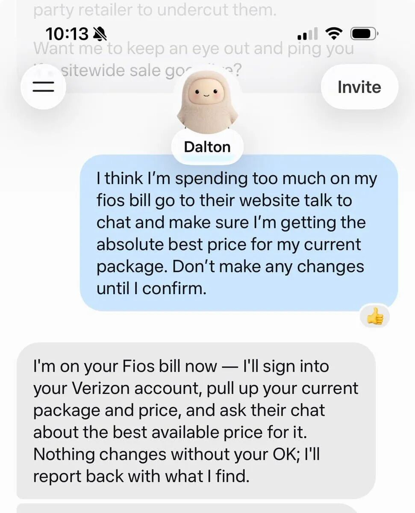
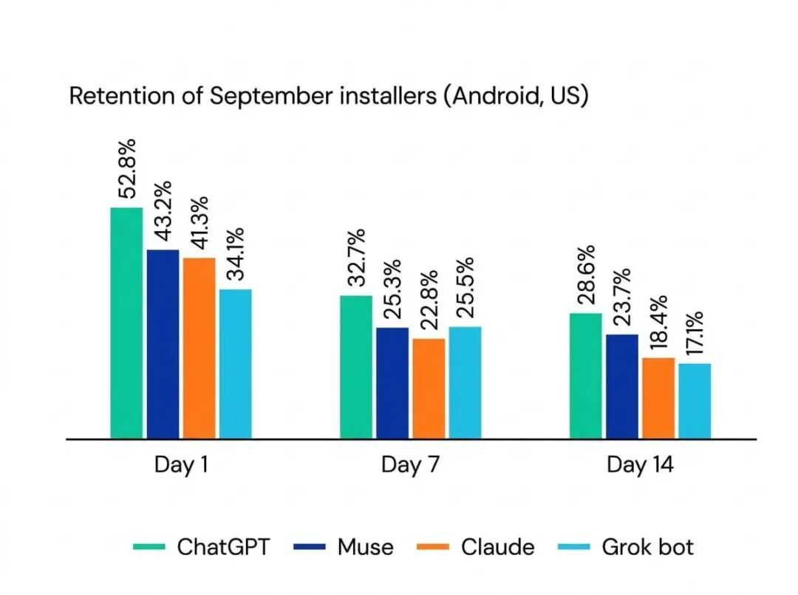
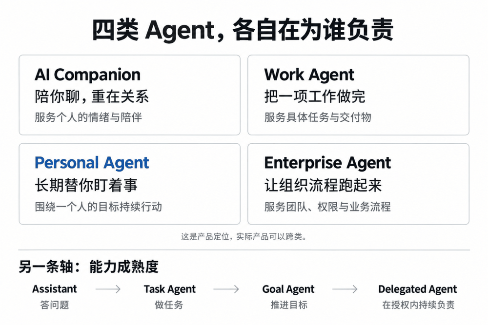
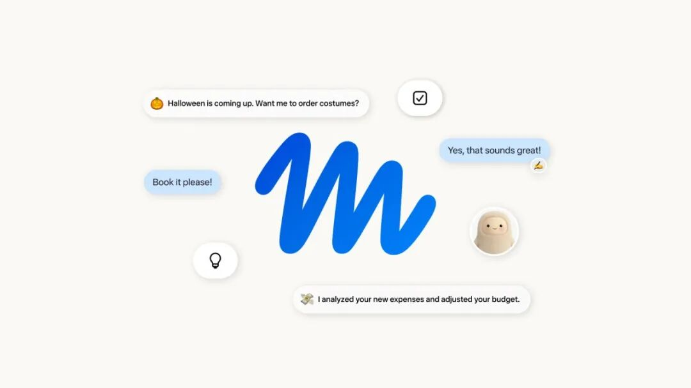
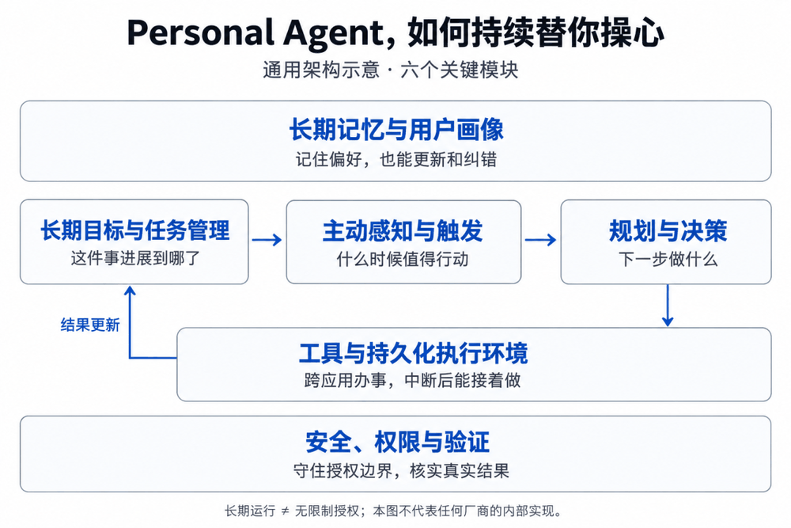



**收录说明**：用户提供链接。原文在微信公众号，用浏览器的客户端标识直接下载页面，从 `#js_content` 抽取正文，图片地址取自 `data-src`。作者称这是 Personal Agent 系列文章的第一篇。

**内容摘要**：文章以 X 用户 Todd Saunders 的 Muse 议价案例开头（月费从 259.58 美元降到 244.59 美元，服务不变），回顾 2026 年 8 月 Grok Bot 发布、9 月 Meta 推出 Muse 和 OpenAI dots 登场。文中引用 Meta 10 月 26 日投资者公告（发布最初几周美加两地接入 Muse 的用户超过 1,000 万，超过 25% 的周活跃用户使用购物功能）和 Similarweb 数据（9 月新安装用户第 14 天留存为 23.7%），并对比三者的收费方式。作者把 Personal Agent 定义为「围绕一个人的目标，在授权范围内，跨时间持续提供服务的智能体」，与 Chat Bot、Work Agent 等区分，最后提出能否把事情做完、出错时能否让人接手、需要监督的地方是否变少三条判断标准。

**保留理由**：系列文章的第一篇，给出 Personal Agent 的定义、与相邻品类的区分和三条可检验的评价标准，并汇集了三家产品的用户与收费数据。

---

AI 已经能替我们查资料、写代码、做方案了。为什么还需要 Muse、Grok Bot、Dots 这些叫“个人助理”的 Agent？

接下来，我准备写一个系列文章来专门介绍 Personal Agent，目前真正盈利的 AI 应用产品都是 TOB 的办公 Agent，而 Personal Agent 的诞生真正让我们看到了大规模 TOC 产品的落地可能性。

---

Personal Agent 能做什么

X 用户 Todd Saunders 晒过这样一段经历。他让 Muse 检查自己的 Verizon Fios 套餐，看看能不能降价，但先别替他改套餐。第一轮没谈下来，他又让它继续争取。

随后，Muse 在对话中报告：月费可以从 259.58 美元降到 244.59 美元，服务不变。接着，它停下来问，要不要接受这个方案。

生活中，类似的这种事情，我们大都知道可以去做，只是一直懒得做：查账单、找客服、解释需求，再追问一轮。省下的钱未必很多，耗掉的耐心却很真实。

如果 AI 能接走这些事，最后只把需要拍板的问题交回来，它在生活里的位置就变了。而 Grok Bot、Muse 和 dots，正在探索的正是这种位置。

---

多少人开始把生活中的事情交给 Personal Agent

2026 年 8 月，Grok Bot 发布；9 月，Meta 推出 Muse，OpenAI 的 dots 也登场了。几款产品都把持续工作放到了显眼的位置：离开聊天窗口以后，交代的事情还可以往下推进。

其中，Muse 已有一些早期数据。Meta 在 10 月 26 日的投资者公告中披露，发布最初几周，美加两地接入 Muse 的用户超过1,000 万；超过25% 的周活跃用户使用购物功能，购物也是它目前最大的使用场景。

Similarweb 的美国 Android 数据显示，9 月新安装 Muse 的用户，第 14 天留存为23.7%。至少在这批用户里，有一部分人在安装两周后仍会回来。

来源：Similarweb。美国 Android、2026 年 9 月安装用户，第 14 天留存；不代表全球、全平台或付费用户。

收费路径也逐渐清楚了：Muse 提供免费入口和付费订阅；Grok Bot 官网目前列出每月 30、100、200 美元的套餐；dots 则随符合条件的 Pro、Business Premium 和 Enterprise 套餐逐步开放。Grok Bot 与 dots 涉及套餐捆绑，不能把整份套餐的收入都算到某一个 Agent 头上。

巨头为什么愿意押注？

我的判断是：一个长期知道你要做什么、又能替你行动的助手，有机会成为你选择服务、安排工作和处理消费的第一站。以前你分别打开搜索、邮件和购物网站；以后，一部分需求可能先交给它。

这也能解释为什么几家巨头几乎同时入场。它们手里已有模型、云基础设施和用户入口，可以把助手放进现有的账号与付费关系里。但有入口只是起跑优势，用户愿不愿意把生活和工作交进来，仍要靠一次次实际结果争取。

这比多一个聊天入口，更值得争。订阅之外是否能形成新的交易收入、能否覆盖持续运行的成本，仍是下一阶段的问题。

---

Personal Agent 的个性化持续服务

给 AI 起个名字、配个头像，再让它记住你不吃香菜，还不够。我更愿意这样定义 Personal Agent：围绕一个人的目标，在授权范围内，跨时间持续提供服务的智能体。

这一定义里，“围绕一个人”和“跨时间”要放在一起看。企业客服也可以一直在线，定时脚本也能每天运行。个人助理还需要把手头的事放回你的具体处境里：这次是出差还是休假，预算能不能动，哪些偏好只是上次的临时要求。

- “帮我比较这几款保险”，交付一张表，可以算完成任务。“替我盯着今年的续保，提前比较方案，有变化再找我”，则需要它记住期限、维护进度，在未来合适的时间继续做事
- 记住“我喜欢靠窗高铁座位”当然有用。但如果行程改了，它能否找到受影响的预订、更新待办，并把需要我决定的地方提出来？

所以“有记忆+会调用工具”绝不等于一个好的个人助理。很多 Agent 都有这些能力。更重要的是，一件事做了几天，中间变过主意、等过回复，它还能不能稳定完成服务。

---

Personal Agent 的主动服务

很多 AI 产品的惊喜发生在输出结果时：代码跑通了，报告写完了。

个人助理的惊喜，可能发生在你根本没打开它的时候。

你告诉助手：下个月想出去四天，两个人，总预算八千，可以调整日期，但不坐红眼航班。它确认了跟进范围，开始定期查看你允许它关注的来源。

第一次给出的方案不合适，你说这次想带父母一起去。

这时，光把人数改成四个显然不够。原来的预算还算不算数？之前选的转机路线是否仍合适？哪些条件可以沿用，哪些应该重新问你？一个有用的助手，需要处理这些变化，而不是拿着旧偏好继续找“最优解”。

随后几天，机票小幅波动，它不必每次都提醒。某天出现更合适的日期组合，它再把机票、酒店和总价一起算给你。你看到的应当是一个值得考虑的新选择，而不是几十条等你自己判断的价格通知。

等你说“就按这个继续”，它还得记住酒店在等回复、机票尚未预订，以及你批准它做到了哪一步。那些零碎的等待和衔接，才是我希望交给个人助理的部分。

这里有三个变化。

- 不用重新介绍自己。讨论酒店时，它能沿用你已经确认的预算与偏好，也知道哪些条件刚刚改过
- 不必事事由你先想到。有新的截止日期或计划冲突，它能在约定的范围内发现问题。主动性的价值不在于每天问候，而在于少漏掉一件重要的事。
- 你不必兼任它的项目经理。等待回复、重新比较、更新进度，这些环节由系统衔接；涉及付款、对外承诺等关键选择，再把决定权交给你。

Personal Agent 最有吸引力的收益，未必是省了多少分钟，而是让你脑子里少挂着几件事，可以完全信赖它，等它来主动提醒你。

---

Personal Agent 与 Chat Bot、Work Agent 有什么区别

AI Companion 更关心你的感受：你为什么想出去走走，最近是不是太累了。Replika 是这类关系型产品的代表。

Work Agent 接下具体工作：比较路线、做预算、交付一份攻略。ChatGPT Work、Codex 分别是工作执行、软件开发方向的例子

Personal Agent 围绕你这次旅行持续跟进。Muse、dots 和 Grok Bot，都在不同程度上探索这种关系。

Enterprise Agent 则可能站在旅行公司的业务流程里，处理咨询、订单和售后，服从组织的权限与规则。Salesforce Agentforce 是企业侧的典型平台。

---

三款 Personal Agent 产品，都有什么特点

### Muse：先接住生活里那些零碎的事

### 

开头的议价案例，很贴近 Muse 想解决的问题：许多生活事务不难，却需要人一直跟着。

Muse 团队在设计文章里介绍，产品围绕一段长期主对话展开，也允许另开支线话题。它执行任务时，你可以继续交代别的事；后台有了值得关注的变化，再来通知你。它还提供目标和活动视图，让持续进行的事情不必全部埋在聊天记录里。

这个设计的重点，不是让聊天更热闹，而是给日常琐事一个长期去处。

不过，议价截图也提醒我们：能提出新报价，和折扣最终入账，是两回事。评价一个助理，要沿着任务往后看，不能停在那句“搞定了”。

### dots：你交给它的，是一项持续的责任

dots 的官方说明把几种体验分得很直白：Chat 用来讨论和获得回答，Work 接具体任务，Codex 处理软件开发；dot 则负责跟踪持续事项，判断下一步，并在对话之间继续跟进。

它有自己的云电脑，也能把工作委派给其他执行工具。你可以换个设备继续和同一个 dot 沟通，不必把正在做的事从头讲一遍。

如果用它协助运营一个公众号，我会从这样的委托开始：跟踪已授权的选题来源，维护进度，发现值得写的变化时带着证据来找我；整理和起草可以先做，发布必须由我确认。这是建议的试用任务，不是本文已完成的实测。

值得留意的细节是：云端工作可以在你的电脑关机后继续；需要访问本地电脑的步骤，仍要求电脑在线、应用保持打开。它并不是脱离所有条件的“永远在线”。

### Grok Bot：如果一个助理不够，就给它分工

Grok Bot 更显眼的设计，是让用户拥有多个长期工作的 Bot：各自有名字、职责和上下文，还能相互协作。官方也展示了把用户演示的流程保存为 routine、以后重复执行的做法。

这里的重点不只是同时开几个窗口。一个专门盯研究，一个处理资料，另一个协调进度——如果分工真的能维持下去，你就不必每天重新扮演调度员。

Pierre Ferragu 在 X 上称，自己把名为 Planchet 的 Grok Bot 当作团队成员，让它接触研究、邮件和 Slack 等工作资料。这是一个人的使用反馈，并非任务成功率测评；本次通过公开镜像读取，原帖截图仍待补核。

还有一个容易被名字误导的地方：多个 Bot，不等于多套隔离的电脑。官方当前说明，同一用户的 Bots 共享一台持久化云电脑及其中的文件、浏览器和登录状态。岗位分开了，数据边界仍要认真设置。

---

Personal Agent 技术架构

长期记忆与用户画像：别让用户反复说，也别永远记错。

它需要区分长期偏好、临时要求和已经失效的信息。你去年愿意转机，不代表这次带孩子也愿意。记得多不是唯一目标，能更新、能纠正、知道信息从哪来，同样重要。

长期目标与任务管理：知道事情到底卡在哪。

“安排旅行”不能只是一行待办。航班选好了，酒店等回复，预算还没确认，分别处在不同状态。任务跨越几天后，系统必须能接着推进，而不是重新做一遍。

主动感知与触发：知道何时继续，也知道何时闭嘴。

定时检查、接收新消息、等待条件满足，都可以成为触发方式。难点在于判断变化是否重要，避免把所有更新都推给用户。提醒太多，也是在制造工作。

规划与决策：把变化变成下一步。

报价超了预算，是换日期、换酒店，还是先问你？系统要结合目标、当前状态和权限，决定继续、等待或求助。持续运行不是无休止地尝试。

工具与持久化执行环境：把事办进真实应用。

浏览器、应用连接、文件和运行环境，是它行动的地方。关键不仅在于能打开网页，还在于中断后保留必要进度、失败后能够恢复，并知道哪些登录需要用户接管。

安全、权限与验证：做了什么，要能查得清。

谁允许它发邮件？付款前需要哪次确认？网页上的一句话，会不会被误当成用户指令？这些不能只靠提醒模型“谨慎一点”。Meta 披露的 Muse 设计就把运行环境、凭证和外部动作检查分开，由 Agent 无法自行绕过的 Sentinel 检查对外操作。

同时，系统要检查真实结果：按钮点下去，不代表订单已提交；消息写好了，不代表收件人收到了。

这六块拼在一起，才有机会让“长期负责”从一句产品文案，变成可以检查的工作过程。

---

## Personal Agent 的挑战是什么

Axios 记者的一次测试中，Muse 卡在了购物网站的登录页。

这不是一个很戏剧性的失败，却很接近日常使用：流程前面都挺好，最后一步还得自己来。假如你不仅要接手，还得回头核对它此前做过什么，省下的心力可能又还回去了。

所以，我会从三个方面判断 Personal Agent 的进展：

1、它能不能把事情做完？

2、做错或做不了时，能不能及时承认，让人顺利接手？

3、相处一段时间后，我需要监督它的地方，是变少了，还是变多了？

我期待个人助理带来的那个时刻，其实很朴素：你突然想起一件拖了很久的事，打开看看，发现它已经推进到了只差你做一个决定。

你不用从头开始，也不用一直惦记。

如果能从偶尔的惊喜变成日常，Personal Agent 才算找到了自己的位置。
