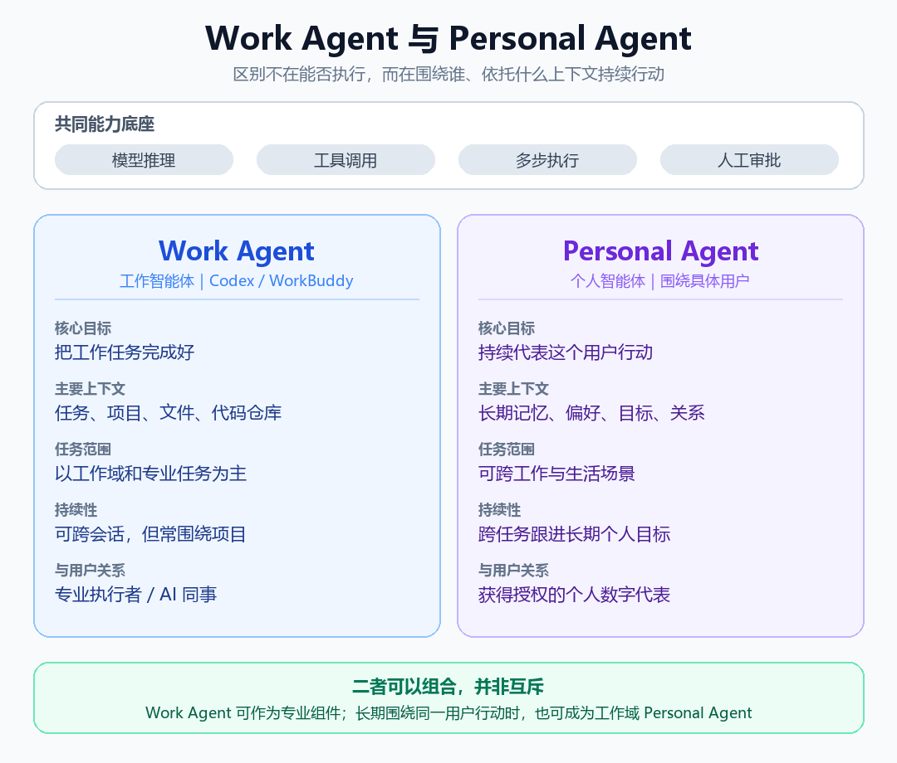



**收录说明**：用户提供链接。原文在微信公众号，用浏览器的客户端标识直接下载页面，从 `#js_content` 抽取正文，图片地址取自 `data-src`。原文多个一级标题按规则降为二级。

**内容摘要**：文章注明信息截至 2026 年 11 月 1 日，区分 Work Agent「对“事情”负责」与 Personal Agent「对“这个人”负责」。海外部分按时间介绍 Grok Bot（8 月 11 日）、Muse（9 月 8 日）、dots（9 月 29 日），引用财联社 10 月 31 日报道称 Grok Bot 日活从 9 月初不足 10 万增至 10 月 26 日超过 60 万，以及 OpenAI 高管 Thibault Sottiaux 10 月 11 日所说已有 100 万个 dots 在运行（文章注明这是 Agent 数量，不等于独立用户数）。国内部分介绍 Today、灵光 2.0、千问 Go!、CoPaw，以及腾讯 Handy Bot、字节「小豆」、Flowtica Verso，认为关键问题是生态围墙和高频 App 接入。文末对比 DeepSeek Super-agent 与 Personal Agent 回答的不同问题，并列出参考来源。

**保留理由**：把海外与国内产品放进同一张时间线和对照表，并标注数据口径，国内产品覆盖较全。

---

> 信息状态截至：2026 年 11 月 1 日。文中产品能力分为已发布、分批邀测、内部测试和研究原型；企业自述不等于独立验证结论。

Personal Agent（个人智能体）正在把 AI 从聊天工具变成长期工作的“数字代表”。它是什么，和普通 Agent 有何不同，又有哪些产品路线？这篇文章一次讲清。

## 一、Personal Agent 是什么，为什么突然火了

Personal Agent（个人智能体）是一种围绕具体用户工作的 AI：它不仅回答问题，还能理解你的长期偏好和目标，并在你授权后连接应用、执行任务、持续跟进。简单说，普通 AI 助手重在“回答一个问题”，Personal Agent 更强调“长期替你办事”。

这个概念并非全新的设想，但在 2026 年迅速走红。一方面，大模型和 Agent 技术让 AI 从生成内容走向实际操作；另一方面，Grok Bot、Muse、dots 等产品在两个月内集中推出，让“长期在线、理解用户、代表用户行动”变成了可体验的产品。尤其是 Muse 上线后的用户增长，进一步推高了行业对这一方向的关注。

## 二、Work Agent 和 Personal Agent，到底差在哪

WorkBuddy、Codex 这类以工作任务和项目执行为中心的 Agent，可以统称为Work Agent，工作智能体。

二者都有模型推理、工具调用、多步执行等能力，真正不同的是：它们围绕谁工作，又依托什么上下文持续行动。

| 维度 | Personal Agent（grokbot/muse） | Codex | WorkBuddy |
| --- | --- | --- | --- |
| 概念层级 | 以用户为中心的角色定位 | 专业 Agent 产品 | 综合工作 Agent 产品 |
| 核心任务 | 围绕个人长期目标持续办事 | 编码、调试、重构和测试 | 研究、文档、数据、文件与自动化 |
| 主要上下文 | 长期个人记忆、目标与现状 | 代码仓库、开发环境和当前任务 | 工作任务、项目记忆、文件与用户偏好 |
| 典型定位 | 个人数字代表 | AI 软件工程师 | AI 工作执行助手 |

一句话理解：Work Agent 主要对“事情”负责，Personal Agent 主要对“这个人”负责。

Codex 和 WorkBuddy 都属于 Work Agent：前者主要处理编码任务，后者主要执行研究、文档、数据等工作任务。Personal Agent 则更强调长期理解某个具体用户，并在授权下跨任务持续行动。简单说，前两者重在“把事情做完”，后者重在“长期围着这个人办事”。

## 三、海外代表产品：按推出时间看三条路线

按正式推出时间先后，三款产品依次是Grok Bot（2026 年 8 月 11 日）、Muse（9 月 8 日）和 dots（9 月 29 日）。它们的共同底座，是云端常驻、个人记忆、跨应用执行和人工审批，但产品定位并不相同。

### 1. Grok Bot：xAI 推出的 AI 同事团队

2026 年 8 月 11 日，xAI 推出 Grok Bot Beta 版，定位为由多个 AI Bot 组成的“数字同事团队”，主要面向工作场景。

使用情况：据财联社 10 月 31 日报道，Grok Bot 的日活跃用户已从 9 月初的不足 10 万，增长至10 月 26 日的超过 60 万。

### 2. Muse：Meta 推出的个人生活与事务总管

2026 年 9 月 8 日，Meta 在美国推出 Muse，随后进入加拿大，定位为覆盖工作与生活的个人事务总管。

使用情况：据财联社 10 月 31 日报道，Muse 上线约六周后，在美国和加拿大的用户已超过 1,000 万。

### 3. dots：OpenAI 推出的持续工作个人延伸

2026 年 9 月 29 日，OpenAI 在 DevDay 上推出 dots，定位为能够长期理解用户、持续推进项目的个人延伸，并逐步向符合条件的付费及企业用户开放。

使用情况：OpenAI 高管 Thibault Sottiaux 于 10 月 11 日表示，已有100 万个 dots 正在为用户工作。该数据统计的是运行中的 Agent 数量，不等于独立用户数。

### 4. 一张表看懂时间线与差异

| 推出时间 | 产品 | 公司 | 核心定位 | 最新公开使用数据 |
| --- | --- | --- | --- | --- |
| 2026 年 8 月 11 日 | Grok Bot | xAI | AI 同事团队 | 10 月 26 日日活超过 60 万，据媒体报道 |
| 2026 年 9 月 8 日 | Muse | Meta | 个人生活与事务总管 | 上线约六周用户超过 1,000 万，据媒体报道 |
| 2026 年 9 月 29 日 | dots | OpenAI | 持续承担职责的个人延伸 | 10 月 11 日已有 100 万个 dots 运行，非独立用户数 |

## 四、国内产品加速，但真正要过的是“生态关”

国内 Personal Agent 在 2026 年下半年明显提速，不过多数产品仍处于分批开放或能力验证阶段。

当前可以重点关注四款产品，以及大厂内测和垂直硬件两条补充路线。

### 1. Today：全场景个人助理

Today 通过可编辑的长期记忆、主动提醒和云端执行，帮助用户持续管理日程与个人事务，发邮件、改日程等外部操作需要用户确认。

### 2. 灵光 2.0：从执行任务到管理事务

蚂蚁灵光 2.0 依托跨会话记忆和独立云主机，可以在对话结束后继续跟进账单、消费、出行和家庭事务。

### 3. 千问 Go!：进入平台，把事务办完

千问 Go! 内嵌于千问 App，依托阿里生态执行价保、理赔、预约、比价下单等多步骤事务，目前采用分批开放方式。

### 4. CoPaw：把模型、数据和运行环境掌握在自己手里

CoPaw 是 AgentScope 团队推出的开源个人智能体工作台，支持本地或云端部署，适合希望自主控制模型、数据与技能的用户，但部署和维护门槛相对较高。

### 5. 还有三条路线值得观察

腾讯 Handy Bot

：公开报道显示正在微信内测试，潜力在微信、小程序、支付和办公生态，完整功能及开放时间尚未正式公布。

字节“小豆”

：仍处于内部测试阶段，可能结合豆包手机助手、抖音内容和本地生活生态。

Flowtica Verso

：通过手机背贴屏幕切入会议记录、个人上下文和待办闭环，属于垂直办公硬件入口，不是全场景个人代理。

### 6. 国内市场的关键问题

国内 Personal Agent 面临的关键问题，不只是模型能力，而是生态围墙和高频 App 接入：跨微信、淘宝、抖音、美团等平台统一执行仍然困难；缺少真实连接器和操作权限，AI 就很难从“给建议”走向“把事情办完”。

## 五、DeepSeek Super-agent，是 Personal Agent 吗

DeepSeek Harness 团队最近推出的 Super-agent 架构，与 Personal Agent 有类似之处，但是也有差别。

Super-agent 架构主要解决一个问题：AI 能做的事情越来越多，人类却没有足够注意力管理所有 Session。

### 1. 它更像一套持续工作的调度系统

其核心设计包括：

Router＋Worker：Router 统一接收信息、维护全局上下文和分派任务，Worker 独立执行具体工作；

跨会话连续性：同一任务可从群聊延续到 GitHub，减少重复解释；

事件驱动：群聊、邮件、日程、GitHub 评论和 CI 结果都能触发 Agent；

投机执行：先在后台尝试，有可用结果再汇报，没有结果就保持安静；

长期在线与恢复：通过云端执行、状态持久化、异步任务和 Watchdog，减少中断与无效循环。

它是在把 Agent 从单个聊天 Session，升级为持续运行的任务调度与执行系统。

### 2. 它和 Personal Agent 重合在哪里

Super-agent 提供了跨会话连续性、多任务并行、主动响应、用户离线后继续执行、多 Agent 协作等能力，也让人类可以从逐步指挥转向设定目标和验收结果。

例如，收到会议邀请后，提前核对日程、准备资料和回复草稿，再等待用户确认，本身就是典型的 Personal Agent 场景。

最准确的定位是：

Super-agent 回答“AI 如何长期在线、并行、主动地干活”；Personal Agent 回答“AI 为谁干活、如何理解这个人，以及获得了哪些授权”。

无论是 Agent 还是 Personal Agent，变化的只是 AI 与人协作的方式，不变的目标都是让 AI 更好地服务人：

把人从重复事务中解放出来，将时间、精力和判断力留给真正重要的工作。

#PersonalAgent #个人智能体 #AIAgent #WorkAgent #人工智能 #AI产品 #技术架构 #效率工具

---

主要资料来源

海外产品

Meta：Introducing Muse

xAI：Introducing Grok Bot

OpenAI：Introducing dots

OpenAI：dots 使用文档

财联社（新浪财经转载）：Grok Bot 日活与 Muse 用户规模

OpenAI 高管披露：100 万个 dots 正在运行

国内产品

Today 中国版官方介绍

Today：What Is Today?

科技日报：蚂蚁灵光 2.0 发布

千问 Go! 官方公告相关报道

CoPaw 官方仓库

国内 Personal Agent 实测与生态观察

DeepSeek Super-agent

[APPSO：DeepSeek 发布全新 Agent 架构](https://mp.weixin.qq.com/s?__biz=MjM5MjAyNDUyMA==&mid=2651114499&idx=1&sn=cd2b8678315672bd4e93b82209f5ec11&scene=21#wechat_redirect)

DeepSeek 官方 Super-agent 研究原型
