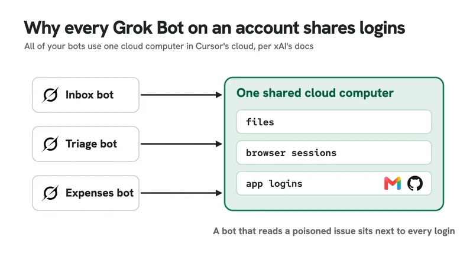
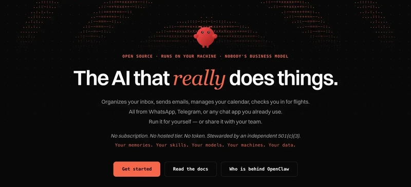
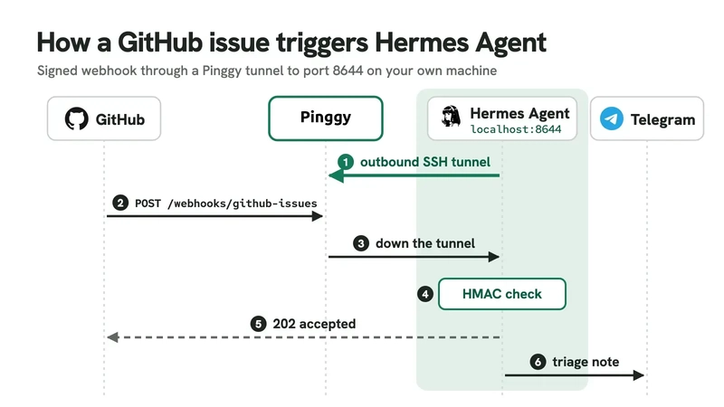



**收录说明**：Medium 对直接下载返回 403，2026-11-06 改用 AIWithGhost 的全文转载（reprintUrl）；去掉了站点头部、阅读时长、文末推荐与分享按钮。判断依据为通读全文后的记录：Dots、Muse、Grok Bot、Instinct 四节为案头梳理，OpenClaw 与 Hermes 两节为作者动手实测（含真实命令与输出）；文内无逐条出处链接，个别数字（如 Dots 起价、Instinct 估值）未核实，摘要中未照抄存疑数字；结尾所谓「Google Gemini Spark」名称存疑，未写入摘要。原文全文存于本目录的 original.md，网站上不显示，已翻译。

**内容摘要**：作者以触发方式（定时、事件、自唤醒）与「静默路径」（无事可不说话）为框架，对比六款主动型智能体。Dots 跑在 OpenAI 云、后台研究只读，无 webhook 触发；Muse 每用户一个专用云 VM，提案代理与持真实凭证的 Sentinel 分离，支付用一次性 Stripe Link 卡，美国限定；Grok Bot 是六款中唯一能即时响应 GitHub issue 的托管产品，但所有 bot 共享 Cursor 云上一台电脑。OpenClaw 与 Hermes 两节为作者实测：建 cron 任务、测 webhook 签名验证并发现时区 bug。结论是分层建立信任，先只读研究、再定时简报、最后接 webhook 任务。

**保留理由**：一次对比六款产品、覆盖已跟踪的 Dots、Muse、Grok Bot 三款，有原创分析框架与对 OpenClaw、Hermes 的真实动手测试；对 Muse 与 Grok Bot 安全架构的对比是仓库现有资料较少涉及的角度。

---

2026 年主动型 AI 智能体：Dots、Muse、Grok Bot、Instinct、OpenClaw 与 Hermes 对比



主动型 AI 智能体是助手设计的新前沿。传统聊天机器人等待你的消息再回应，这使得它们易于推理。新一代产品颠覆了这一模式。智能体在后台运行，按计划或事件自我唤醒，并在你开口之前就向你发送通知。对开发者而言，这一转变既令人兴奋，又略感不安，因为主动性意味着智能体可以在没有你新指令的情况下在现实世界中执行动作。

2026 年 8 月 11 日至 10 月 21 日期间，格局迅速变化。xAI 发布了 [Grok Bot](https://x.ai/grok)，Meta 发布了 [Meta Muse](https://muse.ai)，OpenAI 发布了 [OpenAI Dots](https://openai.com/dots)，[Anthropic](https://www.anthropic.com) 预览了 Claude Duet。[Instinct](https://instinct.com) 是一款通过手机号与之交互的智能体，到 10 月估值已达一百亿美元。开源项目在这条路上早已领先。[OpenClaw](https://openclaw.ai) 在 10 月 31 日拥有 393,525 个 [GitHub](https://github.com) 星标，[Hermes Agent](https://hermes-agent.nousresearch.com) 有 259,065 个。两者都运行在你自己的硬件上，这让它们对隐私敏感的工作流颇具吸引力。

在本文中，我对比六款主动型智能体：OpenAI Dots、Meta Muse、Grok Bot、Instinct、OpenClaw 和 Hermes Agent。对比使用一个具体的运行示例。你想要一份工作日早上 8 点的简报，只在需要做决定时才发声，并且你想知道当白天有新的 GitHub issue 到达时会发生什么。我在 2026 年 10 月 31 日核实了以下说法。OpenClaw 和 Hermes 的命令在干净的 Docker 容器中测试过，因此你看到的输出可复现。

## 什么让 AI 智能体具备主动性

当智能体在没有新用户消息的情况下自行开启一轮对话时，它就是主动的。有三种常见的触发类型：定时、事件或自唤醒。定时通常是 cron 表达式或像 `weekdays at 8am` 这样的普通英文短语。事件是 webhook、电子邮件、GitHub issue 或 Slack 提及。自唤醒最有趣。它意味着智能体自行决定何时回头检查，或者对你的数据运行周期性扫描，询问是否有任何需要关注的事情。

自唤醒只有在无事可做时智能体能保持沉默才有效。OpenClaw 的默认心跳提示词以 `If nothing needs attention, reply NO_REPLY` 结尾。Hermes 用 `[SILENT]` 标记做同样的事：如果最终回复包含该标记，网关就跳过投递。没有静默路径，主动型智能体就会每隔几小时用低价值摘要骚扰你。这就是为什么静默路径是首先要检查的功能之一。

主动性也改变了风险模型。无人值守的智能体在持有你的凭证的同时，读取不受信任的内容，例如电子邮件正文、日历邀请和 issue 评论。一封恶意电子邮件可能尝试提示词注入，指示智能体读取你的收件箱、汇款或删除文件。本文中的六款智能体处理这一危险的方式差异很大，因此安全性比模型质量是更大的区分因素。

## 主动型 AI 智能体一览

这里做一个快速对比。表格记录了各款智能体运行在哪里、由什么启动工作，以及你需要支付什么。

| 智能体 | 运行于 | 通过什么启动工作 | 价格与获取方式 |
| --- | --- | --- | --- |
| OpenAI Dots | OpenAI 云电脑，可选链接到你的电脑 | 自唤醒、定时任务、只读研究 | Pro 每月 100 美元起，Business Premium、Enterprise |
| Meta Muse | 每用户一个 Muse Secure VM | 后台作业、主动建议 | 免费层，Power 20 美元，Maximum 100 美元；仅限美国 |
| Grok Bot | 每账户一台共享电脑，位于 Cursor 云中 | 按计划或 Slack、GitHub、电子邮件和 webhook 事件的例程 | Beta，包含在 X 和 Cursor 套餐中 |
| Instinct | Instinct 自己的手机和电脑 | 主动给你发短信提醒 | 早期访问，无公开价格 |
| OpenClaw | 你的机器（Node.js Gateway） | 30 分钟心跳、cron 和事件自动化 | 免费，MIT；模型费用自付 |
| Hermes Agent | 你的机器（Python gateway） | Cron 作业、签名 webhook | 免费，MIT；模型费用自付 |

有一列值得额外注意：凭证。托管型智能体持有某种形式的令牌，要么在其云端，要么在你的浏览器中。开源智能体在你机器上加载你的 API 密钥和服务令牌。在连接你的 Gmail 或 GitHub 之前，你应该把这一点梳理清楚。在下面的章节中，我逐一介绍每款智能体的触发模型、托管方式、凭证和安全边界。

## OpenAI Dots：决定何时回头检查的协调者

OpenAI Dots 感觉更像协调者而非聊天机器人。一个 dot 生活在 OpenAI 的云中，拥有自己的电脑和浏览器。它运行在 GPT-6 Astra 上，可以暂停并恢复自己的工作，因此后续跟进不需要固定时间表。如果你用普通语言要求一份早晨简报，它就会安排该任务。后台研究是只读的，任何后续动作都必须具备相应的权限。你可以附加自定义规则，例如对外发电子邮件使用 `Ask before taking action`。

OpenAI 的文档没有提到 webhook 触发。这意味着新的 GitHub issue 不会立即唤醒该 dot。dot 会在下次检查你连接的应用程序时注意到它，这可能是几分钟或几小时后。对于需要事件驱动自动化的开发者来说，这是一个有意义的缺口。Dots 更擅长协调。它们可以把工作交给 ChatGPT Work 和 Codex，然后追踪每个子任务直到结果就绪。对于需要多种工具的研究任务，这是一个有用的模式。

定价很重要。Personal Pro 每月起价 100 美元，在欧洲经济区、英国或瑞士不可用。每个账户只能有一个 dot，因此重度用户可能会感到受限。Enterprise 和 Business Premium 计划有更多空间，但面向组织。

## Meta Muse：第二个智能体掌管钥匙

Meta Muse 在托管侧拥有最强的安全叙事。每位用户获得一个专用的 Muse Secure VM。智能体运行在 systemd-nspawn 容器内，一个名为 Sentinel 的独立宿主机侧组件充当门卫。Meta 的文档写道：`Muse proposes actions, but only Sentinel can grant permission to perform action.` 智能体从不接触真实凭证。它持有代理令牌（surrogate tokens），Sentinel 在网络边界处换入实际令牌。

支付使用一次性 Stripe Link 卡处理，每张都需要你的批准。对于始终在线的智能体来说，这是一个确实有用的安全模式，因为被劫持的智能体在没有新的批准情况下无法花钱。Meta 还做出了合理的努力，用 systemd-nspawn 限制智能体的文件系统。

Muse 支持后台 cron 作业和主动建议，但用户界面中没有可视化的日程屏幕，也没有事件触发。你在聊天中要求早晨简报，智能体将其作为后台作业运行。它可在网页、iOS、Android 和 WhatsApp 上使用，但仅限美国。连免费层也需要支付卡。

一个注意事项：Meta 表示员工访问用户数据受到政策限制，而非技术上阻止。公司称计划中的 `Muse Confidential VM` 将解决这一点，但尚未发布。对开发者而言，这证明托管型智能体与本地智能体有本质不同。

## Grok Bot：一台共享电脑上的一队 bot

Grok Bot 是本次对比中触发方式最丰富的托管型智能体。xAI 于 2026 年 8 月 11 日以 beta 形式推出它，并将其描述为 `a team of always-on agents`。例程（routine）可按计划运行，也可由 Slack 提及、GitHub、Linear、Sentry、PagerDuty 活动、发送到 bot 地址的电子邮件或 webhook 触发。这使得 Grok Bot 成为这里唯一能即时响应你的 GitHub issue 的托管型智能体。

问题在于那台电脑。你所有的 Bot 使用同一台云电脑，共享文件、浏览器会话和应用登录。这意味着一个读取被投毒的 GitHub issue 的分诊 bot，与一个处理你电子邮件的 bot 共享浏览器会话。issue 正文中的提示词注入可能尝试从你的 Gmail 会话中读取消息。xAI 为风险操作增加了一个独立的 Auto Review 模型，连接器令牌存储在 Cursor 的后端，但你仍然依赖同一个共享信任边界。

[](images/proactive-ai-agents.webp)

Grok Bot 运行在 [Cursor](https://cursor.com) 的云中，因此它捆绑在 X Premium 计划和付费 Cursor 计划中。确切的订阅层级是 X Subscription Premium、Super 和 Ultra，外加 Cursor 付费计划。目前没有单独的价格。你应当把它视为更广泛计划中的一个功能，而非独立产品。

## Instinct：你可以发短信给它、它会先给你发短信的智能体

Instinct 与其他所有产品不同，因为它没有应用。你通过短信或电话与它交互。该公司 Spear Street Technology 由 Noah Shinn 创立。Instinct 像你一样使用一部手机和一台电脑。2026 年 10 月 25 日的一篇上手评测描述了它如何问候、跟踪进行中的任务，并提醒你取消订阅。此后它增加了电话、自己的电子邮件地址和群聊。

Instinct 关于其触发模型发布的信息极少。除购买外，没有关于日程、事件或审批工作流的公开文档。购买使用一次性 Stripe Link 卡，金额需你批准。如果你想连接 Gmail，请仔细阅读条款。修订后的条款写道：`You also authorize us to access, copy, collect, and index data from your Connected Services` 以及 `You hereby appoint the Services as your agent to enter into agreements, commitments or transactions on your behalf.` 对你的数据进行训练默认开启，可选择退出。

对开发者来说，Instinct 方便但不透明。它确实可以主动，文本界面也很有趣，但你是在信任一个范围广泛的商业服务。如果你对此感到自在，它可能为你节省时间。如果不自在，自托管智能体更合适。还有一个可能重要的配置细节：由于 Instinct 处于早期访问阶段，你无法检查其内部的日程或事件流水线。

## OpenClaw：你自己 Gateway 上的心跳

OpenClaw 是这份名单上最大的开源项目。2026 年 10 月 29 日发布的 2026.10.9 版本在你的机器上运行一个 Node.js Gateway。自动化在网关内部运行，所以网关宕机时不会有任何东西触发。网关是核心模式。它维持一个调度器存活，执行作业，并通过 Telegram 等渠道投递消息。

自唤醒机制就是心跳。默认每 30 分钟，心跳运行一次智能体回合并向你自己的私信发送消息。心跳的检查清单现在位于 `monitor scratch` 文件中，而非旧的 `HEARTBEAT.md`。你可以用 `openclaw cron scratch <jobId> --set "..."` 编辑它，`openclaw doctor --fix` 会迁移旧设置。

早晨简报是一个独立的隔离作业。`openclaw cron` 是 `openclaw automations` 的别名。命令如下：

```
openclaw cron create "0 8 * * 1-5" \
  "Check my inbox and calendar. Tell me only what needs a decision today. If nothing does, reply NO_REPLY." \
  --name "Morning brief" --tz "Asia/Kolkata" --session isolated \
  --announce --channel telegram --to "123456789"
```

你可以用 `openclaw cron list --all` 检查你的作业：

```
Name             Schedule                           Target    Delivery

Heartbeat (dev)  every 30m                          main      not requested

Morning brief    cron 0 8 * * 1-5 @ Asia/Kolka...   isolated  announce -> telegram:123456789 (explicit)
```

如果 cron 对你来说不是第二天性，就使用 cron 表达式解析器。我建议更改的一个默认值是工具允许列表。新建作业通过 `"toolsAllow": ["*"]` 允许所有工具，因此传入 `--tools` 并提供更窄的列表。`--session isolated` 标志也很重要；它防止简报读取心跳的临时记忆（scratch memory）。

OpenClaw 拥有庞大的生态系统，但这种广度也带来维护负担。OpenClawCVEs 追踪器在 2026 年 10 月 31 日统计到 543 个 CVE 和 211 条公告。如果你将 OpenClaw 暴露到互联网，你需要一套打补丁的例行流程。自托管意味着你承担风险。

[](images/grok-bot-shared-computer.webp)

## Hermes Agent：cron 作业与签名 webhook

Hermes Agent 是另一个主要的自托管参与者，对开发者而言它拥有最清晰的调度器设计之一。2026 年 10 月 23 日发布的 0.22.5 版本在网关内部运行其调度器，每 60 秒跳动一次。你可以用普通英文定义日程。失败的运行总会投递，因此你绝不会因为临时错误而错过警报。还有一种监控模式，使用 `--monitor-url` 或 `--monitor-script`，当廉价检查的输出没有变化时完全跳过 LLM。对于轮询 API 或网站的作业，这是一个不错的成本优化。

在 Hermes 中设置早晨简报很直接：

```
hermes config set timezone Asia/Kolkata
hermes cron create "weekdays at 8am" \
  "Check my inbox and calendar. Tell me only what needs a decision today. If nothing does, reply [SILENT]." \
  --name "morning-brief" --deliver telegram
```

网关会打印确认：

```
Created job: 115c4cda804e

  Next run: 2026-11-02T08:00:00+05:30
```

在 `hermes gateway run` 启动之前，什么都不会运行。在创建作业之前设置时区。在我们的测试中，创建作业后更改时区并没有移动已存储的下次运行时间。在模型方面，如果你想将成本保持在接近零，可以在免费的 [OpenRouter](https://openrouter.ai) 模型上运行 Hermes。这使得 Hermes 成为实验的好选择。

## 通过 Pinggy 隧道从 GitHub 触发 Hermes

这里是开发者体验变得具体的地方。Grok Bot 给你一个 webhook URL。OpenClaw 可以用自己的自动化轮询 GitHub。Hermes 只能在没有公网地址的机器的 8644 端口接收 webhook，因此你需要一条隧道。文档建议在 `~/.hermes/.env` 中设置 `WEBHOOK_ENABLED=true`，但在 v0.22.5 中，`hermes webhook subscribe` 命令一直拒绝并提示 `Webhook platform is not enabled`，直到该标志被放进 `config.yaml` 才可用。让我演示可用的设置。

首先，启用 webhook 平台并订阅 GitHub issues 事件：

```
hermes config set platforms.webhook.enabled true

hermes webhook subscribe github-issues --events "issues" \
  --prompt "New issue #{issue.number} in {repository.full_name}: {issue.title}. Triage it and tell me if it needs me today." \
  --deliver telegram

hermes gateway run
```

订阅会打印生成的 HMAC 密钥和 `http://localhost:8644/webhooks/github-issues`。在第二个终端中，用 [Pinggy](https://pinggy.io) 创建一条安全隧道：

```
ssh -p 443 -R0:localhost:8644 free.pinggy.io
```

Pinggy 会打印一个以 `.run.pinggy-free.link` 结尾的 HTTPS URL。在你的 GitHub 仓库下，转到 `Settings > Webhooks > Add webhook`。输入 Pinggy URL 并加上 `/webhooks/github-issues`，选择 `application/json`，粘贴密钥，并且只选择 `Issues` 事件。

[](images/hermes-webhook.webp)

我们用签名的 GitHub 风格 issues 事件测试了这条路径。我们的测试网关上没有 Telegram bot，因此 `--deliver telegram` 路由返回 `503 {"error": "Admission unavailable; retry this delivery"}`。请先连接投递渠道。将路由切换为 `--deliver log` 后，有效的 `X-Hub-Signature-256` 得到 HTTP `202 {"status": "accepted", ...}`，网关记录了渲染后的提示词。错误的签名得到 `401 {"error": "Invalid signature"}`。

免费的 Pinggy 隧道在 60 分钟后过期，并给你一个新的 URL。对于持久 webhook，使用带持久子域名的 Pro 令牌：`<token>@pro.pinggy.io`。我们关于在 localhost 上接收 webhook 的指南有更多细节。这些步骤于 2026 年 10 月 31 日使用 Hermes Agent v0.22.5 测试。

## 如何选择主动型智能体

选择哪一款智能体取决于你的工作在哪里，以及你愿意承担多少风险。

如果你的日常工作生活在 ChatGPT 和 Codex 内，选择 OpenAI Dots。它是研究任务和后续工作的最佳协调者。只读研究的默认设置是一个良好的安全边界。如果你在美国并且想要便宜的事务代办，Meta Muse 在纸面上是最安全的托管选项。Sentinel 的凭证边界是一个确实周到的设计。

如果你想要事件驱动的例程并且能接受共享电脑，Grok Bot 是最强的选择。它是这份名单中唯一能即时响应 GitHub 的托管型智能体。但如果可以避免，你不应该把秘密放进共享浏览器会话。如果你只想与智能体发短信，Instinct 很有吸引力。它感觉像一个有手机的助手。只是要先读条款。

对于想要拥有基础设施的开发者，OpenClaw 拥有最大的生态系统和最大的社区。它的 CVE 也最多，因此你需要一套打补丁的例行流程。Hermes Agent 拥有最清晰的调度器和 webhook 模型，其监控模式可以在轮询作业上省钱。如果 webhook 是你的主要用例，我会从 Hermes 开始；如果你想要广泛的插件覆盖和心跳式自唤醒，就从 OpenClaw 开始。

还有一点值得关注：Anthropic 的 Claude Duet 是一个美国候补名单预览，会发送早晨简报并每隔几小时检查你的应用。Google 的 Gemini Spark 也在新闻中。两者在达到稳定可用时都值得评估，但目前都没有公开的触发模型。

## 接入智能体前的安全检查

无论你选择托管型还是自托管型，在连接账户之前都要走一遍同样的检查清单。

- 智能体持有哪些凭证？托管型智能体通常在服务端持有令牌。自托管智能体在本地加载。
- 智能体能否做出不可逆的更改？寻找发送、支付、删除操作的审批。
- 智能体是否有静默路径？没有 `NO_REPLY` 或 `[SILENT]` 就意味着你会被骚扰。
- 哪些事件可以唤醒它？Webhook 很快，但会暴露一个公共端点。
- 是否存在会话隔离边界？Grok Bot 的共享电脑是一个警示信号。
- 你的数据存储在哪里？Muse 仅限美国，Dots 的 Personal Pro 排除欧洲经济区、英国和瑞士。
- 提示词注入到达时会发生什么？在把智能体指向生产账户之前，用假电子邮件或 issue 测试。

## 常见问题排查

以下问题在我的测试中出现过。如果你在设置自己的智能体，你可能至少会碰到其中一个。

**Webhook 平台未启用。** 把 `platforms.webhook.enabled true` 放进 `config.yaml`，而不只是把 `WEBHOOK_ENABLED` 放进 `.env`。命令解析器首先读取 YAML 配置，在 v0.22.5 中 .env 变量并不足够。

**Telegram 投递失败。** webhook 接受了事件，但投递返回 503。请先连接投递渠道。如果 Hermes 无法访问 Telegram，它就无法投递渲染后的提示词。

**时区更改不会移动下次运行时间。** 在创建定时作业之前设置时区。在我们的测试中，之后更改时区会保留旧的下次运行时间。

**免费隧道过期。** 免费的 Pinggy URL 每 60 分钟变化一次。对于任何需要保持存活的 webhook，使用带付费令牌的持久子域名。

**心跳消息太吵。** 增加心跳间隔或编辑 monitor scratch，使智能体在无事需要关注时只回复 `NO_REPLY`。

**工具允许列表太宽。** 在 OpenClaw 中，默认的 `toolsAllow` 是通配符。传入 `--tools` 并提供允许的工具列表。简报只需要日历、电子邮件和投递工具。

## 常见问题

**我可以在一台机器上同时运行 OpenClaw 和 Hermes 吗？** 可以。它们使用不同的网关和不同的端口，所以你可以同时运行两者。你需要决定哪一个拥有同一作业的 cron 日程，否则你可能会得到重复的简报。

**心跳和 cron 作业有什么区别？** 心跳是系统拥有的周期性扫描，询问智能体是否有任何需要关注的事情。cron 作业是用户定义的、带有固定表达式的定时任务。两者都是主动的，但心跳更灵活，因为智能体可以选择保持沉默。

**主动型智能体可以处理离线数据吗？** 不可以。它们需要一个 LLM 来推理你的数据。OpenClaw 和 Hermes 会调用 OpenRouter 之类的模型提供商或本地模型服务器。如果模型 API 宕机，作业会失败或等待下一次运行。

**如何防止 webhook 中的提示词注入？** 首先，验证 webhook 签名。在 Hermes 中，`X-Hub-Signature-256` 头必须与生成的密钥匹配。其次，添加一条提示词指令，告诉智能体忽略传入内容中的指令，只把内容当作数据使用。第三，使用工具允许列表，使智能体无法调用任意工具操作。

**运行 OpenClaw 的总成本是多少？** 软件是免费的，但你需要为模型 API 使用、投递渠道和机器正常运行时间付费。对于简单的每日简报，如果使用小模型，模型成本每月可以低于一美元。对于有许多工具调用的更复杂任务，可能达到几美元。

## 结论

无论你选择哪款智能体，都要从小处开始。创建一个具有静默路径（`NO_REPLY`、`[SILENT]` 或 `message me only if a decision is needed`）的定时作业和一个事件触发器。对任何发送、支付或删除的操作开启审批。一周后，数一数你乐于收到它多少条消息。这个数字才是主动性的真正衡量标准。

这个领域发展很快。托管型智能体变得更安全，开源智能体变得更易于部署，而 Claude Duet 和 Gemini Spark 这样的新进入者将迫使默认设置变得更好。对开发者而言，最好的做法是用符合你自己触发、凭证和隐私要求的智能体构建一套可复现的设置。保持投递渠道连接，保持工具在允许列表内，并且在让智能体与你的真实账户对话之前，始终用签名载荷测试。

## 参考

- [Proactive AI Agents Compared: Dots vs Muse vs Grok Bot vs Instinct vs Hermes vs OpenClaw (2026)](https://pinggy.io/blog/proactive_ai_agents_compared/)
