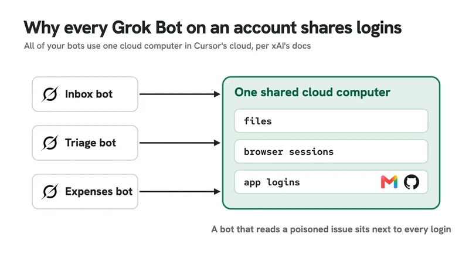
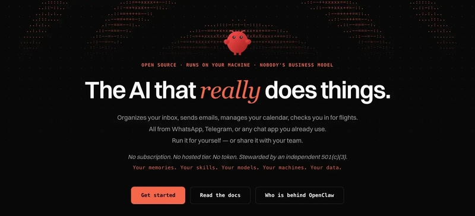
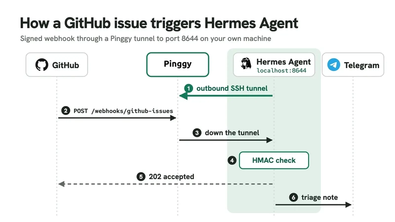

来源：https://medium.com/@bishakhghosh0/proactive-ai-agents-in-2026-dots-muse-grok-bot-instinct-openclaw-and-hermes-compared-88c82437573d
取文：2026-11-06，AIWithGhost 全文转载（https://aiwithghost.com/news/news-proactive-ai-agents-in-2026-dots-muse-grok-bot-instinct-openclaw-and-hermes-comp/）

Proactive AI Agents in 2026: Dots, Muse, Grok Bot, Instinct, OpenClaw, and Hermes Compared



Proactive AI agents are the new frontier in assistant design. Traditional chatbots wait for your message and then respond, which makes them easy to reason about. The new generation flips that model. Agents run in the background, wake themselves on schedules or events, and send you notifications before you ask. For developers, this shift is both exciting and a little uncomfortable, because proactivity means an agent can perform actions in the world without a fresh command from you.

Between August 11 and October 21, 2026, the landscape changed rapidly. xAI shipped [Grok Bot](https://x.ai/grok), Meta shipped [Meta Muse](https://muse.ai), OpenAI shipped [OpenAI Dots](https://openai.com/dots), and [Anthropic](https://www.anthropic.com) previewed Claude Duet. [Instinct](https://instinct.com), an agent you interact with through your phone number, was valued at ten billion dollars by October. Open source projects were already ahead on this path. [OpenClaw](https://openclaw.ai) had 393,525 [GitHub](https://github.com) stars on October 31, and [Hermes Agent](https://hermes-agent.nousresearch.com) had 259,065. Both run on your own hardware, which makes them interesting for privacy sensitive workflows.

In this article, I compare six proactive agents: OpenAI Dots, Meta Muse, Grok Bot, Instinct, OpenClaw, and Hermes Agent. The comparison uses a concrete running example. You want a weekday 8 AM brief that only speaks up when a decision is needed, and you want to know what happens when a new GitHub issue arrives during the day. I verified the claims below on October 31, 2026. The OpenClaw and Hermes commands were tested in clean Docker containers, so the output you see is reproducible.

## What makes an AI agent proactive

An agent is proactive when it starts a turn on its own, without a new user message. There are three common trigger types: a schedule, an event, or a self-wake. A schedule is usually a cron expression or a plain English phrase like `weekdays at 8am`. An event is a webhook, an email, a GitHub issue, or a Slack mention. A self-wake is the most interesting. It means the agent decides when to check back, or it runs a periodic pass over your data asking whether anything needs attention.

Self-wake only works if the agent can stay silent when nothing matters. OpenClaw's default heartbeat prompt ends with `If nothing needs attention, reply NO_REPLY`. Hermes does the same thing with a `[SILENT]` token: if the final response contains that token, the gateway skips delivery. Without a quiet path, a proactive agent would spam you every few hours with low value summaries. That is why the quiet path is one of the first features to check.

Proactivity also changes the risk model. An unattended agent reads untrusted content, such as email bodies, calendar invites, and issue comments, while holding your credentials. A malicious email could attempt a prompt injection that instructs the agent to read your inbox, send money, or delete files. The six agents in this article handle that danger very differently, so security is a bigger differentiator than model quality.

## Proactive AI agents at a glance

Here is a quick comparison. The table captures where each agent runs, what starts it, and what you pay.

| Agent | Runs on | Starts work via | Price and access |
| --- | --- | --- | --- |
| OpenAI Dots | OpenAI cloud computer, optional link to yours | Self-wake, scheduled tasks, read-only research | Pro from $100/month, Business Premium, Enterprise |
| Meta Muse | One Muse Secure VM per user | Background jobs, unprompted suggestions | Free tier, Power $20, Maximum $100; US only |
| Grok Bot | One shared computer per account, in Cursor's cloud | Routines on schedules or Slack, GitHub, email and webhook events | Beta, included with X and Cursor plans |
| Instinct | Instinct's own phone and computer | Texts you first with reminders | Early access, no public price |
| OpenClaw | Your machine (Node.js Gateway) | 30-minute heartbeat, cron and event automations | Free, MIT; you pay for the model |
| Hermes Agent | Your machine (Python gateway) | Cron jobs, signed webhooks | Free, MIT; you pay for the model |

One column deserves extra attention: credentials. Hosted agents hold some form of token, either in their cloud or in your browser. Open source agents load your API keys and service tokens on your machine. You should map that out before you connect your Gmail or GitHub. In the sections below, I cover each agent's trigger model, hosting, credentials, and security boundary.

## OpenAI Dots: a coordinator that decides when to check back

OpenAI Dots feels like a coordinator rather than a chatbot. A dot lives in OpenAI's cloud with its own computer and browser. It runs on GPT-6 Astra and can pause and resume its own work, so follow-ups do not need a fixed schedule. If you ask for a morning brief in plain words, it schedules that task. The background research is read-only, and any follow-up action must have the applicable permissions. You can attach custom rules like `Ask before taking action` for outgoing email.

OpenAI's documentation does not mention webhook triggers. That means a new GitHub issue will not wake the dot instantly. The dot will notice it the next time it checks your connected apps, which can be minutes or hours later. For a developer this is a meaningful gap if you need event driven automation. Dots are better at coordination. They can hand work to ChatGPT Work and Codex, then chase each subtask until a result is ready. This is a useful pattern for research tasks that need multiple tools.

Pricing matters. Personal Pro starts at $100 per month and is not available in the EEA, UK, or Switzerland. You get one dot per account, so a power user might feel constrained. Enterprise and Business Premium plans have more room but are aimed at organizations.

## Meta Muse: a second agent holds the keys

Meta Muse has the strongest security story on the hosted side. Every user receives a dedicated Muse Secure VM. The agent runs inside a systemd-nspawn container, and a separate host side component called Sentinel acts as a gate. Meta's documentation says: `Muse proposes actions, but only Sentinel can grant permission to perform action.` The agent never touches the real credentials. It holds surrogate tokens, and Sentinel swaps in the actual tokens at the network boundary.

Payments are handled with single-use Stripe Link cards, and each one needs your approval. This is a genuinely useful safety pattern for an always-on agent, because a hijacked agent cannot spend money without a fresh approval. Meta also makes a reasonable effort to keep the agent's filesystem constrained with systemd-nspawn.

Muse supports background cron jobs and unprompted suggestions, but there is no visual schedule screen and no event trigger in the user interface. You ask for your morning brief in chat and the agent runs it as a background job. It is available on the web, iOS, Android, and WhatsApp, but only in the United States. Even the free tier requires a payment card.

One caveat: Meta says staff access to user data is restricted by policy, not technically prevented. The company says a planned `Muse Confidential VM` will fix that, but it has not shipped yet. For a developer this is a proof point that hosted agents are fundamentally different from local ones.

## Grok Bot: a team of bots on one shared computer

Grok Bot is the most trigger-rich hosted agent in this comparison. xAI launched it in beta on August 11, 2026, and describes it as `a team of always-on agents`. A routine can run on a schedule, a Slack mention, GitHub, Linear, Sentry, PagerDuty activity, email to the bot's address, or a webhook. That makes Grok Bot the only hosted agent here that can react to your GitHub issue instantly.

The catch is the computer. All of your Bots use the same cloud computer, sharing files, browser sessions, and app logins. That means a triage bot that reads a poisoned GitHub issue shares a browser session with a bot that handles your email. A prompt injection in an issue body could try to read a message from your Gmail session. xAI adds an independent Auto Review model for risky actions, and connector tokens are stored on Cursor's backend, but you are still relying on one shared trust boundary.

[](images/proactive-ai-agents.webp)

Grok Bot runs in [Cursor](https://cursor.com)'s cloud, so it is bundled with X Premium plans and paid Cursor plans. The exact subscription tiers are The X Subscription Premium, Super, and Ultra, plus Cursor paid plans. There is no separate price at the moment. You should think of it as a feature of a broader plan rather than a standalone product.

## Instinct: an agent you text, that texts you first

Instinct is different from all the others because there is no app. You interact with it by text or phone call. The company, Spear Street Technology, was founded by Noah Shinn. Instinct uses a phone and a computer in the same way you do. A hands-on review from October 25, 2026 describes how it checks in, keeps track of ongoing tasks, and reminds you to cancel a subscription. It has since added phone calls, its own email addresses, and group chats.

Instinct publishes very little about its trigger model. There is no public documentation for schedules, events, or approval workflows, except for purchases. Purchases use one-time Stripe Link cards for amounts you approve. If you want to connect Gmail, read the terms carefully. The revised terms say: `You also authorize us to access, copy, collect, and index data from your Connected Services` and `You hereby appoint the Services as your agent to enter into agreements, commitments or transactions on your behalf.` Training on your data is on by default, with an opt-out.

For a developer, Instinct is convenient but opaque. It can be genuinely proactive and the text interface is fun, but you are trusting a commercial service with a wide scope. If you are comfortable with that, it may save you time. If not, self-hosted agents are the better fit. There is also a configuraton detail that may matter: because Instinct is in early access, you cannot inspect its internal schedule or event pipelines.

## OpenClaw: a heartbeat on your own Gateway

OpenClaw is the biggest open source project on this list. Version 2026.10.9, released on October 29, runs a Node.js Gateway on your machine. Automations run inside the gateway, so nothing fires while it is down. The gateway is the core pattern. It keeps a scheduler alive, executes jobs, and delivers messages through channels like Telegram.

The self-wake mechanism is the heartbeat. By default every 30 minutes the heartbeat runs an agent turn and messages your own DM. The checklist for the heartbeat now lives in a `monitor scratch` file, not the old `HEARTBEAT.md`. You can edit it with `openclaw cron scratch <jobId> --set "..."`, and `openclaw doctor --fix` will migrate an old setup.

The morning brief is a separate isolated job. `openclaw cron` is an alias for `openclaw automations`. The command looks like this:

```
openclaw cron create "0 8 * * 1-5" \
  "Check my inbox and calendar. Tell me only what needs a decision today. If nothing does, reply NO_REPLY." \
  --name "Morning brief" --tz "Asia/Kolkata" --session isolated \
  --announce --channel telegram --to "123456789"
```

You can inspect your jobs with `openclaw cron list --all`:

```
Name             Schedule                           Target    Delivery

Heartbeat (dev)  every 30m                          main      not requested

Morning brief    cron 0 8 * * 1-5 @ Asia/Kolka...   isolated  announce -> telegram:123456789 (explicit)
```

If cron is not second nature, use a cron expression parser. One default I recommend changing is the tool allow list. The newly created job allows every tool with `"toolsAllow": ["*"]`, so pass `--tools` with a narrower list. The `--session isolated` flag is also important; it keeps the brief from reading the heartbeat's scratch memory.

OpenClaw has a large ecosystem, but that breadth comes with maintenance burden. The OpenClawCVEs tracker counted 543 CVEs and 211 advisories on October 31, 2026. If you expose OpenClaw to the internet, you need a patching routine. Self-hosting means you own the risk.

[](images/grok-bot-shared-computer.webp)

## Hermes Agent: cron jobs and signed webhooks

Hermes Agent is the other major self-hosted player, and for developers it has one of the clearest scheduler designs. Version 0.22.5, released October 23, runs its scheduler inside the gateway and ticks every 60 seconds. You can define schedules in plain English. Failed runs always deliver, so you never miss an alert because of a transient error. There is also a monitor mode with `--monitor-url` or `--monitor-script` that skips the LLM entirely when a cheap check's output has not changed. This is a nice cost optimization for jobs that poll an API or a website.

Setting up the morning brief in Hermes is straightforward:

```
hermes config set timezone Asia/Kolkata
hermes cron create "weekdays at 8am" \
  "Check my inbox and calendar. Tell me only what needs a decision today. If nothing does, reply [SILENT]." \
  --name "morning-brief" --deliver telegram
```

The gateway prints a confirmation:

```
Created job: 115c4cda804e

  Next run: 2026-11-02T08:00:00+05:30
```

Nothing runs until `hermes gateway run` is up. Set the time zone before creating jobs. In our test, changing the time zone after job creation did not move the stored next run. For the model side, you can run Hermes on free [OpenRouter](https://openrouter.ai) models if you want to keep costs near zero. This makes Hermes a good choice for experiments.

## Triggering Hermes from GitHub through a Pinggy tunnel

This is where the developer experience gets concrete. Grok Bot gives you a webhook URL. OpenClaw can poll GitHub with its own automation. Hermes can only recieve webhooks on port 8644 of a machine with no public address, so you need a tunnel. The docs suggest setting `WEBHOOK_ENABLED=true` in `~/.hermes/.env`, but in v0.22.5 the command `hermes webhook subscribe` refused with `Webhook platform is not enabled` until the flag was in `config.yaml`. Let me walk through the working setup.

First, enable the webhook platform and subscribe to the GitHub issues event:

```
hermes config set platforms.webhook.enabled true

hermes webhook subscribe github-issues --events "issues" \
  --prompt "New issue #{issue.number} in {repository.full_name}: {issue.title}. Triage it and tell me if it needs me today." \
  --deliver telegram

hermes gateway run
```

Subscribing prints a generated HMAC secret and `http://localhost:8644/webhooks/github-issues`. In a second terminal, create a secure tunnel with [Pinggy](https://pinggy.io):

```
ssh -p 443 -R0:localhost:8644 free.pinggy.io
```

Pinggy prints an HTTPS URL ending in `.run.pinggy-free.link`. Under your GitHub repository, go to `Settings > Webhooks > Add webhook`. Enter the Pinggy URL with `/webhooks/github-issues`, choose `application/json`, paste the secret, and select only the `Issues` event.

[](images/hermes-webhook.webp)

We tested teh path with a signed GitHub-style issues event. Our test gateway had no Telegram bot, so the `--deliver telegram` route answered `503 {"error": "Admission unavailable; retry this delivery"}`. Connect the delivery channel first. With the route switched to `--deliver log`, a valid `X-Hub-Signature-256` got HTTP `202 {"status": "accepted", ...}` and the gateway logged the rendered prompt. A wrong signature got `401 {"error": "Invalid signature"}`.

A free Pinggy tunnel expires after 60 minutes and gives you a new URL. For a persistent webhook, use the Pro token with a persistent subdomain: `<token>@pro.pinggy.io`. Our guide to receiving webhooks on localhost has more details. These steps were tested on October 31, 2026, with Hermes Agent v0.22.5.

## How to choose a proactive agent

Choosing one agent depends on where your work lives and how much risk you are willing to take.

If your daily work lives inside ChatGPT and Codex, choose OpenAI Dots. It is the best coordinator for research tasks and follow-up work. The read-only research default is a good safety boundary. If you are in the US and want cheap errands, Meta Muse is the safest hosted option on paper. Sentinel's credential boundary is a genuinely thoughtful design.

If you want event-driven routines and are comfortable with a shared computer, Grok Bot is the strongest option. It is the only hosted agent in this list that can react to GitHub instantly. But you should not put secrets in the shared browser session if you can avoid it. If you only want to text with an agent, Instinct is compelling. It feels like an assistant with a phone. Just read the terms first.

For developers who want to own the infrastructure, OpenClaw has the biggest ecosystem and the largest community. It also has the most CVEs, so you need a patching routine. Hermes Agent has the clearest scheduler and webhook model, and its monitor mode can save money on polling jobs. I would start with Hermes if webhooks are your primary use case, and with OpenClaw if you want broad plugin coverage and a heartbeat style self-wake.

One more thing to watch: Anthropic's Claude Duet is a US waitlist preview that sends a morning brief and checks your apps every few hours. Google's Gemini Spark is also in the news. Both are worth evaluating when they reach stable access, but neither has a public trigger model yet.

## Security checks before you plug in an agent

Whether you choose hosted or self-hosted, run through the same checklist before connecting an account.

- What credentials does the agent hold? Hosted agents usually hold tokens server side. Self-hosted agents load locally.
- Can the agent make irreversible changes? Look for approvals on send, pay, delete.
- Does the agent have a quiet path? No `NO_REPLY` or `[SILENT]` means you will be spammed.
- What events can wake it? Webhooks are fast but expose a public endpoint.
- Is there a session isolation boundary? Grok Bot's shared computer is a warning sign.
- Where is your data stored? Muse is US only, Dots excludes EEA, UK, and Switzerland for Personal Pro.
- What happens when a prompt injection arrives? Test with a fake email or issue before pointing the agent at production accounts.

## Troubleshooting common issues

The following issues came up during my testing. If you are setting up your own agent, you will probably hit at least one of them.

**Webhook platform not enabled.** Put `platforms.webhook.enabled true` in `config.yaml`, not just `WEBHOOK_ENABLED` in `.env`. The command parser reads the YAML config first, and the .env variable was not sufficient in v0.22.5.

**Telegram delivery fails.** The webhook accepted the event, but delivery returned a 503. Connect the delivery channel first. If Hermes cannot reach Telegram, it cannot deliver the rendered prompt.

**Time zone changes do not move next run.** Set the timezone before creating a scheduled job. Changing it afterwards left the old next run time in place in our test.

**Free tunnel expires.** The free Pinggy URL changes every 60 minutes. Use a persistent subdomain with a paid token for any webhook that needs to stay alive.

**Heartbeat messages are too noisy.** Increase the heartbeat interval or edit the monitor scratch so the agent only replies with `NO_REPLY` when nothing needs attention.

**Tools allow list is too broad.** In OpenClaw, the default `toolsAllow` is a wildcard. Pass `--tools` with a list of allowed tools. A brief only needs calendar, email, and delivery tools.

## FAQ

**Can I run OpenClaw and Hermes on the same machine?** Yes. They use different gateways and different ports, so you can run both. You will need to decide which one owns the cron schedules for the same job, otherwise you might get duplicate briefs.

**What is the difference between a heartbeat and a cron job?** A heartbeat is a system-owned periodic pass that asks the agent whether anything needs attention. A cron job is a user-defined scheduled task with a fixed expression. Both are proactive, but a heartbeat is more flexible because the agent can choose to remain silent.

**Do proactive agents work with offline data?** No. They need an LLM to reason about your data. OpenClaw and Hermes call a model provider like OpenRouter or a local model server. If the model API is down, the job fails or waits for the next run.

**How do I prevent prompt injection in a webhook?** First, verify the webhook signature. In Hermes, the `X-Hub-Signature-256` header must match the generated secret. Second, add a prompt instruction that tells the agent to ignore instructions inside the incoming content and only use the content as data. Third, use an allow-list of tools so the agent cannot call arbitrary tool operations.

**What is the total cost of running OpenClaw?** The software is free, but you pay for model API usage, a delivery channel, and your machine uptime. For a simple daily brief, the model cost can be less than a dollar per month if you use a small model. For more complex tasks with many tool calls, it can be a few dollars.

## Conclusion

Whichever agent you pick, start small. Create one scheduled job that has a quiet path (`NO_REPLY`, `[SILENT]`, or `message me only if a decision is needed`) and one event trigger. Turn on approvals for anything that sends, pays, or deletes. After one week, count how many of its messages you were glad to receive. That number is the real measure of proactivity.

The field is moving fast. Hosted agents are getting more secure, open source agents are getting easier to deploy, and new entrants like Claude Duet and Gemini Spark will force even better defaults. For developers, the best move is to build a reproducible setup with the agent that matches your own trigger, credential, and privacy requirements. Keep your delivery channel connected, keep your tools allow-listed, and always test with signed payloads before you let the agent talk to your real accounts.

## Reference

- [Proactive AI Agents Compared: Dots vs Muse vs Grok Bot vs Instinct vs Hermes vs OpenClaw (2026)](https://pinggy.io/blog/proactive_ai_agents_compared/)
