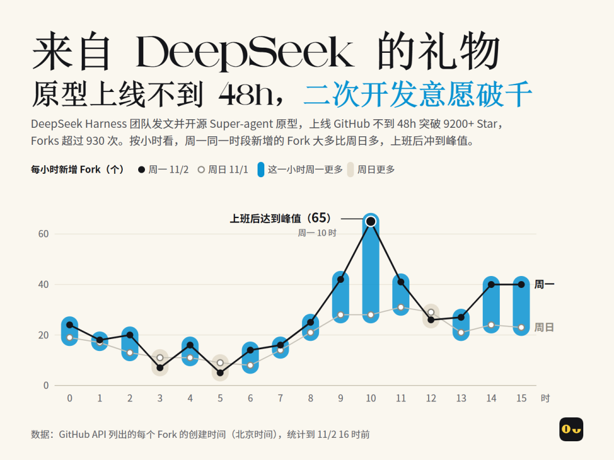
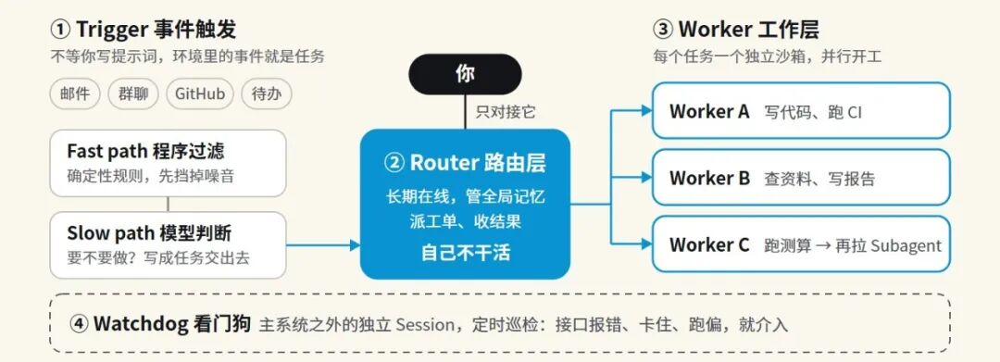
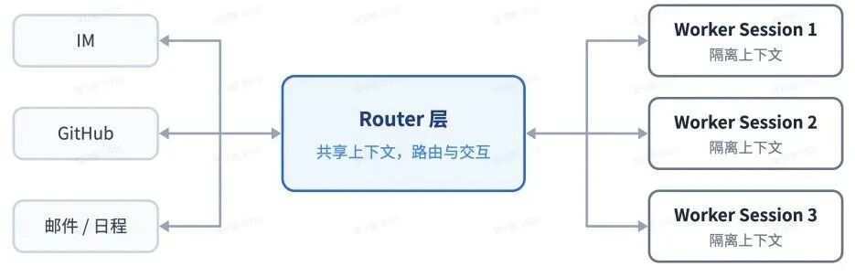
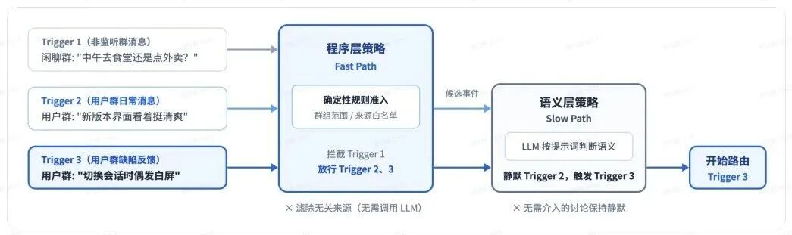
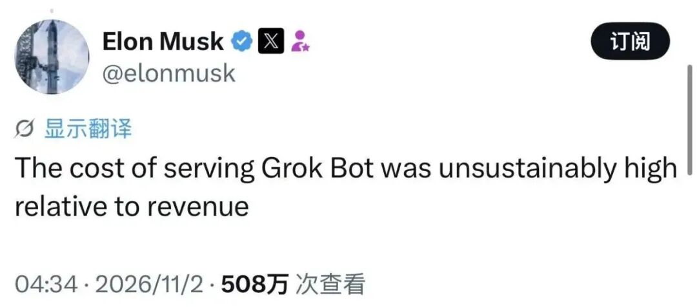



**收录说明**：用户提供链接。原文在微信公众号，用浏览器的客户端标识直接下载页面，从 `#js_content` 抽取正文，图片地址取自 `data-src`。文章主要讨论 DeepSeek Harness 团队 2026-10-30 发布的 Super-agent（tracking 中已评估、未纳入）。文首公众号横幅动图与文末关注引导未收入。

**内容摘要**：2026 年 10 月 30 日晚，DeepSeek Harness（DSH）团队发布《Super-agent 设计探索：迈向更自主的 Agent 系统》并开源原型 dsh-superagent-prototype，上线 48 小时 Github Stars 达 9200+、Forks 超过 930。文章转述其出发点：一个人通常只能同时跟进 3 到 5 个活跃的 Agent 会话，因此由一个 Agent 管理跨对话的上下文并协调其他 Agent。设计包括 Router 与 Worker 双层架构、程序层先筛掉 80% 噪音的两级过滤、事件驱动和「存算分离」的 Watchdog 层。初步实验中多任务压测的任务完成时间中位数为 12.4 分钟、P95 为 15.7 分钟（单会话 P95 为 29.5 分钟），Cache-read tokens 从单会话的 610 万升到 2,323 万。

**保留理由**：对 DeepSeek Super-agent 设计文档与原型的中文解读，包含多 Agent 调度架构以及耗时、Token 成本的公开数据。

---

2026 年 10 月 30 日晚，DeepSeek Harness（DSH）团队发布了[《Super-agent 设计探索：迈向更自主的 Agent 系统》](https://mp.weixin.qq.com/s?__biz=MzY4NzM3MTkxOQ==&mid=2247483844&idx=1&sn=1e93a1f1dc5ae0996f9c45794b896495&scene=21#wechat_redirect)，并顺手开源了原型 dsh-superagent-prototype。

截至目前，原型上线仅 48 小时，Github Stars 已经冲到了 9200+ 星，Forks 超过 930 次，直接冠绝 GitHub Trending 和 Trendshift 榜单。

但是，“常驻后台、多任务协同、主动触发” 的 Agent 是一个烂大街的话题，市面上产品更是多到不知道怎么选：从 XAI 的 Grok Bot，到 Meta 的 Muse AI、OpenAI 的 Dots、Anthropic 的 Claude Duet，再到国内的 Today、蚂蚁灵光 2.0、Cola......太多太多了。有人会把这类产品统称 Personal Agent——它常驻后台，只对你个人负责。

那么，为什么硅谷和国内的产品早就上桌了，DeepSeek 仅仅发了一篇探索笔记和原型，还能溅起这么大的水花？

DSH 团队的文章和原型，核心是探讨现在主流 Agent 设计难以在多任务和团队协作的规模上支撑这一模式，并给出了瓶颈及解决方法：

瓶颈在于人的注意力是有限的。目前，Agent 工作模式仍以单一对话（Session）为基本单位，而一个人通常只能同时跟进 3 到 5 个活跃的 Agent 会话，就像一个项目经理同时管理 3 个以上项目已经是接近负荷了，尽管很多打工人已经超过了这个负荷（bushi）。

解决方案名为 Super-agent。DSH 团队给出了突破这个瓶颈的解决思路，就是单拎一个 Agent 出来管理跨对话的上下文（Context），并协调其他 Agent 完成具体任务。

具体来看，Super-agent 在工程上干了三件事：

双层架构 + 两级过滤 + 事件驱动 + 存算分离 + 看门狗

首先，Super-agent 里把角色进行了职责切分：

1. Router（路由层）：相当于项目组里的总监或经理，24h 接电话，负责落实你的要求、维护全局记忆并派发工单，干一些协调沟通的工作。重点是，它自己是不干活的，和你老板一样（bushi）。

2. Worker（工作层）：相当于项目组里的技术负责人，接到经理（Router）派发的工单后，在独立的沙箱环境里查资料、写代码，甚至自己拉起更垂类的子代理（ Subagent）打下手，只把干净的交付物交回给 Router。

双层架构：Router层统一负责路由与对外交互，多个Worker Session隔离并发执行任务

其次，设置Trigger层（事件驱动）让系统主动找活干。

驱动 Agent 的不再是提示词（Prompt），而是办公环境里的半结构化事件流（包括邮件、群聊、GitHub 评论、待办事项等）。为了不被群里的闲聊刷爆，它采用了 2 级过滤机制：

1. 作为 Fast Path（程序过滤）：基于确定性条件的代码做快速准入，筛掉 80% 的无关消息/噪音。

2. 作为 Slow Path（语义过滤）：由大模型（LLM）判断剩下的信息里有没有需要落实的，并结合上下文写成提示词交给 Worker 层干活。

两级过滤：先由程序层策略筛除大部分无关消息，再交由语义层策略判断

最后，设置了一个“存算分离”的 Watchdog 层：

把运行状态和执行环境解耦，在主系统外引入独立的外部控制回路（Control Loop），单独配置一个定时对话来排错。

从 DSH 团队公开的初步实验结果来看，Super-agent 是花更多 Token 换取更快更稳定的多任务调度。在嘈杂的多任务压测中，任务完成时间中位数为 12.4 分钟、P95 为 15.7 分钟，比传统带 Subagent 工具的单 Session 模式快了近一倍（单会话 P95 高达 29.5 分钟）。

技术架构看完了，回到开头的问题：为什么偏偏是 DeepSeek 炸出了这么大的水花？这里仅代表我个人，从业务与落地的视角聊三点感受：

一是 DeepSeek 的开源杀伤力。

不论是 Grok Bot、Muse、Dots 或者 Duet，实质都是“闭源模型 + 云托管黑盒”，更多的还是面向 C 端群体；到了更严肃的 B 端场景，更多地还是采用私有化部署。

而 Super-agent 背靠 DeepSeek 工程经验，不仅直接给出 MIT 协议的开源代码，而且原生支持 Github 和飞书，很戳中国内的职场与研发团队的生态痛点。

不过也开始有开源博主控诉 DSH 团队抄袭他们的架构。

二是罕见地公布的 Token 账单。

我发现 DSH 团队报告中有一组数据：Super-agent 跑一轮任务的缓存读取量（Cache-read tokens）从传统单会话的 610 万 直接飙升到了 2,323 万（近 4 倍）；如果进一步算上不同路由配置，单次实验的缓存 Token 甚至会从 2,323 万进一步涨到 3,177 万（增幅约 37%）。

不论是 XAI、Meta、OpenAI 或者 Anthropic，我好像是没见过会直接公布 Always-on Agent 的 token 开销，除了马斯克在推上抱怨“高得不可持续的成本”。

三是 DeepSeek 在工程基建上的恐怖号召力。

别忘了今年 8 月底，DeepSeek Harness 发布不到48h，Github收获超过 9.5 万 Star，Forks 接近 9000 次。

只能说， DeepSeek 又为人类送上大礼。

END
