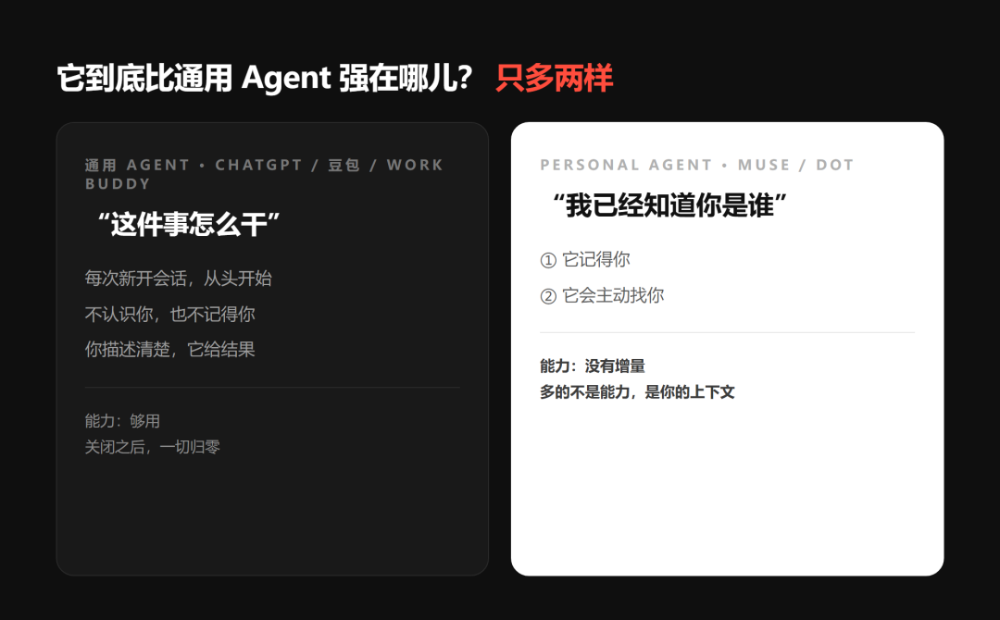
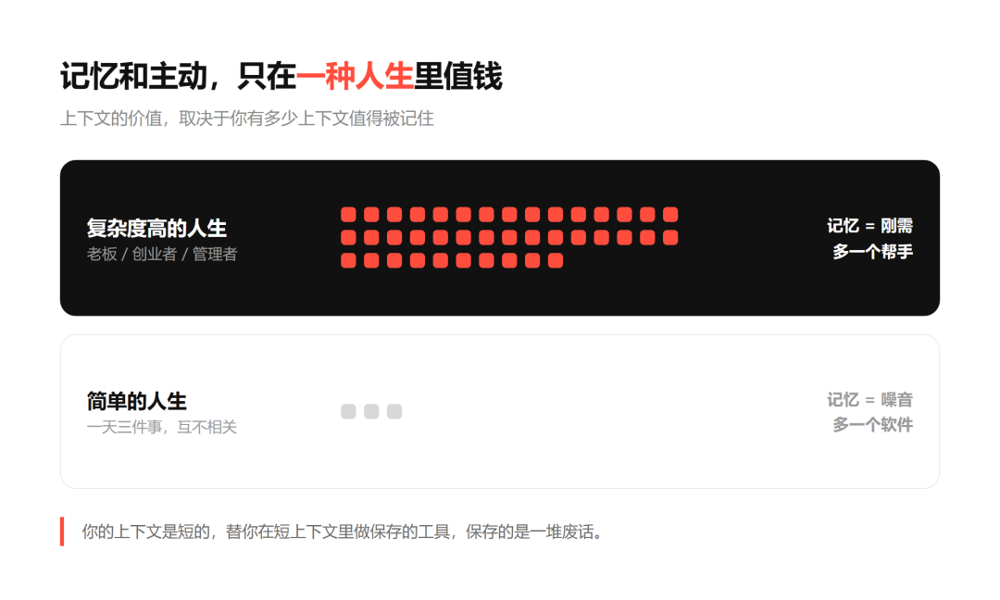
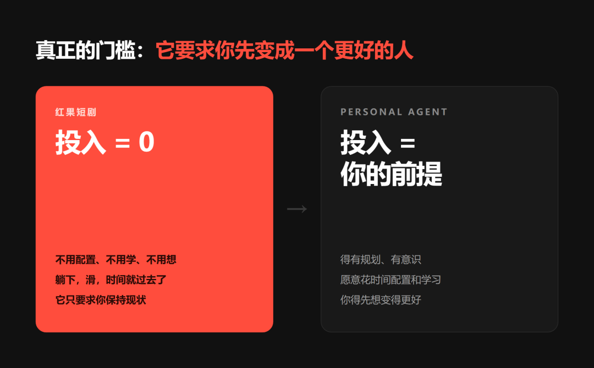



**收录说明**：用户提供链接。原文在微信公众号，用浏览器的客户端标识直接下载页面，从 `#js_content` 抽取正文，图片地址取自 `data-src`。作者自称没有下载过 Grok Bot、Muse、dots，文中只有概念讨论，products 不列具体产品。

**内容摘要**：作者自称没有下载 Grok Bot、Muse、dots 等产品，认为与通用 Agent 相比，Personal Agent 多出来的「只有两样」：「它记得你」和「它会主动找你」，多出的是用户的上下文而不是更强的能力。作者认为记忆和主动只在「高频、多线程、跨领域，并且持续产生需要被追踪的状态」的人生里才值钱，并称「Personal Agent 最大的竞争对手是红果短剧」。结论是 Personal Agent 不是伪需求，真实用户是高级白领、创业者、管理者及长期做跟踪型工作的人，他们的瓶颈是带宽。

**保留理由**：从用户分层角度判断谁需要 Personal Agent，是一个简短明确的观点样本。

---

说实话，截止到今天，我也没有下载Grok bot ，Muse，dot等此类personal Agent

因为，我始终不明白存在的价值

我甚至觉得，它是一个大号地，配置少地 Openclaw,Hermes agent

但也没有简单到，傻瓜式的配置。

就非常鸡肋...

我深入研究，这一类personal agent使用的场景：

## 一、它到底比通用 Agent 强在哪儿？

这是我最晚想明白的一件事，也是理解整个品类的前提。

你现在，用的通用 Agent，豆包工作、ChatGPT、Claude、各种 WorkBuddy，解决的是一件事：**这一件事怎么干。**

你描述清楚，它给结果。

查资料、写文案、做表格、改代码、算一笔账

合上窗口，它就把你忘了，而这对结果没有任何影响

因为它不需要认识你，也不需要记住你

那 Muse、Dot 这类 Personal Agent，到底多了什么？

**只有两样。**

**第一，它记得你**

**第二，它会主动找你**

它并没有提供更强的能力。

同样的模型、同样的检索、同样的写作，通用 Agent 都能做。

它多出来的，是**你的上下文**

你是谁、你在跟谁推进什么事、上周答应过谁什么。

所以第一次用完觉得"好像也没帮上什么"，不是你用得不对。

是它给的确实不是能力，是上下文。

而上下文这个东西，不是所有人都需要。

## 二、记忆和主动，只在一种人生里值钱

关键在于：**上下文的价值，取决于你有多少上下文值得被记住。**

一个老板的一天：40 封邮件、10 个小会、5 条业务线同时在跑、下周要见的人上个月提过的一个细节、半年前答应别人的一件小事。

这些东西互相牵扯，到处是没关闭的接口，忘掉哪一条都会产生成本。

这时候因为他自己的大脑也不够用了。

> **只有这一种人生，才值钱。**

高频、多线程、跨领域，并且持续产生需要被追踪的状态

只有活在这样的人生里，Personal Agent 才从"多一个软件"变成"多一个帮手"。

"主动"是同一个逻辑

产品没问题。人不对。

## 三、真正的分水岭，是你愿不愿意改变

上一节说的是客观处境。但还有一个更根本的分层：**主观意愿**

愿意改进的人，本来就极少

他们用得上，因为会主动配置、主动迭代、主动承担学习成本

这类人看到一个新工具，第一反应是"我怎么把它用起来"

而大部分人不是"用不上"，是**不想改变**

不是没能力改，是没意愿改。低效对他们不构成痛苦，最多是不舒服，忍忍就过去了

所以"你用得上这个工具吗"本身就是一次分类测试：

> **用得上，说明你属于那一小撮**

绝大部分效率工具从诞生到今天，真正重度使用的都是同一小批人

> Personal Agent 最大的竞争对手是红果短剧

所以

我不认为 Personal Agent 是伪需求

它有真实用户：

生活复杂度高、且愿意主动改进的那一小部分人，高级白领、创业者、管理者

以及长期做跟踪型工作的人

他们的瓶颈是带宽

而记忆和主动，是对带宽的直接扩容
