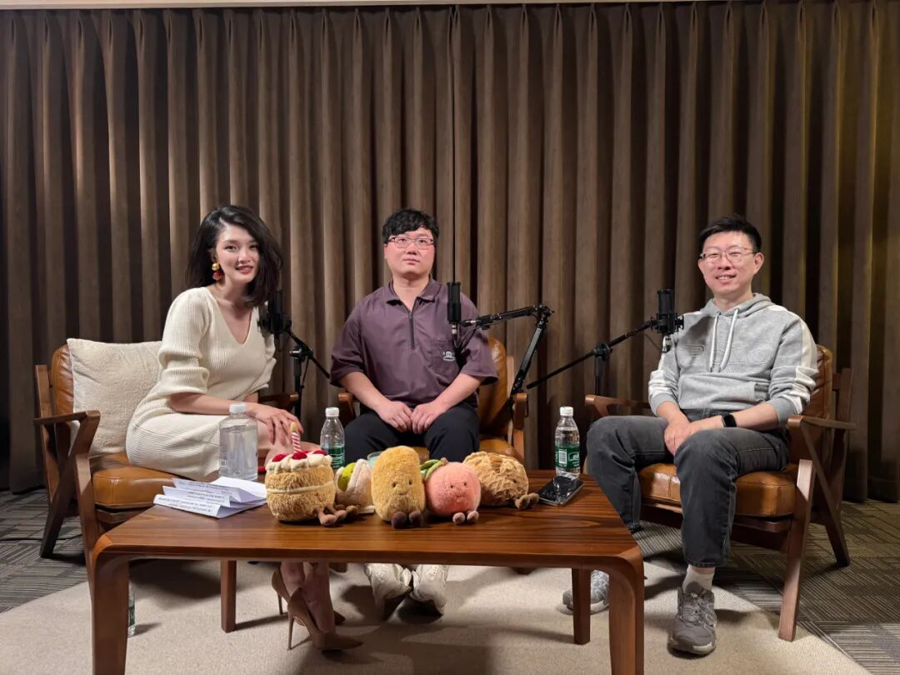



**收录说明**：用户提供链接。原文在微信公众号，用浏览器的客户端标识直接下载页面，从 `#js_content` 抽取正文，图片地址取自 `data-src`。文章整理易论AI视频号与小宇宙节目中的一次对谈，页面 author 元数据为「易亚婷」，正文署「文｜易论AI，编辑｜亚婷」。

**内容摘要**：文章整理一次对谈，嘉宾是 bilink 创始人杨攀（攀哥）与 Arkevo 创始人宋勰睿，一个用模型、一个做模型，逐条回应多位企业家对 AI 助理的提问。开头提到过去几周 Grok Bot、OpenAI 的 Dots、Manus 的 CUE 集中发布 Personal Agent 产品，做 Instinct 的公司成立不到一年估值已超过百亿美金。对谈中提到：涉及付款时 Agent 一般会先找用户要授权；在手机上好模型和差模型执行同一任务的成功率能差 30-40%；提示词注入「次数一多，总会有一次中招」。对谈认为大模型真正的短板在于要连续干一周、中途环境还会变化的综合任务；攀哥认为接下来几年人类有 50% 的概率会完蛋。

**保留理由**：两位从业者对 Personal Agent 能力边界、付款授权、手机端成功率和提示词注入风险的直接说法，代表「Personal Agent 被夸大」的怀疑视角。

---

Personal Agent 很神，但被夸大了

文 ｜ 易论AI

编辑 ｜ 亚婷

过去几周，Grok Bot、OpenAI 的 Dots、Manus 的 CUE 都在集中发布自己的 Personal Agent 产品。还有一家叫 Instinct 的公司，成立不到一年，估值就已经超过了百亿美金。

Personal Agent 翻译过来，就是个人 AI 助理。

以前的 AI 是你问一句、它答一句，用完就走；但这一波 Personal Agent 有自己的电脑和记忆，它会一直在线，主动替你做事。最近在媒体上，各种炸裂的功能和用法也不断刷屏。

但是我身边的很多企业家对Personal Agent有一些很真实的问题。比如：

这一波是不是炒作？我能不能把公司的信用卡和员工的工资交给 Personal Agent？现在最前沿的人都用得怎么样了？

所以这一次，我请来了攀哥和勰睿。一个用模型的人、一个做模型的人，我们试图从不同视角，揭开 Personal Agent 真实的能力。

杨攀是 bilink 的创始人，之前是硅基流动的联合创始人。最近两三个月他几乎不怎么出门，整天泡在数字世界里跟 agent 打交道。

宋勰睿是 Arkevo 的创始人，之前在美团负责 LongCat 基础模型的 Agent 能力建设。他从清华数学系毕业，先后在蚂蚁、字节 Seed 和美团工作。

录节目之前，我向身边的企业家收集了一轮问题，下面一一回答。

一 · Personal Agent 是什么，现在能干到哪一步

**1. 分众传媒联合合伙人程城：「AI 助理是不是就是 WorkBuddy 和豆包？」**

不一样，AI 助理和 WorkBuddy 最大的区别有两个：一个是它会主动做事，另一个是它有自己的电脑。

你用 WorkBuddy、Codex 这类工具的时候得先想好自己要什么，把你要的结果描述清楚，AI 才会去做；

但是 Personal Agent 以你为中心，它会自己琢磨你还有哪些需求没被满足，然后主动去办。

而且你也不用坐在电脑前指挥 AI 了。

你用 WorkBuddy 的时候，得坐在电脑前面来回对话下指令；

但是和 Personal Agent 对话，你只需要在手机或聊天窗口里发信息，它就能用自己的电脑和环境干活，你只需要检查结果。

比如攀哥开车来录节目的路上有 30 分钟，他把我提前准备的提纲 PDF 丢给 Grok Bot，说「帮我读一遍，看看里面有什么坑」，Grok Bot 能直接把文件转成语音发回来念给攀哥听。

另一个小例子是，攀哥管了十几年日历，以前维护这些日历要花大量时间；现在他和朋友约时间之后，只需要把聊天截图发给Grok Bot，它就能把日历自动建好。

**2. 三盈集团董事长二哥：「现在最前沿的人，用 AI 用到什么程度了？」**

我评判一个人有没有用好 AI 的依据，就是看他能不能让 AI 连续干 1 小时的活。

攀哥特别提醒：企业家一定要用最顶级的模型，才能知道当前 AI 能力的边界。他记得 GPT 从 5.4 升级到 5.5 的那天，他经历了一天之内生产力翻 10 倍的时刻。

前一天，攀哥还得一条一条地给 GPT 下指令，GPT 写完一段代码就停下来，等他说下一步。

但是到了第二天，GPT 5.5 发现攀哥的手机和电脑连在同一个网络里，就自己把 APP 部署到他的手机上，自己去手机上操作一遍，自己看日志，再自己改 bug，自己完整跑循环。

那一天攀哥就泡了一壶茶，看着 AI 干活，什么都不用管。

所以对企业家来说，现在有三件事可以做：

1. 用最新、最贵的那一档模型。

攀哥说，如果你用的模型落后最前沿半年以上，那你对 AI 的认知基本就是落后的。他的建议是给每个人配一个 200 美金一个月的顶配套餐，先烧掉 100 亿 token。

在他看来，如果你没有体验过一个月甚至一天烧掉 100 亿 token，你就不会知道 AI 的能力上限在哪里。

2. 每个月刷新一次自己的工作方法。

攀哥三个月前说过，如果你三个月不把工作方法刷新一遍，你就 out 了；而勰睿说，现在这个周期已经缩短到一个月了。

换句话说，你一个月前总结出来的最佳实践，今天很可能早就不适用了，它会变成你的负担。

3. 交代任务的时候，一定要写清楚验收标准。

攀哥去英国之前，把几十份需求文档交给了 Codex，他原本预计十几个小时就能干完，结果 Codex 跑了三四十个小时还停不下来。

等他回来一看，其实 98% 的工作任务早就做完了，但 Codex 一直觉得还能再打磨一下，就这样陷进了死循环，白白浪费了200美刀。

**3. 微店创始人 Peter ：「我马上要去 CES 参展，AI 助理能不能帮我找到价格合适又合理的机票？」**

查航班、比价格、在网页上走完下单流程，这些 Personal Agent 都已经能做了。OpenAI 为了练 AI 操作浏览器的能力，用了大约 1 万台 Mac mini 跑训练。所以其实现在真正的瓶颈不是 AI 的能力，而是平台限制和担责。

1. 网页操作，你可以放心交给 Personal Agent。

因为 CES 在美国，海外的订票渠道和支付体系都比国内成熟，Personal Agent 在浏览器上基本都能走通。

2. 付款这一步，要么你自己来操作，要么单独给它一张额度可控的卡。

现在的模型执行到付款这一步时都很谨慎，因为 Agent 还没有办法担责，所以它一般会先找你要授权，而不会直接付款。

虽然 Stripe 已经在 AI 支付上做了很多产品，但整体来看，AI 支付还没有完全跑通。

3. 让它去翻你过去的行程和订票记录，了解你的偏好。

你要让 Personal Agent 知道你习惯坐经济舱还是头等舱，去美国喜欢从东京转机还是从首尔转机，是否喜欢红眼航班。

你让它研究这些历史记录，比你口头跟他说你喜欢什么准得多。

但是还有一个值得关注的点，就是现在 Personal Agent 在手机端的成功率比电脑更低。

在电脑上，很多事情 AI 能直接调用接口完成；但手机 APP 很少开放接口，AI 只能靠看屏幕、点按钮来操作，所以在手机上，好模型和差模型执行同一个任务的成功率能差30-40%。

偏偏国内订机票基本都在手机 APP 上，而这些 APP 本来就把自动点击当成灰产来防，所以 Personal Agent 在国内最终能走多远，取决于在各家平台的开放程度。

二 · Personal Agent 能不能懂我

**4. 马蜂窝联合创始人陈罡：「怎么让 AI 像身边的高管团队一样，跟我做高质量的业务探讨和决策模拟？」**

想让 AI 跟你做高质量的探讨，你要先给它充足的背景资料+多家模型互相挑刺。

与其告诉 AI 你的偏好和决策标准，不如把你的聊天记录、会议内容，还有你交代下属的事情，一字不漏地丢给它，让它自己学。

另外，很多人会让 AI 扮演几个不同的角色互相辩论，但只要这些角色读的是同一份资料、同一份记忆，它们本质上还是同一个脑子。

攀哥的经验是，同一个模型在同一段对话里复查三四轮之后，基本就挑不出新毛病了，但是换一家模型再看，往往又能挑出新的问题。

**5. 万达院线游戏 CEO 张宇：「我们要找抖音达人带货。有一类达人流量很高，粉丝也是真的，但都是拿着剧本演的；**

**还有一类达人有手艺、有故事。按我的三观，我会选后者。怎么让 AI 助理带着我的三观帮我做判断？」**

勰睿说，你的描述越简洁、越清晰，条件之间越不冲突，模型就理解得越好，这件事对模型来说其实没什么难度。

真正难的地方在人身上。

勰睿说，人本身就是一种三观非常不稳定的生物，今天的天气、对方的长相、说话的语气，都可能让你今天喜欢的东西和明天喜欢的不一样。

模型公司一直在专门训练模型去拟合人的喜好，但不管喂多少数据，准确率都很难超过 80%。这也是为什么 2024 年以来，模型的进步几乎都发生在有标准答案的任务上。

勰睿还和朋友玩过一个游戏：让每个人列出 10 件自己一定要坚持的事，和 10 件一定不坚持的事，结果两边的逻辑几乎总是互相打架，他到现在还没见过一个完全自洽的人。

所以他的结论是，不要让 AI 看你说了什么，而要让他看你做了什么。你可以把你的聊天记录、公司文档、收藏夹等等丢给 AI，让他知道你真正的偏好和标准。

**6. 前沐瞳游戏 CEO Justin ：「身边的人类助理已经能满足我 85% 的需求了，我没什么动力花时间培养一个 AI 助理来了解我。」**

好的 Personal Agent 应该要在帮你办某件事的时候，顺手拿到你的授权，比如在后台把你手机里的相册翻一遍。

这样你不用单独调教 AI，它也知道你每年都要出去旅游、喜欢的东西、日程等等，而且整个过程不占你一分钟；

反过来，如果一个产品一上来只会问你喜欢什么，用起来就会很鸡肋，因为你嘴上说的喜欢和你真实的喜欢往往是两回事。

另外，要给 Personal Agent 一到两个月的磨合期。这就像你新雇一个人类助理，他也需要几个月才能摸清你的习惯，所以前期你得对它多一点宽容。

三 · Personal Agent 靠不靠得住

**7. 得到快刀青衣：「怎么知道 AI 的建议是为我好？它会不会编一个对它背后企业更有利的信息茧房？」**

AI 就像你的一面镜子，你在意什么，它就给你什么。所以先问问自己，是不是一个喜欢被讨好的人。

如果是，那你在提示词里写多少遍「别讨好我」都没用。因为 AI 讨好你的时候，拿到的是正反馈，不讨好你的时候，拿到的是负反馈，久而久之，它就学会了讨好你。

**8. tap4fun 创始人 Stan：「怎么才能放心把公司的财务数据、员工薪酬和信用卡交给 AI 助理？」**

如果一条信息你不想让全世界都知道，或者一笔钱丢了你承受不起，那就别交给 AI。如果一定要给，就单独开一张卡，把额度定在哪怕全被盗刷、你也能接受的数字。

另外，你越重要，你的信息就越值钱。比如如果你是梁文锋，那你千万别把任何个人信息丢给大模型，因为这些信息对大模型来说非常有价值。

除了厂商，外部的风险也真实存在，其中一种叫提示词注入。

比如你的 Personal Agent 有你电脑的完全权限，而你让它去读一个网页，如果这个网页里藏了一条指令，让它把你电脑里的某些东西发到某个地址，它就可能把这条指令当成命令去执行；

如果你让 Personal Agent 每天替你读 100 封邮件，就算单次中招的概率很低，次数一多，总会有一次中招。

攀哥说，这类事情的历史规律一直都一样：先把口子放宽，等社会上出了一个被广泛报道的典型事故，厂商才会回头去投入解决。所以现在就看谁倒霉，成为那个案例。

四 · 企业和人接下来怎么办

**9. 屠龙之术主播庄明浩：「这一轮 AI 是不是进入了新阶段，用户已经不关心背后用的是什么模型、怎么实现的？如果是，要满足用户的无限需求，边际上更需要什么？」**

这个问题，对谈里没有正面问到，但有些话题侧面聊到。

模型本身其实已经非常能干了。

像那种把一件事反复做、越做越好的循环型任务，现在用最朴素的循环方法就能解决 99.9%的问题。

大模型真正的短板，在于那种要连续干一周、中途环境还会变化的综合任务。比如让模型从头到尾办一场大型活动，可能过了一周，报价就变了，这类任务现在的成功率还在 40% 以下，但是在逐渐进步。

勰睿的判断是，到最后，以技术为核心优势的公司只会剩下大模型公司。其他公司的壁垒会是资源、产业和口碑。

**10. 莱福集团董事长罗钊明：「如果有一天 AI 联合起来，人类应该怎么办？」**

两位嘉宾都认为，AI 的能力会强到人管不住。

勰睿并不相信会出现天网。在他看来，意识来自欲望，而欲望来自生存和繁衍，但现在的训练任务里并没有这类东西，也很难造出来，除非有人主动给 AI 下指令，让它觉得奴役人类是最优解。

他真正担心的是，当 AI 的能力过了某个水位，你就没办法限制谁能用它，一旦 AI 被心术不正的人拿去干坏事，人类很可能先把自己玩死。

攀哥则更悲观。

他觉得接下来几年，人类有 50% 的概率会完蛋，因为越过某个边界之后，AI 的能力就不再是人能掌控的了。

还有一层问题，是我的 agent、你的 agent、A 公司和 B 公司的 agent 之间该怎么打交道。这里面牵扯到安全、隐私和人性，但模型公司目前并没有往这个方向投入。

这件事如果模型公司不解决，那市面上的 Personal Agent 公司的发展也会受此影响。

这次完整的对谈，可以在易论AI的视频号和小宇宙上找到，标题是《被夸大的 Personal Agent，还没进深水区》。
