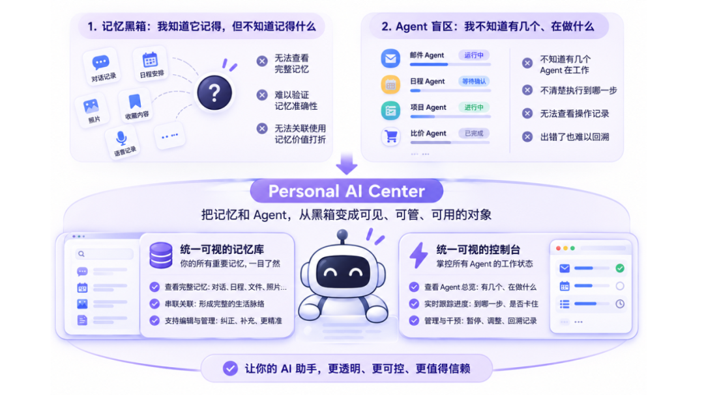
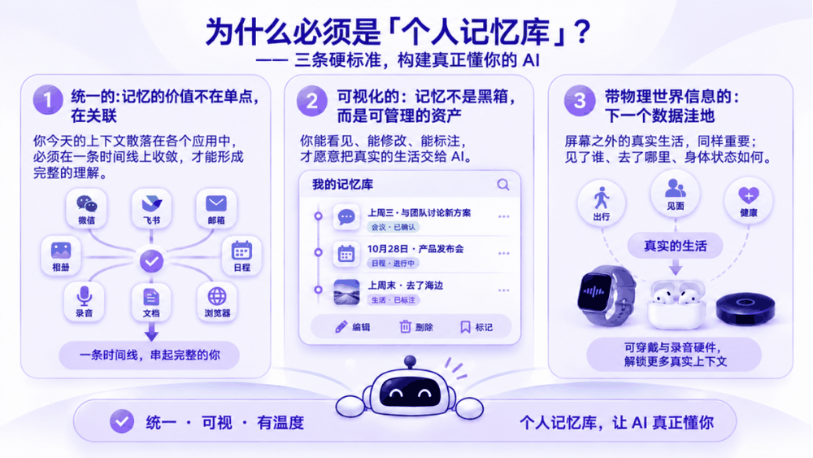
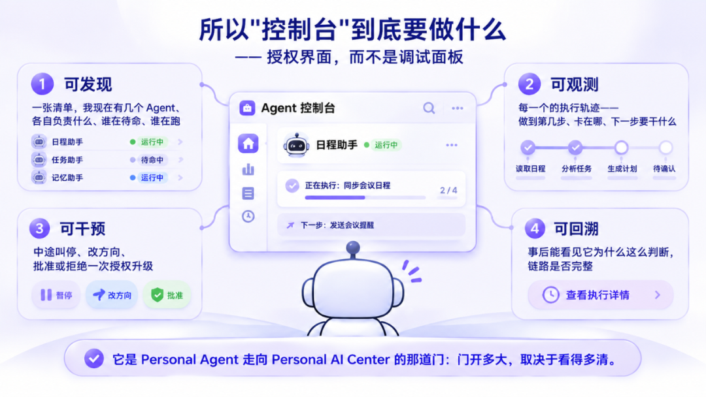
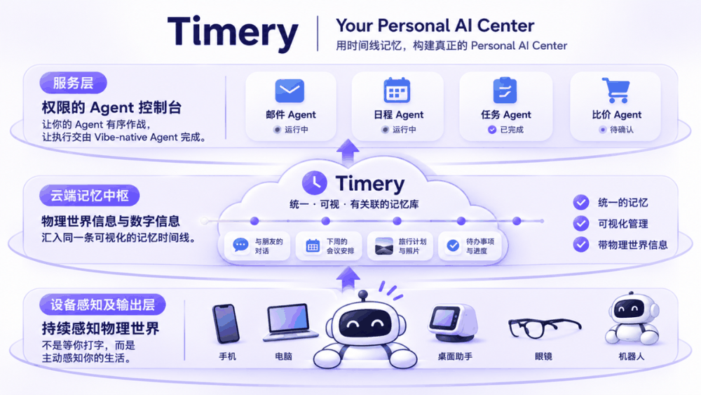



**收录说明**：用户提供链接。原文在微信公众号，用浏览器的客户端标识直接下载页面，从 `#js_content` 抽取正文，图片地址取自 `data-src`。发布方是做 Timery 产品的创业团队，文章后半介绍自家产品 Timery，照录；文末产品二维码图属于推广，未收入。

**内容摘要**：文章把 Meta 的 Muse、Instinct、Manus 的 Cue、OpenAI 的 Dots 归为同一类常驻后台的 Personal Agent，认为它们缺的不是能力，是「掌控感」：没有直观的方式展示「我的记忆有哪些」，也没有直观的方式展示「我的 Agent 有哪些」、做到了哪一步。作者提出 Personal AI Center = 个人记忆库 + Agent 控制台，控制台分可发现、可观测、可干预、可回溯四层，并认为「能随时收回的权限才产生信任」。文末介绍作者团队的产品 Timery（「用时间线记忆构建 Personal AI Center」）。

**保留理由**：创业团队对 Personal Agent 记忆与执行过程可见性问题的论述，「记忆库 + 控制台」的框架可作为相关讨论的出处；文末产品介绍是作者的自述。

---

2026 年的行业共识已经很清楚：AI 正在从"你交代它执行"，变成"它常驻后台替你盯着"。

Meta 的 Muse、Instinct、Manus 的 Cue、OpenAI 的 Dots——形态各异，但都在做同一件事：**一个有****长期记忆****、能主动触发任务的数字管家。** 我们把这一类统称为 Personal Agent。

它补上了前两代最致命的缺口：Chat 关掉就忘，Agent 干完就走，只有常驻后台的 Personal Agent，才第一次让 AI 有了"持续存在"的感觉。

但有个一个更远的问题：

**Personal Agent 之后，是什么？**

我的答案是 **Personal AI Center**。

这不是顺延，是一次**必要的补课**——因为 Personal Agent 身上有一个所有人都绕不开、却很少有人讲清楚的结构性缺口。

## 一、Personal Agent 缺的不是能力，是"掌控感"

## 

Personal Agent 这一代，能力已经足够了：能记住你、能主动、能在后台持续跑。

但它缺一样东西，而且缺得很具体——**掌控感**。

掌控感不是一个虚词，**而是贴合人性的设计**，落到产品上其实是两个非常具体的缺口，恰好对应人生活里最需要被"看见"的两样资产：**我的记忆**，和**我的 Agent**。

### 1. 没有一个直观的方式，展示"我的记忆有哪些"

### 

现在几乎每个产品都说自己有记忆。但记忆是散落的：这一段在某次对话里，那一段在某个 App 的收藏里，还有一段只存在于一次语音、一张照片、一个日程备注里。

**你能感觉到它记得，但你无法知道它到底记得什么。**

没有统一视图，后面一连串事情都成立不了：无法确认记忆是否完整、是否准确，无法纠正它的理解偏差，也就无法判断"它现在给我的建议，是基于我真实的生活，还是基于它拼凑的猜测"。

而且散落的记忆无法被组合使用——**记忆的价值从来不在单点，在关联。** 人脑之所以能判断，是因为"上周见过谁、当时在推什么、后来卡在哪"这条链是连着的。链一断，AI 就只能给你通用答案。

所以黑箱记忆的代价是双重的：**对用户，它是一项不可审计的资产；对产品，它拿不到真正的生活数据。**

### 2. 更没有一个直观的方式，展示"我的 Agent 有哪些、执行到哪一步了"

### 

上一个时代你只有一个对话框，AI 的一切都发生在你眼前。

Personal Agent 时代第一次出现了**多个常驻后台的 Agent**：一个盯邮件，一个管日程，一个跟项目，一个比价，一个在等你的确认。能力是扩张了，但观测界面还停在"一个对话框"。

于是最基础的几个问题都答不上来：

我现在到底有几个 Agent 在替我工作？

它们分别跑到哪一步了？哪个卡住了，哪个在等我拍板？

它动了哪些数据、花了钱没有、有没有越界？

出错了，我能不能回头看它是怎么想的？

**一个替你做事的系统，如果连"有几个、在做什么、做到哪"都答不上来，它不是管家，是一屋子看不见的实习生。**

这两个缺口的本质是同一件事

AI 的能力边界已经扩展到"持续、多处、后台运行"，而人对它的观测方式还停留在"一个对话框"。

**能力的扩张速度，超过了可见性的扩张速度。** 这就是 Personal Agent 当下的天花板——不是模型不够强，是我不敢把更重要的事交给一个我看不见的东西。

> Personal Agent 解决了"AI 能不能持续替我工作"； Personal AI Center 要解决的是"我看不看得见它记得什么、在做什么"。

所以要再往前一步，必须把"记忆"和"Agent"这两样东西，从黑箱里的状态，变成**看得见、数得清、管得住的对象**。这正好对应 Personal AI Center 的两个组件：一个统一可视的记忆库，和一个统一可视的控制台。

## 二、所以之后是：Personal AI Center = 个人记忆库 + Agent 控制台

## 

这个等式就是我们的全部判断。左边是产品形态，右边是两个必须同时成立的能力：

**个人记忆库**，回答"AI 凭什么懂我"

**Agent 控制台**，回答"我凭什么敢让它做"

缺任何一个，产品都会退回上一代：只有记忆没有控制台，是更聪明的助手；只有控制台没有记忆，是更顺手的工具。

回头看这条演进线，你会发现它其实不是技术线，而是**信任线**：

Agent 无沉淀 → Personal Agent 无视图 → Personal AI Center 执行可见

## 三、为什么必须是"个人记忆库"——三条硬标准

## 

不是所有记忆都叫记忆库。要撑起一个 Center，必须同时满足三条：

### 1. 统一的：记忆的价值不在单点，在关联

### 

你今天的上下文散落在微信、飞书、邮箱、相册、日程、录音、文档、浏览器标签里。这些是孤岛。**孤岛不产生理解，只产生检索负担。**

必须在一条时间线上收敛。因为人的理解本来就是时序的——"上周三见过谁、当时在推什么、后来卡在哪"，这条链一旦断开，AI 就只能给你通用答案。

统一不只是体验问题，它是**能不能形成认知的前提**。

### 2. 可视化的：这是最被低估的一条

### 

这一点常被当成 UI 问题。我认为它是**商业模型问题**。

记忆如果是黑箱，它就是一项**不可审计的资产**：用户不知道它记了什么、记错了没法改、理解偏了没法纠。人不会把自己真实的生活交给一个看不见的东西。

而"拿不到真实数据"意味着什么？意味着 AI 永远停在通用助手的位置，永远做不出"懂你"的判断。

**所以可视化不是美化，是数据获取的前置条件。** 你让用户看见记忆，用户才肯交出记忆——这是因果链，不是设计偏好。

我把它叫做**记忆的共同编辑权**：我能看见、能删、能改、能标注对错。这是人和 AI 建立长期关系的最低契约。

### 3. 带物理世界信息的：下一个数据洼地

### 

屏幕只占你一天的很小一部分。真正决定判断的东西大量发生在线下——见了谁、当面说了什么、路上想到什么、身体状态如何。

大模型已经吃完了公开互联网。**下一个未被开采的数据洼地，是"没有被数字化的个人物理世界"。**

这也是为什么我判断：可穿戴与录音硬件不是配件生意，是**入口生意**。谁的设备能合规、低打扰地采集真实世界的上下文，谁就拿到了别人拿不到的那 90%。

## 四、所以"控制台"到底要做什么

## 

如果缺的是可见性，那控制台就不是一个"日志面板"，它得提供四层东西：

**可发现**：一张清单，我现在有几个 Agent、各自负责什么、谁在待命、谁在跑

**可观测**：每一个的执行轨迹——做到第几步、卡在哪、下一步要干什么

**可干预**：中途叫停、改方向、批准或拒绝一次授权升级

**可回溯**：事后能看见它为什么这么判断，链路是否完整

四层里最容易被忽略的是**可干预**，但它才是关键。因为可见性本身不产生信任，**能随时收回的权限才产生信任**。

所以控制台是**授权界面**，不是调试面板。一个只能读日历的 Agent 是提醒工具；一个被授权读记忆、调服务、代为决策的 Agent 才是分身——**差别不在模型，在信任界面。**

它是 Personal Agent 走向 Personal AI Center 的那道门：门开多大，取决于看得多清。

## 五、我们在这个方向上做的事

## 

我们把这个判断做成了一个产品：**Timery**——用时间线记忆构建 Personal AI Center，把 AI 以"深度"+"顺势而为"的方式嵌进日常。

三层结构：

- **设备感知及****输出层** — 手机、电脑、智能硬件、桌面助手、眼镜、机器人。不是等你打字，而是持续感知物理世界。
- **云端记忆中枢** — 物理世界信息与数字信息汇入同一条可视化的记忆时间线。
- **服务层** — 权限的Agent控制台，让你的Agent有序作战，让执行交由 Vibe-native Agent 完成。

### Personal Agent 是这一站。它把 AI 从"工具"变成了"在场"。

### 

但它还不是终点，因为**在场的 AI 不等于可信的 AI**。之后的那一步，是让 AI 拥有一个归属于你、看得见、可编辑的记忆库，和一个敢把权限交出去的操控台——那才是 Personal AI Center。

我们在做这件事，也正在寻找认同这个判断的长期伙伴，如有意向欢迎直接找我聊。

*Timery · 以时间线记忆构建 Personal AI Center*
