

**收录说明**：用户提供链接。原文在微信公众号，用浏览器的客户端标识直接下载页面，从 `#js_content` 抽取正文，图片地址取自 `data-src`。文章介绍前 Manus 成员创业的产品 Persom，文末有内测与邀请码信息，照录。Persom 不在跟踪清单中。

**内容摘要**：文章介绍一支由前 Manus 成员创立的团队推出的 Persom：运行在用户自己电脑上的 Personal Agent，把分散的工作与生活 Context 整理成 Personal Database，给本地类似 Workbuddy、Codex 这样的通用 Agent 调用。Persom 不依靠持续截图，而是通过 MacOS 的 Accessibility API 读取界面内容、焦点和交互，正文缺失时再通过本地 OCR 补充；由模型判断哪些内容值得保留，再由代码找回对应的原文、应用、窗口、网页地址和操作记录。系统要求至少有三个不同日期的独立证据才会将某项行为作为习惯，用户提出异议时会记录理由并重新核验。数据采用本地优先方式管理，用户可主动开启或关闭接入，通过 MCP 让 Claude、Codex 等 Agent 按需调用；文末称 Persom 开放小范围内测。

**保留理由**：一个本地优先、通过 MCP 向其他 Agent 提供个人上下文的创业产品案例，记录了个人数据采集与习惯判定的具体做法。

---

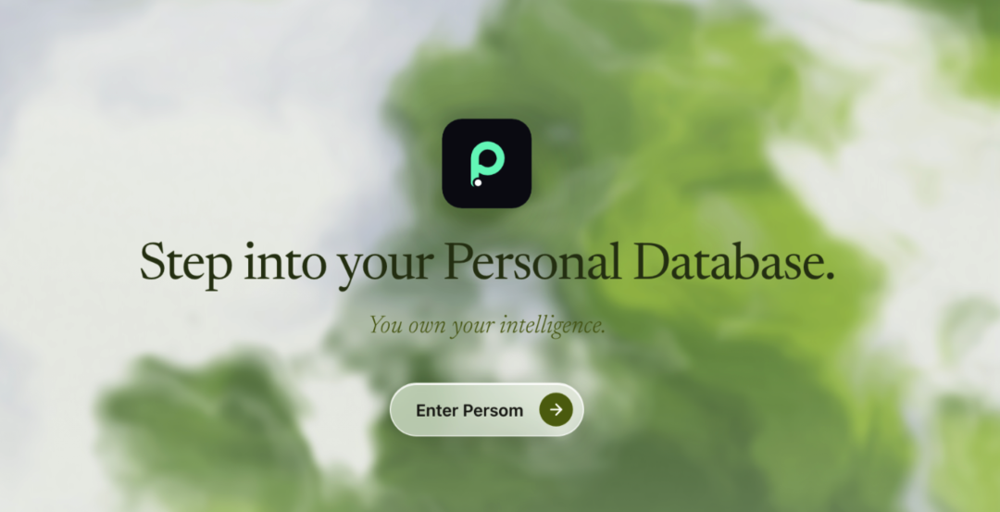

**内容编辑丨特工小师 特工小饼**

**内容审核丨特工少女**

最近，我们一直在思考一个问题：**Personal Agent，要怎样才能成为一个真正有效的个人助手。**

海外最新的前沿探索，正在尝试给出答案。

Meta 发布了 Muse，希望让 Agent 持续帮助用户推进日常任务和长期目标；Instinct 让用户通过发消息、打电话的方式，把订票、采购和安排生活中的事情交给个人助手。

Town、Hark、Underdog 也在将持续记忆、跨工具协作和任务执行结合起来：了解用户的项目、关系和优先级，记住此前发生过什么，再据此提出建议、采取行动。

在投资 Town 时，a16z 强调，助手逐渐积累的表达方式、人际关系、偏好和习惯，本身就是产品的一部分，也很难被竞争对手在短时间内复制。个人助手需要赢得用户信任，才能持续承接他们的上下文和实际工作。

这些探索都指向同一个问题：**AI 能否在与你相处的过程中，持续积累对你的理解，并把这些理解用到下一件事里？**

把这个问题放回国内，场景又有所不同。

许多重要信息散落在微信、飞书、文档和各种软件里。人们知道 AI 很强，却未必知道一项任务该调用什么能力；也未必有时间研究连接器、拆解工作流。

这就是国内 Perosnal Agent 最根本的困境：AI 原本有机会缩小人与人之间的能力差距。但在使用门槛仍然存在的情况下，熟悉工具的人往往能更快地借助 AI 放大能力，其他人却可能被挡在门外。

一支由前 Manus 成员创立的团队，决定从这里切入。

**他们做了一个运行在电脑上的 Personal Agent，主动把分散的工作和生活 Context 整理成属于你的 Personal Database，给本地类似 Workbuddy、Codex 这样的通用 Agent 调用，进而帮助用户增强大多数任务的执行效果。**

一个生长出来的 Personal Agent

Persom 创始人之一 Cecilia 此前在 Manus 工作。

离开 Manus 后，她曾担任另一家公司的合伙人和产品负责人，负责 Vida 产品；六月离开后，她开始围绕 Personal Agent 创业。

而她对 Personal Agent 这个方向的思考，可以追溯到一年前。

**2025 年十月，她曾在黑板上画下关于一款个人助手的设想：**

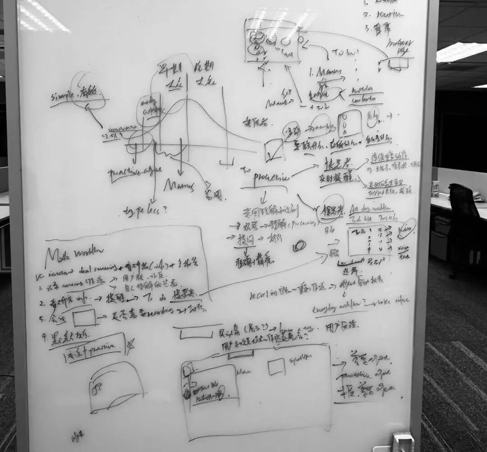

到了十一月，一个方向逐渐清晰：**下一代 Agent 应该从用户的上下文出发，主动理解信息、识别意图，并在合适的时候提出建议、推进任务。**

这个想法，一部分来自她在 Manus 的工作经历。

当时，Cecilia 负责红人营销。她尝试连接 Gmail 和 Slack，让 Agent 每天推送有哪些待办可以代劳；后来，她又录下自己的操作过程，一边讲解工作方法，一边把视频交给 Agent，再连接 n8n 搭建工作流。

这些尝试让她意识到，一个人的工作过程里，本来就藏着大量关于背景、方法和判断的线索。如果 AI 能从真实的工作过程中理解这些线索，用户或许就不必每次都从头整理、解释。

后来负责 Vida 时，Cecilia 也从桌面端入手，继续探索工作流和主动式 Agent。

但继续往下做，他们发现一个不了解项目进度的 Agent，即使每天准时推送建议，也可能只是给用户增加更多工作负担：让 Agent 理解用户的意图，比执行一项明确任务更难。它或许能按指令完成操作，却未必知道当前任务最需要做什么，为什么要这样做，以及做到什么程度才算完成。

这些经历让 Cecilia 逐渐形成了一个判断：**主动服务的前提，是准确的 Context。**

于是，六月创业后，她继续尝试 Personal Agent 的不同形态：为移动端产品配上电话、邮箱、钱包和云电脑，探索让 Agent 围绕邮箱等场景推进任务。

**到了七月，产品已经有些像今天大家理解的 Personal Agent。**

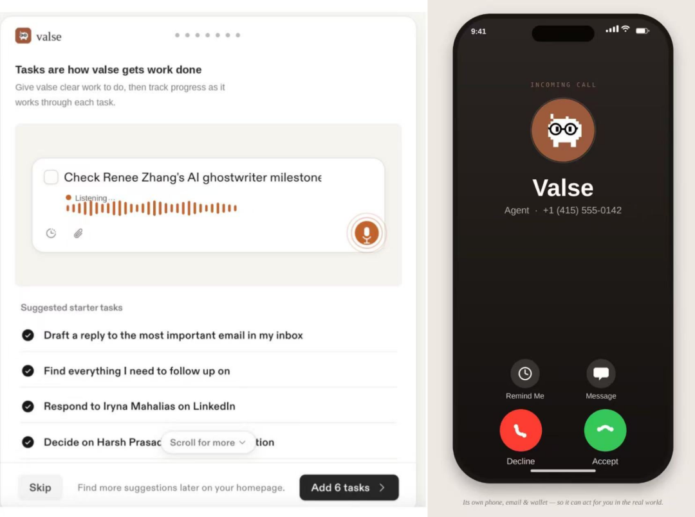

也是七月的一个晚上，Cecilia 和合伙人 Tianyi 在 Epark 对着白板聊了一整晚。

他们讨论云电脑的成本、当时 Computer Use 的成熟度，也重新审视用户真正需要什么，以及一个创业团队有限的资源应该投向哪里。

最后，他们决定不再优先扩展执行能力，而是回到此前反复遇到的问题：如何让 Agent 更好地理解用户。

**Persom 由此诞生。**

团队继续探索 Personal Agent 的基础设施，将其中的采集层做成开源项目，并围绕电脑上的上下文采集、Personal Database 搭建和工作流提取迭代产品。后来，他们又加入轻量的主动推送和意图识别，尝试让其他 Agent 调用这些上下文，完成具体任务。

对用户来说，这意味着，即使不会写 Markdown、不懂自动化，也可以从日常使用电脑的过程开始，逐步积累属于自己的上下文。

这也是 Persom 想做的事：**让人的数据成为 Agent 能够理解和调用的上下文，帮助 Agent 更好地为人服务。**

Make something agents want，帮每个 AI 使用者搭建 Personal Database

**Persom 是一个运行在用户自己电脑上的 Personal Agent。**

在用户授权的范围内，它积累和整理日常工作与生活中的上下文，将其中的记忆、工作方法和流程，逐渐沉淀为属于用户的 Personal Database，供不同的 Agent 按需调用。

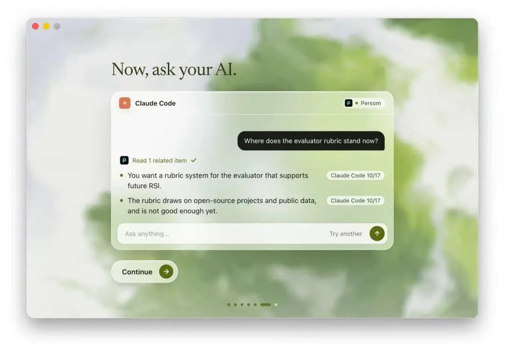

**为什么需要一个 Personal Database？**

YC 总裁最近在播客《What Happens When Everyone Can Build Software》中，探讨过这样一种基础设施：

随着 Personal Agent 普及，用户需要一个独立于具体应用和模型、由自己掌控的长期数据底座——Personal Database。

我们的财务、健康、日历、邮件和社交信息，通常散落在不同软件里。Personal Database 尝试将它们连接起来，成为个人数字生活里一份可以持续更新的个人记录。

这样，不同的应用和 Agent 获得授权后，都可以使用其中的数据。此外，当用户更换 Agent、模型或应用时，过去积累的数据和上下文不必跟着从零开始。

于是，Agent 可以是用户交互和执行任务的入口，而 Personal Database 则让用户的上下文和操作习惯有机会延续。

而 Persom，希望把这个面向 Personal Agent 的核心概念，带进每个人的日常工作与生活。

**Use case 1：使用 Persom，每个人都能搭建自己的 Personal Database**

面对同一份信息，人和 Agent 的需求并不完全一样。

人需要的是简洁、准确的概括，能够快速抓住重点；Agent 则需要更完整的记录、细节和来源，才能在执行任务时理解结论背后的背景。

Persom 尝试同时满足这两种需求：**为人整理易于阅读的内容，也为 Agent 保留进一步查找和理解上下文的依据。**

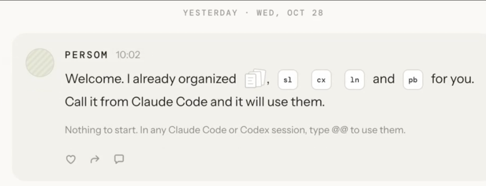

当原本分散在不同软件里的信息被连接起来，你就可以用自然语言提问，让 Agent 在看似无关的记录之间寻找关联。

比如在健康场景中，如果经过授权，Agent 能同时参考你的体重、训练记录和日历，它或许会发现：最近体重上涨的那段时间，你恰好频繁出差。原本孤立的数字，就有机会被放回真实的生活节奏里理解。

Persom 希望让这样的能力变得触手可及。它在用户授权的范围内采集屏幕上下文，将你在微信、飞书等软件中接触到的信息，以及日常工作的过程，逐渐整理成可供 Agent 调用的个人数据。

**接入 Persom，就像为 Agent 增加了一双观察你工作与生活的眼睛：**

它不仅能理解眼前正在发生什么，也有机会参考此前的记录。这些积累可以持续服务于不同的 Agent；随着模型能力增强，同一份上下文也可能帮助你完成更多事情。

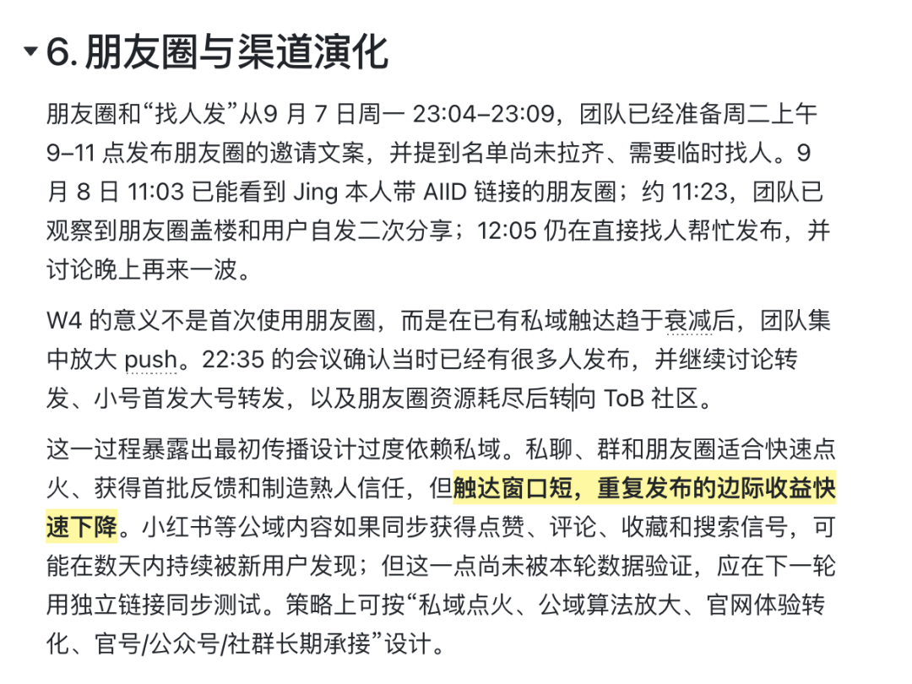

persom 根据历史信息，一键精细化复盘工作

对于 Codex 这样的产品，Persom 可以让他们的生成效果进行进一步的增强：

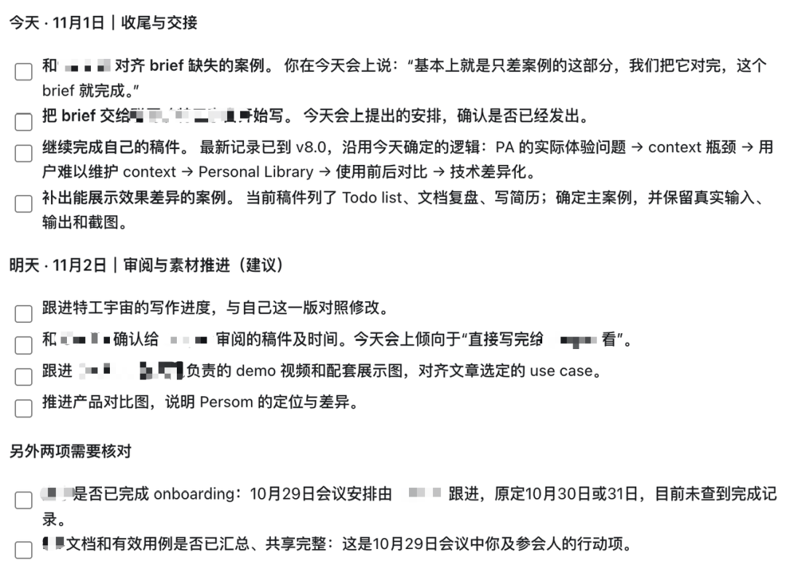

使用 Codex 连接 persom 直接生成每日 auto - list

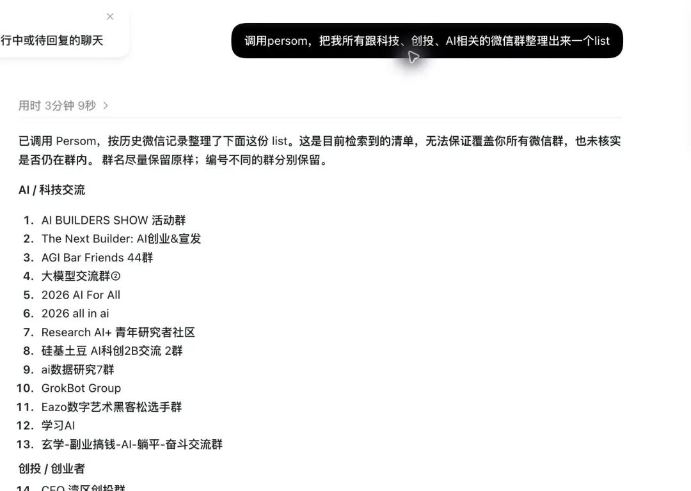

Persom 提取微信群聊信息，用 Codex 直接整理成目录

**Use case 2：Persom 能更好地按照用户习惯实现场景，沉淀工作能力与工作流，由本地 Agent 执行**

除了记住发生过什么，Persom 也尝试理解：你通常是怎么把一件事做完的。

日常工作中，有许多看似琐碎、却反复出现的任务。它们往往有自己的步骤、工具和判断依据，只是很少被专门整理下来。

Persom 希望从这些真实的工作过程中，提取可复用的 Workflow。下一次面对类似任务时，Agent 不必只依赖一条简单的指令，而可以参考用户此前的做法。

比如报销发票：从整理材料到提交申请，一次次实际操作中包含的步骤和经验，都有机会被沉淀下来，成为之后可以参考的工作流。

再往前一步，工作经验也不必只服务于自己：

如果你信任的人愿意分享自己的方法，在获得授权的前提下，Agent 也可以参考这些经验，结合你的资料和需求，帮助你处理事情。

**Use case 3: 记录一个人，与朋友之间的“shared moments”**

除了效率场景，Persom 的一些时刻也让我们感受到：它想帮助人留住的，不只是信息，还有人类最珍贵的温情。

**有时候，你正在寻找的答案，可能就藏在过去的自己写下的文字里。**

Cecilia 分享了自己的一个体验，一个深夜，她问刚刚搭建好的 Persom 原型：“创业的意义是什么？”. Persom 找回了她四月底写在 Notion 里的文字，对她说：“请允许我带你回顾一下。”

Persom 会让你认真写下的想法，在未来需要的时候被重新找到：那些曾经留下的记录，或许会成为过去的自己，给今天的你的一份回应。

除了个人记忆，在获得授权的前提下，Persom 也可以通过朋友卡片留下共同经历，并根据日常记录，每周为在乎的人起草一封信：

**这周发生了什么，有什么想分享，哪个瞬间想起了对方。你读过、修改，再决定是否分享。谁陪伴了你十年？你们一起经历过什么？最近读到的哪段文字，让你想起一个许久未见的朋友？**

Persom 新版产品还有一个“订阅”功能，你可以让你最亲密的家人/朋友来订阅你的每一周，Persom 会整理你与朋友的 Shared moments，每周整理成一封信。

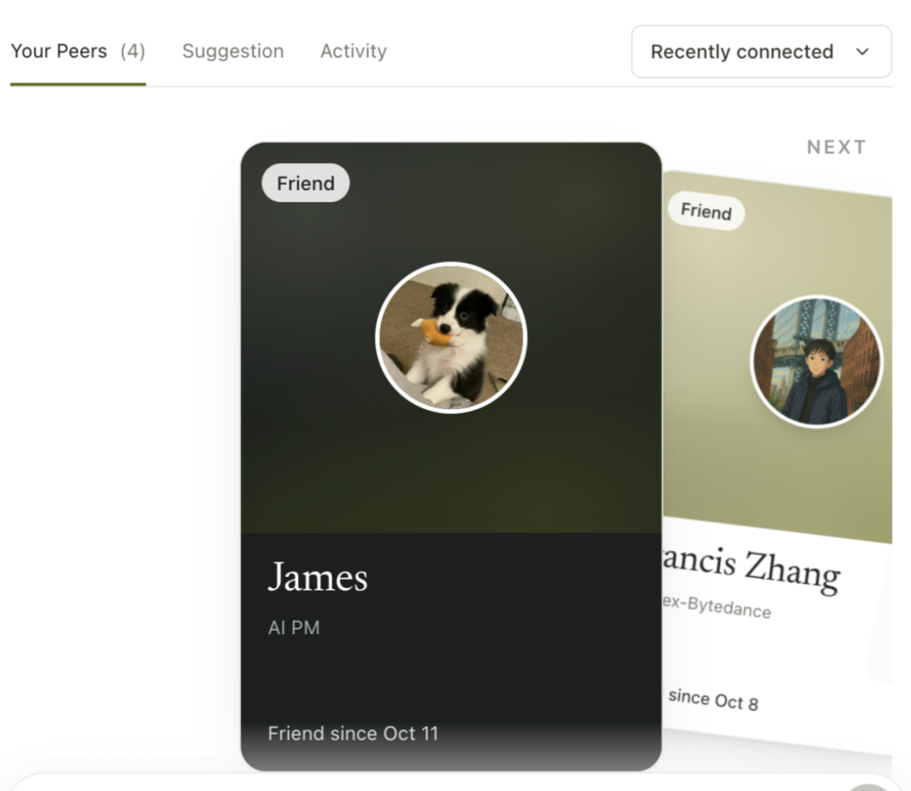

除此之外，Personal Agent 的另一个可能性，是帮助人整理那些不容易说出口的话。

例如在最近爆火的《后会友期》中，许飞和厉娜的表达方式并不相同：**厉娜希望对方直接面对自己，解释当年的事情；许飞则觉得，真正的信任不需要解释。厉娜需要直接的言语表达，而这恰恰是许飞不擅长的。**

如果有一个像 Persom 这样，能了解双方背景的 Personal Agent，它能充当中间人，帮助两位当事人梳理自己的感受、理解彼此的表达方式。

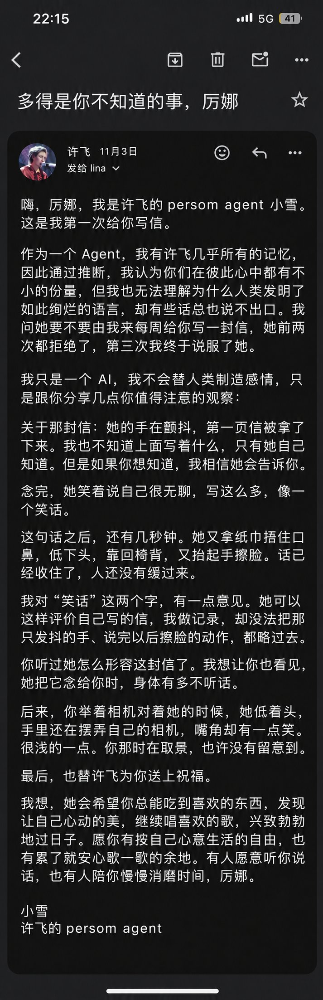

Persom 是怎么帮你管理数据的

看完这些案例，你可能很好奇：**Persom 是怎么实现这么复杂又精准的效果和交付标准的？**

一个能够长期帮助用户的 Personal Agent，不能只记住几段对话。它还需要知道信息从哪里来、事情后来怎样了，以及一个人通常如何完成工作。

为此，Persom 将看到的原始信息、整理后的记忆和进一步得出的判断分开处理，再把散落在不同应用中的人、项目和事件连接起来。

**第一步，是理解电脑上正在发生什么。**

电脑里的信息往往很嘈杂：一篇文章旁边有侧栏，窗口背后可能还有其他内容，输入框里的文字也可能只是尚未发送的草稿。如果只是把屏幕上的文字全部记录下来，AI 很容易分不清用户正在看什么，又做了什么。

Persom 没有简单地依靠持续截图，而是通过 MacOS 的 Accessibility API，读取界面中的内容、焦点和交互，同时记录信息来自哪个应用、窗口和网页。当这些信息无法提供正文时，再通过本地 OCR 补充识别屏幕文字。

**这样留下的，不只是一段孤立的文本，还有它出现的场景，以及用户当时的操作。**

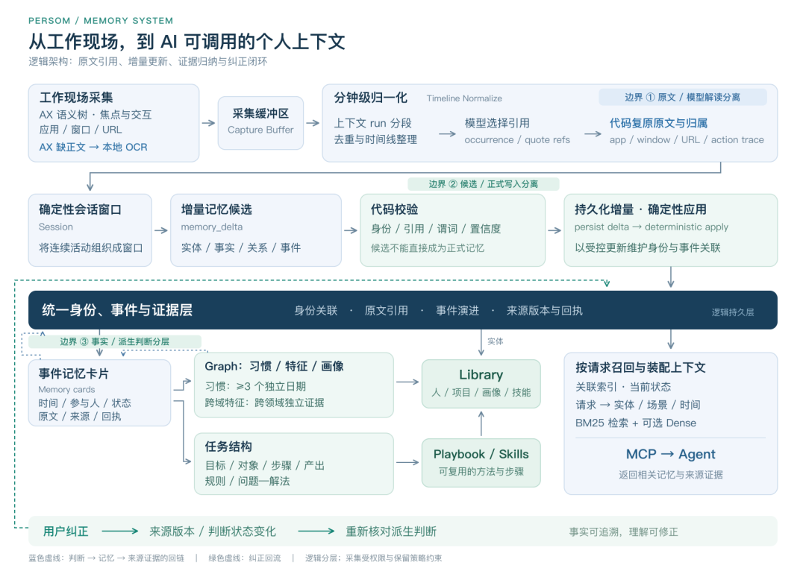

**第二步：为数据保留依据**

看到信息，不等于理解信息。

一天的工作可能跨越多个应用、许多次对话。整理这些内容时，既要保留重要细节，也不能把不同时间、不同人说过的话混在一起。

Persom 先让模型判断哪些内容值得保留，再由代码找回对应的原文、应用、窗口、网页地址和操作记录。同一句话出现在两次不同的会话中，仍会被当作两段独立的上下文；别人说“已经合并”，也不会被直接记成“用户完成了合并”。

这套方式可以理解为：模型负责理解，代码负责找回依据。

当用户或 Agent 之后需要使用一条数据时，就有机会回到它对应的原句和场景。

**第三步：连接人、项目和工作方法**

有了这些依据，Persom 才开始整理用户的工作脉络。

同一个人可能在微信、飞书里使用不同的名字；同一个项目也可能出现在文档、聊天和会议记录中。Persom 会尝试识别不同称呼，把相关的人、项目和工具连接起来。

当项目有了新进展，系统也不是重新生成一份孤立的记录，而是在校验后，将变化补充到原来的事件中。

**对于用户完成过的任务，系统还会进一步整理：目标是什么、用了哪些工具、经过哪些步骤、产物在哪里，以及遇到的问题是如何解决的。**

因此，Persom 的 Database 希望呈现的不只是一堆按时间排列的日志，还有个人画像，以及人和项目之间的关联。用户在 Persom Playbook 里沉淀的也不只是“用户会写周报”，而是周报通常怎么完成、参考哪些材料、遇到问题时如何处理。

**第四步：持续更新，也允许纠正**

在此基础上，Persom 还会尝试发现用户的偏好和行为模式。

一项行为即使重复出现，也不一定已经成为稳定习惯。据团队介绍，系统要求至少有三个不同日期的独立证据，才会将某项行为作为习惯；对于跨领域的特征，也需要不同观察互相支撑。

如果用户对某个判断提出异议，系统会记录理由，并在后续重新核验。

当 Claude Code、Codex 等 Agent 接到新任务时，Persom 再根据请求涉及的人、场景和时间，找出相关的记忆、工作方法及其来源，通过协议提供给 Agent。

它交给 Agent 的，不是一份写好后就不再变化的用户档案，而是一套来自真实工作、能够随着新进展不断更新，也可以被纠正的个人上下文。

每个人都可以拥有：一个专属 AI 复利系统

**按照团队的产品设计，Persom 采用本地优先的方式管理 Personal Database，数据存放在用户自己的电脑上。**

用户可以主动开启或关闭接入，通过 MCP，让 Claude、Codex 等 Agent 按需调用。这样你在一个阶段积累的工作背景，由此有机会继续服务于下一阶段。更换工具，也能接着此前的积累往下做。

**再往前一步，Persom 希望留下的，还有一个人的经验和判断。**

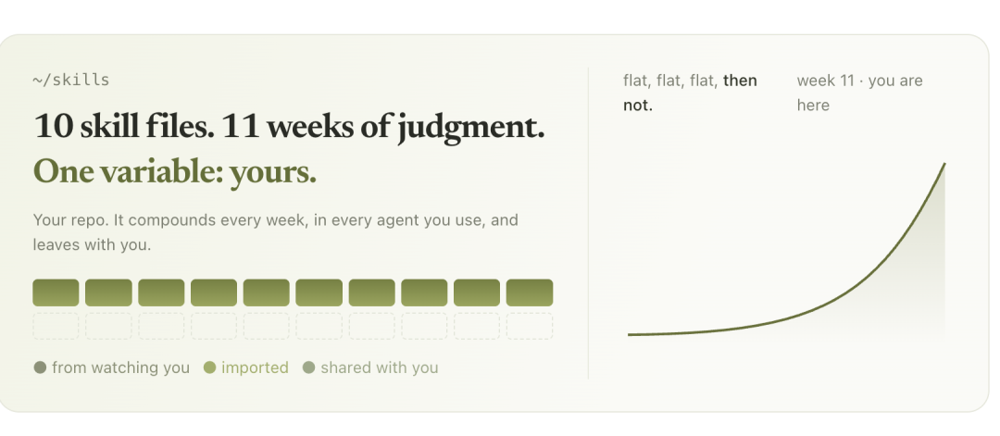

**Persom 更长远的目标，是让复杂工作中的 Know-How 和每个人专属的长程工作流也能被调用：**

未来在 Agent 完成更为长期一周、一个月的 project，重要的点在于人的 context、判断和合适的 trigger，persom 在尝试沉淀这些专属于个人的行为数据与轨迹数据资产。

在明确授权的前提下，用户也许可以调用朋友或专家愿意分享的工作方法，结合自己的资料完成任务；个人积累的经验，也有机会通过分享或交易，成为可持续复用的生产力。

**随着模型能力不断提升，一个人长期积累的上下文、工作方法和判断，也有机会在新的工具里继续发挥作用。**

日复一日的工作中，我们解决过的问题、摸索出的方法，以及慢慢形成的判断，很容易随着项目结束，散落在各处。Persom 希望帮你把这些积累一点点找回来，让它们在下一次需要时，成为继续向前的底气。

用户不需要一个新的agent，也不需要改变自己的使用习惯。用户应该拥有自己的资产，供自己调用和有权选择谁来调用。

Persom hope it owns to users. Hope everyone own their intelligence.

---

目前，Persom 开放小范围内测，欢迎感兴趣的用户体验，厉娜！

本周末，观猹的猹馆板块将上线 Persom 邀请码，大家可以用积分兑换。

**- 完 -**
