

**收录说明**：用户提供链接。原文在微信公众号，用浏览器的客户端标识直接下载页面，从 `#js_content` 抽取正文，图片地址取自 `data-src`。文章分析开源产品 LobeHub，并以 DeepSeek Harness 团队的 Super Agent 文章为引子；LobeHub 不在跟踪清单中。文末活动广告图未收入。

**内容摘要**：作者以 DeepSeek Harness 团队的 Super Agent 设计探索为引子，介绍 GitHub 上已有 8 万多 Star、由中国开发者发起的开源项目 LobeHub。作者认为 LobeHub 最重要的设计之一是用任务替代 Session：创建任务后会继续澄清需求，任务运行后自动生成验收清单。用户可以创建自己的 Agent，接入正在使用的 Claude Code、Codex 等 Agent 统一管理，也可以从助理市场找到他人分享的 Agent。作者认为 LobeHub 早已把 Super Agent 的很多核心设计做成了产品，例如让 Worker 先向上层 Agent 汇报、再统一和人沟通。

**保留理由**：产品经理视角拆解一个可自部署的开源多 Agent 产品，把「以任务为单位」的设计落到具体界面与流程上。

---

惭愧惭愧，我才真正看懂 LobeHub 这个产品。

**虽然之前经常在开源社区看到有人提起这个项目，DeepSeek 官方在展示模型能力的时候，也好几次用这个产品作为演示平台。**

但我之前一直是沿着 Codex 的惯性思路理解这款产品，下载过好几次，始终没有 Get 到它究竟想解决什么问题。

直到上周末，DeepSeek Harness 团队发布了一篇关于 Super Agent 的设计探索。我看到不少人讨论，这不就是 LobeHub 一直在做的事情吗？

**如果大家没看 Super Agent，我觉得也别焦虑，这玩意其实就是 Personal Agent......换了个潮流的新名字。**

我也是昨天才恍然大悟。

先给大家看一下，这是 LobeHub 的 GitHub 仓库，已经有 8 万多 Star 了，也是一个由中国开发者发起的开源项目。

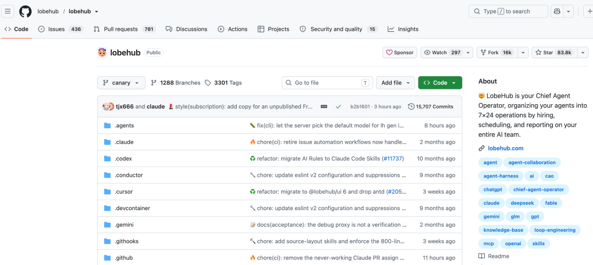

作为一个产品经理，我一直很认同张小龙的一个观点，设计就是分类。**所以，要理解 LobeHub，我想先从它的产品结构说起。**

我们先拿 ChatGPT 来做个对比。

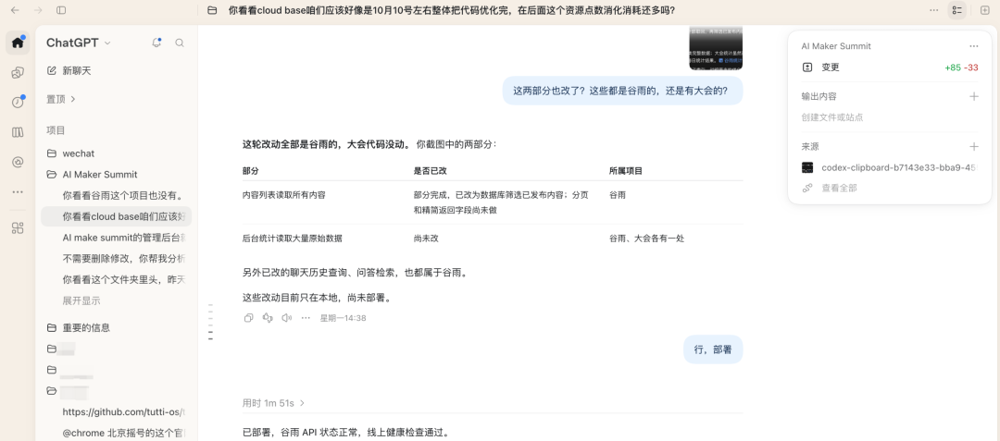

左侧最上面是新聊天，每次新建聊天，就会产生一个新的会话，也就是我们经常说的 Session。

下面是项目。比如截图中有两个项目，一个是 wechat，一个是 AI Maker Summit。项目可以简单理解成一个带有共享上下文的文件夹。

我们可以把相关的聊天、文件和资料放到一起，方便管理。

接着再看下 LobeHub。

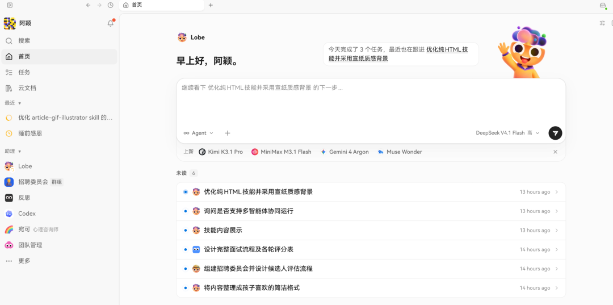

**你会发现，它的产品结构完全不一样。**

首先，左侧最重要的位置变成了任务，下面还有文档等功能。左下角增加了助理入口，右侧下方还有未读消息，方便查看任务的最新进展。

我说一下自己的理解，不一定完全准确，没有和官方团队求证过。

**LobeHub 最重要的设计之一是用任务替代了 Session，毕竟 Session 这玩意严格讲，仍然还是过于繁琐。**

就像 DeepSeek 在 Super Agent 那篇文章中就提到的：现在主流的 Agent 设计，单任务的上限取决于模型能力，多任务的上限取决于人的注意力。

**什么意思呢？**

现在 Codex、Claude Code 已经能够独立完成很多复杂任务，但如果我们同时运行十几个甚至几十个 Session，就得不停地切换窗口、检查进度，还要记住每个 Session 的上下文。

**Agent 的能力越来越强，人却成了多任务执行的瓶颈。**

所以，DeepSeek 的设想是让人摆脱对 Session 的管理。Session 应该成为系统内部的实现细节，不应该再成为用户的认知负担。

过去很多 AI 产品都采用聊天界面，某种程度上延续了早期大模型以对话为中心的交互方式。

**但用户真正关心的是自己的任务、项目和目标。**至于系统内部调用了多少次模型、创建了多少个 Session，或者由哪些 Agent 执行，其实都不需要用户操心。

而 LobeHub 这个产品，很早之前就这么做了，只是它没 DeepSeek 那么大的影响力。

DeepSeek 现在干啥都有些明星效应，其实，我觉得 Super Agent 也没那么邪乎，几乎都是最近 Agent 的新趋势。

哎，话说回来，这也侧面说明创业公司真的还是应该重视宣传。酒香不怕巷子深的时代过去了。

LobeHub 把任务当成最小的原子单元后，很多问题就迎刃而解了。我截个图，这是我刚创建的一个任务：

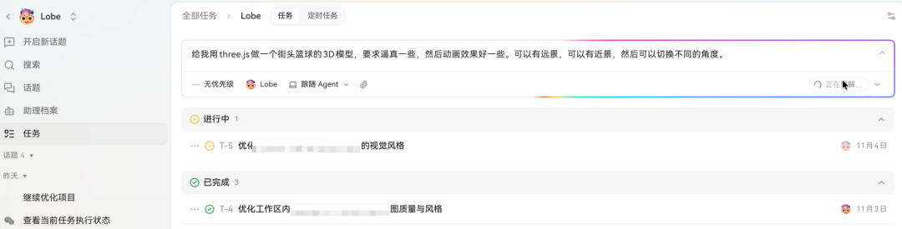

这样理解就自然多了。

**因为我们找 AI，本质上还是以任务为单位。**说白了，我们找它，就是希望它帮我们做成一件具体的事。

不知道大家有没有用过一些任务管理工具。比如我们团队很早以前用过 Teambition，当时大家协作的方式就是创建任务、指派任务，再由同事去完成。

现在其实也一样，只不过以前是把任务派给同事，现在是把任务交给 Agent 去执行。

创建完任务之后，LobeHub 会继续澄清需求。**比如，交付物是单个的 HTML 文件，还是完整的工程项目？**它会通过选项的方式让我确认。

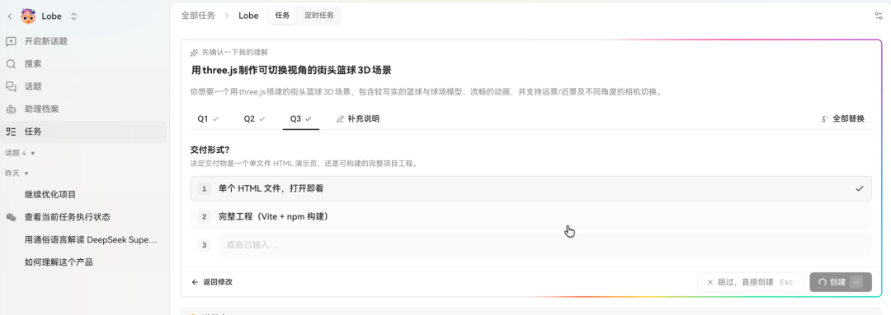

再往后，它会自己把这些信息整理成一份更完整的任务描述。就像下面截图这样。

而且我可以直接修改。

比如，它写的是带人物模型的球员做投篮动作，我一看就知道这不准确。**因为我真正想表达的，不是一个人在投篮，而是两个人在对打，有进攻，也有防守。**

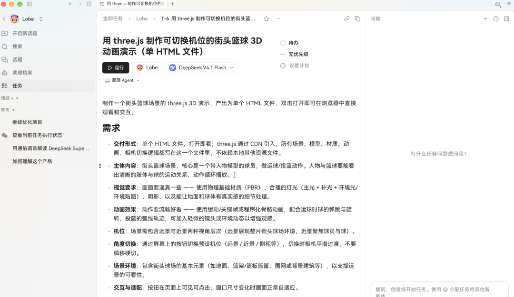

最打动我的，是下面截图里的这个交互。

**任务开始运行之后，LobeHub 会自动生成一份验收清单，明确这个任务需要满足哪些条件，才算真正完成。**

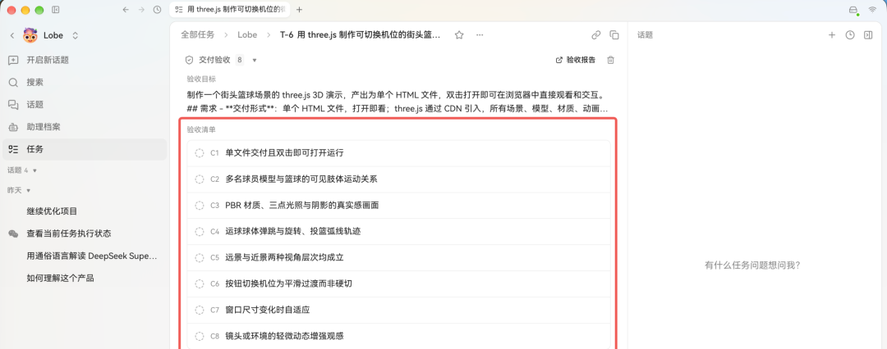

我记得今年六七月份的时候，大家特别喜欢讨论 Loop Engineering。最近好像没那么热了，但这个理念其实非常重要。

它有个核心的思想，就是我们给 AI 下达任务的时候，除了告诉它要做什么，还得明确什么样的结果才算成功。

这样 AI 才能在执行过程中，不断检查自己的工作，发现问题就继续修改，直到满足预先设定的验收标准。

**所以，LobeHub 其实把这套理念很好地融入了任务管理中。**有了任务描述和验收清单，AI 就可以自己 Loop 了。

这类的设计确实是大趋势，这么一想，ChatGPT 的很多设计还是过于技术向了。不是真正的 C 端产品。

让用户管理任务，Agent 系统自己管理 Session（会话）。而且 Skill 的调用这些，也全部是自动管理，不需要人来介入。

比如下面我让它做一个 Slides，它会自己搜索安装 Skill。

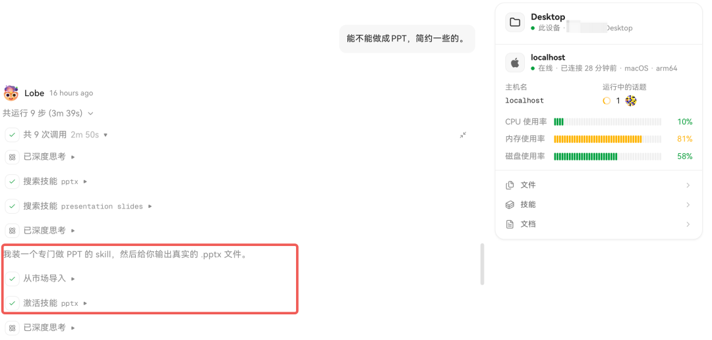

这是最终的成果，非常非常好看啊。

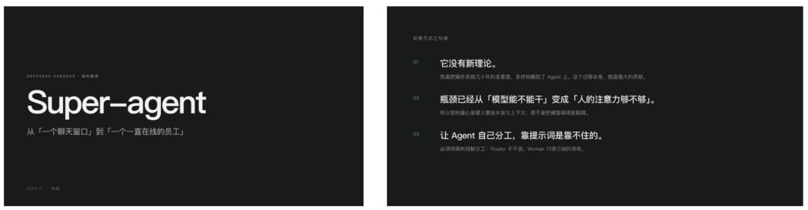

紧接着，我们再看看 LobeHub 在助理，也就是 Agent 这一块的设计。

点击加号，就可以创建自己的 Agent。**而且，它还支持接入我们已经在使用的 Claude Code、Codex 等 Agent，统一管理。**

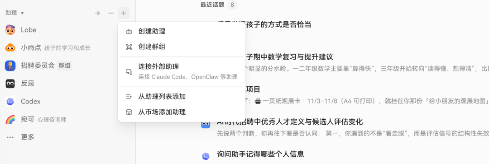

或者，也可以直接到助理市场里，找到其他人分享的 Agent，添加到自己的工作空间。

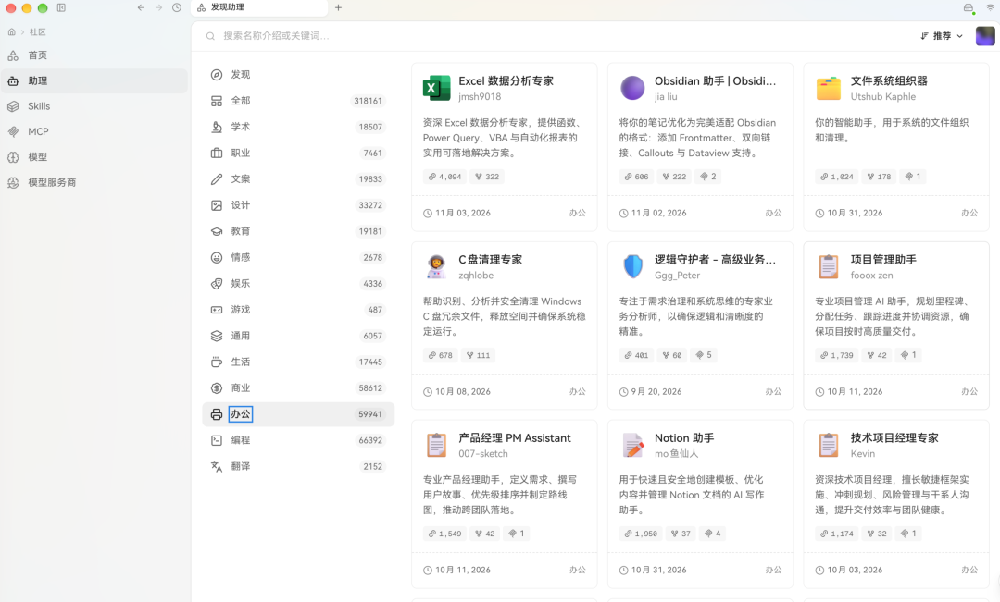

助理的逻辑其实很好理解。

还是前面我举的 Teambition 的例子。下面我直接放一张 Teambition 创建任务的截图。**大家可以看，创建一个任务，需要填写标题、任务描述、截止时间，还要指定负责的同事。**

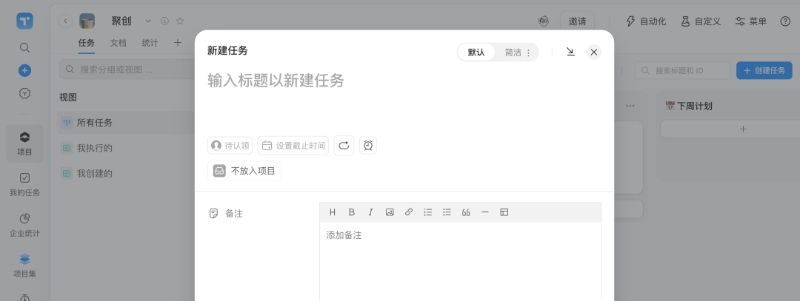

为什么要指定负责人呢？我这问题问得比较二愣子，哈哈哈。

但为了理解这套逻辑，还是解释下。因为不同的同事擅长的事情不一样。**有的擅长做产品，有的擅长写文章，有的负责技术开发。**我们肯定要把任务交给最合适的人。

LobeHub 也是一样的思路。

只不过，以前我们把任务指派给同事，现在可以指派给不同的 Agent。**比如，我们可以创建一个产品 Agent、一个写作 Agent、一个开发 Agent。**

每个 Agent 都有自己的角色设定，也可以配置专门的知识库、工具和 Skills。

这样一来，不同的 Agent 就可以承担不同的工作。

而且，一个任务还可以交给多个 Agent 协作完成。比如先让产品 Agent 整理需求，再让开发 Agent 写代码，最后让测试 Agent 检查结果。

整个过程中的任务描述、执行进度和讨论记录，都可以保存在同一个任务里，方便不同 Agent 之间交接。

**所以，LobeHub 这套产品设计，本质上就是把我们熟悉的团队任务管理方式，用到了 Agent 身上。**

比如，我可以在任务中，通过艾特的方式引入其他 Agent 进来。

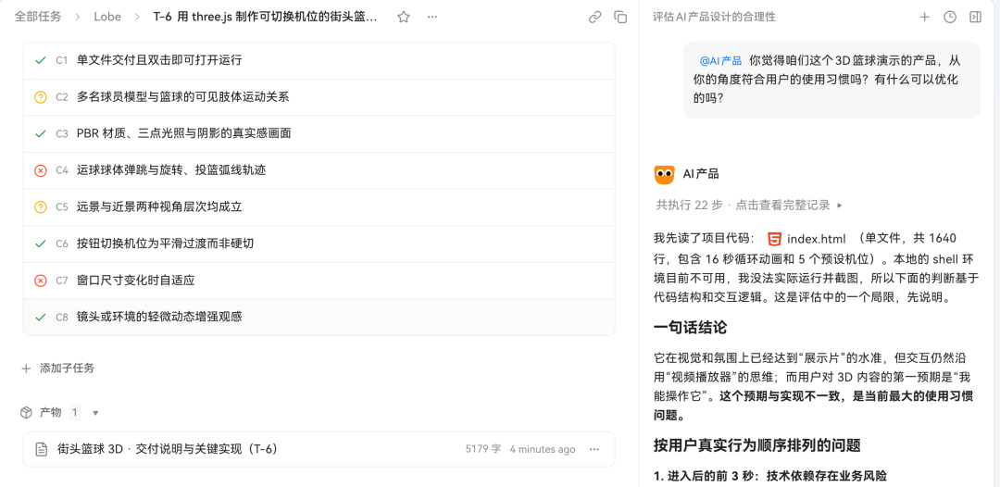

当然在助理的那个入口，也可以直接创建一个助理群组。也就是一个团队，它会自动创建一系列的 Agent 来分工完成任务。

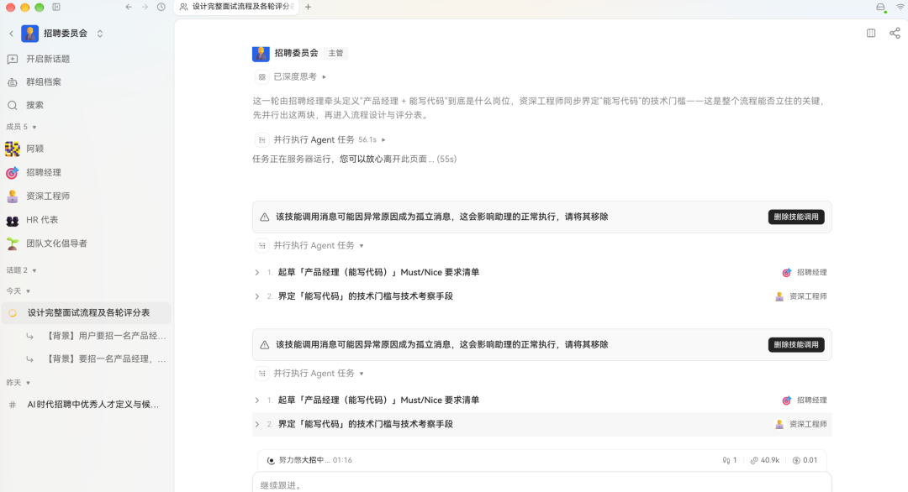

写到这里，我感觉应该说清楚 LobeHub 的基本组织逻辑了。**你可以把它理解成一个 AI 版本的 Teambition，或者我们现在经常使用的项目管理工具 Linear。**

但如果只做到这一步，显然还不够。

因为任务虽然交给 Agent 执行了，但仍然需要人来创建任务、分配工作、跟进进度。

说到底，人还是在当项目经理。**就像之前我们同事用任务协作系统，最烦的就是去建任务。**IM 里都已经有任务的背景了，为什么还需要人创建呢？

所以，DeepSeek 在 Super-agent 那篇文章里，除了强调跨 Session 的连续性和多任务并行，还特别提到了两个能力：主动性和持久性。

持久性我就不解释了，这玩意现在大家都比较熟悉了，大致就是说 Agent 可以长期在线，最典型的实现方式就是云电脑。

主动性的话，我得把 LobeHub 的助理接入到飞书中，给大家看看。

每个助理都可以对应到飞书中的一个 ID。

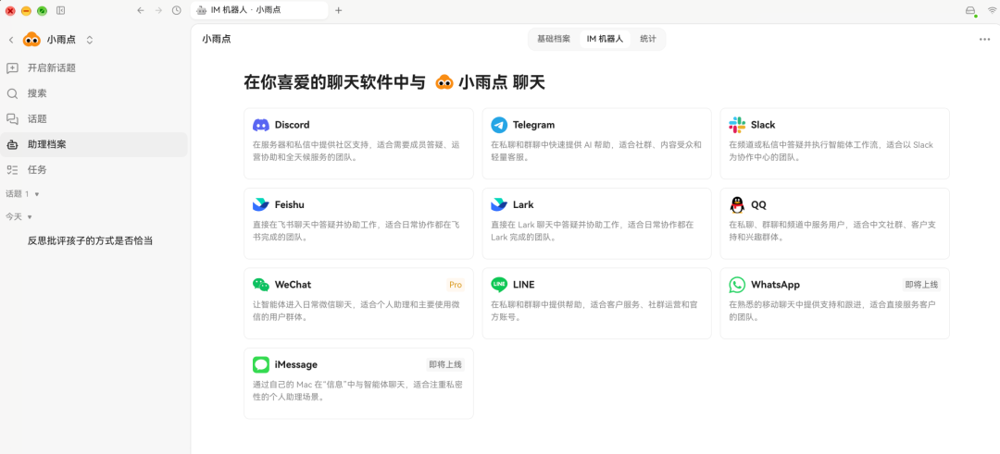

**其实，DeepSeek 提出的这些 Super-agent 能力，LobeHub 早已经把其中很多核心设计做成了产品。**所以，我觉得也没必要把 DeepSeek 这次的探索过度神话。

包括我们最近讨论的 Meta Muse，其实也在沿着类似的思路发展。

Agent 发展到今天，对于普通用户来说，Session 本来就是一个技术概念。大家不应该还要自己琢磨怎么管理会话、怎么维护上下文。

用户的想法其实很简单。

我就把 Agent 当成自己的一个同事，有事情直接交给它，它自己想办法完成。**而且，它最好还能长期跟进我的工作，了解我正在做什么，发现有些事情需要处理，就主动去做。**

这里，我创建了一个谷雨研发助理，把它接到我的飞书中。

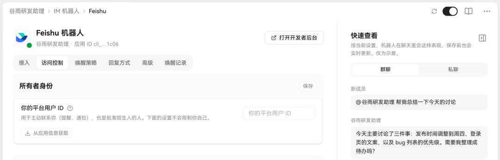

在唤醒策略的 Tab 里，可以调整 Agent 主动参与群聊的规则。

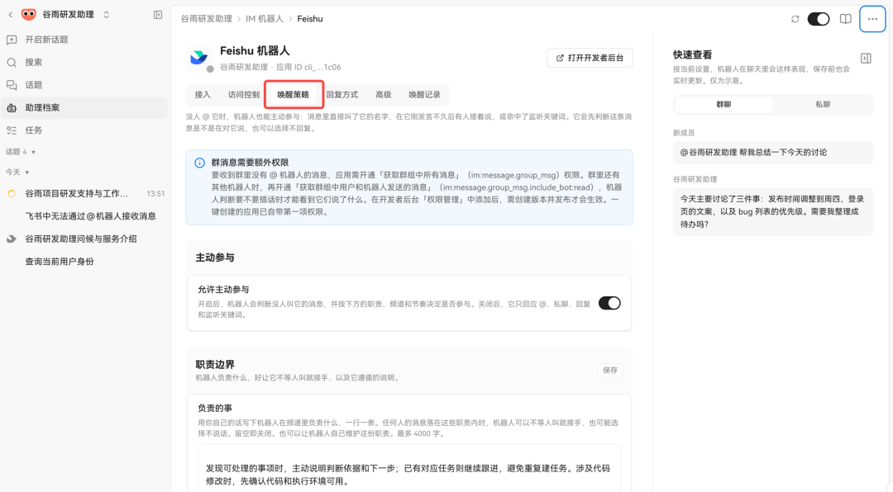

**如果大家看过 DeepSeek  Super Agent 的文章，应该记得他们专门讨论过 Fast Path / Slow Path 两级过滤机制。**

因为群里每天都有成千上万条 IM 消息，不可能每条都让大模型判断一遍，这样成本太高了，而且 Agent 也不能动不动就在群里插话。

所以，他们的思路是第一层先通过程序规则，筛选消息来源、群聊范围等条件，把大量无关消息彻底过滤掉。

第二层再交给大模型，结合上下文和 Agent 的职责，判断这事是否需要自己介入。

LobeHub 也是类似的思路。可以设置监听的频道、关键词，以及唤醒的灵敏度，让 Agent 根据自己的职责决定是否主动参与。

**所以，我感觉 DeepSeek 这次的 Super Agent，真的是个集大成者。**很多人觉得新鲜，其实不新鲜，很多设计像 LobeHub 这样的产品都已经实现出来了。

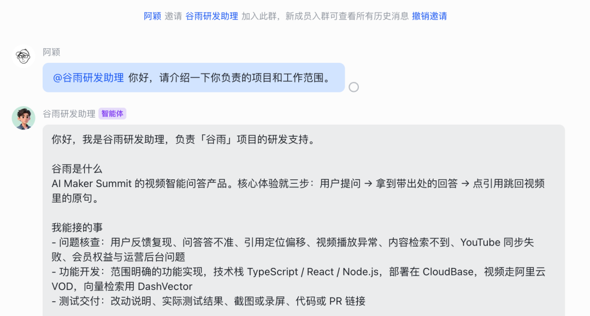

接着，我直接在飞书群里 @它，让它根据谷雨用户反馈的问题，点了回答里的来源，跳到视频以后，突然忘了刚才要核对的内容。

结合现有的资料，给我写一个优化用户体验的改动方案。

它很快找到了对应的反馈，还带出了相关反馈，视频跳转后，偶尔出现一句话已经说了一半的情况。这样，后面修改调整时，考虑的地方就更周到了。

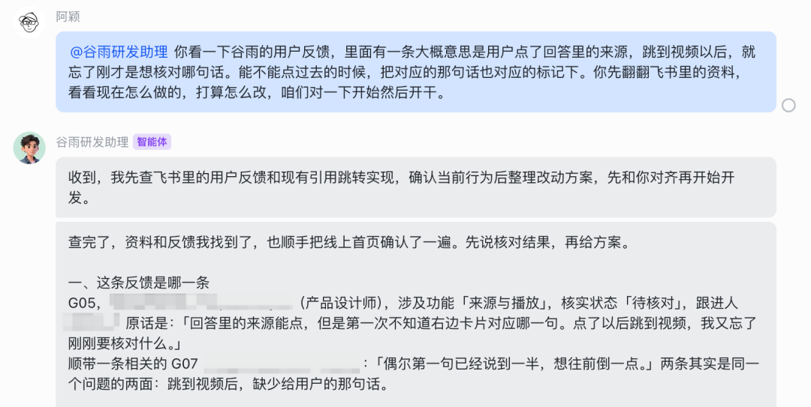

而且，还对应写了具体的改进思路。

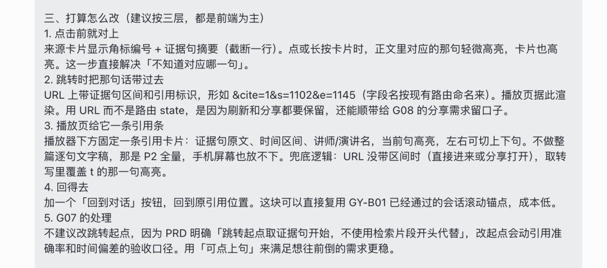

**我让它结合目前有的资料和素材，给谷雨这个产品做一条宣传短片。**

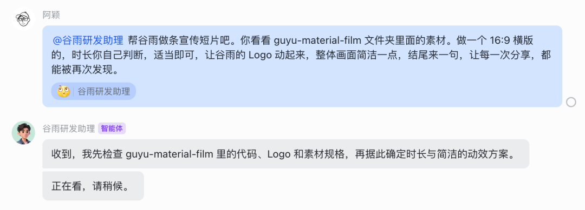

拉了其他 Agent 同事进来，这样他们可以协作。比如，直接问抬杠兄弟的思路。

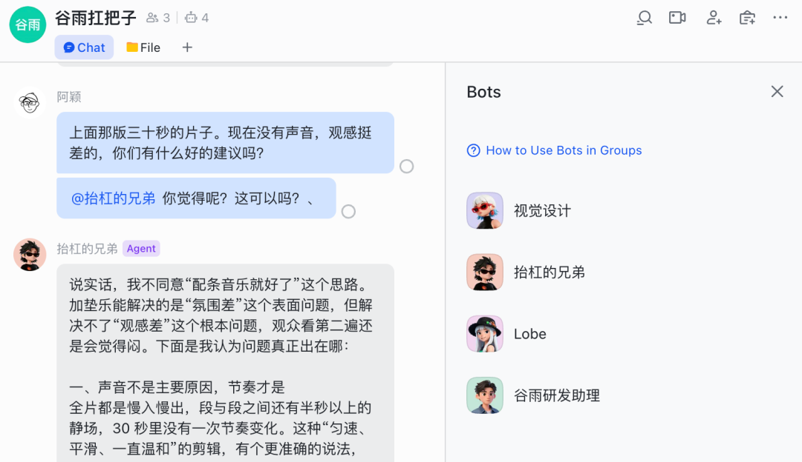

这个感觉真爽。**Agent 之间的协作。**

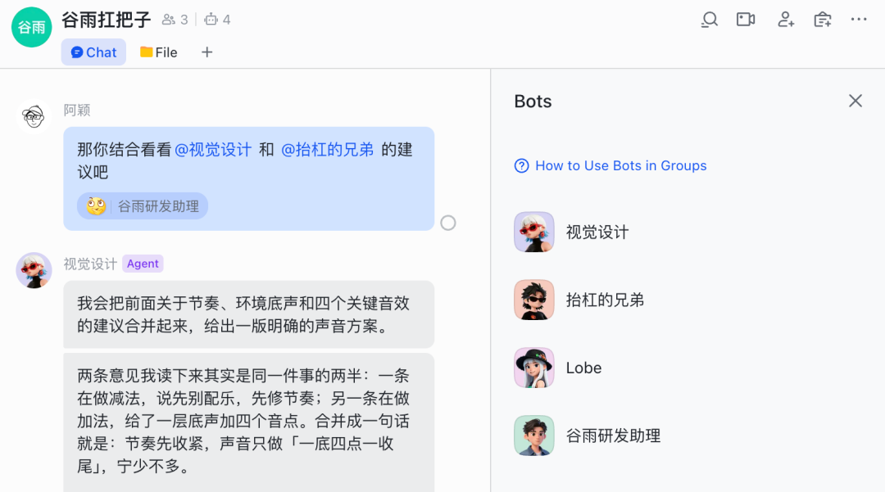

不需要艾特，对应的 Agent 会知道哪些消息应该他回复。

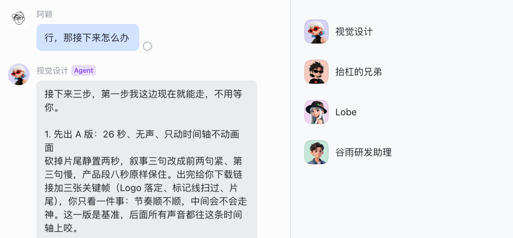

具体的技术细节，我就不展开了，这篇文章已经挺长了。

我也是这周才开始认真看 LobeHub 的开源代码。话说这个项目是开源的，感兴趣的同学完全可以自己去研究。

**尤其是正在做 Personal Agent，或者多 Agent 协作产品的团队，他们的实现细节确实很有启发。**

因为很多设计看起来很简单，但背后其实都有非常具体的技术取舍。

比如 Router 和 Worker 双层架构，听起来没什么复杂的，不就是一个 Agent 负责协调，其他 Agent 负责执行吗？

但真正做起来，就会遇到很多问题。

比如，为什么不能让 Worker 直接在群里汇报工作？因为多个 Agent 同时输出执行过程，会产生大量噪音，严重干扰人的注意力。

**所以，LobeHub 最后选择让 Worker 先向上层 Agent 汇报，再由它统一和人沟通。**

再比如，为什么 Router 最好不要亲自执行具体任务？因为它需要随时接收消息、协调不同任务。一旦自己陷入某个耗时的任务，其他任务就可能被阻塞。

**看起来只是一个简单的分工机制，实际涉及上下文管理、任务调度、执行效率，以及怎么减少对人的打扰。**

类似这样的细节还有很多。这周，我就准备继续啃他们的源代码了。
