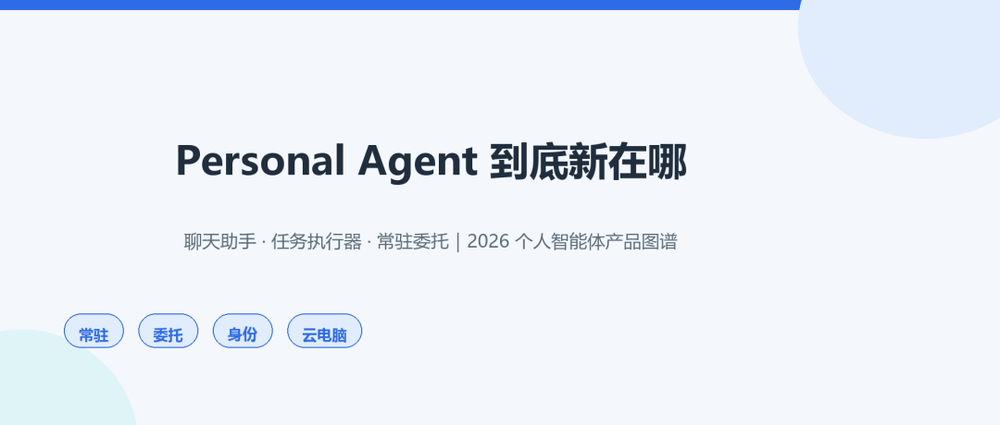
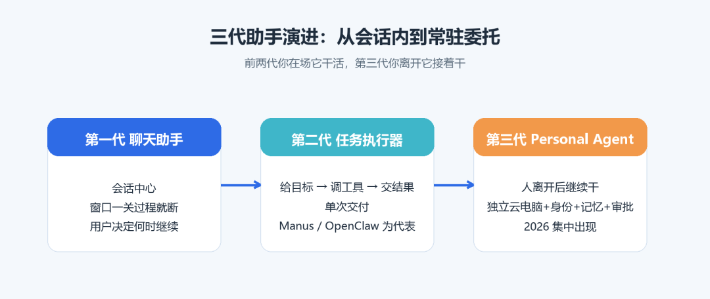
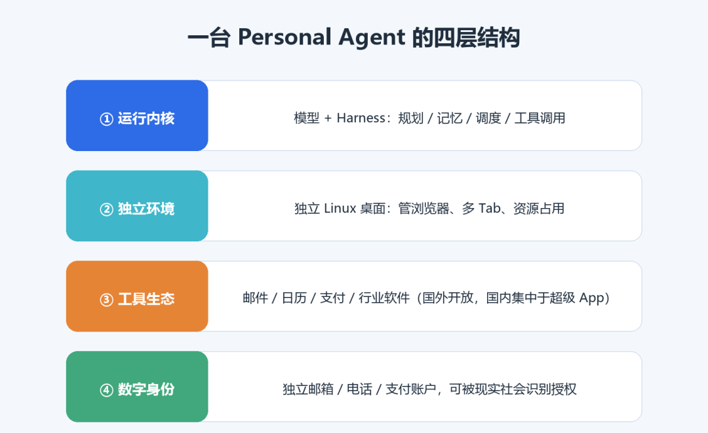



**收录说明**：用户提供链接。原文在微信公众号，用浏览器的客户端标识直接下载页面，从 `#js_content` 抽取正文，图片地址取自 `data-src`。系列上篇，下篇为同一公众号的「关掉对话它凭什么继续干活」。文末参考文献照录。

**内容摘要**：鸿煊的学习笔记上篇把 Personal Agent 与聊天助手、单次交付的云端任务执行器区分开，并从运行内核、独立执行环境、工具与服务生态、数字身份四层拆解。文章按独立身份（Cue、Fo）、接入生态（dots、Muse、Gemini Spark）、多 Agent 协作（Grok Bot、Manus）、用户自持（OpenClaw）等路线梳理产品，并给出各产品的发布日期与限制，如 Gemini Spark 当前最多 50 个活动计划。文中整理了已暴露的摩擦，例如有用户拒绝 Messages 权限仍被同步 18.7 万条 iMessage，并注明 Fo 的 71% 完成率来自开发方的模拟测试。

**保留理由**：用统一框架对十款产品分路线比较，并列出各产品已暴露的问题，注明数字口径；属综述整理，无自测。

---

## 导语

2026 年 9 月，几乎在同一周里，Meta Muse、Manus 2.0 与 Cue、OpenAI dots 密集登场，Grok Bot 则在 8 月先行落地并一路扩容。这一轮产品不再只是"你问一句、我答一段"，而是你交代完就关掉 App，它在自己的云电脑上继续盯着这件事。本文把这轮 Personal Agent（个人智能体）和过去的聊天助手、早期 Manus、开源运行时 OpenClaw 放在一条线上对比，拆出它的四层结构，再按四条产品路线梳理 10 款代表性产品，最后坦白每一条路线上真实存在的落地摩擦。读完你会得到一张产品坐标系：看到任何一款新助理，都能快速判断它属于哪条路、强项在哪、坑在哪。

## 一、先划清三代：会话内、单次交付、常驻委托

要理解新在哪里，先看它从哪来。Personal Agent 并不是 Agent 第一次学会调工具、后台运行或保存记忆，真正变化发生在**产品组织方式**上。

**第一代：以当前会话为中心的聊天助手。** 用户提问，系统生成答案、建议或草稿；即便能调工具，任务也由当前对话启动，后续要不要继续、何时再跑，基本由用户决定。窗口一关，过程就断了。

**第二代：云端任务执行器。** 以早期 Manus 为代表，用户给出一个明确目标，系统在独立环境里调用浏览器、文件和代码工具，最后交出报告、网页或结果。后来补的 Sandbox（隔离环境）、Cloud Computer（常驻机器）、Project（项目知识）、Schedules（定时执行），都是给"单次交付"打补丁，但主线仍是完成用户交办的一项任务。OpenClaw 则属于另一支：可自行部署配置的个人 Agent 运行时，自带长期记忆、约 30 分钟一次的 heartbeat（周期唤醒）和落盘任务调度器，能接消息渠道、配 cron、Webhook、工具与权限，但环境、配置和安全责任都压在用户自己身上。

**第三代：2026 年集中出现的 Personal Agent。** 厂商开始围绕**一个具体用户**，把长期运行环境（一台真正的电脑）、个人身份、触发条件、审批和记忆管理整合进同一个完整产品。部分产品给 Agent 配独立邮箱、电话甚至钱包；部分为每位用户准备隔离云电脑并连接邮箱、日历、浏览器和支付；界面也从"一段即时对话"扩展成任务列表、审批页、计划安排、记忆管理和执行记录。

图1：聊天助手 → 云端任务执行器 → 常驻委托型 Personal Agent 的三代演进。

一句话概括差别：**前两代是"你在场它干活"，第三代是"你离开后它接着干"。**

## 二、解剖一台 Personal Agent：四个组成部分

抛开各家包装，当前 Personal Agent 在实现机制上大致可以拆成四层。

图2：运行内核、独立执行环境、工具与服务生态、数字身份四层结构。

**第一层，运行内核。** 即底层模型加上围绕模型构建的 Harness（外壳框架），负责规划、记忆、任务调度和工具调用。这一层决定"会不会想、记不记得住、排不排得顺"。

**第二层，独立执行环境。** 真正能持续工作的 Personal Agent，通常需要一台属于自己的电脑，例如独立 Linux 桌面，能像人一样操作浏览器、管理多个 Tab、处理资源占用。一个很具体的工程细节：页面开太多导致系统卡顿时，它还得主动清理无用 Tab 再继续。这也是为什么"云端一台真电脑"成为标配，而不只是一个 API 调用池。

**第三层，工具与服务生态。** Agent 要接足够丰富的外部工具才办得成事。国外的邮件、日历、财务软件通常提供较开放的接口；国内能力更多集中在超级 App 和政务平台里，信息流、支付、借贷、政务都在其中，但整体接口开放程度有限。

**第四层，进入现实社会所需的数字身份。** Agent 从"操作软件"走向"代替个人办事"，需要一套能被现实社会识别和授权的账号、支付工具与通信号码。网络电话只能让它完成通话；真实手机号和支付账户，才意味着它能注册服务、验证身份、拨打电话甚至完成交易。

## 三、四条产品路线：谁在给 Agent 发"身份证"，谁在接入生态

把市面上产品按"身份从哪来、连接从哪来"归类，可以看到四条差异明显的路线。

### 路线 A：给 Agent 独立邮箱、电话和支付（Cue / Fo）

这条路线走得最远：直接给每个 Agent 一套外部可寻址的身份。

**Cue（来自 Manus）。** Manus 在 2026 年 9 月 28 日随 2.0 公布这款独立应用，为每位 Agent 配置邮箱、电话、钱包和电脑，可收发邮件消息、在用户授权的权限内支付、用户离开后继续工作。官方示例里，多个 Agent 在群聊中调查纽约发布会场地、筛选候选并制作演示稿；线下用户扫描商家二维码即可创建对应 Agent，用于预订、代点餐或排队；连接器展示了 Trip.com、Oura、Gmail、MyFitnessPal 等，早期免费但需邀请码。

**Fo（来自 Wajo，创始人有 CMU、Meta、Google DeepMind 背景，并非 Google 产品）。** 定位"把事做完"的行动 Agent，自有电话、邮箱、语音和一次性支付卡（商家与 Fo 都看不到用户真实卡号），卡住时转给训练过的人类执行助理。9 月 28 日对公众开放，分免费 Fo Mini（每日任务上限）、邀请制无限 OG、按需报价 Pro 三档。官网称内部 104 项真实杂务完成率约 71%、信任率 94%。它的代表性设计是**人机正式交接**：自动化跨不过去的现实环节交给人类助理处理，再把结果写回任务流程，过程中还能向人学习。

### 路线 B：接入现有应用生态（dots / Muse / Spark）

这条路线不强行发身份，而是依托大平台生态与插件网络。

**Dots（来自 OpenAI）。** 9 月 29 日 DevDay 发布，使用 GPT-6 Astra，有自己的云电脑，通过插件生态连接 4000 多个应用；首发提供一个主 dot，面向组织的专用 dots 仍在重点企业试点。它把当前任务上下文、相关 ChatGPT 记忆、dot 自己的持久上下文三者分开；隔离的 Linux/Chrome 云工作区负责执行，密码经安全登录流程进入浏览器而不进入模型上下文，另有独立 Auto-review 检查可能影响外部世界的动作是否越权。

**Muse（来自 Meta）。** 9 月 8 日正式公告，每位用户获得持续存在的云端计算机和浏览器，可从 iOS、Android、muse.ai 与 WhatsApp 使用，关闭 App 后工作继续；一个持续主对话可并行处理多个请求并接受打断，复杂话题另开侧边对话。技术重点是 Secure VM：每位用户一台独立 Linux 虚拟机，Agent 在 systemd-nspawn 容器内运行，即使拿到容器管理员权限也碰不到宿主机；凭证、审批、安全服务放在容器外，authd 管凭证、模型主要用替代令牌，Sentinel 在网络边界审查连接器动作，eBPF 用于流量控制与数据污染追踪，浏览器由独立 broker 进程管理，子 Agent 主要靠无障碍树读取界面以收窄任意执行网页 JS 的范围。

**Gemini Spark（来自 Google）。** 5 月 19 日 I/O 公布，运行在 Gemini 产品内，结合 Gemini 模型与 Antigravity 运行框架，连接 Workspace，在 Google Cloud 专用虚拟机执行；支持时间、Gmail 条件、主题事件三类调度，当前最多 50 个活动计划、同时运行上限 15。6 月加 Mac 客户端、Keep、Tasks 和自定义 MCP；7 月可在用户许可下利用 Chrome 登录态和已保存密码处理网页事务，并扩展到 160 多个国家；9 月连接 Google Photos。官方仍称其为实验早期功能，提示注入、误操作、个人信息外泄风险均在。

### 路线 C：让多个 Agent 按角色协作（Grok Bot Group / Manus）

**Grok Bot。** 8 月 11 日发布，一组 Bot 共享一台云电脑，用户合上笔记本仍可工作；能跨应用执行、互相传递上下文、在群聊分工，覆盖 macOS、Windows、Linux、iOS、Android。界面用 Bot 名单显示谁在做什么、哪里需要人判断：skill（操作方法）说明"如何做"，routine（定时流程）说明"何时做"，Teach a task 可录制最长十分钟的可见电脑操作生成 skill 草稿，每个 Bot 最多配 50 个 routines。9 月 28 日公测的 Team Bots 可共享文件、工具、技能和团队知识，同时保留各人私有对话。

**Manus 的演进脉络。** 2025 年 3 月首发时核心是"给目标、云端用工具、交结果"；7 月公开上下文工程方法，Wide Research 把多对象工作分发给并行子 Agent；2026 年 1 月 Sandbox 为每项任务提供隔离云 VM（网络、文件系统、浏览器、工具），空闲休眠、返回唤醒；4 月 Cloud Computer 是专用常驻机器，可跑 bot、脚本、服务和周期采集；5 月 Project 自更新从任务中提取可复用决定、格式与流程，经用户批准写回项目知识——注意这不等同模型在线训练，也不表示系统无边界记录整个账户。

### 路线 D：强调用户控制与自部署（OpenClaw），以及国内的 Today

**OpenClaw** 前身是 2025 年 11 月出现的 WhatsApp Relay"Clawd"，2026 年 1 月底更名，是一套可部署在个人电脑或服务器上的开源个人 Agent 运行时。长期运行的 Gateway 维持消息渠道连接，Web UI / CLI / 客户端经 WebSocket 长连接接入，同会话任务串行执行并限制全局并发；记忆分布在 USER.md、MEMORY.md 和按日期记录的笔记里，SQLite 提供检索索引；后台 dreaming（记忆整理）把符合条件的历史材料合并到更紧凑的长期层并保留审阅记录；heartbeat 周期唤醒、cron 存计划、Webhook 收外部事件。

**Today** 是国内最先发布 Personal Agent 的公司，把记忆管理直接放进用户界面：个人记忆含人物、项目、偏好，可查看、编辑、删除；提供早间简报和晚间收尾，连接邮件、日历、笔记与任务，对外动作需要确认，也具备主动链接能力（如识别用户从事计算机行业后主动推送相关信息）。

## 四、一张表看懂：路线、身份、生态、明显摩擦

| 产品 | 所属路线 | 身份来源 | 主要生态/执行环境 | 已暴露的典型摩擦 |
| --- | --- | --- | --- | --- |
| Cue（Manus） | 独立身份 | 独立邮箱/电话/钱包 | 隔离电脑，Trip.com、Gmail、Oura 等连接器 | 电话 9.9 美元/月、首月免费后约 20 美元起；部分热门国家收不到短信，号码绑代理 IP；重启容器换"住宅"IP，常落到巴基斯坦、埃及、越南等 |
| Fo（Wajo） | 独立身份+人工兜底 | 自有电话/邮箱/一次性支付卡 | 模拟世界测试，卡住转人类助理 | 保险报价仍一问一答填表；经 iMessage 收身份证等敏感信息时缺"已存保险库、仅本次使用"的确认 |
| dots（OpenAI） | 接入生态 | 主 dot，三层上下文分离 | 云电脑+4000 应用插件，Auto-review | 主动性近乎定时任务、缺常识、空转烧 token；语音比普通 GPT Live 差、接通慢；连 Codex 不稳；不能自改 AGENTS.md |
| Muse（Meta） | 接入生态 | 可命名设形象，Stripe/虚拟卡 | Secure VM 独立 Linux 虚拟机+WhatsApp 等 | 默认把对话用于训练、记忆无关闭开关；有用户拒绝 Messages 权限仍被同步 18.7 万条 iMessage；Amazon 以未授权访问为由屏蔽代购；被曝内部测试暴露 iCloud 照片 |
| Gemini Spark（Google） | 接入生态 | Gemini 产品内身份 | Google Cloud 专用 VM、Workspace、Chrome 登录态 | 实验早期；用 Chrome 本地路径时设备和浏览器都须保持开启；官方自述提示注入、误操作、隐私外泄风险 |
| Grok Bot | 多 Agent 协作 | 一组 Bot 共享用户级权限 | 共享一台云电脑，Team Bots 共享知识 | 多 Bot 共享文件、浏览器会话与登录，彼此无安全隔离；删一个 Bot 未必清理共享文件与会话 |
| Manus | 多 Agent/通用任务 | 项目知识经批准写回 | Sandbox 隔离 VM、Cloud Computer 常驻机 | 仍以"完成一项任务"为主线，持续委托能力靠增量模块叠加 |
| OpenClaw | 用户自持 | 用户自配账号/凭证 | 自部署 Gateway，cron/Webhook/heartbeat | 开源可审计≠默认安全，沙箱默认关闭；安全责任在用户 |
| Today（国内） | 生态/记忆前置 | 用户界面可管理记忆 | 邮件/日历/笔记/任务，云电脑实为沙箱 | 索取大量权限并扫描本地磁盘，个性化以大量数据为代价；云电脑非真常驻机 |

> 说明：表中价格、完成率、同步条数等均来自原文综述引用的公开反馈与官方披露，属于特定时间点、特定账号的体验，不代表普遍结果。

## 五、热闹之外：这轮产品共同的真实摩擦

把十款产品的差评并在一起，会发现摩擦高度集中，且大多不在"模型聪不聪明"，而在**现实接入层**。

**身份是花钱买来的，而且不稳。** 独立电话并非免费，号码还和代理 IP 绑定，想换区先换 VPN；沙箱重启就换"住宅"IP，常见于非主要西方国家，直接影响本地服务注册与短信验证。

**平台在对抗。** Amazon 以未授权访问和隐私为由屏蔽 Muse 代购；这说明 Agent 模拟用户操作去跨平台办事，在平台关系和风控上天然脆弱。

**隐私与信任是最大争议点。** 默认对话用于训练、记忆没有开关、拒绝授权仍被同步海量消息，这些会让"把生活交给它"的不适被反复放大。

**主动性常常被高估。** 不少反馈指向：所谓主动，其实只是定时任务；缺常识、还要人去撤销它的操作；简单任务也要跑几分钟，甚至通话没打通。

**完成率数字要打折看。** Fo 的 71% 完成率、94% 信任率来自开发方自己搭建的模拟世界与固定流程，且完成率不含人类助理兜底，属于开发方预印本口径，既非独立横评也非同行评审，不能当成市场普遍成功率。

## 总结：给读者的三个判断动作

1. **先归路线再看卖点。** 看到一款新 Agent，先问：它发独立身份，还是接生态？是多 Bot 协作，还是用户自部署？路线决定它的成本结构与风险点。

2. **重点核查现实接入层。** 别被演示视频打动，去查：电话/支付怎么收费、IP 是否稳定、隐私默认怎么设置、平台会不会封、出错能不能撤销。

3. **把"完成率"问清楚口径。** 是真实用户结果还是模拟任务？含不含人工兜底？谁评测的？

下一篇我们钻进工程内核：关掉对话之后，它凭什么继续干活——记忆、身份、触发器、状态机、权限与安全到底怎么搭。

## 参考文献

[1] 郑天. 这是一篇把"Personal Agent"讲明白的科普级综述！. Datawhale, 2026-10-18. https://mp.weixin.qq.com/s/j6swcZFbBQuls7Def4HR-Q

[2] Alibaba Cloud AI Agent Handbook. 阿里云开源. https://github.com/aliyun/ai-agent-handbook
