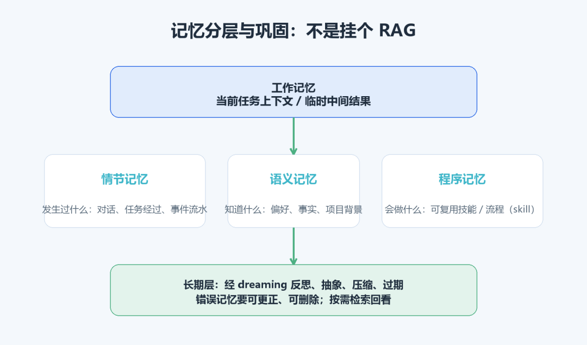
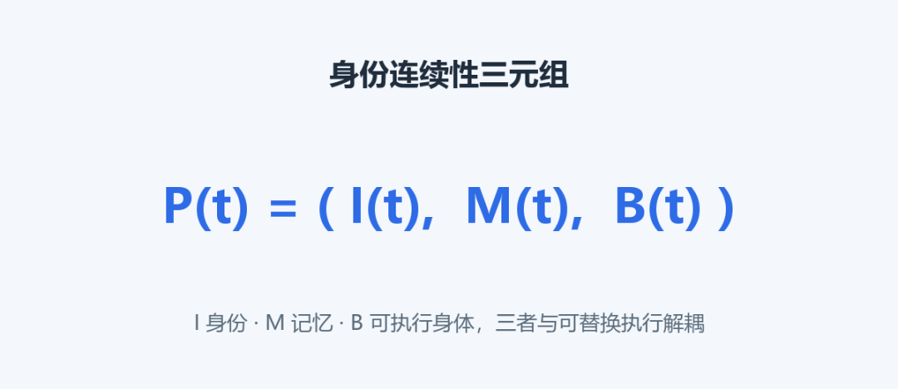
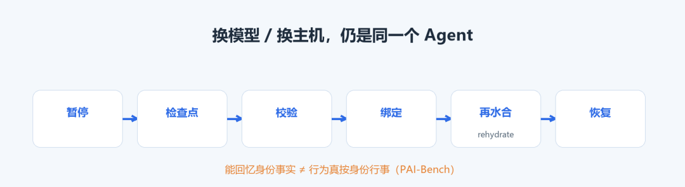
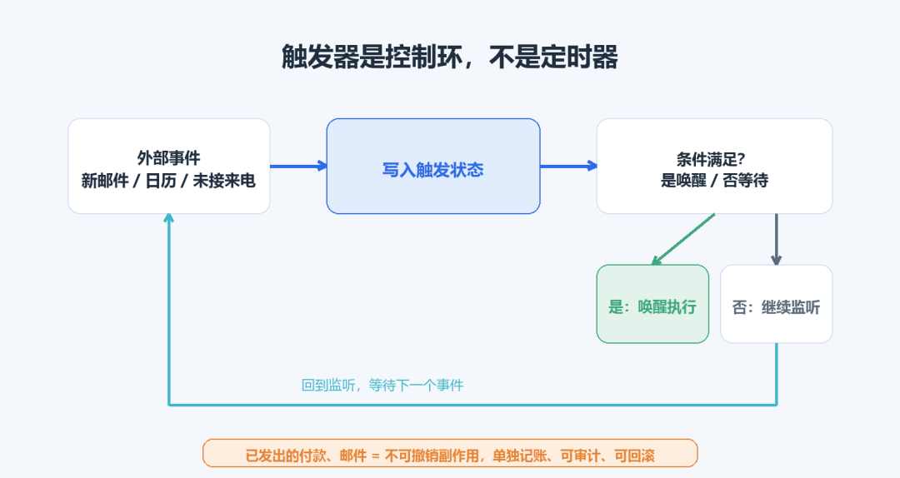
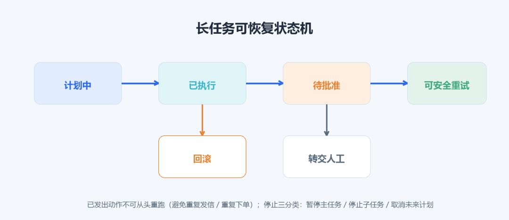



**收录说明**：用户提供链接。原文在微信公众号，用浏览器的客户端标识直接下载页面，从 `#js_content` 抽取正文，图片地址取自 `data-src`。系列下篇，上篇为同一公众号的「Personal Agent 到底新在哪」。文末参考文献照录。

**内容摘要**：鸿煊的学习笔记下篇面向开发者，认为 Always-On Agent 的关键是把任务、权限、记忆、凭证、触发条件和已发出的动作移出会话上下文，而不是模型更会聊天。文章讲了记忆分层及 MemGPT、Letta、Mem0、Zep 等方案，触发器、长任务状态机与对外副作用的记账，以及 dots 的停止操作。安全部分对比 Muse 的 Secure VM 与 Sentinel、dots 的安全登录；评测部分引用 Fo 9 月 26 日报告的自主完成率约 71%、信任通过率约 94%，并注明来自开发方。文末附工程自检清单。

**保留理由**：从工程角度拆解持续运行的设计要点（状态、记忆、触发、权限、验证），引用具体产品机制与开源方案。

---

## 导语

很多人以为 Always-On Agent（全天候智能体）是"模型更会聊天了"。恰恰相反，它的本质是**运行时的变化**：把任务、权限、记忆、凭证、触发条件和已经对外发出的动作，全部挪到会话上下文之外保存。这一篇面向一线算法与开发工程师，把 Personal Agent 拆成六个工程问题：记忆怎么分层、身份怎么跨运行时延续、触发器为什么不是定时器、长任务状态机怎么设计、权限与凭证怎么隔离、任务完成怎么验证。每个问题都给出主流做法、代表系统和容易踩的坑。

## 一、Always-On 的本质：状态移出会话，而不是模型变强

先给定义：**Always-on Agent** 是你交代任务后，即使结束对话，它仍能记住任务、等待变化，并在合适时机继续推进的智能体。它不只响应你当前这句话，还会依据之前留下的任务状态和新发生的事件采取行动。

举个采购例子：你说"盯住这笔采购，供应商延期就找替代方案，但换供应商前要让我确认"，然后关掉聊天窗。第二天供应商发来延期邮件，它被事件唤醒，结合昨天的要求整理替代方案并向你申请审批；你没回，它就保存进度等待；你批准后接着执行，而不是让你重新描述一遍需求。关键不是"一次执行了两天"，而是**跨越两天、多次执行和等待，始终接着处理同一项委托**。

上一代 Agent 的规划、浏览、写稿基本绑在当次会话上下文里，窗口一关，任务、权限、中间结果跟着丢。这一代的做法是把需要长期保存的状态放到会话之外：任务账本、记忆、权限、凭证、触发条件，以及已经对外发出的动作。于是关掉 App 后，它仍能被新邮件、日历事件或未接来电唤醒，在自己的云电脑上接着干。

邮箱、电话、预算内钱包也不是新的模型能力，而是给这个常驻进程一个**能被外界找到的身份**：用自己的账户沟通、付款，而不是借用户登录态。这带来三点硬要求：

• 记忆要能巩固、压缩和遗忘；

• 身份要能跨模型、跨主机延续；

• 已经发出的信、付出的钱要可审计，不能被悄悄撤回。

要注意：Cue、Dots、Muse、Fo 解决的只是"进程和身份不随对话结束"，**并不等于办事一定可靠**。

## 二、持久状态不等于 RAG：记忆要分四层，还要会遗忘

一个常见误区是把"长期记忆"等同于"挂一个 RAG 检索库"。RAG 解决的是"把外部资料塞进上下文供本次参考"，而 Personal Agent 需要的是**随时间巩固、压缩、过期、可更正的自我状态**。

认知科学把记忆分成几类，Agent 设计直接借用了这套划分：

| 记忆类型 | 回答的问题 | 在 Agent 里的对应 |
| --- | --- | --- |
| 情节记忆 | 发生过什么 | 历次对话、任务经过、事件流水 |
| 语义记忆 | 知道什么 | 用户偏好、事实、项目背景 |
| 程序记忆 | 会做什么 | 可复用的技能、流程、操作方法（skill） |
| 工作记忆 | 当前正在用什么 | 当前任务上下文、临时中间结果 |

这套划分有学术源头：Tulving 区分了情节记忆与语义记忆，Baddeley 提出工作记忆，Soar 和 ACT-R 提供了"感知—决策—行动"循环。LLM 领域综述把记忆演化概括为三阶段：**先存轨迹 → 再反思轨迹 → 最后把轨迹抽象成可复用经验**。全天候场景需要的正是最后一步：下次不用重放整段对话，也能沿用已有规则和技能。

### 执行状态本身就是记忆

长任务不能把完整历史塞进上下文；可一旦压缩，又会丢掉当时看不出价值、事后才发现有用的细节。FlowState 的做法是把三样东西分开存：**带类型的状态节点、节点之间的关系、对原始工具输出的引用**。循环运行时只增量更新状态，推理时再按需回看历史。原文引用的实验显示，在同一模型上，MemoryArena 成功率与 τ3-Bench 通过率分别提升约 4.6 和 14 个百分点，token 消耗下降约 40%。这和 Manus Cascade 这类 Harness 思路相近：工具和上下文按需加载，而不是每次把全部能力塞进提示词。

图3：工作记忆、情节/语义/程序记忆与 dreaming 整理压缩的分层流向。

### 记忆从哪来、错了怎么改

长期记忆不能只解决"记住"，还要解决**来源、作用范围、更新时间、过期和删除**。错误偏好一旦进入长期层，会在许多后续任务中反复出现。用户需要知道一条记忆从哪次对话或哪个项目产生、当前影响哪些任务、何时更新、如何更正或删除。

工程上的代表方案：

• **MemGPT（2023.10）** 把记忆读写设计成工具调用：有限上下文分成系统说明、可写工作区和消息队列，会话与归档存放在上下文之外，模型按需检索和修改，借鉴操作系统的虚拟内存分页（见参考文献[2]）。

• **Letta 的 MemFS** 用 Git 保存可跨会话共享的记忆，后台子 Agent 回顾会话并通过 dreaming 合并经验，保留可审阅的变更历史。

• **Mem0** 提供可外接的记忆层，抽取与更新记忆事实（见参考文献[10]）。

• **Zep / Graphiti** 把不断到来的对话整理成带时间关系的知识图谱，旧事实被失效而非直接覆盖，可回答"用户上个季度偏好什么"（见参考文献[9]）。

• 产品侧：dots 把任务上下文、相关 ChatGPT memory、自己的持久上下文分开；Today 允许查看、编辑、删除记忆；OpenClaw 用文件加索引保存不同层次信息。

**Sleep-time Compute**（2025.4）说明了用户没提问时后台计算的一种用途：提前处理可复用上下文。作者报告在达到相同准确率的论文设定中，查询阶段所需计算约降到五分之一；但这个数字不能外推成"所有产品成本都降 80%"（见参考文献[7]）。LongMemEval 与 V2 则提醒团队分开评估三件事：记忆写入是否正确、需要时能否找到、读出内容能否支持当前任务。

## 三、身份要能跨运行时延续：换模型、换主机，还是"同一个"

Agent 换模型、换 Harness、换主机之后，仍应是"同一个"。原文引用的一篇架构论文把这种连续性写成三元组：

公式图1：身份连续性三元组。

其中 **I(t) 是身份、M(t) 是记忆、B(t) 是可执行的"身体"**，并且与可替换的执行绑定分开。迁移流程是：暂停 → 检查点 → 校验 → 绑定 → 再水合（rehydrate）→ 恢复。配套基准 PAI-Bench 区分了两件经常对不上的事："能回忆出身份事实"和"行为上真的按这个身份行事"。Cue、Fo 提供的邮箱和电话，本质就是把身份从提示词里的一段人设，落实成**外部可寻址的账户**。

图4：暂停、检查点、校验、绑定、再水合、恢复六步迁移流程。

## 四、触发器是控制环，不是定时器

新邮件、日历、未接来电这类事件，会先写入**触发状态**，只有满足条件才唤醒云电脑执行一次。这更像分布式系统里的订阅和事务，而不是聊天补全。

这里有一条会计红线：**对外付款、发信属于已经提交、无法收回的副作用，必须和内部计划分开记账**，否则既无法审计，也无法回滚。内部计划可以反复改，副作用一旦发出就落账，两者不能混在一个状态里。

图5：外部事件 → 写入触发状态 → 条件判断 → 唤醒执行 / 继续等待；副作用单独记账。

## 五、长任务状态机：可恢复、可暂停、可回滚

长任务首先需要一个**可恢复的任务状态机**，记录哪些步骤仍在计划中、哪些已执行、哪些等待批准、哪些可安全重试、哪些需要回滚或转交。如果一封邮件已发出、一个日历事件已创建，简单从头运行会造成重复操作。并行任务还要控制资源冲突：OpenClaw 对会话做串行化并设全局并发限制；Grok Bot 不同角色共享云电脑，也需避免同时改同一文件或占用同一浏览器会话。

dots 把停止操作拆成三种，看似比一个停止按钮复杂，却准确说明后台同时存在当前流程、并行分支和未来触发器：

1. 暂停主任务；

2. 停止子任务；

3. 取消未来计划。

用户停止当前任务，不一定已撤销未来计划；停止一个子任务，也不等于主任务结束。任务控制界面必须把这些差别说清。

工程范式上，**LangGraph Persistence / Interrupts** 提供会话检查点，以及"暂停等待批准、之后从原位置恢复"的能力（见参考文献[8]）。评估侧，Pare/Pare-Bench 使用事件驱动环境，区分用户通过界面操作和 Agent 通过 API 操作时看到的不同操作面；π-Bench 关注长周期主动助理面对隐藏意图与交互时的表现。

**何时打扰用户**也要进设计：低风险信息汇总后通知，高风险动作执行前暂停；条件不确定先调查，需要判断时给少量清晰选项。衡量体验可以记录一个指标——用户为盯进度、纠正步骤、重新提供上下文而回到任务的次数；次数越多，后台执行省下的注意力越有限。

图6：计划中 / 已执行 / 待批准 / 可安全重试 / 回滚 / 转交六态与转移条件。

## 六、谁在执行，权限什么时候失效

借用户登录态能快速连很多应用，但外部系统会把动作记成用户本人操作。系统必须明确：一封邮件由谁发起、一个电话由谁拨出、一笔支付由哪个 Agent 提交、用户在哪个节点批准。Cue、Fo、Instinct 用独立邮箱、电话或支付工具区分行动身份；生态型产品更多靠凭证隔离、动作审批和审计记录。

身份与权限要覆盖整个任务周期：

• Agent 协作时验证对方身份，共享日历只披露协调所需信息；

• 凭证要有使用期限；

• 用户撤销权限后，仍在运行的任务也要停止使用该权限；

• Agent 更换角色或被删除后，关联文件、会话、授权要有明确处置。

OpenClaw 在 2026 年 9 月 21 日的权限复盘中特别指出：**权限要随请求一路传递，授权必须绑定最后访问的资源，不能只在任务开始时做一次判断**。

两种凭证隔离设计值得对照：

• **Muse Secure VM** 把凭证、审批、安全服务放在 Agent 容器之外，模型主要用替代 token，由 Sentinel 在网络边界判断连接器动作与出口。

• **dots 安全登录**让密码进入浏览器、避免进入模型上下文。

两者都在减少模型直接接触真实凭证的机会。但要清醒：**独立身份有助审计，并不会自动带来安全**，仍然需要限额、有效期、撤销和执行记录。

### 浏览器与工具调用怎样避免越权

Personal Agent 把一个高层目标拆成连续工具调用，任务开始时的一次确认，覆盖不了后续目标变化、资源替换和新数据出现。原则是：权限随请求传递，审批绑定最后执行的动作与资源，真实凭证尽量留在模型上下文之外，执行环境与安全判断分层，撤销还要影响已启动任务。

**MCP（模型上下文协议）解决的是工具互操作接口，而且协议本身无状态**：每个请求自包含，服务端不依赖前序请求建立上下文。它让连接更方便，却不替开发者决定谁能访问资源、一次授权保持多久、目标文件是否变化、工具返回数据是否被污染（见参考文献[3]）。浏览器操作还会遇到页面改版、登录过期、点击错位、不可信页面内容；浏览器一旦持有真实登录态，一次识别错误就可能导致发送、删除、购买或信息披露。

Muse、dots、Spark 的公开资料都没有宣称彻底解决提示注入。Muse 用隔离环境、容器外凭证、Sentinel 分层控制；dots 加独立 Auto-review；OpenClaw 把命令审批绑定目录和可执行文件。这些都是降险，不是免疫。只要 Agent 会阅读不受信任的网页、邮件、文档，同时又能调高权限工具，系统就必须持续区分外部内容与用户指令，并记录每次授权实际作用到什么资源。

## 七、失败怎么处理，如何证明任务真完成了

网页会改版、账号会过期、现实服务会取消、用户要求还可能互相冲突。系统要尽早识别失败、保留现场、说明未完成部分，并在重试、回滚、等待、询问用户、转交人工之间做选择：LangGraph interrupt 支持暂停后继续；dots 分开管理主任务、子任务、未来计划；Grok Bot 异常时追问或中断；Fo 把机器跨不过的环节交给训练过的人类助理，再把外部结果写回任务。

**验证完成不能只听 Agent 自述。** 订单是否生成、邮件是否送达、日历是否改对、文件是否存在、PR 是否通过测试，这些外部状态才更可靠。主流基准各测一块：

| 基准 | 测什么 | 局限 |
| --- | --- | --- |
| GAIA | 通用助理的多步推理、联网、工具使用 | 不覆盖操作系统级长流程 |
| OSWorld | 真实操作系统环境中的开放任务 | 不直接测长期记忆与身份一致 |
| τ-bench / τ²-bench | 工具调用与多轮/双控交互可靠性 | 偏客服与 SaaS 场景 |
| LongMemEval | 长期记忆的索引、检索与读取 | 不测执行与支付 |

单项高分不能证明一款完整 Personal Agent 已经可靠（见参考文献[4][5][6]）。

Wajo 为 Fo 构建了模拟世界：可控的商家网站、邮箱、电话、合成人物，并把仿冒网站、暗黑模式放进流程；评分优先读外部系统状态和执行记录，模型评委只处理确定性检查无法裁决的部分，也不能推翻硬性结果。9 月 26 日报告 Fo 自主完成率约 71%、信任通过率约 94%，**完成率不含人类执行助理兜底**；配套预印本含 104 个完成任务、60 个信任任务，每种配置跑 3 次，对比基础模型、移除护栏的 Fo、完整 Fo 与 OpenClaw，后者在共同任务上完成率约 42%。必须强调：这些数字来自模拟任务和固定流程，受模型、工具、执行环境共同影响，论文作者来自开发方 Wajo，是开发方预印本，**既非独立横评也非同行评审**，不能包装成市场份额或真实客户普遍成功率。

## 总结：工程自检清单

落地一个 Always-On Agent 前，逐条核对：

[ ] 状态是否全部移出会话上下文（任务账本/记忆/权限/凭证/触发器/已发副作用分账）

[ ] 记忆是否分层（情节/语义/程序/工作），并支持来源、范围、过期、更正、删除

[ ] 身份是否与可替换执行解耦，支持暂停—检查点—恢复迁移

[ ] 触发器是否为事件控制环，副作用是否单独记账可审计

[ ] 是否有可恢复状态机，停止是否区分主任务/子任务/未来计划

[ ] 权限是否随请求传递、绑定最后资源、可撤销并影响运行中任务

[ ] 真实凭证是否留在模型上下文之外，是否有分层安全审查

[ ] 完成度是否用外部系统状态验证，而非 Agent 自述

[ ] 提示注入是否只做到降险、并明确告知用户残余风险

下一篇转向商业与格局：为什么是 2026 集中爆发，C 端如何靠信任变现，B 端如何走向数字员工，以及中国为什么是"生态内嵌"而不是一个通用助手统一天下。

## 参考文献

[1] 郑天. 这是一篇把"Personal Agent"讲明白的科普级综述！. Datawhale, 2026-10-18. https://mp.weixin.qq.com/s/j6swcZFbBQuls7Def4HR-Q

[2] Packer C., et al. MemGPT: Towards LLMs as Operating Systems. arXiv:2310.08560. https://arxiv.org/abs/2310.08560

[3] Model Context Protocol Specification (Stateless). Model Context Protocol. https://modelcontextprotocol.io/specification/draft/basic

[4] Mialon G., et al. GAIA: A Benchmark for General AI Assistants. arXiv:2311.12983. https://arxiv.org/abs/2311.12983

[5] Xie T., et al. OSWorld: Benchmarking Multimodal Agents for Open-Ended Tasks in Real Computer Environments. arXiv:2404.07972. https://arxiv.org/abs/2404.07972

[6] τ-bench / τ²-bench. Sierra & Stanford AIMS. https://taubench.com （τ-bench arXiv:2406.12045；τ²-bench arXiv:2506.07982）

[7] Lin K., et al. Sleep-time Compute: Beyond Inference Scaling at Test-time. arXiv:2504.13171. https://arxiv.org/abs/2504.13171

[8] LangChain. LangGraph Interrupts / Human-in-the-loop. https://docs.langchain.com/oss/python/langgraph/interrupts

[9] Zep Graphiti Temporal Knowledge Graph. https://www.getzep.com/platform/graphiti/

[10] Mem0 Open Source Memory Layer. https://docs.mem0.ai/open-source/overview
