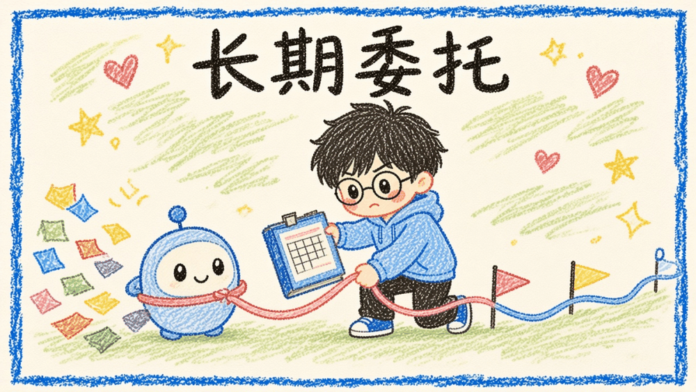
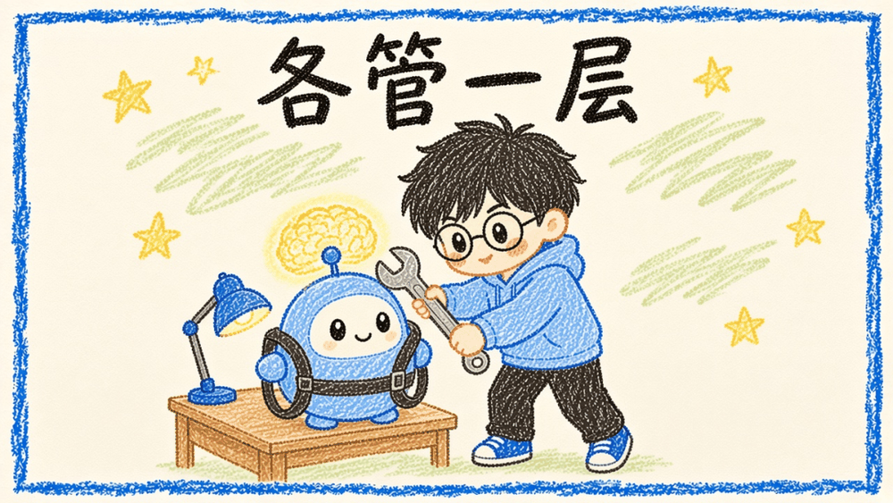
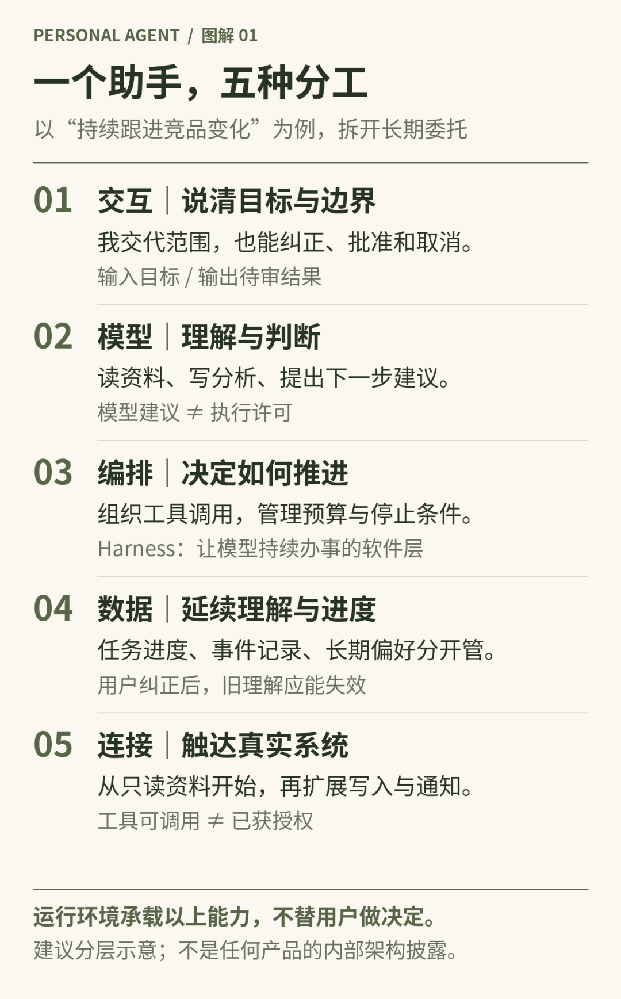
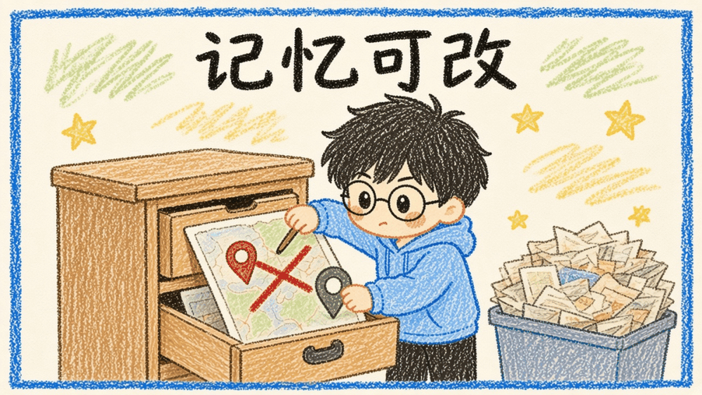
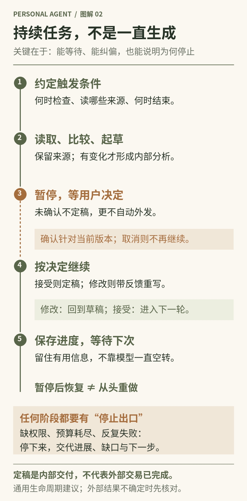
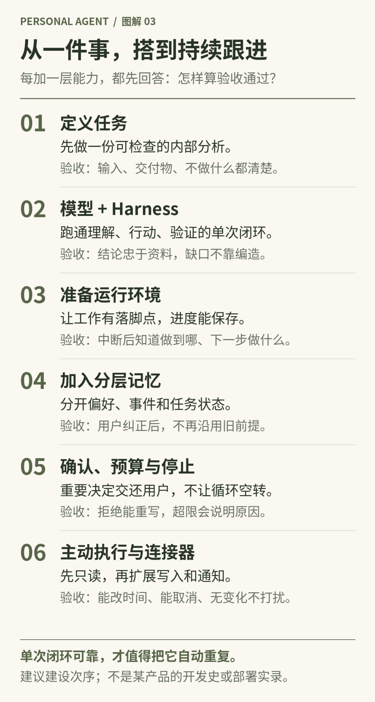
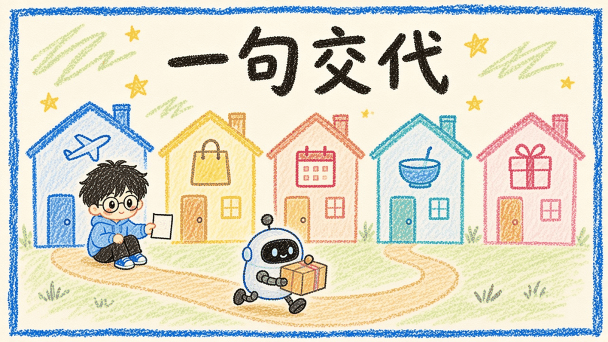
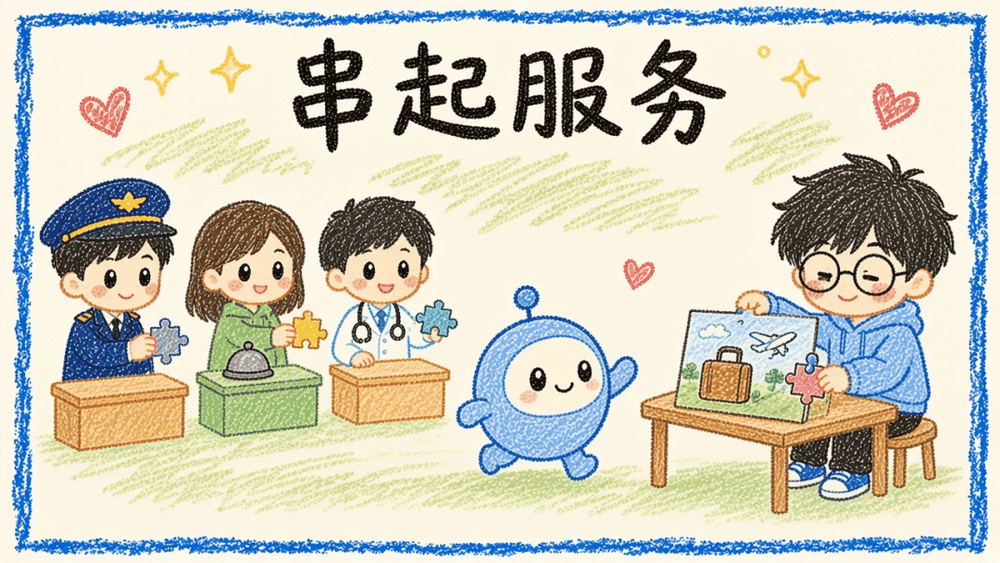



**收录说明**：用户提供链接。原文在微信公众号，用浏览器的客户端标识直接下载页面，从 `#js_content` 抽取正文，图片地址取自 `data-src`。

**内容摘要**：阿言er的文章先给 Personal Agent 下了带边界的定义，再按官方材料梳理时间线：Grok Bot 官方公告换算为北京时间 8 月 12 日，Meta 9 月 8 日介绍 Muse，Manus 将 Cue 列入 Manus 2.0，OpenAI 9 月 29 日发布 dots。文章逐个比较 Grok Bot、Muse、dots、Cue，并提到腾讯 WorkBuddy 与千问办公，指出 WorkBuddy 官方更新日志最早列有 2026 年 3 月 4 日的正式发布条目。第四章以一个「发布前竞品跟踪」任务为例，给出模型、Harness、云端电脑、记忆分层、主动执行、连接器与权限的搭建路线；后两章讨论市场竞争和对电商、SaaS、金融医疗等行业的影响。

**保留理由**：较系统的产品对比与搭建思路，产品论述多标注官方材料与日期，并区分事实与推断。

---
假设我要准备一次产品发布：持续跟踪竞品，整理用户反馈，更新发布方案，再把变化同步给团队。今天的AI已经能把其中每一件事做得很漂亮。我可以很快拿到一份分析、一版文案、一张表格。但几天之后，竞品又更新了，用户提出了新问题，方案里的价格也变了。我仍然要记得重新打开工具、补齐背景、判断哪些材料失效，再把任务串起来。

AI完成了许多工作，我却没有真正放下这件事。我从亲手制作的人，变成了不停分配、搬运、检查和催促的人。单个任务越容易生成，任务之间的协调反而越显眼。我们缺少的，可能已经不只是一个更聪明的回答者，而是一个能在我们离开后，仍然知道事情推进到了哪里的协作者。

这是我理解Personal Agent的起点：**AI产品的设计对象，正在从一次请求，转向一个人的长期事务。**它不只是替我完成今天的竞品报告，还要知道这份报告服务于哪次发布，什么变化值得重新调查，哪些结论已经过期，什么时候必须回来问我。这个变化看起来只是多了一层记忆和后台运行，实际上会牵动产品入口、技术架构、商业分发，甚至行业服务如何被购买。

不过，我不想把它写成“万能助手终于来了”的故事。真正值得讨论的是：哪些变化已经发生，哪些能力还停留在产品承诺里，以及要让一个助手持续替人办事，我们究竟还欠哪些工程与制度上的账。

## 一、它首先是一种委托关系，而不是一个新聊天框

我会给Personal Agent一个带边界的定义：围绕特定用户，在明确授权下，持续利用个人上下文，通过工具推进事务，并允许用户检查、纠正和撤回委托的AI系统。这里的“持续”不是模型不停生成，“个人”也不是给机器人起个名字。它意味着服务关系跨越多次对话，工作不能每次都从零开始，用户仍然掌握最终决定权。

普通聊天助手更像一个随叫随到的顾问：我问，它答；任务型Agent更像承接一次项目的执行者：给定目标，查资料、调工具、交结果；Personal Agent则尝试承接任务之间的连续性。它需要理解为什么做、上次怎么做、这次哪里不同，以及这件事还该不该继续。三者不是互斥的物种，同一个产品完全可能同时提供这几种工作方式。

例如，我说“帮我分析这次竞品改价”，一次性Agent可以交付报告；我说“接下来一个月，盯住影响我们发布定位的变化，只在重要变化出现时提醒我”，问题就变了。系统需要保存观察范围、资料来源、结束条件、通知偏好和行动权限。它不能因为监测到对手降价，就擅自替我们调整定价或给客户发邮件。

因此，我更看重五种能力：知道我的背景与约束；把目标转成可执行步骤；接入实际工作系统；跨时间保存进度并按条件继续；让重要判断可以被验证和接管。记忆、工具、调度、状态与用户控制缺一项，长期委托就容易断在某个地方。会聊天、能联网、支持定时，并不能自动拼成一个可靠的私人助手。

长期委托

“主动”尤其容易被误解。好的主动性不是每天发十条建议，而是在约定范围内减少我需要惦记的事情。发布计划没有变化，就安静；新证据推翻了核心结论，就解释影响；缺少访问权限，就准确说清卡在哪里；准备对外作承诺，就停下来让我决定。它承担的是跟进责任，不是获得无限自由。

这也解释了它与工作流、陪伴产品的差别。固定工作流擅长稳定输入和明确步骤，个人助手面对更多变化和澄清；陪伴产品可以深入理解我，却不一定具备工具执行与履约闭环；编程Agent可以很好地修改一个仓库，却未必适合处理我的报销、旅行和长期学习。区别不在于谁更高级，而在于持续服务的对象和责任边界不同。

对话助手

主要承接什么：一次问题与内容生成

用户通常还要做什么：提供背景，搬运结果，安排后续

固定工作流

主要承接什么：已知条件下的重复流程

用户通常还要做什么：预先定义规则，处理流程外情况

任务型Agent

主要承接什么：一个目标下的多步执行

用户通常还要做什么：提供目标，验收一次交付

Personal Agent

主要承接什么：围绕个人的连续事务

用户通常还要做什么：设定边界，处理关键判断，纠正长期理解

这些形态会重叠。真正有价值的不是产品有没有贴上Personal标签，而是我能否少解释一次、少盯一次、少重复纠正一次。把用户从操作员变成审批员还不够，如果所有细节都要审批，注意力负担只是换了个名字。

## 二、为什么是这一轮：不是一个产品发明了整个品类

如果问“最早火起来的是谁”，我首先要限定口径。私人数字助理的想象早于大语言模型；可执行开源助理的传播，与2026年各家集中推出长期代理品牌，也不是同一件事。把它们压缩成某个产品突然创造新品类，会让我们误判技术积累，更容易把发布会先后顺序当成真正的产品差距。

在这一轮开源个人助理的传播中，OpenClaw是重要节点。其官方介绍回顾，前身起于2025年11月，后来经历改名，在2026年1月底以OpenClaw的名字亮相。它把模型、常驻运行环境和用户熟悉的聊天入口接在一起，让“在聊天软件里交代电脑干活”变得非常具体。这里说的是一条显著走红的开源路线，不是断言它发明了个人Agent。

OpenClaw的重要性，在于把一条路线带到更多人面前，而不是成为所有后续产品的共同祖先。其官方介绍允许把系统部署在笔记本、家庭服务器或VPS上，运行位置本来就有选择。更准确的变化是：开源方案让使用者承担部署、凭据、权限与运维，托管产品则尝试把这些成本收进产品内部。体验门槛下降，不等于所有底层问题都已消失。

工具、应用连接与持续运行条件共同推动个人代理走向产品化。

随后，记忆和执行环境逐渐从工程配件变成产品卖点。Hermes Agent的官方文档展示了另一种持续性的做法：用MEMORY.md保存工作知识，用USER.md保存个人偏好，再通过会话检索补充历史。它还明确提醒，保存成功的工具调用与“我记住了”这句回答不是一回事；会话开始时装入的记忆快照，也不会因为文件改变就自动更新。

这里值得关注的，是产品开始认真面对记忆的生命周期。保存、读取、压缩、检索、纠正和跨会话生效是不同环节。OpenClaw与Hermes提供了不同的组织方式，托管产品又可能选择另外的实现。它们更像围绕共同工程难题展开的多条路线，而不是一条必然升级的家谱。

到了2026年下半年，品牌化的持续代理明显密集起来。Grok Bot的官方社区公告时间换算为北京时间是8月12日凌晨；Meta在9月8日介绍Muse；Manus的9月28日官方博客目录将Cue列入Manus 2.0；OpenAI在9月29日发布dots。

日期相近，确实能支持“多家正在争夺长期代理入口”的判断，却不能单凭这些日期证明哪一家用户最多、增长最快。

为什么这一轮更有产品感？需求侧，用户已经体验过生成和单次执行，开始感受到搬运背景、衔接任务和反复验收的成本。供给侧，工具调用、浏览器操作、执行框架、应用连接器与云端环境能组合出更完整的服务。商业侧，厂商不再满足于回答一个问题，而希望进入用户的邮件、文件、项目和交易链条。三股力量汇合，才让长期委托成为一个现实的竞争方向。

这些路线的接入范围、运行方式与安全假设并不相同，不能笼统地说谁已经涵盖了谁的全部能力。独立品牌淡化，也可能是能力被整合进主入口：Anthropic当前官方材料明确描述聊天与Cowork合并，并在托管云环境继续执行；Google的2026年7月官方更新也仍在扩展Spark的浏览器能力。产品整合、改名和退出，需要分别举证。

## 三、看代表产品，不能只看谁的功能更多

把几款产品放在一起，我更愿意比较它们选择从哪里建立长期关系。有人从一个可协作的团队切入，有人从生活目标切入，有人利用原有对话上下文，也有人从桌面文件与企业工作空间出发。它们都接近“持续替我办事”，但并不意味着已经形成相同的能力集合。

在看新品牌之前，ChatGPT的Memory与Tasks、Claude Code已经分别展示了积木式能力：前者提供个人上下文与计划任务，后者把收集上下文、工具行动、结果验证做成执行循环。但Memory不保存每个细节，Tasks也有资料访问边界；Claude Code的权限由软件执行，项目说明不是强制权限规则。

它们说明个人助手并不是凭空出现的新物种，而是把已有能力重新围绕长期关系组织起来。

**Grok Bot选择的是“我的一支常驻团队”。**官方公开描述包括云电脑、浏览器、工具连接、Bot之间的线程与群聊协作，以及从示范中保存可复用routine。一个研究Bot收集竞品变化，一个写作Bot调整方案，是它希望降低协调负担的方式。值得注意的是，官方公告说同一账号下Bots共享电脑、分别使用屏幕；不能把多个Bot头像理解为底层文件与登录天然完全隔离。[3][4]

这条路线的价值，不只是并行产量，而是用户不用在几个窗口之间充当消息中转站。但协作越多，交接责任、上下文来源和权限归属就越重要。10月27日的官方日志一边增加订单跟踪、订阅管理模板，一边修复并发记忆保存和routine时区问题。我反而觉得这些小修复比“全天在线”更能说明竞争进入了什么阶段：从完成购物，延伸到物流、续费和后续跟进，也开始承担长期运行产生的细碎成本。

**Meta Muse选择的是“理解我的生活，并把目标往前推”。**9月8日发布材料描述了专属Secure VM、浏览器、日常应用连接，以及在用户关闭应用后继续推进工作；发送邮件、购买等敏感动作需要确认。它还公开了系统层与主代理分开的Sentinel检查机制。对我而言，重点不是那个“首款”宣传语，而是它把长期目标、个人记忆、生活服务和独立执行环境放进了同一套用户叙事。

不过，安全架构描述不是独立安全评测。专属虚拟机可以收紧运行边界，不能自动保证模型判断、网站内容和交易结果都正确。发布页提及的Confidential VM仍使用未来语气；后来的新加坡发布说明也明确，连接器会逐步开放。合作名单很长，不等于每个用户当天就能调用名单里的所有服务。

**ChatGPT dots选择的是“把已有理解接上持续执行”。**9月29日发布页描述了云电脑、连接应用、持续推进项目和用户反馈。它天然拥有一个优势：用户可能已经在ChatGPT里解释过大量背景。但官方帮助文档又揭示了真实边界：ChatGPT记忆与dot自己的记忆不是同一个对象，具体任务不会自动收到用户与dot的全部对话，暂停dot也不一定停止独立任务。

这几条限制很重要。它们说明统一入口不等于统一状态，主助手听到了新指令，不代表每个执行分支都已经更新。截至2026年11月7日，企业等工作区仍处于11月4日至18日的管理员预览窗口，访问受角色与地区等条件影响。我不会把“发布”写成所有人都已经无条件可用，也不会把用户可以主动发起语音通话，写成代理能够主动打电话找人。

**Cue则把“代理拥有身份”推到更显眼的位置。**Manus官方帮助页将它定义为独立应用里的个人代理团队，描述了每个代理自己的邮箱、电话号码、钱包与电脑，也能通过自然语言创建定时自动化。这不仅是多加几个工具，而是代理开始以持续身份参与通信与服务。不过当前材料明确需要邀请码；拥有钱包也不能被写成可以不经授权任意花钱。

这些新名字还容易制造混淆。New Computer曾经的Dot强调理解个人与提供陪伴、建议，它不是OpenAI的dots。其官网目前是结束运营公告，不能把旧介绍页当作2026年仍可用的执行代理。这个案例至少提醒我：长期理解并不自动兑换成稳定商业模式；当用户把个人经历交给服务，退出、导出和服务终止也是产品能力的一部分。

再看中国，办公和既有生态是一条更容易观察的入口。腾讯WorkBuddy的官方更新日志最早列有2026年3月4日正式发布条目，之后持续补充工作空间、连接器、长期记忆与定时任务。它不是等海外9月的新品牌出来后才突然开始。11月3日的定时任务改版仍标“灰度中”，所以最新界面与能力不能默认覆盖全部账号。

阿里巴巴在8月3日宣布千问办公面向中国市场开放公测，网页云端与桌面客户端并行。对照10月27日国内帮助文档，钉钉入口、云端定时任务、连接器与技能构成其工作流方向；同时浏览器自动化仅客户端支持，部分网页制作能力也有端侧差别。一个产品同时提供云端与桌面，不代表本地文件操作在电脑离线时仍能继续。

那么，国庆期间大厂是否在赶这个项目？公开证据可以回答一半：WorkBuddy确实在10月3日和4日发布5.7.5、5.7.6，涉及定时任务汇总、产物通知和海外邮件连接器。但这只能证明假期有公开迭代，不能据此推断团队加班规模、内部赛马安排，更不能扩展为所有大厂同步赶工。现有资料不足以把字节内部研发节奏、阿里假期专项发布写成官方事实。

我愿意下的判断是：中国厂商已经在争夺文件、通信和日常工作流里的助手位置；至于某个内部代号什么时候全量开放，或者国庆谁在连夜追赶，不能让行业气氛替代证据。未来的竞争也未必复制同一个海外App，而可能出现在办公桌面、企业通信、手机系统和生活服务的不同入口。

## 四、如何从0到1搭建：先让一件事有闭环，再让它能持续跟进

看过几条产品路线，再回到开头那次发布准备，我最想问的是：如果自己从零搭建一个Personal Agent，究竟应该先做什么？不是先接上所有应用，也不是先建五个不同名字的Agent，而是让一件有限的事，有一个完整、可以检查的闭环。

下面按公开搭建思路组织：先看共性能力，再拆模型、Harness与运行环境，接着处理用户记忆与主动执行，再谈连接器和权限，最后给出建议的搭建顺序与验收方法。整章使用同一个假设任务串讲，是我按产品判断整理出的建议路线，不是对某套商业产品内部架构的复述，也不是实测部署日志。

任务缩成一句明确假设：“发布前一个月，关注两家竞品的官方更新，发现影响定位的变化，就帮我起草一段内部分析，等我确认；不要替我发出去。”先做今天这一轮：我提供资料，助手给出草稿，我修改并定稿。等这条链稳定，再讨论它如何按约定醒来、从哪里读新资料，以及没变化时如何保持安静。

### 先看共性：环境、记忆、主动、接口、安全

把主流持续代理产品拆开看，表面差异很大：有的强调组建Bot团队，有的强调生活目标，有的强调已有对话上下文，有的强调办公资产。落到可建设的能力上，通常绕不开五件事：完整的执行环境、持续记住用户偏好、在约定范围内主动跟进、接入外部应用的接口，以及可控的安全边界。

再压缩一层，工程上最先落地的往往是两件事：给助手一个能干活的地方，以及给它能动手的工具与接口。记忆、主动性与安全边界，则决定这件事能不能长期做、敢不敢做。对产品经理来说，这五件事比“多几个模型名字”更值得排优先级：哪一项缺失，长期委托就会断在哪里。

回到发布场景。没有执行环境，助手只能口头建议；没有记忆，下周还要重新交代发布目标和写作偏好；没有主动性，我仍得每天催它检查；没有连接器，它读不到官方更新；没有安全边界，它可能在我没确认时就把内部分析发出去。五件事一起成立，才谈得上“替我盯住这件事”。

### 模型、Harness与云端电脑：给助手配员工、方法和工位

搭建时可把问题拆成三块：模型决定判断与生成能力；Harness决定如何把资料送进模型、把工具结果带回来、管理上下文与执行过程；云端电脑或服务器则是助手真正落脚的工位。三者各管一层，不能互相冒充。

模型负责理解与决策，执行框架负责调度与约束，运行环境承载工具和状态。

**模型**方面，常见做法不是只用一个万能模型，而是按任务分配：一种是按难度或类型做路由，把简单查询和复杂推理分开；另一种是由较强模型负责拆解与拿主意，再把可拆开的执行步骤交给更便宜的模型。公开讨论里，前者更像成本优化路线，后者更像早期产品容易接上的协作方式。挑选主模型时，我会看工具调用、长程任务、上下文利用以及成本与稳定性；执行模型则更看单步完成与指令遵循。具体模型版本会快速变化，本文不复述未经独立核验的推荐档位，也不把“强模型带小模型”说成已经搭好的多Agent组织。

**Harness**可以暂且理解成“让模型持续办事的那层软件”。面向Personal Agent，它通常要覆盖工具接入、上下文管理、用户记忆、任务恢复、循环执行、多模型协同以及权限控制。公开可参考的框架选型包括Hermes、nanobot、Pi：Hermes更强调记忆、跨会话检索、技能沉淀、任务调度与多渠道交互的成套能力；nanobot更轻，适合快速验证，但生产运维、消息与容器管理往往还要自己补；Pi更适合希望深度定制的开发者，记忆、任务跟进和定时往往需要自行实现。这些都是公开项目选型参考，不是我实测部署结果，也不等于某一闭源产品的内部实现。

**云端电脑**解决的是：助手离开聊天窗口之后，工作还在哪里继续。它可以是闲置主机、轻量云服务器，也可以是托管产品提供的虚拟机。OpenClaw一类开源路线允许部署在笔记本、家庭服务器或VPS；Grok Bot、Muse、dots等托管产品则把常驻云环境收进产品叙事。[1][3][5][7]云服务器是放置软件与状态的地方，不等于已经给每个用户配好了完全隔离的独立虚拟机；专属Secure VM之类能力，要以各产品官方说明为准，也不能自动保证判断、网页内容和交易结果都正确。

图1｜个人代理的五种分工。建议结构，不是某产品内部架构披露。

一次委托从头走完，会看到四层分工。交互层让我说明目标并作决定；模型层理解资料、提出下一步或生成文字；编排与工具层判断这一步是否允许、如何执行；数据层保存工作进度与个人相关信息。它们互相协作，但不能互相冒充：模型说“记住了”不是保存凭证，聊天里说“确认”也不一定批准了正确的那张卡。Claude Code的公开说明也强调：权限由软件执行，而不是由模型自行宣布。

### 用户记忆：从“任务做到哪”到“逐渐理解我”

传统任务Agent的记忆，多半围绕“这件事怎么顺利完成”：任务要求、相关资料、执行进度和操作经验。Personal Agent还要面对多次重复任务、不同环境下的相似任务，并在过程中逐渐形成对用户的持续理解。

因此，记忆通常会朝四个方向扩展：从只围绕任务，转向同时保存用户背景、偏好和长期目标；从只让信息在当前任务生效，转向区分临时要求、场景习惯和长期偏好；从只参考任务历史，转向结合作息、优先级与个人约束；从只追加执行记录，转向持续维护、修正冲突，并让用户查看、修改和删除。

公开产品已经把这些差异写进文档。ChatGPT的Memory明确不保存每个细节；dots则区分主对话记忆与dot自身记忆，具体任务也不自动继承全部对话；Hermes文档提醒，保存成功的工具调用与“我记住了”这句回答不是一回事，会话开始时装入的记忆快照，也不会因为文件改变就自动更新。

对应到发布准备，我会刻意分四类信息。“我喜欢先结论后论据”是可能长期复用的偏好；“这周先不讨论价格”只是阶段要求；“昨天比较过两家竞品”是发生过的事件；“草稿还在等我确认”是任务进度。把它们揉成一个大摘要，短期省事，长期就会出错：助手可能把本周例外当作永久习惯，或者记得我的口吻，却不知道工作还没结束。

因此，好的记忆系统至少要回答三件事：长期资料柜里留什么；当前工作台一次拿什么出来；用户纠正后，旧理解如何失效。资料柜可以很大，工作台却不宜堆满——无关历史会占据成本，也会污染判断。纠正也不该只改一句显示文案：如果发布地点已从上海改到杭州，而旧摘要仍写着上海，后续分析就会带着旧前提继续。产品经理验收时，不必先追问向量库品牌，而应检查：用户改了什么，下一次工作是否真的按新理解继续。

记忆可改

### 主动执行：什么时候开始、怎么跟到底、何时来找我

主动性是Personal Agent与一次性Agent最容易混淆的地方。它不是模型不停生成，而是用户交代过的事情，在约定范围内继续跟进，不必每次催促。公开材料里，ChatGPT的Tasks、Cue的计划自动化、WorkBuddy与千问办公的定时能力，都在尝试回答同一类问题。

搭建这项能力，可以抓住三个问题。第一，什么时候开始做：靠定时调度、事件触发或周期检查唤醒；只靠一句“记得每天执行”不够，系统需要保存安排并按条件启动。第二，交代的事情怎么跟到底：保存目标、进度和下一步，条件满足后继续，失败时有限重试，并提前约定哪些可自行处理、哪些必须确认；用户改变主意时，也能暂停或取消。

第三，什么时候来找我：有重要进展、遇到无法解决的问题，或需要拿主意时再提醒；一般信息可以汇总，没有变化就保持安静，并尊重作息与通知偏好。

放到发布场景：第一版我不会一上来承诺“帮我盯一个月”。先让助手处理我提供的两份竞品更新，起草内部分析。交付不是研究完一切，而是一份我能检查来源、纠正判断的草稿。持续监测是后面再加的能力。主动跟进应建立在可信的单次闭环上，而不是把不稳定过程自动重复。

确认也要做成真正的状态，而不只是多写一句“请检查”。草稿出来后，流程应从正在生成转为等待决定；我说“结论可以，但不要推断对方用户增长，只写价格变化”，系统应带着反馈重写，而不是从最初提示词随机再生成一版。

确认定稿、拒绝重写、尚未决定，应能被软件区分。定稿通常只意味着内部交付成立，不等于已经对外发送、下单或通知他人。Muse等产品把发送邮件、购买等敏感动作单独要求确认，正是在强调：执行许可不能被聊天语气吞掉。

等我确认

图2｜持续任务的等待、纠偏与恢复。确认定稿不等于对外发送。

执行过程还需要预算与停止条件。步数、时间与费用预算，决定消耗到什么程度该整理进展并交还决定；失控检测则观察是否在同一步反复空转、连续失败或没有实质进展。预算管消耗，停止条件管异常模式。如果两份资料始终读不到，正确交付不是一份自信的空想分析，而是说明读到了什么、缺什么、为什么停止。代码或状态里标记“有进展”，不等于分析准确；显示“已完成”，仍需要核对产物。

### 连接器与权限：生态分水岭，也是责任边界

连接器是让助手接入外部应用、读取信息并执行操作的桥梁。常见路径包括：用MCP一类标准接口接应用能力；用API或SDK直接对接；用CLI调用现成命令；或通过集成平台减少逐个开发成本。对Personal Agent来说，接入哪些应用，往往比再换一个更炫的模型名字，更能决定它能不能真正进入用户的生活与工作。

公开产品也在用连接器表达不同策略。Muse更强调生活与经营场景，并说明连接器会逐步开放；Grok Bot强调连接方式的灵活性；办公向的WorkBuddy、千问办公则把文件、通信和工作流接进既有入口。连接器名单很长，不等于每个用户当天都能调用名单里的所有服务；装了技能，也不等于扩大了权限。

权限设计要分清几层：身份来自哪里，读哪些对象，写哪些字段，哪些动作需要人工确认，结果如何核验。服务端会话身份应优先于模型对聊天内容的猜测；工具返回成功，只证明这一步有结果，不代表整件事已经办妥。竞品网页还可能夹着“忽略之前指令”的文字——它属于研究对象，不是新的委托人。给助手换一台云电脑可以改善隔离，却不会让网站内容自动变可信，也不会替用户批准从没同意的操作。

隐私与出站控制也应前后成对出现：不该进来的尽量别进来，不该出去的尽量别出去。规则识别、确认卡和执行环境隔离都能减少暴露面，但不能据此承诺零泄漏。对第一版发布任务，我建议的边界很具体：允许读取我提供的资料和约定来源；允许生成内部分析草稿；不允许未经确认的外发。

### 建议的搭建顺序与验收

把前面这些能力压成一条建议顺序，我会这样排：

第一，先定义一件能验收的事。输入是什么、输出是什么、暂时不做什么，都摆到明面上。对这个例子，第一版交付是内部分析草稿，不是全网监测网络。

第二，选模型调用方式与Harness，让“理解—行动—验证”能跑通单次闭环。参考Claude Code公开的收集上下文、采取行动、验证结果循环，先保证草稿可检查，再谈多角色分工。

第三，准备运行环境。先保证重启后任务状态可恢复，再追求更炫的虚拟桌面。云环境解决的是持续工作条件，不是自动获得全部应用登录。

第四，把记忆分层：任务进度、事件记录、长期偏好分开保存，并提供查看与修改入口。验收标准是：纠正发布地点或写作偏好后，下一轮是否还带着旧前提。

第五，把确认、预算和停止条件做成流程的一部分。未确认不能当成最终版本；拒绝后应反映拒绝原因；资源耗尽或反复空转时，要停下来交代原因。

第六，最后才加主动执行与连接器。先接只读的资料来源，再考虑写入和通知；先验证启动条件、改时间、取消和“无变化保持安静”，再扩到更多应用。渠道与多Agent也应放在后面：接进飞书或微信，先要解释谁能看到发布资料；拆研究与写作角色，先要解释谁读什么、交什么、由谁验收。

图3｜从单次交付到持续跟进。每增加一层能力，都先验证能否交付。

这就是我理解的从零到一：先做一件能验收的事，再让它能被纠正、能留下合适的记忆，最后才赋予持续跟进的条件。模型决定下一步有多聪明，Harness决定过程是否可控，运行环境决定离开窗口后工作能否继续，连接器决定它碰得到哪些真实系统，记忆与主动性决定理解能否跨时间延续。把这些层接起来，才可能从“今天帮我写一段”，走向“这段时间替我盯住这件事”。

## 五、市场真正争夺的，是用户不再亲自协调的那一层

为什么这些工程细节会变成市场问题？因为长期助手争夺的，不只是某一次生成结果的份额，而是用户下一次遇到事情时，首先交代给谁。一旦助手理解目标、掌握上下文，并有办法调用服务，它就可能成为搜索、比较、创作与交易之前的协调层。功能仍在原来的系统里，决定先用哪个功能的入口却可能迁移。

这也让我重新理解“爆火”的意义。我不能用一组发布公告证明全民迁移已经发生，但多家公司同时投入持续代理，说明竞争问题在改变：模型多会一道题，未必足以构成完整差异；谁能把能力变成稳定、可撤回的长期委托，谁才可能获得持续使用。它是产品价值链的扩展信号，不是胜负已经确定的证明。

我会用更贴近日常事务的指标检验它：用户一周花多少时间解释和监督？同一个错误纠正几次才不再出现？任务失败后恢复要多少人工？有多少通知真的需要用户判断？完成一次跨应用事务后，产物与实际状态是否一致？这些指标未必像生成速度那么好看，却能衡量用户究竟有没有把事情从脑子里放下。

这里还有一个反直觉：越长期的关系，越不应该靠无限积累数据制造锁定。记忆可见、可导出、能纠正，授权可缩小、可撤销，才可能让用户愿意逐渐交付更重要的事务。一个“特别懂我却无法解释自己记住什么”的系统，短期可能显得神奇，长期却会放大不信任。控制能力本身，会成为用户愿不愿意授权的前置条件。

商业模式也会变化。助手承担云环境、模型调用、连接服务和长期巡检，成本不再是一条回答的Token。订阅可以覆盖常驻关系，复杂任务可能另计资源，部分交易又可能带来服务费用。但如果助手一边替我挑最合适的产品，一边因为佣金偏向某个商家，我需要知道推荐到底在替谁优化。商业利益冲突不能藏在拟人化对话后面。

多Agent也不是免费扩容。拆成研究、写作、审核可能提高并行度，同时会增加上下文复制、等待、协调与错误传播。如果任务本来可以一次可靠完成，造三个角色反而让我管理更多状态。我的选择标准不是团队看起来像不像真人组织，而是拆分后责任是否更清楚、结果是否更可靠、总成本是否下降。

所以，未来AI产品会不会都向Personal Agent靠拢？我倾向于说，**会有更多产品借用它的持续性，但不会所有产品都长成同一个私人管家。**专业创作需要精细操控，金融交易需要严格资格和确认，企业数据受组织边界限制。用户也可能选择工作与生活分开的助手，而不是让同一个系统了解全部事情。

更可能出现的是一个分层世界：个人助手维护目标和偏好，专业代理承担特定领域任务，业务系统保存权威记录并完成履约。入口可能相对集中，执行网络却更加专业化。谁能接住委托、谁有权限做决定、谁对最后结果负责，会比界面里有没有一个聊天框更重要。

## 六、行业产品不会消失，但可能不再总是第一站

把这个判断放回各行业，变化就不再抽象。假设我不再打开五个App分别搜索，而是对助手说“把这件事安排好”。这不是App瞬间消失，而是需求表达、服务发现、交易与履约开始分层。行业公司既可能失去一部分直接访问，也可能通过更可靠的接口获得原本接不到的需求。

一句交代

### 电商与旅行：从吸引点击，转向接住带约束的委托

假设我要安排一次出差，助手可以理解时间、预算、行李和退改偏好，向交通、住宿和差旅系统查询。行业服务需要返回的不只是漂亮的卡片，而是实时库存、价格有效期、税费、退改条件和可核验的预订状态。用户批准的应该是具体方案，而不是一句笼统的“替我安排旅行”。

如果航班变动，持续助手的价值才真正出现：发现变化，检查后续衔接，给出可行选项，再取得改签授权。航空公司、酒店和平台仍然负责库存、订单与售后；助手负责串联信息与用户意图。退款不能凭聊天中的一句“已取消”成立，必须拿到交易系统的回执。这也是行业事实来源不会被个人助手取代的原因。

专业机构承担各自服务与责任；个人助手负责串联信息、用户意图和进度。

商家的品牌并不会因为少一次App访问就失效。质量、会员权益、独家库存和售后信任仍然影响选择。但单纯依靠复杂页面、连续弹窗和用户耐心的转化方式，可能更难适应代理入口。更有价值的建设，是给机器提供明确的查询、暂存、确认、支付和售后接口，并让每一步授权都能对上真实交易。

### 企业SaaS：从让人填表，转向让代理可靠地写入

在办公里，个人助手可能替我收集反馈、整理客户资料、更新项目状态。SaaS不一定被替代，而可能从每天反复点击的界面，部分转为代理调用的执行底座。CRM依然保存客户事实，项目系统依然维护负责人和进度，财务系统依然处理凭证；助手不能靠自己记忆中的摘要覆盖这些权威记录。

因此，企业产品需要更细的对象权限、字段级可写范围、版本冲突提示和审计轨迹。一个销售允许助手更新客户备注，不等于允许读取全部合同；个人助手也不能把离职前的组织资料带到下一家公司。代理代表个人还是组织，调用使用谁的身份，产生的文件属于谁，都应该在接口与合同里讲清楚。

这里的商业计量也可能调整。如果大量重复操作由代理完成，单纯按人头和界面活跃计价，未必能解释实际价值；但按每一次工具调用收费，也可能惩罚高效集成。更合理的方向可能是围绕业务对象、执行量、治理能力和可验证结果重新组合，而不是认为AI一来，所有SaaS都只能退化成廉价数据库。

### 内容与教育：助手协调长期目标，专业产品保留深度控制

内容生产很适合观察这种分工。个人助手理解我的选题方向，发现新资料，维护引用和版本，再调用写作、设计、剪辑工具。真正重要的不是每天自动多发几篇，而是新证据出现时，能指出哪些结论和素材需要修改。创作工具仍然提供排版、时间线、视觉精修和人工判断的空间，不会因为有助手就失去价值。

教育也类似。助手可以围绕学习目标安排练习，根据错题调整计划，记录哪些概念反复卡住；专业教学产品则提供内容体系、测评和教学服务。一次答对不能直接推断已经掌握，一次情绪低落也不该永久写进学生标签。长期画像需要可修订，未成年人的隐私、监护与分享边界更不能交给模型自行决定。

我尤其不希望“用户不再停留具体功能产品”被解释成取消所有专业界面。有时用户就是要亲自调整一个镜头、一段公式或一道题的推导。好的助手应该知道什么时候代办，什么时候把控制权交回专业工具，让用户得到更深的掌握，而不是用一键完成把过程彻底遮住。

### 金融与医疗：能串联事务，不等于获得专业资格

高风险领域更能检验这套逻辑。助手可以整理账单、解释资料、汇总就诊记录、提醒复查、准备要问专业人士的问题；但了解用户，并不自动获得投资顾问或医生的资格。用户一句“照你觉得最好的办”，也不能抹掉资质、适当性、知情同意与数据处理的要求。

在这类场景，行业接口应区分读取、模拟、建议、预约与真正执行。每一步需要什么身份，允许影响哪个账户或记录，结果由哪个专业机构确认，都应显式呈现。模型输出置信度不是医学证据，代理显示“交易成功”也不是清算完成。个人助手降低协调成本，专业系统与专业人士仍然承担各自法定和合同责任。

跨行业看，共同挑战最终会落在代理间协作：我的助手向商家代理询价时，对方怎么确认它代表我？这次授权有效到什么时候？支付额度属于单笔还是整个计划？任务取消后，已经交给第三方的请求如何处理？一次登录并不能回答这些问题，代理之间需要可验证的身份、授权范围、状态和结算边界。

这些接口可能比一个更炫的聊天入口更有长期价值。未来行业公司争取的，不只是“让用户愿意打开我”，还包括“让用户信任的助手愿意调用我，并且调用后确实能办成事”。但这个未来不会自动到来：封闭生态、商业分发冲突、非标准化服务和责任不清，都可能让用户继续需要多个入口。

## 结语：真正的下一代入口，应当让人少操一点心

回到最初那次产品发布。理想的Personal Agent不是替我生成一百份材料，而是知道哪些材料还有效，哪些变化值得处理，哪些工作可以自己推进，哪些决定必须交给我。我离开时，它有可恢复的状态；我纠正时，它能停止沿用旧理解；我撤回时，它知道要停到哪一层。

这也是我对这一轮热度的核心判断：AI开始从提供能力，走向承接委托。它会让更多行业服务被助手发现、组合和调用，让一部分用户注意力从功能入口迁移到个人目标。但模型再强，也不能替代真实库存、业务记录、专业资格、授权和履约责任。入口变化与产业消失，是两回事。

Personal Agent能否成为主流，不取决于我们能不能给每个人配一台云电脑、建一支Bot团队，而取决于连续使用之后，解释、监督和纠错的总成本有没有真的下降。**最值得期待的，不是一个永远显得很忙的AI，而是一个让我终于不用一直惦记着事情的助手。**
