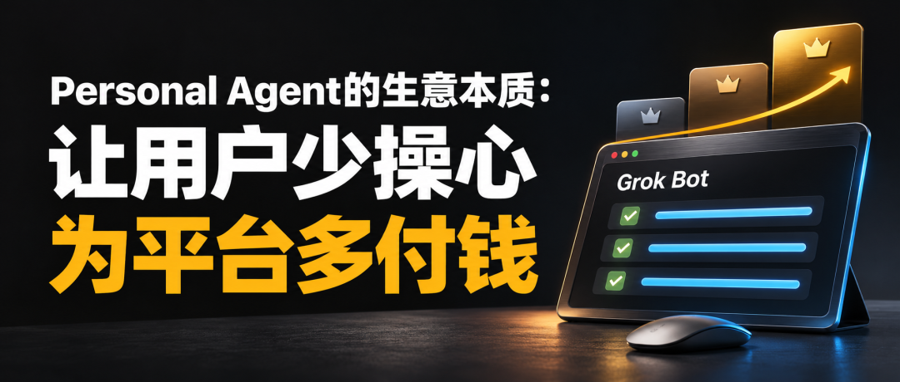



**收录说明**：用户提供链接。原文在微信公众号，用浏览器的客户端标识直接下载页面，从 `#js_content` 抽取正文，图片地址取自 `data-src`。原文三个一级标题降为二级。删去文末作者介绍、往期文章列表与交流群引导。

**内容摘要**：多略功导的文章讨论用户的付费意愿与 Personal Agent 的成本能否算得过来，称据第三方追踪，Grok Bot 的日活从 9 月初不到 10 万增长到 10 月底超过 60 万。文章提出用户侧与平台侧的单位经济关系，并指出 Dots 放在 ChatGPT Pro 套餐、Grok Bot 从 X Premium 起提供，套餐从 30 美元升到 100 美元的 Super 约为 3.3 倍。作者判断 To B 更容易先在职责明确、任务重复、结果易验收的工作中跑通，并说自己团队用 Grok Bot 最多的是运营上的杂活。

**保留理由**：从单位经济和套餐升级角度分析 Personal Agent 的商业模式，附作者团队使用 Grok Bot 的简短经验。

---
最近，Personal Agent 越来越火。Grok Bot、Muse、Dots、Claude Duet，几家 AI 厂商都在往这个方向走。

需求在增长，但我更想讨论的是：用户愿意为这份便利付多少钱？厂商收到的钱，能不能覆盖提供便利的成本？

## 1️⃣ 从使用 AI，到把事情交给 AI

Agent 早就有了。大家为 AI 编程、生图、研究付费，已经很正常。Personal Agent 往前走了一步：它更贴近用户，持续理解你的目标，主动推进工作，需要你时再来找你。

Grok Bot 强调可以交付工作的 AI 同事；Meta 的 Muse 更贴近日常生活，帮用户处理购物、行程和生活事务；OpenAI 的 Dots 强调理解目标、持续工作；Claude Duet 则面向专业人士和小企业主，主动提醒、接手任务。

它们的共同方向，是减少用户亲自组织和推动工作的负担。你交代一件事，它自己调用工具、推进任务，你离开之后，它也可以继续做。

需求信号也很强。据第三方追踪，Grok Bot 的日活从9月初不到10万，增长到10月底超过60万。马斯克还特别强调，除了试用，它几乎没有免费层。

10月24日，他在 X 上说，智能体需求的增长速度，超过了他以往见过的任何增长。

用户开始愿意付钱，把事情交给 AI。但需求旺盛，还需要一套能持续运转的经济模型。

## 2️⃣ Personal Agent 的单位经济，应该怎么算？

所谓单位经济，说白了，就是平均每服务一个用户，收到的钱能不能盖住服务他的成本。

但 Personal Agent 的账，不能简单地单独拆出来。

没有它的时候，大家照样使用大模型、编程和生图工具。现在加上个人助理，它帮你安排步骤、调用能力、检查结果，让你少操心。用户购买的，仍然可能是同一个平台的订阅套餐。

所以，先看用户这边：

原有 AI 服务的价值 ＋ Personal Agent 的省心价值 ＞ 套餐总支出

原来的 AI 能力值得买，个人助理又替你省下一部分时间和精力，你就可能愿意买更贵的套餐。前提是它确实接得住任务，减少你的参与，而不是让你换一种方式继续盯着。

再看平台这边。都按每月、每位付费用户的平均值来算：

平均套餐收入 ＞ 平均 AI 能力使用成本 ＋ 平均 Personal Agent 新增运营成本

一笔是模型、工具等能力实际被使用的成本；另一笔是个人助理为了理解目标、协调步骤、主动推进而增加的成本。同一次调用，只计一次。

这里看的是一群用户的平均账。有些用户用得多，服务他们可能亏钱；有些用户用得少，就可能贡献更多毛利。按完整服务成本计算，整体平均下来收入大于成本，就是毛利为正。研发、获客和公司管理费用，则是下一层要算的账。

Grok Bot 就把这个矛盾摆到了台面上。马斯克承认，它的服务成本相对于收入，高得不可持续。

可以不为 Personal Agent 单独收费，但它必须给平台带来收入增量。

比如，ChatGPT 在个人订阅中把 Dots 放进 Pro 套餐。Grok Bot 则从 X Subscription 的 Premium 套餐开始提供，Super、Ultra 提供更大的使用额度。

如果个人助理体验足够好，用户开始习惯把工作交给它，就可能愿意升级套餐，获得这项功能，或者让它接走更多任务。

这种收入增长，往往是跳跃式的。ChatGPT 从每月20美元的 Plus 升到100美元的 Pro 100，同一个用户贡献的月收入变成原来的5倍；X Subscription 从30美元的 Premium 升到100美元的 Super，则变成约3.3倍。

更高的套餐，又会带来更多能力或更充足的额度，推动用户尝试平台里的其他功能。个人助理让这些能力更容易用起来，用户把更多工作放进平台，使用习惯和粘性也就逐渐形成。

Personal Agent 带来便利，便利推动升级，升级增加收入。只要平均收入盖得住平均服务成本，这个单位经济模型就有可能成立。

## 3️⃣ To C，还是 To B，哪里更容易成立？

沿着这两条公式往下看，关键就变成：什么场景里的“省心”，最值得用户付钱？

To C，是帮个人解决生活里的各种问题。我倾向于认为，英美市场更容易出现一些机会，因为服务入口分散，跨系统办事的体验不连贯。同一件事，可能需要在网站、App、邮件和电话之间来回推进。

个人助理把这些环节接起来，用户就能感受到便利。买它，有点像在亚马逊买一台除草机：原来要自己干的活，现在有东西替你干，节省时间和精力，价格合适就值得买。

这种付费意愿，可以体现为独立购买一项服务，也可以体现为升级一个套餐。低频的小便利未必撑得起持续付费，长期减轻负担、明确省钱的任务，更容易找到价格空间。

To B，则更接近一个数字员工、数字同事。

你交给它一类工作，它持续推进，主动汇报，需要判断时再找你。哪怕你在外面跑销售，它也能把事情往前推，你不用像 babysitter 一样反复照顾它。

它的交互关系，更接近一个可以委托的同事，而不是一台电脑这样的办公工具。

同事是你交代完活，他就自己去做，你不在的时候也继续做；电脑等办公工具，通常还需要你在旁边操作和推动。

这份价值，企业更容易算账：节省了多少工时，减少了多少管理负担，多完成了多少工作。如果还得有人全程检查、纠错，省下来的收益就会被吃回去。

所以，我更看好 To B 先在职责明确、任务重复、结果容易验收的工作里跑通。企业愿意为可靠交付付费，厂商也更容易控制执行成本。

To C 为生活便利买单，To B 为可靠委托买单。最终都要回答：它替用户省掉的操心，值不值那个价格？

-

我们目前用 Grok Bot 最多的，其实就是一些运营上的体力活、杂活，比如上传内容、处理视频相关的操作。它确实能帮我节省体力和精力，这个价值很直接。

但换到编程场景，我是否需要一个 Personal Agent 主动替我推进？还是自己打开 Claude Code、Cursor，和 AI 结对编程，边讨论、边判断、边修改？还真不一定。

先找出那些你想交出去、它又确实接得住的工作，再看它省下的时间和精力，值不值新增的支出。这可能比先买一个“全天候个人助理”，更容易找到答案。🔚
