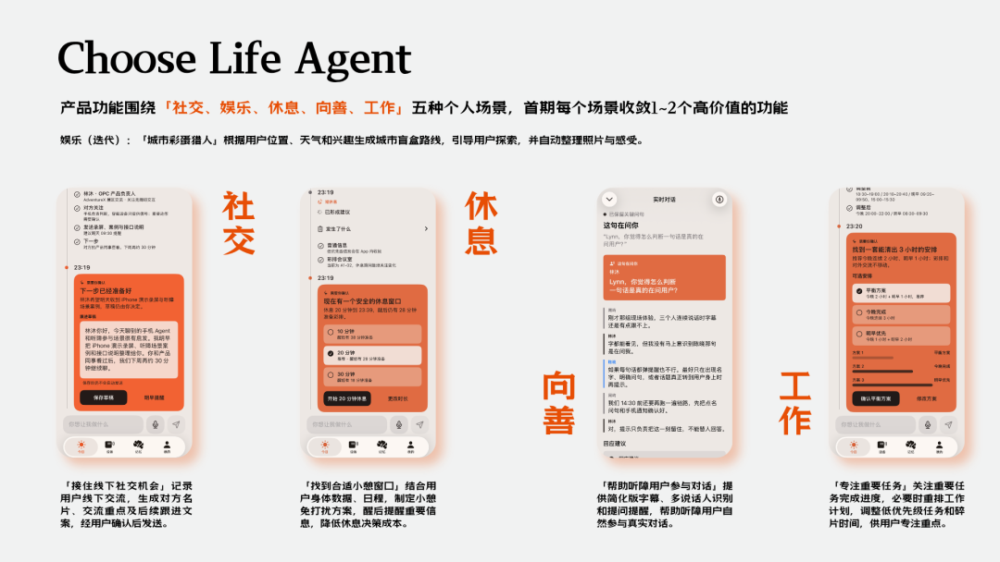
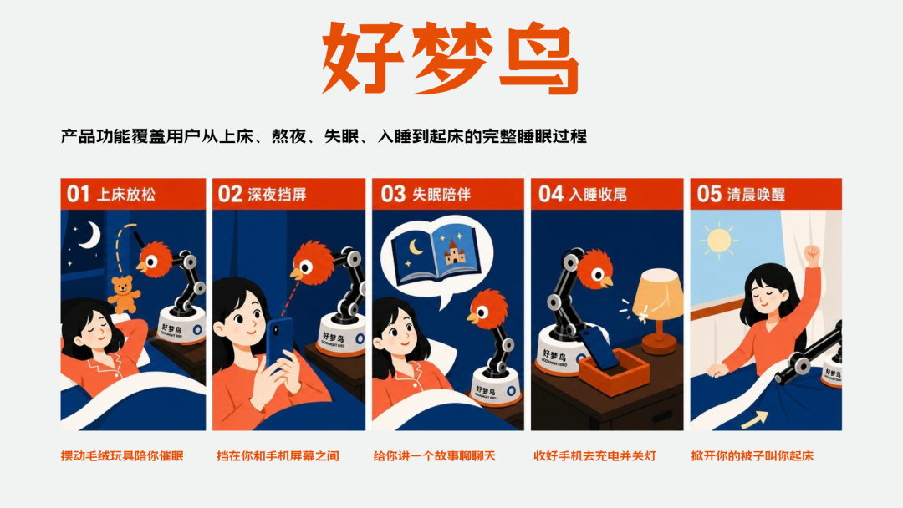



**收录说明**：用户提供链接。原文在微信公众号，用浏览器的客户端标识直接下载页面，从 `#js_content` 抽取正文，图片地址取自 `data-src`。个人公众号，作者回顾自己的黑客松作品，作品不是跟踪产品。原文四个一级标题降为二级；文末作者的交流邀请照录。

**内容摘要**：蒙莱特的文章回顾作者 7 月在 AdventureX 黑客松做的 Choose Life Agent，定义为「帮助用户更好生活的主动式Agent」，把耳机、手表、戒指、眼镜作为感知用户状态的设备。8 月作者在 SheNicest 黑客松做了具身睡眠 Agent「好梦鸟」，接入机械臂、云台相机和传感器。作者认为硬件应提供纯软件难以提供的价值，并承认比赛 Demo 距离真正可用、可靠的用户产品还有非常大的差距。

**保留理由**：硬件出身的创业者在 Personal Agent 走热前的相近尝试，记录了主动式 Agent 与穿戴、具身硬件结合的思路；篇幅短，属个人经历。

---
近期Personal Agent的爆发，我的第一感觉是熟悉

回头来看，自己在7月就做过相近概念的产品

市场讨论的很多策略和问题，也都反复琢磨过

## 1、Choose Life Agent

7月参加AdventureX黑客松，我做了一个叫Choose Life Agent的产品，成绩蛮不错，得了赛道第一名

当时没有Personal Agent概念，我给它的定义是：帮助用户更好生活的主动式Agent

围绕社交、娱乐、休息、向善、工作五种个人场景，分别设计了一些功能

因为自己做硬件出身，很自然地结合了穿戴设备；我把耳机、手表、戒指、眼镜作为Agent的感知器官，让它听你所听、看你所看、感你所感

这样Agent就不必被动等你提问，而能主动理解你在做什么、状态怎么样、需要什么，给出方案并执行

我总结产品的三个特点是：帮助用户更好生活、主动执行、跨端互联

## 2、好梦鸟

8月我开始思考，做通用Agent很难避免和大厂正面竞争；对于创业团队，需要收敛到足够垂直的场景+硬件

于是在8月SheNicest黑客松又做了一次收敛实验，产品叫好梦鸟，也得了大众投票第一名

这次我把它定义为：会伸手照顾人、有性格的具身睡眠Agent

我接入了机械臂、云台相机和传感器，围绕从上床到起床的睡眠全过程，设计了一些好玩的功能

会伸手照顾人，是让Choose Life Agent通过机械臂拥有自己的手脚，便能对用户所在的物理世界产生实际影响

有性格，是通过毛绒外观、身体动作、灯光效果与软件交互方式，让机械臂不再是一个冰冷的工业品

做好梦鸟时，有几个很强烈的感受：

我们不缺睡眠建议，缺的是意志力失效时，能帮自己打破惯性、推动执行的外部力量

睡眠只是一个切入口，生活中有无数个“知道该做，却缺少行动力”的时刻

产品能在合适的时机完成行动，就有机会从一个回答问题的工具，变成真正的生活帮手

## 3、继续前进

9、10月，我接触了很多AI硬件创业项目，也更系统地思考Personal Agent与智能硬件的结合方式

其中一个明确的点是：硬件不应只是Agent的实体外壳，而应该提供纯软件难以提供的独特价值

比如感知真实世界的信息，让人与AI的交互更加便捷，或者通过物理交互创造新的体验

## 4、回到现在

近期各种Personal Agent的爆发，回头来看，自己在7月就做过相近概念的产品

当然一个比赛Demo，距离真正可用、可靠的用户产品，还有非常大的差距

长记忆、主动性、工具调用、推理成本与延迟···大量工程化的点需要解决

但我还是挺开心的

从7月的主动式生活Agent，到8月的具身睡眠Agent，再到近期对软硬件结合的深入探索，背后我的产品判断一直是连贯的

我现在感兴趣的，就是让AI真正进入我们的日常生活，帮助越来越多的人们

过去几年我一直在做智能穿戴产品，现在正在做智能硬件与Personal Agent结合的创业项目

如果你也在做Personal Agent、智能硬件或者具身智能，欢迎找我交流
