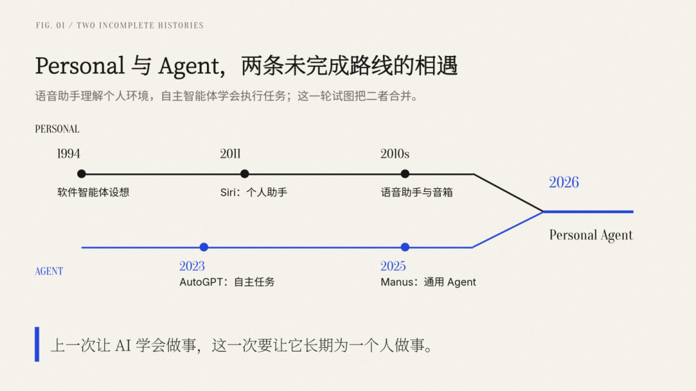



**收录说明**：用户提供链接。原文在微信公众号，用浏览器的客户端标识直接下载页面，从 `#js_content` 抽取正文，图片地址取自 `data-src`。原文用一级标题作小节标题，删去空标题行后降为二级。

**内容摘要**：西奥不是费勒斯的文章从 1994 年 MIT 的研究、2011 年 Siri 讲起，认为这一轮 Personal Agent 是「有 Personal 缺 Agent」的语音助手与「有 Agent 缺 Personal」的自主智能体两条路线的相遇。文章归纳行动能力、上下文组织、现实世界接口三道门槛同时下降，认为记忆不是壁垒，用户的「托付史」才是可积累的资产。文中引千问获得 70 元现金赔偿的案例，并注明这是企业自述的个案；最后提出任务完成率、服务成本、互联网服务是否开放三个可被推翻的前提。

**保留理由**：对「为什么是现在」、记忆与托付、代理冲突有自己论证框架的独立分析。

---

今天开始我们讲个故事：1994 年，MIT 媒体实验室的 Pattie Maes 写下《Agents that Reduce Work and Information Overload》，讨论如何让软件智能体帮助人筛选信息、分担工作。

2011 年，Siri 随 iPhone 4S 发布，苹果把它称为“只要你开口，就能帮你完成任务的智能助手”

此后的语音助手、智能音箱、聊天机器人，再到 2023 年的 AutoGPT 和 2025 年的 Manus，都在反复兑现同一个愿景：人只需要表达目标，机器负责完成剩下的步骤。

所以，Personal Agent 当然不是一个新概念。真正值得追问的是，为什么一个被讲了三十多年、也失望过许多次的概念，偏偏在此刻重新成为行业中心？

一个简单回答是“模型更强了”。这句话没有错，却解释得不够。模型变强可以解释 Agent 为什么更能做事，却不能单独解释它为什么必须变得 Personal，更不能解释大厂和创业公司为什么同时把长期记忆、个人上下文与主动服务放到产品中心。

躺在床上想了好久，我个人认为，这一轮热潮更像是两条未完成的技术路线终于相遇：

语音助手时代有 Personal，却没有足够的 Agent；上一轮自主智能体浪潮有 Agent，却没有真正的 Personal。

今天发生的变化，是二者开始被装进同一个产品。

---

## 上一次浪潮，缺的不是一个聊天框？

早期语音助手已经拥有不少“个人”条件。它住在手机里，知道你的联系人、位置和日程，也能替你设定提醒、发送短信。但这些能力大多建立在明确的指令和预先设计的功能上。你可以让它“到家后提醒我给妈妈打电话”，却很难把“帮我安排一次适合全家人的旅行”完整地交给它。

它认识用户，却只能理解一小部分世界。

2023 年前后的自主 Agent 浪潮走了另一条路。AutoGPT 让人们看到，语言模型可以把目标拆成任务，调用搜索和代码工具，再根据结果继续规划。

到了 Manus，模型、浏览器、工具和任务流程被进一步组织成普通用户能够理解的产品。

但这类产品仍然主要以“任务”为单位。你交付一份调研、一次分析或一个网站，它尝试完成，然后结束。它可能知道怎样做好一件事，却不知道这件事为什么对你重要，也不知道完成之后，下一件事是什么。

换句话说，上一轮 Agent 拥有行动能力，却缺少一条连续的个人时间线。

这也是今天 Personal Agent 与 Deep Research、通用任务 Agent 的真正分野。区别不在于回答里有没有出现你的姓名，也不在于系统是否保存了几条“喜欢咖啡”“正在健身”的偏好，而在于它能否把此刻的任务放进你过去的目标、约束和经历之中。

同样一句“帮我看看这家公司”，对准备买入的人、已经持有的人和正在考虑加入这家公司的人，意味着三项不同任务。通用 Agent 研究公司，Personal Agent 则必须先理解：你为什么问。

图 1｜Personal 与 Agent，两条未完成技术路线的相遇。

## 为什么是现在：三道门槛同时下降了

阿里的蒋冠军在千问的访谈中，把 Personal Agent 的条件归纳为模型、个性化数据，以及生态工具和服务体系。

这个来自产品一线的划分，也解释了为什么这一轮复兴不是由某一次模型发布单独触发的。

第一道门槛是行动能力。推理、代码和工具调用结合以后，模型不再只生成答案，而可以操作浏览器、读取文件、运行程序，并在失败后调整路径。Agent 开始从一段提示词，变成一个能够持续执行任务的系统。

第二道门槛是上下文的组织方式。更长的上下文窗口并不意味着把用户的全部历史一股脑塞进模型。真正有用的是筛选、压缩、更新和召回：哪些信息值得长期保存，哪些只在今天有效，哪些不应出现在另一个场景里。记忆由此不再是简单的数据库存储，而成为任务系统的一部分。

第三道门槛是现实世界的接口。订机票、申请理赔、管理慢性病，都不是生成一段文字就算完成。系统需要连接航空公司、支付工具、专业知识库和客服流程，还要处理授权、确认与撤销。模型能够规划，只说明它知道应该做什么；生态能否提供可靠工具，才决定它是否真的做得到。

这三项条件并没有突然成熟。更准确地说，它们刚刚成熟到足以让产品把下一阶段的形态摆到用户面前，再通过真实使用补齐能力。

因此，今天的产品热与交付能力之间存在一段故意的时差。Personal Agent 仍然可能不稳定，但开发者已经无法只靠内部测试想象真实需求。用户会怎样描述一个模糊目标，会在哪一步失去耐心，会因为什么错误不再回来；

只有把这些半成品放进真实生活，才可能知道。

## 另一股推力：应用需要离开基模的“卵壳”

技术条件解释了 Personal Agent 为什么变得可行，商业处境则解释了它为什么迅速变热。

过去几年的 AI 应用一直面临同一个不安：

如果产品的能力主要来自底层模型，那么模型升级之后，应用究竟留下了什么？界面、提示词和任务编排当然有价值，但其中一部分只是对当前模型短板的临时补偿。模型补上短板，这些工程就可能迅速折旧。

我们在讨论创业机会时，把 Personal Agent 的吸引力概括为“价值和竞争力可以长在基模之外”：长期积累的个人上下文、用户理解和信任关系，可能成为应用自己的资产。

这也是“Personal”受到重视的一层隐秘原因。它不仅承诺更好的用户体验，也提供了一种新的创业叙事：应用不再只是模型能力的分销商，而可以在服务一个人的过程中，逐渐形成自己的交付能力。

大厂同样有自己的账。用户在一个长期助手那里留下的不只是点击记录，还包括如何描述目标、怎样拆分任务、何时修改方案、在哪一步放弃。这些真实执行轨迹，既能改进产品，也能成为后训练的反馈。千问所说的“从真实需求反推能力”，正是这种循环的一种实现：先梳理用户需求，再拆解能力缺口，最后在真实工具环境中提高稳定性。

所以，Personal Agent 的复兴既来自用户需求，也来自供给方的共同焦虑。模型公司需要真实任务，应用公司需要可积累的资产，平台则希望成为用户与现实服务之间的新接口。

三方在同一个词上相遇，并不意味着他们想要的是同一个未来。

## 记忆不是壁垒，托付史才是

一旦“个人数据”被视为资产，产品很容易走向一个旧习惯：尽可能多地收集，尽可能深地绑定，再把迁移成本称为用户忠诚度。

但 Personal Agent 未必适合这套互联网逻辑。

记住用户，不等于理解用户。

一个人半年前说要跑马拉松，不代表他今天吃烧烤时，需要助手跳出来提醒卡路里；用户询问某种疾病，也不意味着他希望以后每次聊天都被当作病人。记忆的价值不只取决于召回准确率，还取决于是否知道何时不该使用。

真正能够积累的，也不是一堆静态资料，

而是一段可以被验证的“托付史”：

上一次交代的事情有没有办好，不确定时有没有追问，涉及支付时有没有停下来确认，用户改变主意以后，系统有没有更新。

千问的员工之前提到一个航班延误理赔案例：客服最初提供代金券，但用户要求现金，Agent 没有把代金券当作任务完成，而是继续寻找路径，最终帮助用户获得 70 元现金赔偿。这是企业自述的个案，不能证明通用能力；它有意义的地方，是展示了 Personal Agent 的一种基本动作——围绕用户的真实目标保持任务，而不是尽快给出一个形式上的结果。

信任就在这些细小结果里形成。它不是产品宣称“我们是伙伴”之后便自动获得的关系，而是用户一次次交付小事、检查结果，再决定是否交出更大权限的过程。

这也给创业公司留下一条不同于通用入口的路径：

不必一开始就理解一个人的全部生活，

可以先在一类高价值、反复发生、结果能够验证的事情上，建立足够可靠的托付史。健康、财务、个人成长都有可能，但它们对专业性、隐私和错误成本的要求，也远高于普通效率工具。

图 2｜信任不来自保存了多少资料，而来自一次次可验证的交付。

---

## 当助手开始替你行动，谁为它付费就变得重要

Personal Agent 最难的问题，可能还不是技术，而是代理关系本身。

一个能为你搜索、比较、下单和交涉的系统，天然会影响你的选择。它越了解你的偏好、焦虑和支付能力，就越能有效地帮助你；同样的能力，也可以用来更有效地向你推销。

如果产品靠订阅收费，它至少有一条相对清楚的理由去节省用户的钱和时间。如果它从交易中抽佣，或者由拥有电商、本地生活和广告体系的平台提供，那么“忠于用户”就需要接受更具体的检查：

它推荐的是最适合你的服务，还是平台最希望你购买的服务？它会为了完成任务而减少你的选择吗？又是否会以主动服务为名，不断提高你消费的频率？

这不是大厂独有的道德瑕疵，而是 Personal Agent 商业模式必须回答的代理冲突。人类助理、理财顾问和房产经纪人也面临类似问题，只是软件把这种冲突放大到了更高频、更隐蔽、更难审计的日常决策中。

因此，权限设计不能只是一道安全功能。用户能否查看 Agent 使用了什么信息、为什么推荐某个方案、代表自己说过什么，以及能否撤回授权，决定了它究竟是一个受雇于人的助理，还是一位比你更了解你自己的销售员。

图 3｜代理关系不只是权限问题，也是商业模式问题。

---

## 这一次，真正不同的是什么

Personal Agent 的复兴，不是因为旧愿景终于找到了一个更时髦的名字，也不是因为长期记忆让聊天机器人突然拥有了灵魂。

真正的变化是；产品竞争的单位开始从一次回答、一次任务，转向一个人在时间中的连续需求。

模型负责推理，Harness 负责组织上下文、工具和权限，生态负责把行动接入现实，而用户通过一次次交付，决定这个系统是否值得继续了解他。

但这套判断仍然有三个可以被推翻的前提：任务完成率能否稳定到足以形成信任；服务成本能否降到用户价值之下；互联网服务是否愿意向跨平台、受用户控制的 Agent 开放。如果这三点没有改善，Personal Agent 仍可能只是一轮更精致的演示。

2011 年，Siri 的承诺是“只要你开口”。今天的问题已经变成了：当你不再开口，它是否知道该怎样继续，何时应该停下，以及什么时候必须把决定还给你。

这才是一个助手从能办事，走向真正 Personal 的距离。
