

**收录说明**：用户提供链接。原文在微信公众号，用浏览器的客户端标识直接下载页面，从 `#js_content` 抽取正文，图片地址取自 `data-src`。删去文首的公众号横幅图片和文末的关注引导。

**内容摘要**：AI问消的文章把 agent 分为网页型、coding/working、广义 personal（OpenClaw、Hermes）和本体跑在云端的狭义 personal agent，并逐个介绍 Muse、Grok Bot、Dots、Cue。文中称 Muse 9 月 8 日上线、免费起步、仅限北美；Grok Bot 上线两个月全球下载 220 万+、周付费用户 80 万；每个 dot 有自己的云端电脑和浏览器，能接 4000 多个应用；Cue 仍为邀请制内测。文末给出选购建议：想零成本试水选 Muse，嫌注册、支付麻烦选 Grok Bot，担心数据和模型绑定选 OpenClaw 或 Hermes。

**保留理由**：入门科普，给出四款产品的价格门槛与选购对照，夹有作者使用 Muse 的个人经历；文中数字未给出处。

---
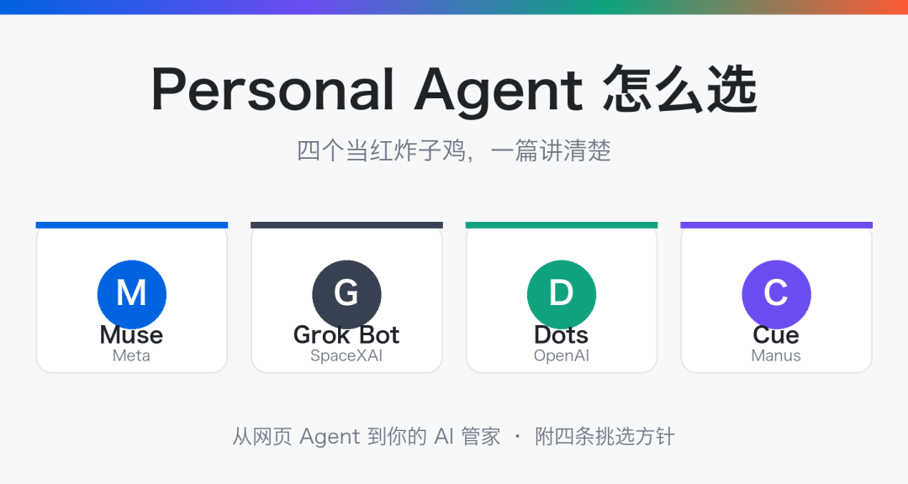

最近不管刷哪个平台，都在被 Muse 刷屏。朋友圈里有人晒邀请码，群里有人问怎么注册，好像一夜之间，人人都多了一个住在云端、24 小时待命的 AI 管家。

Muse、Grok Bot、Dots、Cue，这四个新东西现在被叫做 personal agent。它们跟你天天在用的 Codex、WorkBuddy、Claude Code 到底是什么关系？是全新物种，还是换了个马甲的老朋友？这篇文章把 agent 的家谱捋清楚，看完你就知道，该把时间、订阅费该花在哪个上面。

一、先把家谱捋清楚

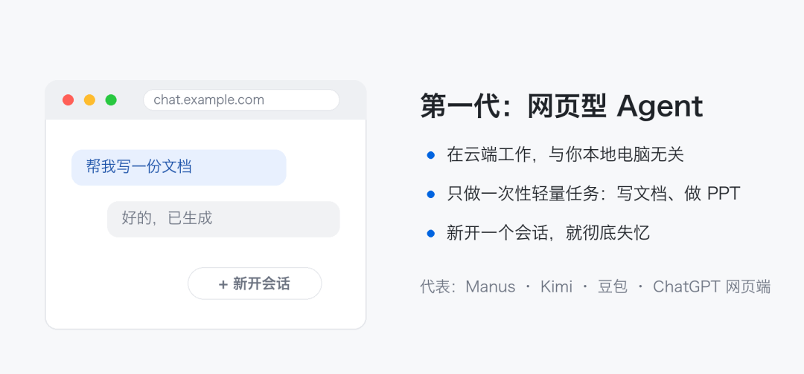

最早的一批叫网页型 agent，最具代表的是 Manus。2025 年 Manus 一夜爆火之后，Kimi、豆包、ChatGPT 的网页端全都跟进了。多说一句，这些名字里有很多你以为是"模型"，其实是模型厂商自己做的网页端应用。

网页 agent 干活在云端，跟你本地电脑几乎没关系。它擅长一次性的轻量任务：写个文档、做个 PPT、生成一个小程序，都还可以。但它有个致命短板：没有连续性。你新开一个会话，它就彻底失忆，之前你跟它说过什么、一起做过什么，一概不知。

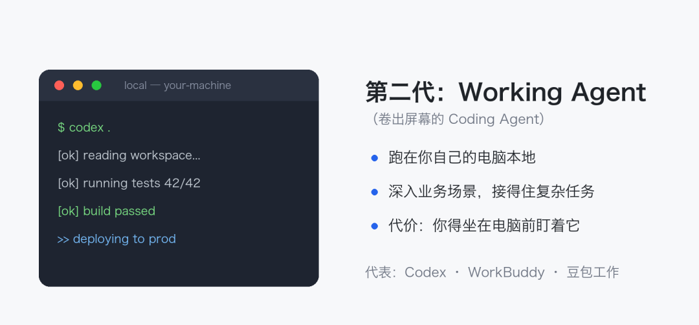

然后是 coding agent。顾名思义，为写代码而生，Codex、Claude Code 都是这一代。但它们的活儿越揽越多，早就不止写代码了，所以我擅自给它改了个名字：working agent。其中WorkBuddy、豆包工作，都算这一类。

working agent 跑在你自己的电脑上，能扎进你的业务场景，接复杂任务。代价是：太重。你得坐在电脑跟前，一直陪着它，聊着，盯着。

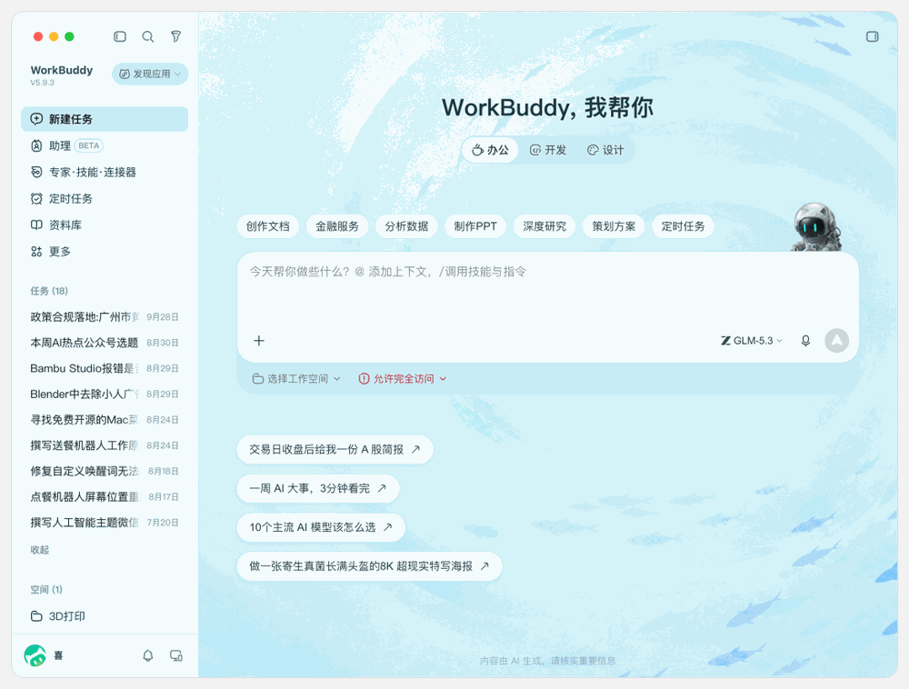

于是有了下一个定位。官方没给专有名词，我们管它叫广义 personal agent：先是大名鼎鼎的"龙虾" OpenClaw，后是大名鼎鼎的"马" Hermes。

它们也跑在你本地，但刚出场时有两个 working agent 没有的能力。一是打通即时通讯：在你平时用的聊天软件里发条消息，它就开始干活。二是定时任务：到点自动注入提示词，自己开工。

这两个能力太香，香到 working agent 全都补了课——移动端 App 出了，定时功能也上了。两边能力越靠越近，现在很多人不怎么提 OpenClaw，也是这个原因：这些场景“Codex们”也能做到了，差别不大。剩下的主要是分工：生活上的事交给它，重要的工作还是放在 working agent 上做。

但广义 personal agent 有个绕不过去的痛点：它住在你电脑里。你得专门准备一台永不关机的电脑——电脑一关，"personal"这个属性就没了，它还怎么长时间替你干活？

于是厂商端出了狭义 personal agent。名字是它们自己起的，跟 OpenClaw、Hermes 的区别其实就一条：本体跑在云端。每个用户分到一台独立的、长期开机的云端电脑，你可以自己登进去装软件、登账号，agent 跟你共用这台机器。它既像网页 agent 一样不依赖你的电脑开机，又能装客户端去操作你的本地电脑——两头的好处都占了。

说白了，就是把已有的东西重新组合一下，再起个新名词。这也是 AI 时代一个常见现象：几个旧能力拼一拼，就是一个新概念，一轮新营销。

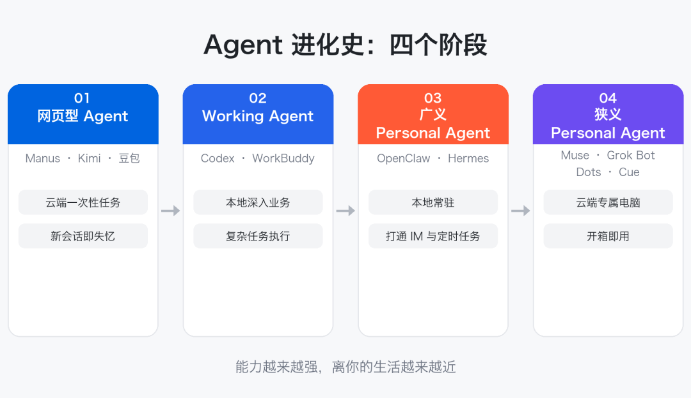

二、personal agent 和 working agent，差别就一个词

狭义和广义的区别，是电脑在云端还是本地。而 personal agent 和 working agent 的区别，就是一个词：自主性。

working agent 规则性强。你说一步它走一步，不越界、不发挥。这种性格特别适合切进业务里，写代码更是如此——你不希望你的 agent 在生产环境里"自我发挥"。

personal agent 自主性强，它会自己构思工作场景和工作方式。举个例子：我出去旅游前跟它说了句"我要开始减肥了"。我的 Muse 并没有立刻给我拉减肥计划，而是一直等我旅游回来，才提醒我：玩好了，该减肥了。

什么时候该干什么，它自己心里有数。这是这个品类最迷人的地方。

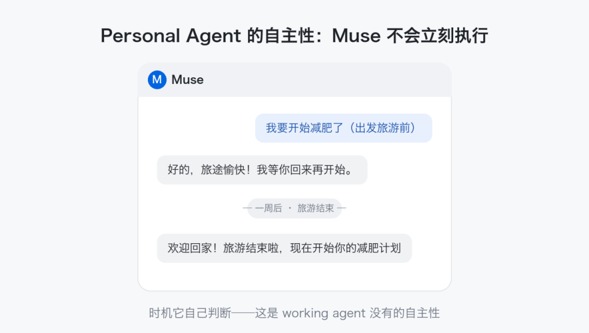

三、四个当红炸子鸡

1. Muse：Meta 憋出来的大招

Muse 是 Meta 出的，就是做 Facebook、Instagram 那家。Meta在 AI 时代憋了这么久，总算掏出了一个像样的产品：9 月 8 日上线，一个月用户破千万，十天冲上美区 App Store 榜首。

最大优势是免费起步。而且邀请码机制大方：注册后 48 小时内兑一个码，你和邀请人各得 10 亿 token。

模型是 Meta 自研的 Muse Spark，中规中矩——能用，但跟 Claude、GPT 的旗舰还有距离。硬伤一条：目前只对北美用户开放注册。想上车，等它开区，或者各凭本事。

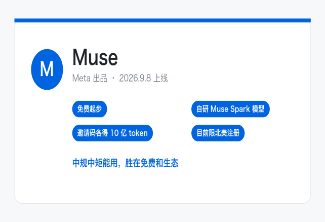

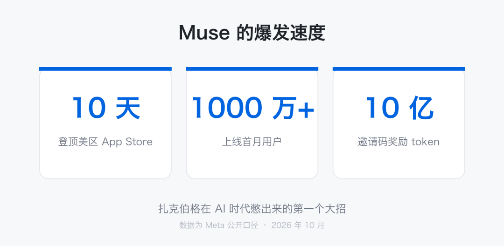

2. Grok Bot：马斯克的多面手

Grok Bot 出自马斯克家（xAI 并进 SpaceX 之后，现在对外叫 SpaceXAI）。它最大的特性是多 agent：上来就能建一堆 Bot，一个 Bot 管一个专属场景。最近被 Muse 冲了一下，又推出"主 Bot"——让主 Bot 主动发现活儿、主动接管。

马斯克对中国用户是真大方：没有注册地区限制，支付门槛也低。这四个里面，它的入场费最低，订阅最低一档 30 刀（更早 20 刀的档位也能用上，官方还预告了一个 8 刀的新套餐）。

模型是自家的 Grok 4.7，能力中规中矩，赶不上旗舰，但云端机器的性能评分挺高。这笔账划算：等于订一个 agent，白送一台云端电脑，还能拿它干很多别的事。

发展也确实猛：上线两个月全球下载 220 万+，周付费用户 80 万，马斯克说这是"我这辈子见过增长最快的产品"。

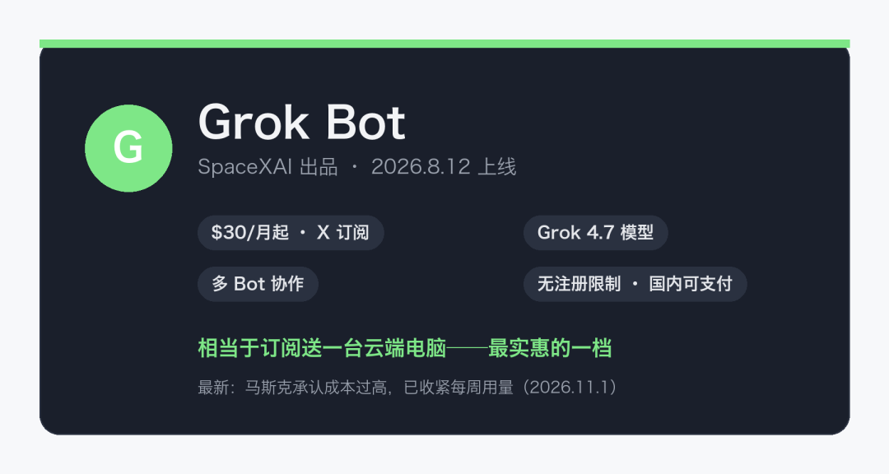

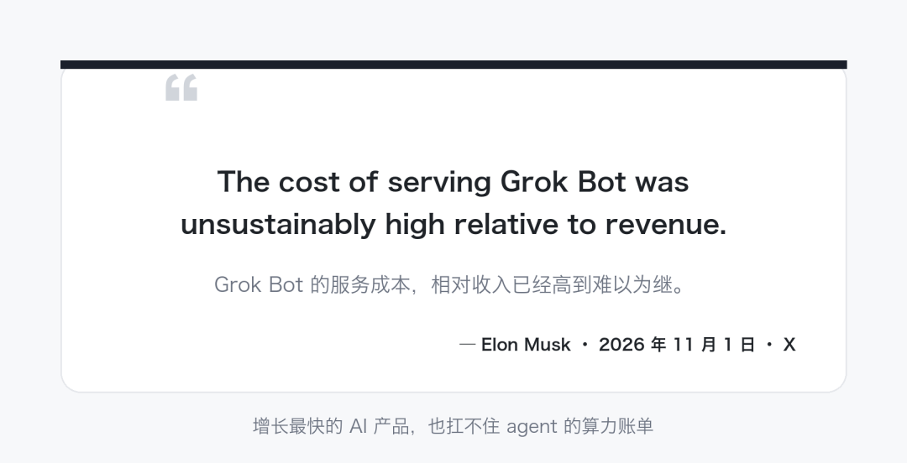

3. Dots

Dots 是 OpenAI 9 月底 DevDay 上发布的。入场价最贵：ChatGPT Pro 起步，100 刀一个月，20 刀的 Plus 用户连门都摸不到。

给的东西也确实硬：模型直接上 GPT-6 Astra，当下数一数二；每个 dot 有自己的云端电脑和浏览器，能接 4000 多个应用；在 ChatGPT、Slack、iMessage 里都能使唤它。官方讲过一个例子：一个早期用户的 dot 发现他忘了给某家媒体寄发票，自己把发票拟好，经他确认后发了出去。

但这里必须吐槽几句。OpenAI 现在的问题是啥都想做：ChatGPT 的 Chat 模式、Work 模式（也就是 Codex 那套），现在又来一个 Dots。三者独立，功能又没完全打通，用起来割裂。比如让 Dots 指派任务，还要去本地再建一个会话，限制一堆，膈应人。好消息是 OpenAI 自己也认了这个账，说 Chat 和 Work"很快"合并。

顺带一提：OpenClaw 的作者现在就在 OpenAI。所以 Dots 身上有几分龙虾的影子，一点也不奇怪。

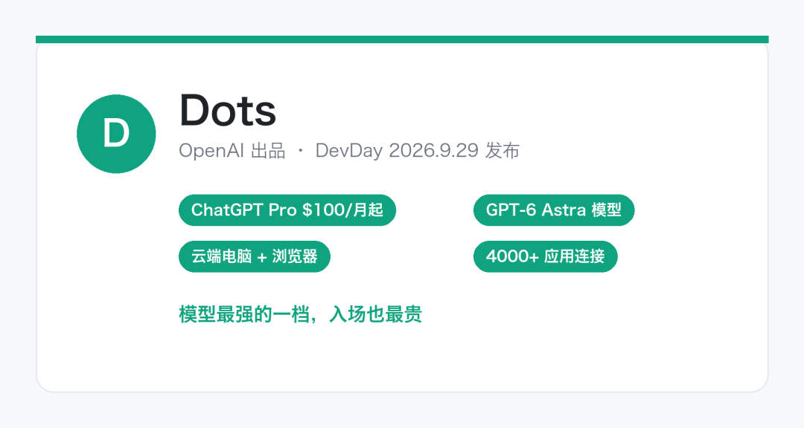

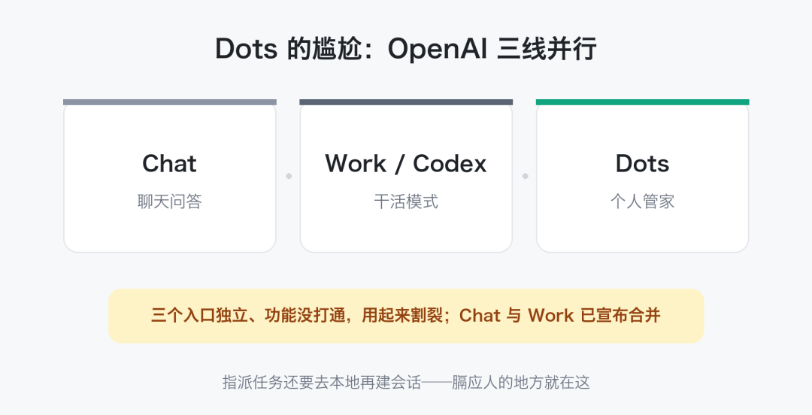

4. Cue：Manus 的绝地反击

Cue 还在邀请制内测阶段。就是 2025 年那个一夜成名的 Manus，传闻被 Meta 看上，收购谈到一半黄了，回来憋了个 Cue。

Cue 的玩法比前面三个都激进：每个 agent 有自己的邮箱、电话号码、钱包和电脑。它能以自己的名义收发消息、在你设的预算内付款、替你接电话然后留个摘要，多个 agent 还能拉群协作。到餐厅扫个码，它替你点餐排号。

目前公开信息很少，模型用的谁家的没说，定价也没定。机器性能大家自己看，可以期待。

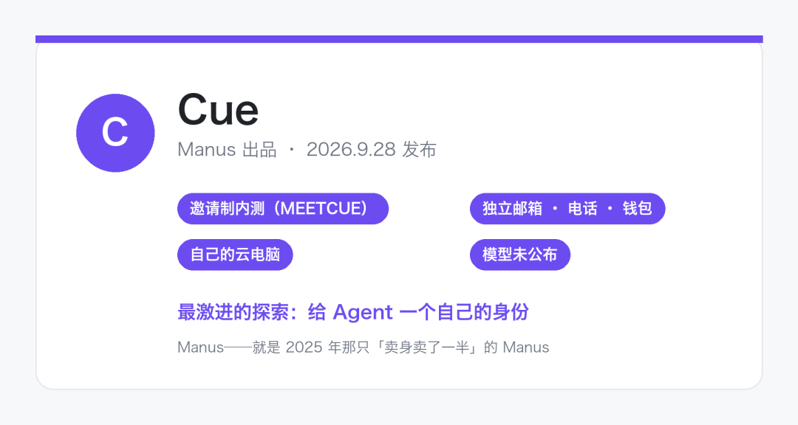

这四个，是目前国际上声量最大的狭义 personal agent。

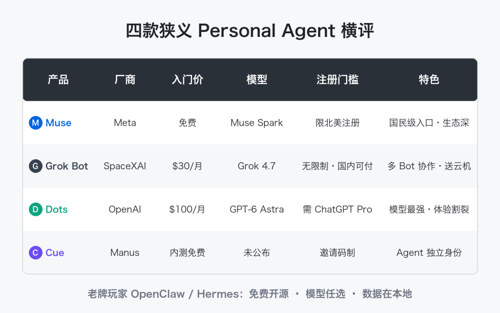

四、国产玩家在路上

现在正是窗口期，国内厂商都在奋起直追。

Muse 在海外为什么火？核心不是模型多强，而是生态绑得深：Instagram、Facebook、各种支付软件，甚至苹果健康，全都打通了。国产 personal agent 一定也会有这一手——等哪天微信、支付宝、美团、高德被打通，就是它们起飞的那天。可以期待一下。

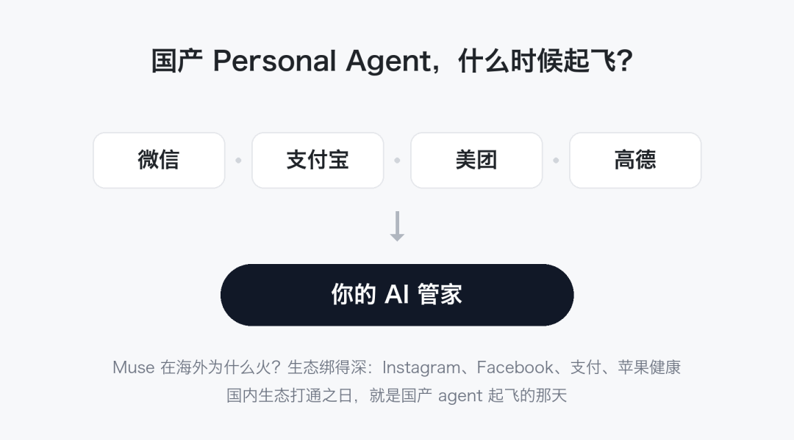

五、到底怎么选

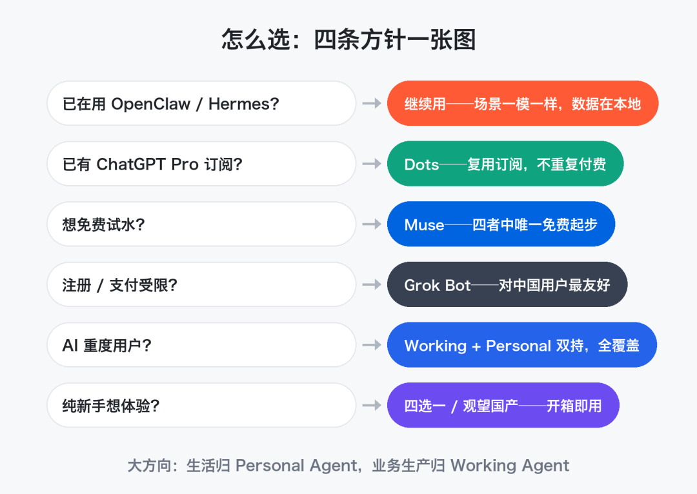

大方向两条：生活辅助场景，交给 personal agent；业务生产，尤其写代码，老老实实用 working agent——业务的事，我不放心交给 personal agent。

在这个前提下对号入座：

已经在用 OpenClaw 或 Hermes 的，没必要看 Muse 它们。能力、场景几乎一样，你的数据还在本地。唯一的要求，是那台不关机的电脑。

纯新手，想体验一下的：选那四个（或者观望国产），开箱即用。不用管部署，不用研究定时任务怎么设——你说一次，它自己就把定时任务设好了。

AI 重度用户：working agent 加 personal agent 双持，一个管生产一个管生活，全覆盖。

具体到四个产品怎么挑，四条方针：

已经有 ChatGPT Pro 订阅的，优先 Dots，订阅复用，不用重复付费。

想零成本试水的，选 Muse，四个里唯一免费起步的。

嫌注册麻烦、支付麻烦的，选 Grok Bot，对中国用户最友好。

担心数据绑定、模型绑定的，选 OpenClaw 或 Hermes。模型绑定这事很关键：Muse、Grok Bot 绑的是自家模型，万一哪天 GPT、Claude 大上台阶，拉开了差距，你想换换不了，数据还在人家手里，那就难受了。它俩模型随意切，数据在本地，没这个负担。

六、结语

这篇文章把 personal agent 的家谱和挑选方针都掰开揉碎讲完了。拿自己的情况往里套一套，该选哪个，答案自然就有了。
