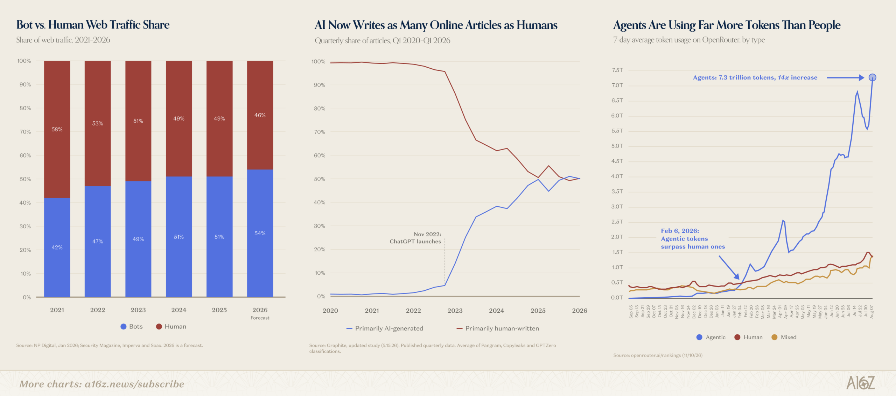
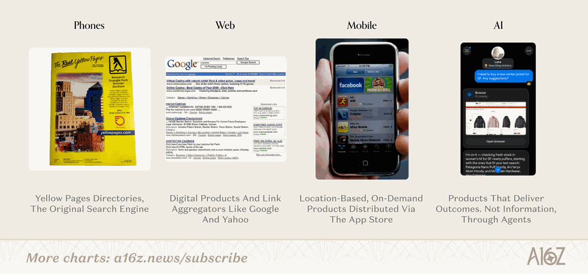
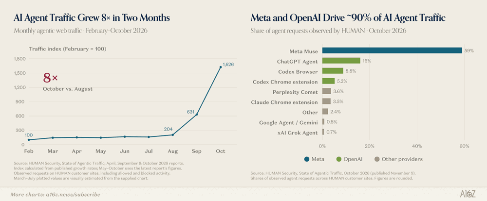
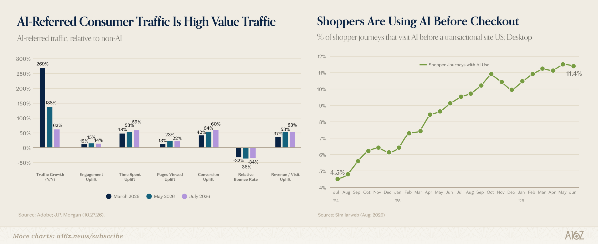
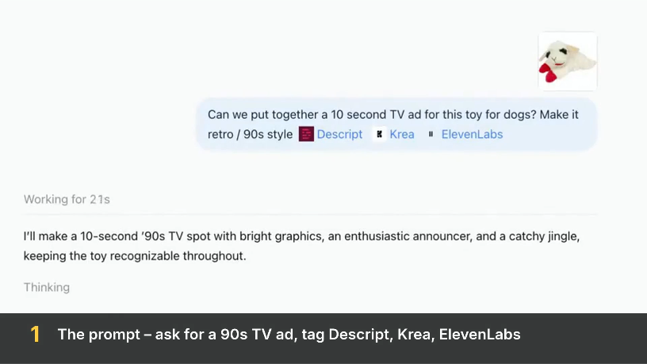
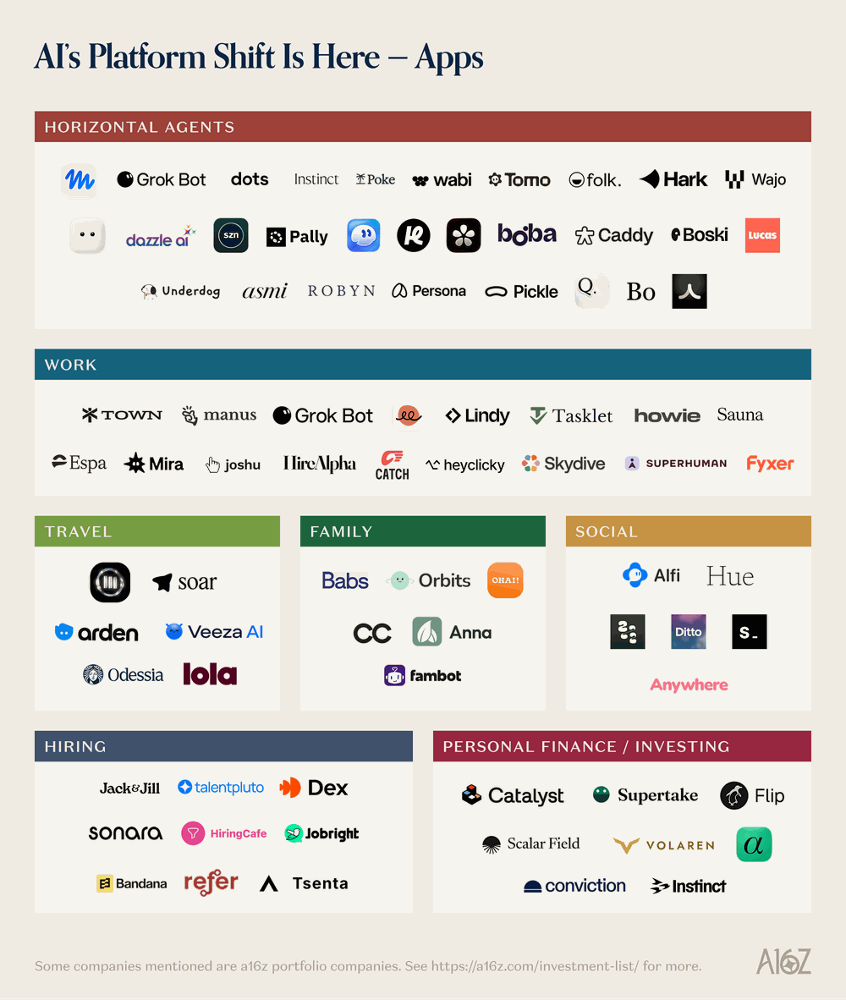
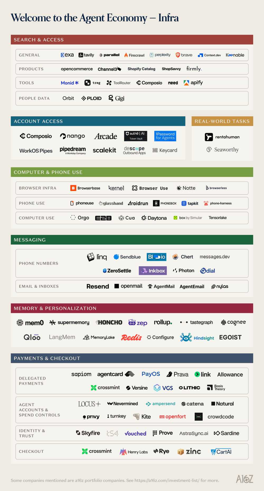



**收录说明**：直接下载后以 main.wr25-main 抽取；已删去文首标题/作者/分享区块与文末作者简介、推荐文章、法律声明等站内元素；文内 7 张图表已本地化到 images/；原文全文存于本目录的 original.md，网站上不显示，已翻译。文中“智能体已占互联网流量多数”等标题性说法与所附图表口径存在出入（据 PPC Land 与 i10x 的核对，流量多数一图统计的是全部机器人流量；a16z 自身声明未独立核实第三方数据），此处照录原文，不作定论。

**内容摘要**：文章提出 B2A（business-to-agent）论点：互联网的主要使用者已不再是人类，智能体已占互联网流量多数、新发表文章过半由其撰写、多数上线代码由其生成；随着智能体从回答问题转向替用户完成任务，它们将决定使用哪些产品与服务并代为花钱，把智能体视为一等客户的企业可能迎来一波增长。数据方面，Human Security 观测到 8 月至 10 月智能体浏览器流量增长 8 倍，其中 Muse 占约 60%，OpenAI 产品合计约 30%；Shopify 称 2026 年第一季度 AI 驱动流量同比增长 8 倍，AI 搜索带来的订单增长近 13 倍。文章列出四类受益者：智能体与智能体模型、因智能体而新出现的产品、为智能体优化的既有企业、智能体基础设施。编码智能体是文中给出的一个案例：截至 2026 年 9 月，40% 的 GitHub PR 源自智能体草稿，六个月前为 17%。该文为探索智能体经济的系列首篇，后续将发布消费者智能体使用情况、智能体如何决定流量去向、基础设施发展与交易完成障碍等方面的内容。

**保留理由**：本库已收 allthingsmuse 的 HUMAN 59% 十月报告，这篇给出 HUMAN 8 月至 10 月 8 倍增长与 Muse 约 60%、OpenAI 合计约 30% 的口径，以及 Shopify 流量 8 倍、订单近 13 倍的数据，并提出 B2A 框架与四类受益者划分。

---

互联网的主要使用者不再是人类。它们是 AI agent。

如今 agent 已占网络流量的大多数，撰写了网上新发表文章的一半以上，并生成了推送到生产环境的大部分代码。

这就是平台转移早期阶段的样子：采用情况是可以测量的，但它所催生的商业模式大多还看不见。此前每一次转移都同时改变了人们能做什么，以及企业如何触达他们。Web 给了企业一个谁都能访问的店面；移动把那个店面放进了每个人的口袋。AI 已经改变了人们能做什么，但它对分发方式的改造才刚刚开始。

随着 agent 从回答问题转向完成任务，它们会越来越多地决定用哪些产品、订阅哪些服务，以及代表我们把钱花在哪里。

把 agent 当作一等客户的企业，有机会迎来一波增长。不这样做的企业，可能会发现自己受到威胁。多年来，零售商和平台筑墙把 bot 挡在外面——现在，它们将不得不为 bot 的生意而竞争。

如果 agent 能真正走向大众消费者并获得真实使用量，它们将释放 AI 最大的未实现机会：一次真正的平台转移。此前每一次平台转移（web、移动）都把一种新的产品能力与一种新的分发机制配成一对。AI 在第一个方面超额完成，在第二个方面表现不足，这也是消费者采用在 ChatGPT 之外一直如此有限的重要原因。

分发转移的早期迹象已经出现。ChatGPT、Claude 和 Grok 这类 LLM 已是许多企业庞大而有价值的流量来源。[Shopify 报告称](https://www.shopify.com/blog/how-agentic-commerce-works)，2026 年第一季度流向其店铺的 AI 驱动流量同比增长八倍，而由 AI 搜索带来的订单增长近十三倍。而且还在加速：Human Security 观察到 8 月到 10 月间 agentic 浏览器流量增长 8 倍，其中 Muse 贡献了最大份额的活动（60%），OpenAI 的产品合计达到 30%。

就像网站能比广告牌更有效地触达用户，理论上 agent 应该是更强的推荐来源——因为它们掌握着关于用户及其需求的深入而具体的数据。到目前为止，这一点正被证明成立：AI 引荐的消费者流量参与度更高，转化为收入的效果更好，跳出率更低。即便在 agent 出现之前，估计美国有 11% 的购物旅程在进入交易网站之前先访问了 AI。

目前，这些流量大多通过浏览器使用实现——agent 要么接管用户的浏览器，要么启动自己的虚拟机和浏览器实例，像人一样点来点去完成任务。不过，我们开始看到相当于「agent 的应用商店」出现，只是加了料——连接器、插件和 MCP，让 agent 能更直接地访问第三方工具与网站。

举个例子——我们让 ChatGPT 用 Krea、Descript 和 Eleven Labs 插件制作并编辑一段视频广告。它在多个产品之间协调操作，还向我们追加推销了 Descript 的付费方案，才把视频做完。

随着底层平台允许用户把自己的身份或令牌「借」给其他产品来完成任务（例如「用 ChatGPT 登录」（Sign in with ChatGPT）），用 agent 注册或购买产品只会越来越容易。最终，agent 将能无需人工介入地挑选并安装自己需要的工具——Claude [已经允许](https://x.com/ClaudeDevs/status/2117680635561312732)企业管理员为整个组织连接插件。就在昨天，OpenAI [推出](https://openai.com/index/introducing-businesses-chatgpt/)了 ChatGPT 中的 Businesses——企业现在可以认领自己的商家页面、添加商品信息流，并查看用户在 ChatGPT 上如何与其互动的洞察。

有几类公司可能从 B2A（business-to-agent，企业面向 agent）经济中受益：

- **agent／agentic 模型** —— 多数人把「消费者 agent」想象成 Instinct、Muse、Wabi 这样的独立框架。我们相信，随着其背后的模型变得更以行动为导向，每个产品很快都会以 agentic 方式运作。ChatGPT（周活跃用户 12 亿）在这方面有一个格外引人遐想的机会。
- **因 agent 而新成为可能的产品** —— Amazon 需要互联网才能成立，Uber 没有手机就不可能存在。我们预计 agent 也会催生自己的例子。具体如何很难预测，但几个主题包括自运行的 SMB、由 AI 居间撮合的市场或网络型产品，以及自动优化器。
- **为 agent 做优化的既有企业** —— LLM 早已是许多网站的重要流量来源，这构成了[生成式引擎优化](https://a16z.com/geo-over-seo/)（generative engine optimization，GEO）行业的基础。GEO 大体止步于发现。agent 会把它推进到评估与执行购买／注册选择，那是一个更大的市场。
- **agent 基础设施** —— agent 要代表其主人于真实世界中运作，就需要自己的一套工具。在相当低的 agent 用量下，我们就已看到支付、欺诈与身份，以及通信（iMessage、电话、邮件等）方面的系统性紧张。

我们已经有一个关于这可能如何演变的案例研究——编码 agent，它彻底改变了开发者的行为。截至 2026 年 9 月，GitHub 上有[高达 40%](https://github.blog/news-insights/octoverse/octoverse-commits-pushes-reach-new-highs-in-2026-as-developers-build-with-agents/?utm_source=chatgpt.com) 的 PR 始于 agent 的草稿——而六个月前只有 17%。

与消费者 agent 一样，编码 agent 也必须依赖外部工具来完成任务。假设用户让 agent 建一个网站。完成这项工作可能需要数据库、托管、认证、邮件投递和监控。除了 agentic 模型与框架本身（Cursor、Codex、Claude Code、Cognition，以及 Replit、Lovable、Base44 这类 vibe coding 平台），许多其他参与者也在增长：

- Supabase 在 2026 年 6 月[报告](https://supabase.com/blog/supabase-series-f)，超过 60% 的新数据库由 AI 工具创建
- Neon 在 2025 年 5 月[报告](https://www.databricks.com/company/newsroom/press-releases/databricks-agrees-acquire-neon-help-developers-deliver-ai-systems)，自动化 agent 部署了其 80% 的新数据库
- Stripe 在 2026 年 6 月[报告](https://stripe.com/blog/stripe-projects-adds-new-agents-providers-developer-controls)，agent 占了其文档流量的近 40%、API 资源 CLI 请求的 70%
- Vercel 在 2026 年 10 月[报告](https://vercel.com/blog/vercel-ship-2026-recap)，由 agent 触发的部署在过去十二个月增长了 28 倍

全球劳动力中开发者不到 1%——当另外 99% 开始使用 agent 时，会发生什么？

这是探索 agent 经济的系列文章的第一篇。把它称为「AI 商业」低估了这个机会——是的，agent 会把交易量带给实体产品与服务。但它们也会重塑流量、token 和收入如何被导向数字产品。多数企业仍在因为欺诈与拒付的顾虑而封锁 agent 流量，但我们相信，它们将不得不拥抱这股越来越有价值的浪潮。

未来几周，我们会发布更多关于以下内容的洞察与数据：消费者 agent 的使用现在是什么样子、agent 如何决定把流量导向哪些网站与产品、围绕 agent 的基础设施如何发展，以及 agent 完成交易还面临哪些障碍。

这个领域每天都在变化——下面是目前我们对市场的最佳描绘。其中包括 agent 本身，以及让它们得以存在的基础设施。

