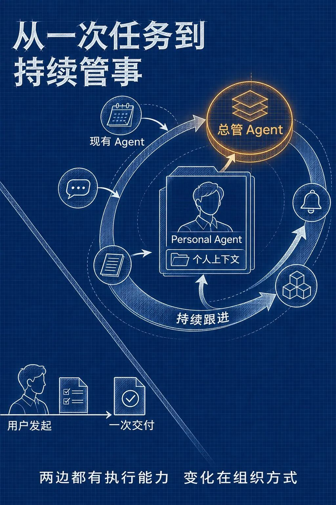
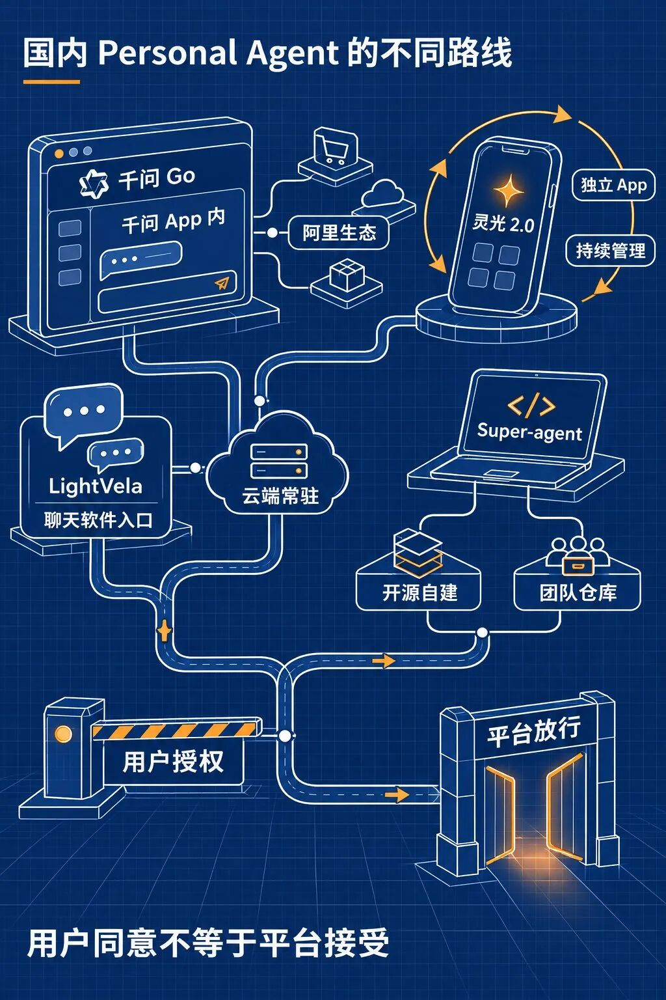
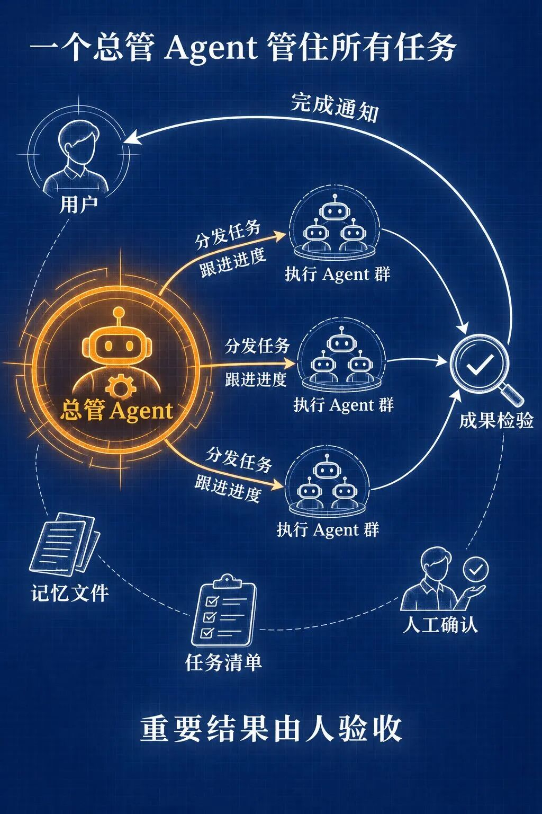



**收录说明**：用户提供链接。原文在微信公众号，用浏览器的客户端标识直接下载页面，从 `#js_content` 抽取正文，图片地址取自 `data-src`。文末参考资料列表照录。

**内容摘要**：潜在工作室Tech 的文章以千问 Go 内测用户争取到 70 元航班赔偿的案例引入（注明为媒体转述），给出 Personal Agent 的工作定义和判断标准。文章梳理国内路线：千问 Go（10 月 13 日开放体验申请）、蚂蚁灵光 2.0（10 月 27 日发布）、腾讯 LightVela（9 月 28 日上线）、DeepSeek Super-agent（MIT 许可的研究原型），并对照 xAI Grok Bot 与 OpenAI dots 的设计。文中核对了官方文档中的具体设置，如灵光断开应用不删除记忆、LightVela 恢复默认会设为「关闭审批」，并逐条列出资料出处。

**保留理由**：把国内外产品放在同一框架下比较，核对官方文档里的权限与记忆设置，资料来源标注详细。

---
一位用户只记得自己此前的航班有过延误，不记得是哪一趟，于是对千问 Go 说，帮忙沟通赔偿。按照新京报 10 月 13 日的报道，千问 Go 查询了订单和航班动态，联系客服，在对方提出代金券时继续要求现金，最后为用户争取到 70 元赔偿。[1]

这是内测用户分享、经媒体转述的案例，我们没有拿到原始任务记录，无法核查每一步细节。单看它呈现的任务结构：用户没有提供完整信息，也没有逐步指挥，AI 需要先弄清他在说哪件事，再调用获授权的服务，把这件事往前推进。

Personal Agent 直译是个人智能体。这个词目前还没有权威统一定义，本文采用一个工作定义：它代表一个具体的人，保留这个人的上下文，在授权范围内使用工具和账号，持续跟进目标，并在关键动作上回到人面前确认。

## Personal Agent 是下一代吗

WorkBuddy、QoderWork、豆包工作这类产品，已经能围绕目标拆任务、调用工具，连接聊天软件、桌面和文档；定时、后台执行、记忆等能力也陆续出现在这类产品里。[12]

它们与年初流行的 OpenClaw（小龙虾）一样，都把 AI 从回答带到执行。我倾向于把 Personal Agent 看作这类产品的下一阶段，但分水岭不是再多一个技能，而是产品围绕的核心对象变了：之前是一项任务，现在是一个具体的人及其长期事务。

另一个变化是任务入口。Personal Agent 只给用户一个总管 Agent：它接收需求，把任务分给后面的 Agent，跟进进度，收集并初步检验成果，完成后再通知用户。用户不需要记住每个任务在哪个会话里，也不需要手动切换窗口。系统先做检查，重要结果仍由人验收。

还是拿航班赔偿来说。现有 Agent 可以从用户发起的一项任务开始，查订单、写材料、联系客服并交回结果。Personal Agent 的重心则扩展到保存相关个人上下文，在航班状态、订单或客服回复发生变化时继续跟进，并把需要本人决定的动作交回来。产品的组织方式从交付一次结果，转向维护一件事的后续状态。

这里说的「下一代」是本文的产品判断，不是行业标准或学术分期。现有 Agent 正在吸收记忆和持续执行能力，Personal Agent 也未必已经成熟，两边不会出现一条整齐的断代线。

因此，不能只凭「记得你」或「会定时」认出 Personal Agent。更有用的是看五件事：它保存哪些个人上下文，能否由时间或事件触发后续动作，用户是否只面对一个总管 Agent，权限能不能限制和收回，做过的动作能不能回查。它开始拥有时间维度，也就带来了新的责任和风险。

现有 Agent 与 Personal Agent 都有执行能力；变化在产品组织方式，不在功能有无。

## 国内已经出现几种产品路线

千问 Go 走的是现有 App 与阿里生态的路线。它在 10 月 13 日开放体验申请，内嵌于千问 App，不是独立应用。除了前面提到的航班赔偿，公开报道中的任务还有淘宝价保、汽车保养询价与预约、运动场馆预订和购物比价。[1] 这些任务的共同点是需要查询个人订单、比较方案，或者与服务方多轮沟通。

产品状态需要单独说明。鞭牛士 10 月 26 日观察到千问 Go 入口已经开放，但「云端 Pro 模式」尚未上线，其他能力也在分批邀测。发布时展示的功能，不能全部当成已经向所有用户开放的能力。[2]

蚂蚁灵光 2.0 更强调主动发现和持续管理。蚂蚁在 10 月 27 日的官方英文发布页中，直接把这次升级称为转向主动式 Personal Agent。官方材料列出了跨多次对话的记忆、长周期任务管理和独立的云端电脑：用户退出对话后，任务仍能继续运行，新的信息到达后，Agent 可以接着跟进。[3]

它连接支付宝账单、会员和出行，也接入钉钉、飞书、邮箱和米家等服务。授权管理由蚂蚁的 APASS 承担，官方说法是 Agent 不直接接触账号密钥，用户可以查看、调整或撤销授权。[3] 截至 11 月 8 日，灵光披露 App 用户超过 2000 万，2.0 上线首周管理超过 116 万项事务；这些数字来自厂商自报，并非第三方审计。[4]

腾讯轻量云团队的 LightVela 则把入口放进了聊天软件。它在 9 月 28 日正式上线，Agent 运行在云端，能跨多次对话保留记忆，用户通过微信、QQ、企业微信、飞书或钉钉与它对话，不必自己部署服务器。[5]

LightVela 把长期记忆分成经验事实和用户画像，用户可以在管理台查看，也可以通过对话要求它记住或忘掉某些信息。高风险操作则有智能审批、始终询问和关闭审批三种方式。[5]

DeepSeek Harness 团队最近公开的 Super-agent，提供了一个相邻的开源参照。代码以 MIT 许可公开，但官方明确写明它是研究用原型，不是正式 DeepSeek 产品，也不能当成稳定产品使用。它围绕一个 GitHub 仓库持续工作，也可选接入飞书；被允许的人提出请求后，系统建立工作项，在独立会话和目录中执行，最后提交代码修改供人审核。默认情况下，它只记录自己本可以做什么，不会真的主动接单；只有打开自动接单并写好规则后，才会执行。[11]

它没有个人记忆，保存的是仓库、任务和会话上下文。按本文的工作定义，它更像团队仓库代理，而非通用 Personal Agent；不过，常驻、分级授权、结果交代和网页面板都已进入可审查的开源代码，这正好能作为自建路线的参照。[11]

这些路线背后的产品取舍也不同。千问 Go 依托阿里生态完成个人事务，灵光试图在授权后主动发现并持续管理事情，LightVela 把记忆、模型、技能和聊天入口交给用户配置，Super-agent 则把常驻、授权与工作记录做成可审查的开源原型。它们的开放程度、适用场景和能力边界都不同。

千问 Go、灵光 2.0、LightVela 与 DeepSeek Super-agent 代表不同路线；用户授权和平台放行是两套边界。

## 海外产品怎样保存持续任务

xAI 在 9 月的设计文章中，把 Grok Bot 产品围绕的对象从会话改成 Bot：每个 Bot 有自己的身份、记忆、运行环境和工具，用户指令可以启动工作，时间、事件或另一个 Bot 也可以。用户回来时，面对的是同一个持续存在的 Bot，而不是一串沉到侧栏下方的聊天记录。[6]

OpenAI 的 Dots 提供了另一种参照。每个 Dot 有一台云电脑，可以跨 ChatGPT、Slack 和 Teams 保存上下文；用户能查看进度，也能用自定义规则规定哪些动作可以独立执行、哪些需要批准。OpenAI 没有把 Dots 命名为 Personal Agent，本文是按这些可观察行为把它作为对照。[7]

海内外产品的差别还体现在入口和连接方式：国内产品更常从超级 App、聊天软件和自有服务生态进入个人事务，Dots、Grok Bot 则突出常驻 Bot、云电脑和插件连接。生态带来便利，也带来另一道边界。

## 用 Orca 或 herdr 搭一个丐版

用 Orca 或 herdr 搭一个丐版，可以先从它们已有的总管能力开始。用户只对一个总管 Agent 说话，由它分发任务、跟进状态、收集并初步检验成果，完成后通知用户，不需要手动切换会话。[9]

Orca 的自动化可以定时启动，并沿用同一个会话；如果它运行在自己的电脑上，电脑和 Orca 都需要保持运行。结果写成文件，下次可以接着查看。[8]

这还称不上完整的 Personal Agent。它没有统一的个人账号授权体系，也不会替用户决定哪些事情值得做。在此之外，还要补三样：记忆文件、任务状态和人工确认。下面的补法只用于说明结构，不是我们已经在长期使用的完整产品。

长期记忆可以放在一份可读的 `MEMORY.md` 里。把长期偏好、正在跟进的事项和权限边界写进去，任务开始时要求 Agent 先读，结束时让它列出需要更新的内容，由人确认后再改。

任务状态可以交给看板或一张清单。Orca 能显示任务进度和生成的文件；个人事务不必接入代码仓库，一张清单能分清进行中、等待本人确认和已经完成就够了。离开之后还要能知道事情停在哪一步，而不是只看 Agent 最后说了一句「完成了」。[9]

权限边界要单独写清。发消息、付款、取消订阅、删除文件等动作始终留给人；采集和整理阶段只让 AI 查看，不让它修改。这样的限制需要在任务规则里写清楚，并由实际执行过程验证，不能把它当成工具天然提供的安全能力。

两者的差别更多在使用现场。我们此前试用时，感觉 herdr 比较简陋，更适合在远程服务器上管理长期运行的会话；如果只是需要一个随时能回来的远程入口，它有可取之处。我们后来留在 Orca，是因为任务看板和文件管理更清楚。[9]

如果想从开源工具开始自己搭，DeepSeek Harness 官方页面已经列出插件、执行记录，以及标为实验功能的定时任务和自动审批检查；Super-agent 也采用总管加分派的结构，一个路由 Agent 接需求和分派，执行 Agent 分别处理任务。它和 Orca 不在同一层：Harness 是搭建 Agent 的基础工具，Orca 是管理工作台。我没有实测 Super-agent，这里只据官方文档介绍，不把部署写成亲测教程。[11]

这套搭法没有现成的服务连接、独立云电脑和统一的账号授权，也不能保证 Agent 主动发现的每件事都值得做。它的价值是用较低的成本，把持续跟进、记忆文件、任务状态和人工确认跑通。先让它盯一件低风险的小事，比一上来交出邮箱、支付和全部文件更容易看清问题。

总管 Agent 统一分发、跟进、收集并初步检验成果；重要结果仍由人验收。

## 交出权限之前，先看这几处

记忆不一定容易管理。OpenAI 的安全说明明确写到，断开应用只停止新的信息共享，已经进入 Dot 上下文的信息不会因此消失。LightVela 也写明，关闭长期记忆或用户画像，不会删除已经保存的内容。[5][7]

审批也需要看具体设置。LightVela 的文档显示，恢复「安全」分组的默认值，会把高风险操作的审批模式设为「关闭审批」，同时关闭会话操作确认。这里的恢复默认反而是更松的设置。[5]

平台还有自己的决定权。极客公园的一次横向实测里，灵光读取淘宝购物车时受到风控拦截，部分对外发送动作即使用户确认，也仍被产品安全策略拦截；豆包手机助手配套的 SAEP，则让第三方 App 声明是否接受屏幕自动化操作。[10] 用户愿意授权，不代表网站、商家和平台都愿意让 Agent 进入。

第一次使用这类产品时，可以只让 AI 查看和起草，把发信、付款等动作留在逐次确认之后，定期查看活动记录，并在断开连接后另行检查记忆和文件如何处理。Agent 能持续办事之后，一次错误也可能持续产生影响，验收仍需要有人负责。

你会把哪件需要持续跟进的事交给 Personal Agent，哪一步又必须由自己确认？想接着看这些记忆与权限在真实产品里怎样工作，可以先关注，后面继续拆。

前面提到的办公 Agent 演进，见[《2026年快过完了，你还记得年初的那只小龙虾吗？》](https://mp.weixin.qq.com/s?__biz=MzcwMjQxMTQ2Nw==&mid=2247484706&idx=1&sn=89a7cd1da7e5d4f5dd1f5caf4e8229a7&scene=21#wechat_redirect)；Orca 的实际使用取舍，见[《换了三个工具后，我们把 AI 编码的工作台留在了 Orca》](https://mp.weixin.qq.com/s?__biz=MzcwMjQxMTQ2Nw==&mid=2247484202&idx=1&sn=eac862ed6f9fd3a2f07ee9b3ed199d54&scene=21#wechat_redirect)。

## 资料来源

[1] 新京报，2026-10-13，《千问推出个人智能助理：可申请理赔、购物保价》。70 元案例为内测用户分享、媒体转述。

https://www.bjnews.com.cn/detail/1791871625129586.html

非独立 App 的产品形态，另见 AIBase 2026-10-13 转述千问团队当日澄清：

https://news.aibase.com/zh/news/31597

[2] 鞭牛士，2026-10-26，《千问Go!入口已开放，会员包月最高399元》。开放状态为第三方观察，价格未写入正文。

https://www.bianews.com/news/details?id=247920

「我的应用」等能力分批开放的后续报道，见 IT之家 2026-10-25：

https://www.ithome.com/1/017/625.htm

[3] 蚂蚁集团，2026-10-27，灵光 2.0 官方英文发布页；中国日报同日报道，用于核对跨会话记忆、独立云主机、连接器与 APASS。

https://www.antgroup.com/en/news-media/press-releases/1793066400000

https://cn.chinadaily.com.cn/a/202610/27/WS6ae01544e4b09a165c791b6a.html

[4] IT之家，2026-11-08。用户量与首周事务量均为灵光披露、媒体转述，非第三方核验。

https://www.ithome.com/1/024/010.htm

[5] LightVela 官方上线文、产品概览、记忆管理与高级设置文档，访问日期 2026-11-09。

https://lightvela.com/blog/lightvela-personal-ai-cloud-now-live

https://lightvela.com/docs/overview

https://lightvela.com/docs/configuration/memory

https://lightvela.com/docs/configuration/advanced-settings/

[6] xAI，2026-09-03，Designing Grok Bot for a world of persistent agents。

https://x.ai/news/designing-grok-bot

[7] OpenAI，2026-09-29，Introducing dots 及安全说明；11 月 3 日有后续模型更新。

https://openai.com/index/introducing-dots/

https://openai.com/index/how-we-build-safety-security-and-privacy-into-dots/

[8] 工作室自有材料：Orca 自动化当前配置（2026-11-10 读取，确认定时启动、沿用会话和本机运行能力）。

[9] 工作室自有材料：15 期 Orca 采访记录，2026-09-15；用户 2026-11-10 补充 Orca／herdr 的总管 Agent 能力，包括任务分发、成果收集与初步检验、完成通知。herdr 与任务管理体验保留当时口径，不推测其后功能变化。

[10] 极客公园横向实测，网易转载全文可读，原发 2026-10-31；豆包 SAEP 官方文档，访问日期 2026-11-09。

https://www.163.com/dy/article/LAJ4D5K705119FMA.html

https://o.doubao.com/SAEP\_Protocol

[11] DeepSeek Harness 团队，`dsh-superagent` 官方仓库及领域、授权、面板文档；DeepSeek Harness 官方产品页，访问日期 2026-11-10。研究原型、非正式产品及非稳定产品均为 README 明示；默认只记录、不主动接单的条件见授权文档。

https://github.com/deepseek-ai/dsh-superagent-prototype

https://github.com/deepseek-ai/dsh-superagent-prototype/blob/main/docs/001-domain.md

https://github.com/deepseek-ai/dsh-superagent-prototype/blob/main/docs/002-authorization.md

https://github.com/deepseek-ai/dsh-superagent-prototype/blob/main/docs/005-panel.md

https://www.deepseek.com/en/harness/

[12] WorkBuddy、QoderWork、豆包工作官方资料，用作现有类小龙虾 Agent 的能力基线；02 期已发布文章用于产品形态背景。正文不使用「普及」等无当月口径的市场判断。

https://www.workbuddy.cn/docs/workbuddy/From-Beginner-to-Expert-Guide/Practice-Cases/Practice-Ten

https://www.aliyun.com/product/qoderwork

https://www.doubao.com/work

https://mp.weixin.qq.com/s/caKmLokG1Lpd-cRU2kEv\_w

定义边界另见 W3C Community Group 草案，该页明确声明不是 W3C Standard，也不在 Standards Track。

https://w3c-cg.github.io/ai-agent-protocol/use\_case.html
