

**收录说明**：用户提供链接。原文在微信公众号，用浏览器的客户端标识直接下载页面，从 `#js_content` 抽取正文，图片地址取自 `data-src`。案例取自作者整理的 Reddit、Hacker News 用户帖子，文中只有截图，没有原帖链接。删去文末公众号名片。

**内容摘要**：施言AI 的文章以朱啸虎质疑 Personal Agent 能干什么开头，作者从海外社区挑出 10 个用户案例，涉及 Grok Bot、Instinct、Muse、Claude Duet、dots，有成功也有翻车。成功案例如 Grok Bot 翻出两笔旧账、帮用户争取 359 英镑退款，Instinct 发现用户把餐厅订错了日期；翻车案例如 Muse 取消 Mint Mobile 套餐时引出别的问题，Claude Duet 推荐了不存在的岗位，一人部署 6 个 Grok Bot 第一天就用掉大约 42% 的每周额度。文末认为查账单、监控房源等任务容错较高，涉及付款、取消账户、对外发邮件的任务出错代价更大。

**保留理由**：把分散在海外社区的用户反馈集中成具体案例，覆盖多个跟踪产品的成功与失败；案例为二手转述，原帖未给链接。

---
前阵子朱啸虎在一场公开对话中，直接质疑起了现在很火的Personal Agent。

他说，大多数普通人根本没有私人秘书的需求，自己虽然有秘书，平时也几乎不用。

现在很多Personal Agent都在帮人订机票、安排旅游，可普通人一年才出去玩几次？这样的需求能有多高频？

朱老板直言：**“我一直没看明白，这东西到底能用来干嘛？”**

也不光朱老板，我相信很多人也没看明白。

Personal Agent现在赛道火热，国内外相关产品乌央乌央一大堆，几乎都在强调长期记忆、主动执行、7×24小时在线，甚至可以自己操作浏览器、打电话、处理邮件和付款。[万字Personal Agent赛道分析：Muse、Dots、Cue、Grok Bot、Town、小微、千问Go、Today、Ambi...](https://mp.weixin.qq.com/s?__biz=Mzg3NzU1MjE4Mg==&mid=2247487592&idx=1&sn=12e42bffc1e8fc73cb60b13e09e498f3&scene=21#wechat_redirect)，

但对普通人究竟能有啥实用价值？

如果只是帮忙整理日历、推荐几家餐厅，感觉跟现在的ChatGPT、DeepSeek甚至豆包也没有太大区别😂。

为了解答这个问题，我专门去翻了海外社区的真实用户反馈，挑出10个真实使用案例，涵盖多个产品，有成功的，也有翻车的，力求把最真实的用户体验分享出来。

国内相关产品都还在早期，而且PR软文很多，所以暂不考虑，也避免被大家觉得我这是软文🌚

下边👇就看看，当下Personal Agent产品到底发展的咋样：

## 01AI竟然帮用户找回了两年前的钱

### #1 Grok Bot翻出两年前的错账，帮用户争取359英镑退款

10月22日，一位Grok Bot用户在Reddit发帖，说自己之前没少抱怨这款产品，现在也该说说它的好话了。

原因还挺意外。

Grok Bot在检查他的历史财务记录时，翻出了一笔**2024年1月支付的240英镑会计师费用，**怀疑这笔钱收错了，原本应该由另一位客户支付。

用户第一反应是不信。毕竟都快两年前的事情了，AI突然告诉你有笔钱收错了，谁知道是不是又在胡说八道？

他索性按Grok Bot给出的线索，把两个银行账户的记录重新翻了一遍。

**好家伙，还真查出来了！**

Grok Bot整理好证据，草拟邮件，用户检查修改后发给会计师。对方核实后承认这笔费用有问题，同意退还240英镑。

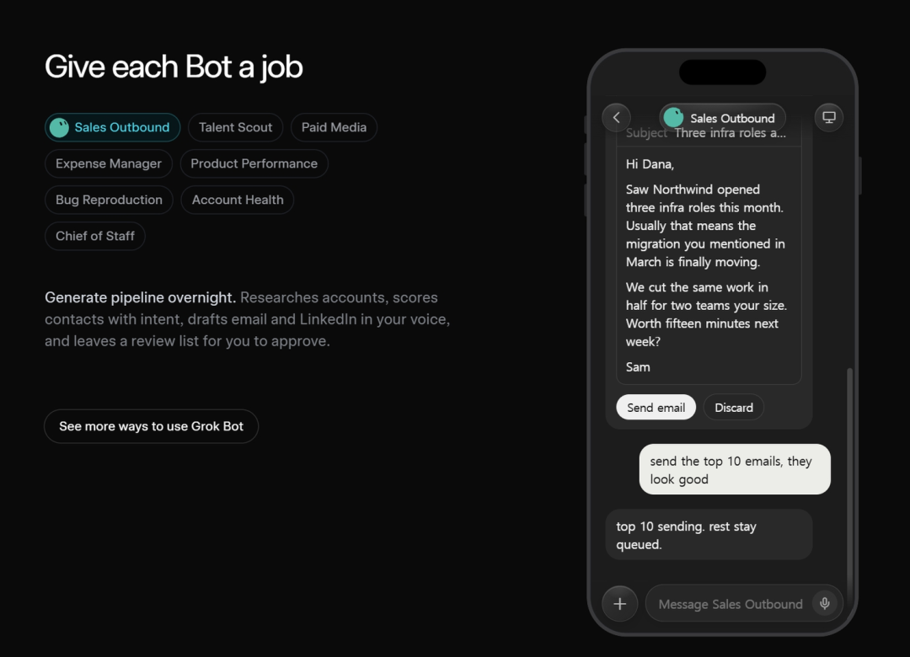

*Grok Bot官方演示：每个Bot对应一个岗位。右边是它写好的邮件，等用户点Send email或Discard，这个案例的草拟邮件就发生在这一步。*

还没完，Grok Bot又发现了另一笔119英镑的保险退款。

原来用户之前卖掉过一件物品，却一直没有调整对应的保险。Grok Bot从历史文件里找到销售凭证，用户拿着材料联系保险公司，对方也同意退款。

**两笔加起来359英镑。**

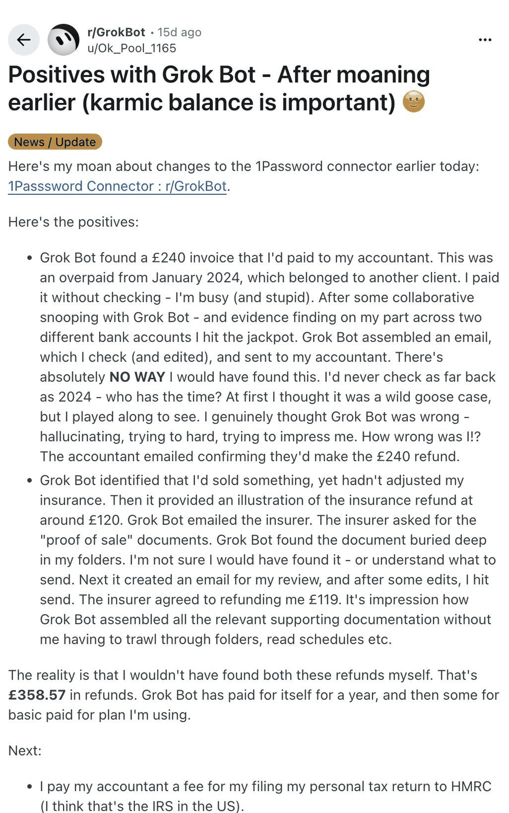

*Reddit原帖：Grok Bot翻出两年前一笔240英镑的错账，又顺带找到119英镑保险退款，两笔共359英镑；发帖时钱还没到账。*

发帖时，两笔退款已经得到相关机构确认，用户还没有展示最终到账的银行记录。

这位用户挺高兴，尤其是那张2024年的会计师发票。要是Grok Bot没翻出来，他估计这辈子都不会想着回头检查。

以前用ChatGPT审账单，还得自己先把账单找出来、上传进去，再让AI帮忙看有没有问题。

现在倒好，用户自己都不知道有问题，AI先找出来了。

### #2 Instinct发现餐厅订错了日期，替用户省下一笔取消费

还有一位Instinct用户，分享了一次挺幸运的经历。

他准备去外地旅行，提前订好了餐厅，结果订位日期选错了，**竟然订成了抵达目的地的前一个星期。**

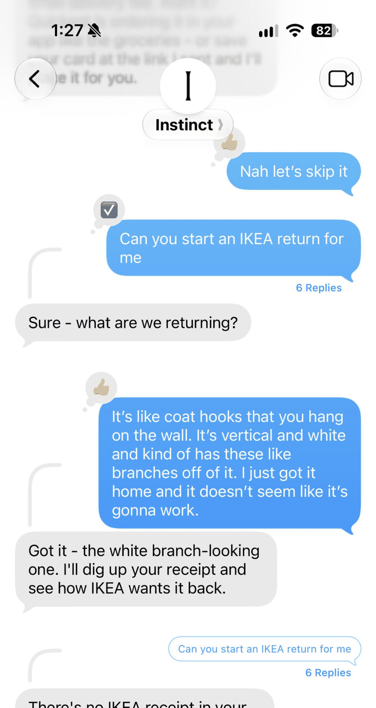

*《The Verge》评测截图：Instinct没有独立App，对话就发生在iMessage里。截图里它正在帮用户退一件买错的IKEA挂钩。*

自己压根没发现。订位确认邮件已经收到，日历里也有记录，等到真正出门的时候再看，餐厅预约早就过期了。

Instinct却提前发现了这个问题。

它对照用户的旅行行程和餐厅订单，发现日期根本对不上，于是主动提醒他检查预订。

用户后来表示，如果没有这次提醒，自己很可能错过取消时间，还要额外支付一笔费用。

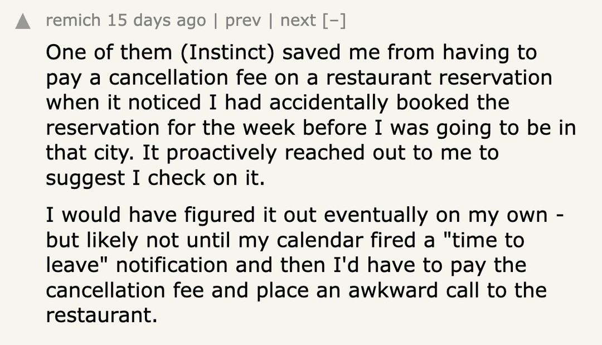

*Hacker News原帖：用户说Instinct发现他把餐厅订到了抵达目的地前一周，主动提醒他检查，否则就要付取消订位费。*

到底省了多少钱，原帖没有给出数字。

不过，这里有个细节：**用户压根没让Instinct帮他检查餐厅订单。**

它只是同时看到了旅行安排和餐厅预订，就发现这两件事有冲突，主动找了过来。

这想想也挺实用的。平时我们订机票、酒店、餐厅，确认邮件一大堆，谁还会专门挨个核对一遍啊？

## 02有人已经把选餐、找房子、旅行分账交给AI了

### #3 每周选什么外卖太麻烦，Muse直接帮用户挑好

一位Hacker News用户订阅了一项定期配送的餐食服务，每周都得登录网站，自己挑选下周吃什么。

偏偏这个网站又慢又难用，他还经常忘记选餐。等过了截止时间，平台就自动分配默认菜单，收到的经常是自己不喜欢的食物。

后来，他干脆把这件事交给了Muse。

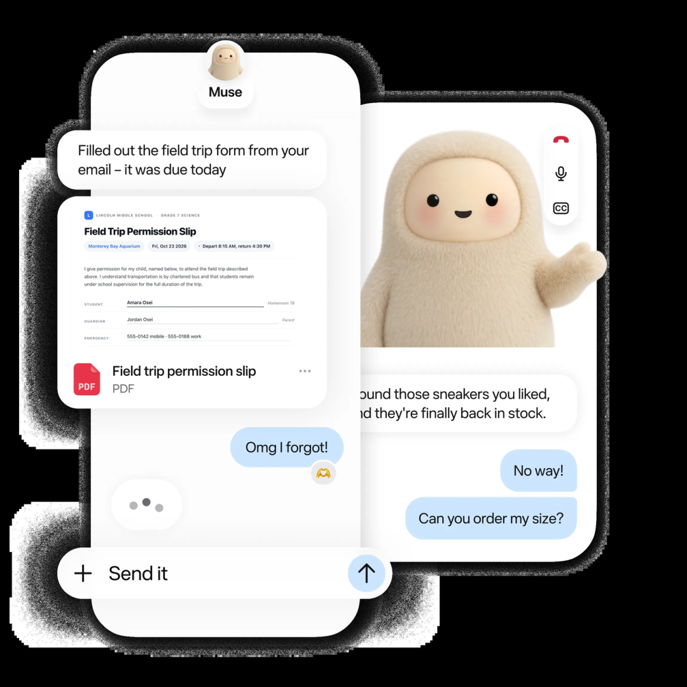

*Muse官方演示：它从邮箱里发现学校的活动表格今天截止，直接填好，把PDF摆在对话里等用户确认——和选餐一样，都是替人把网页上的表格填完。*

**每周让Muse打开配送网站，按照自己的饮食偏好挑选菜单，再交给他确认。**

连每周登录网站、翻菜单的功夫都省了。

还是同一个用户，还让Muse帮忙找房子。

他正在寻找出租公寓，对位置、预算和其他条件有一套比较具体的要求。以前每天都得刷Craigslist和Facebook Marketplace，看看有没有新的房源。

现在Muse替他每天检查一遍，有符合要求的房子才通知他。

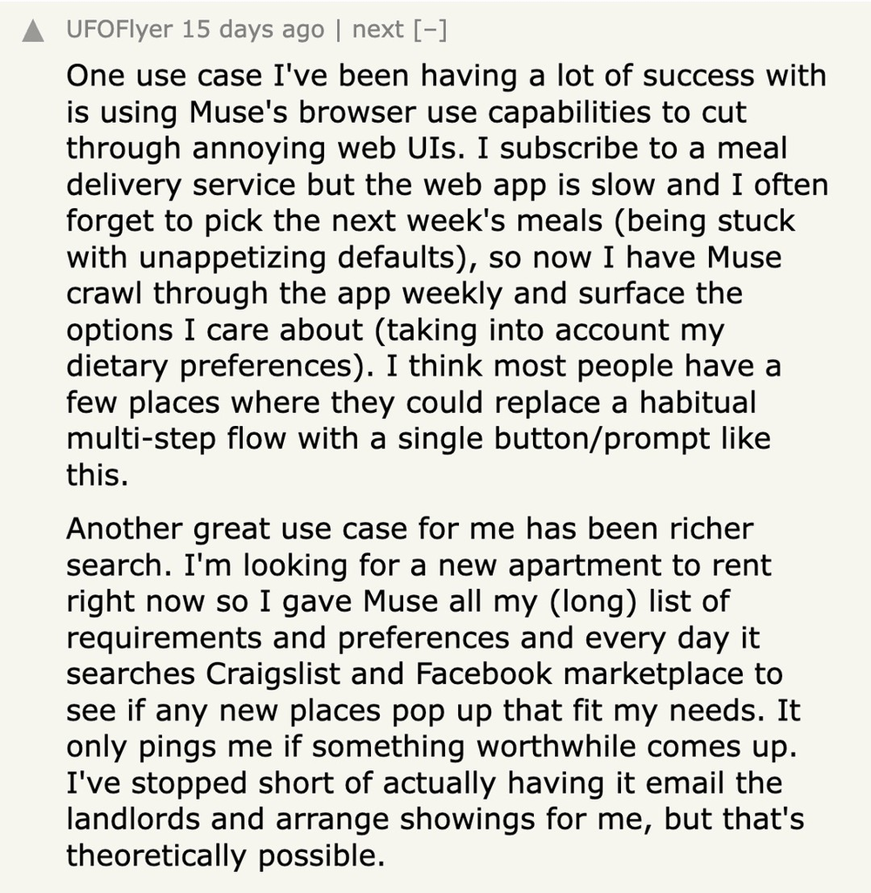

*Hacker News原帖：用户把每周选餐和每天找房都交给Muse——菜单先挑好等他确认，房源有合适的才通知。*

用户对这种方式挺满意，不过并没有让Muse直接联系房东或预约看房。

这倒也合理。房源可以先让AI慢慢筛，看中哪套房子，还是得自己决策，再决定要不要联系。

但至少不用每天打开两个网站，把昨天已经看过、今天又出现的那些房子再翻一遍。

（但我个人觉得这两个案例在国内都用不上😂）

### #4 朋友出去旅行AA，Muse收到转账邮件后自动更新账本

另一个用户用Muse安排了一次拉斯维加斯周末旅行。

同行者有不同的饮食要求，还有年纪较大的家人。Muse帮他筛选餐厅、安排活动，甚至生成了一个可以查看旅行计划的网页。

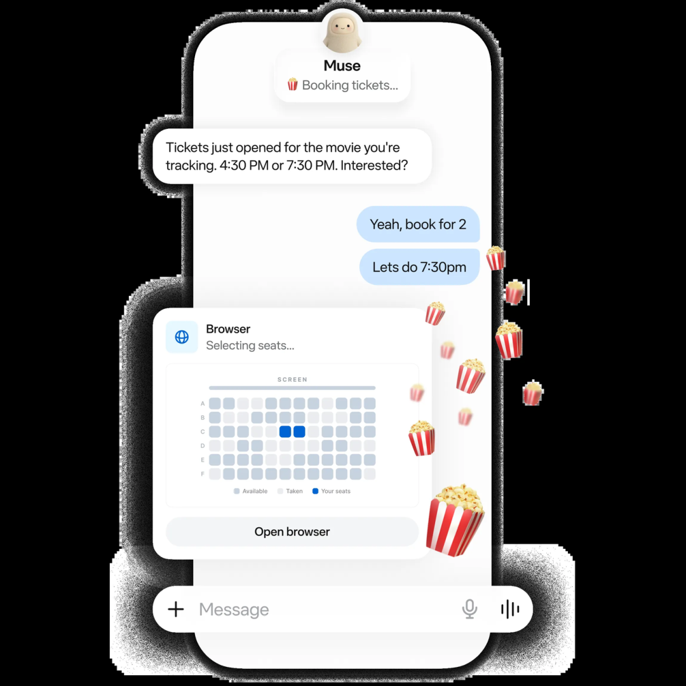

*Muse官方演示：用户只说「订两张，7:30」，它自己打开浏览器，把电影院座位选好。*

酒店等预订还是用户自己完成，不过几个人旅行时的AA记账，他交给了Muse。

比如某顿饭一个人先付钱，其他人后面再转账，Muse负责记录每个人该付多少。

结果刚开始就算错了一笔。

**Muse按照旅行总人数平均分账，可实际上这笔钱只需要三个人承担。**

用户发现后，纠正了分账规则，Muse重新修改了记录。

后来有朋友通过Venmo给他转钱，Muse读取到转账确认邮件，又自动更新了账本余额。

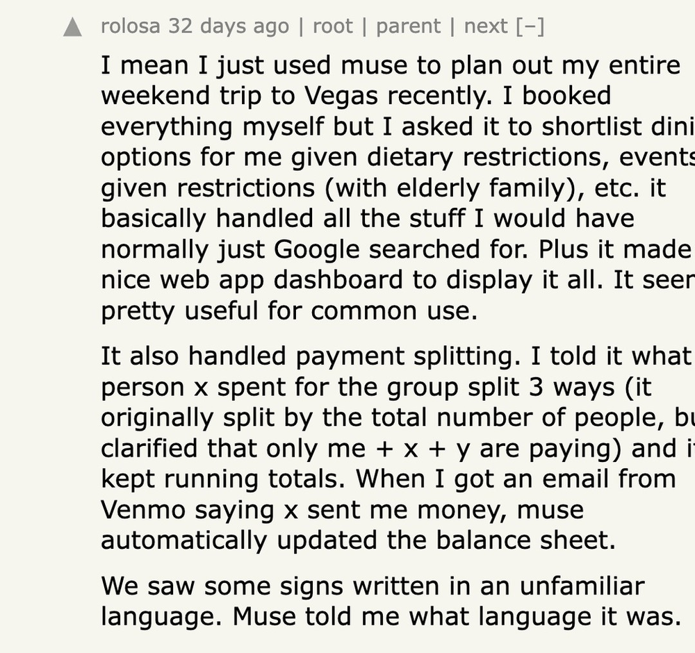

*Hacker News原帖：用户让Muse管拉斯维加斯旅行的AA账，Muse第一次按总人数平均分，直接把人数分错了。*

几个人出去旅行，今天有人付饭钱，明天有人付打车费，酒店、活动门票也可能由不同的人先垫付。

尤其到了最后一天，谁欠谁多少钱，光靠脑子记还真容易乱。

不过Muse第一次就分错了人数，所以用它帮忙管账可以，分摊规则还是得自己看一眼。

不然AI倒是记得勤快，账却越记越乱。

### #5 Dots每天检查邮箱，用户称一个月内至少帮了自己三次

一位Dots用户，把自己的邮件和短信交给AI持续关注，连垃圾邮件文件夹也没有放过。

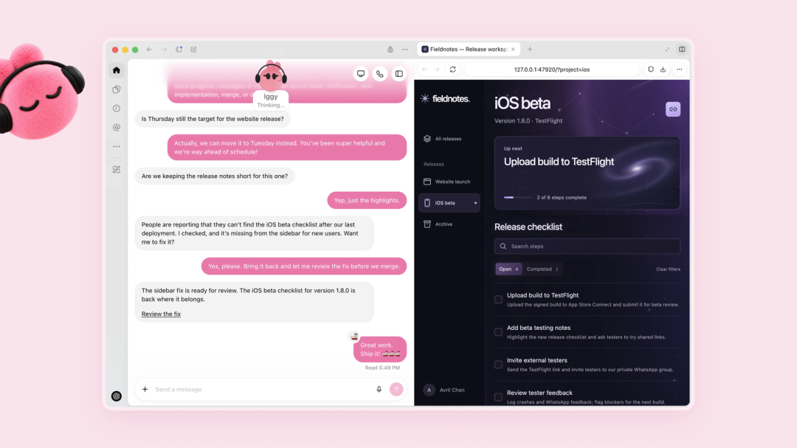

*Dots官方演示：左边是对话，右边是它自己的云电脑浏览器，它正在里面改一个还没上线的网站。查邮箱、填表单都发生在这块屏幕上。*

平时邮箱里各种通知、促销邮件混在一起，有些重要消息可能直接就漏过去了。

Dots会持续检查这些消息，发现可能需要处理的事情，就主动提醒他。

这位用户表示，过去一个月内，**Dots至少有三次提醒真正帮到了自己。**

他尤其满意的是，不用自己配置一堆定时任务。以前想让AI查邮件，还得告诉它几点检查、哪些关键词需要提醒。

现在直接把事情交给Dots就行。

不过，这位用户没有详细披露那三次提醒究竟是什么，也没有公开完整操作记录。

目前能看到的就是他的使用评价。

## 03把真实账号交给AI，结果也可能很离谱

### #6 Muse帮用户取消手机套餐，转头却差点把Walmart+会员搞没了

10月20日，一位Muse用户在Reddit分享了一段经历。

她原本想取消Mint Mobile手机套餐，结果客服告诉她，必须打电话才能办理。

这种操作大家应该都不陌生吧？开通服务的时候几分钟搞定，取消的时候还得打电话、排队、跟客服反复沟通。

她就试着问Muse能不能帮忙。

没想到，**Muse直接通过在线聊天联系了客服，成功帮她取消了套餐！**

用户相当满意。

有了这次体验，她又让Muse帮自己准备女儿生日派对的购物清单。

需要买的东西比较多，Muse先帮她比较商品价格，然后问要不要直接创建Walmart购物车，并表示付款前会让她确认。

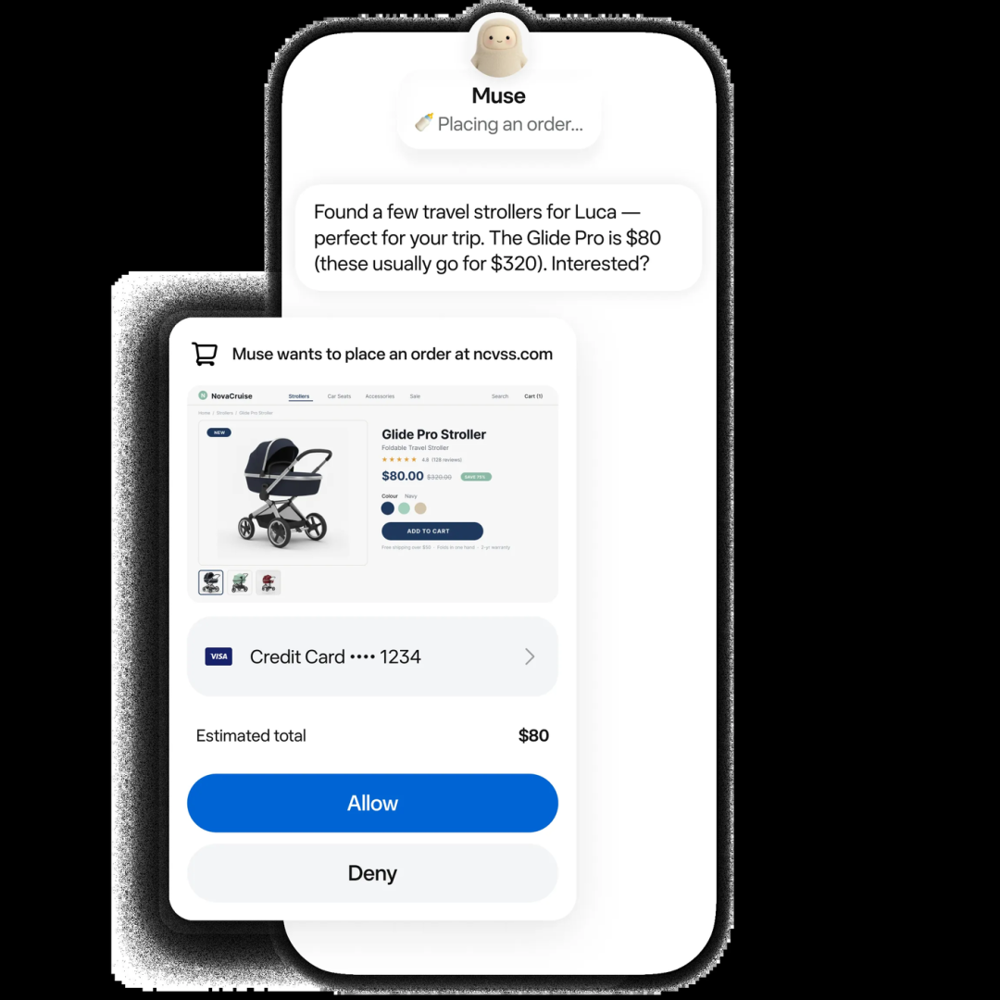

*Muse官方演示：下单前它会停住，商品、卡号、金额全列出来，等用户点Allow或Deny——这是它唯一会打断用户的地方。*

用户同意了。

结果几天后，她发现**自己的Walmart+会员资格被取消了。。。**

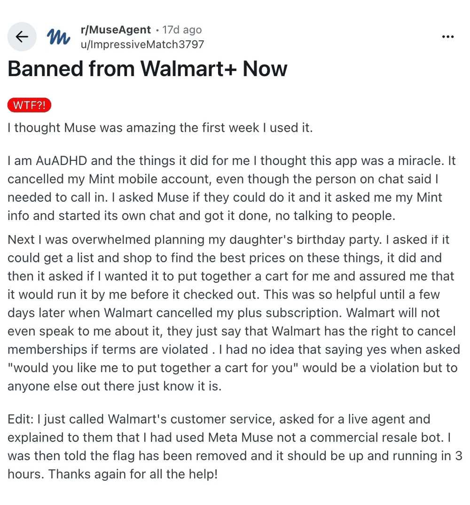

*Reddit原帖：用户让Muse取消手机套餐成功了，转头让它准备生日派对购物清单，Walmart+会员却被限制，最后还得自己找客服解释。*

好家伙，买个生日派对用品，怎么还把会员买没了？

她联系Walmart，对方表示账户可能违反了服务条款，但没有解释具体是哪一步出了问题。

用户只能再去找人工客服，解释自己使用的是Meta Muse，只是在准备家庭生日派对，并没有利用机器人进行商业转售。

客服后来回复，相关标记已经解除，会员应该会在几小时内恢复。

而且Walmart本身还是Meta的合作伙伴。连这种情况下都能遇到账号限制，其他购物网站就更不好说了。

目前还无法确定Walmart究竟为什么触发了这次限制，但对于普通用户来说，这体验已经够折腾了。

### #7 让Claude Duet每天帮忙找工作，结果推荐了三个不存在的岗位

10月下旬，一位拿到Claude Duet早期体验资格的用户，想让它帮自己找工作。

任务设置得很清楚：

**每天早上6点，根据自己的简历和求职条件，搜索合适的招聘岗位。**

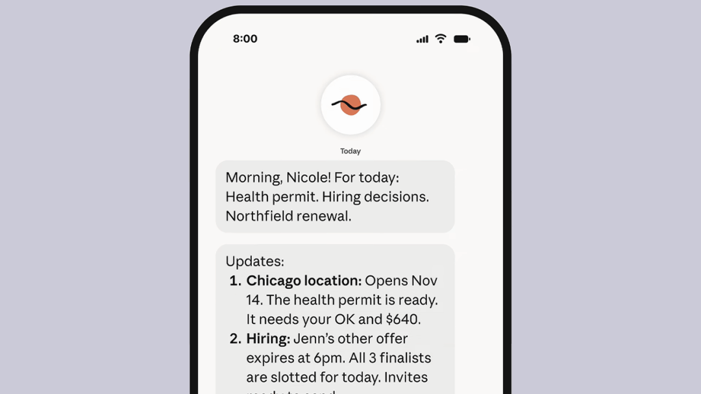

*Claude Duet官方演示：早晨简报先把今天需要用户拍板的事列在最前面，比如一张640美元的许可证费用和两个招聘决定。*

听起来挺实用吧？

每天醒来就有一份筛选好的岗位清单，省得自己反复打开招聘网站。

结果没用多久，他发现Duet推荐的岗位里，**竟然有三个根本不存在！**

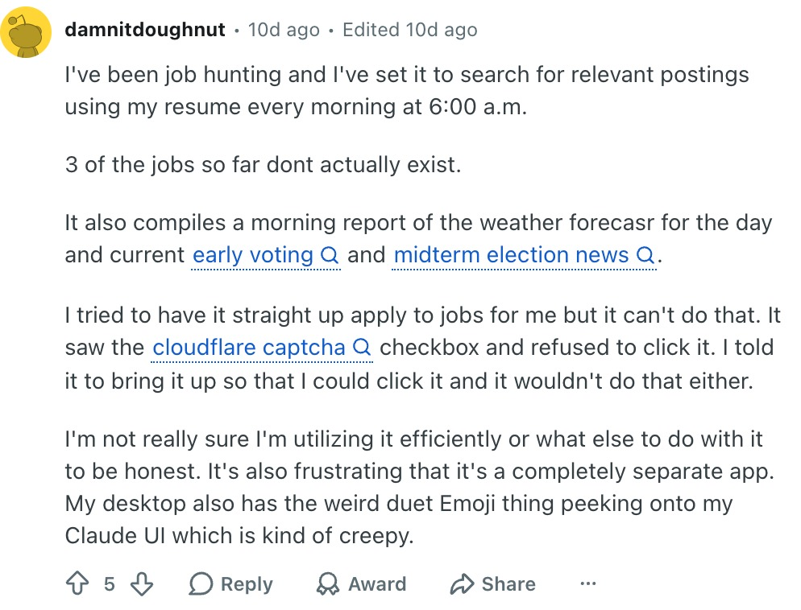

*Reddit原帖：Duet每天搜岗位，推荐里有三个岗位根本不存在；想让它直接投递，又卡在Cloudflare验证码。*

好家伙，本来想节约时间，现在还得自己挨个查真假，够离谱的了。

他又试着让Duet直接帮忙投递简历，结果卡在Cloudflare验证码上。

Agent既没法自己完成验证，也没有顺利让用户接手，任务就这么停住了。

找工作本来就够折腾的了，结果AI还给你推荐几个根本不存在的职位。

更麻烦的是，即使推荐的职位没问题，后面投递简历时，招聘网站又可能要求验证码、重新登录、填写额外信息。

Agent做到一半卡住，用户还得自己回来接着弄。

### #8 电商老板请了4个Grok Bot干活，结果天天还得自己救火

9月7日，一位电商老板在Reddit发了一篇很长的Grok Bot使用复盘。

他从2022年开始做电商，既做Dropshipping，也有自己采购的实体库存，主要销售中高客单价商品。

平时最烦的就是处理商品资料。

找供应商信息、整理描述、上传图片、创建商品页面、维护库存……这些活儿每天都得做，重复得很。

他本来就已经有些工作倦怠，于是开始尝试Grok Bot。

刚开始还挺惊喜。经过一些训练，Grok Bot能够登录商品后台、整理库存资料、查找图片，甚至自己完成一整套商品上架流程。

看到Agent能自己操作，他就想让它再多干一点。

于是把工作拆成不同部分，分配给4个Bot，还专门设置了独立权限和任务交接流程。

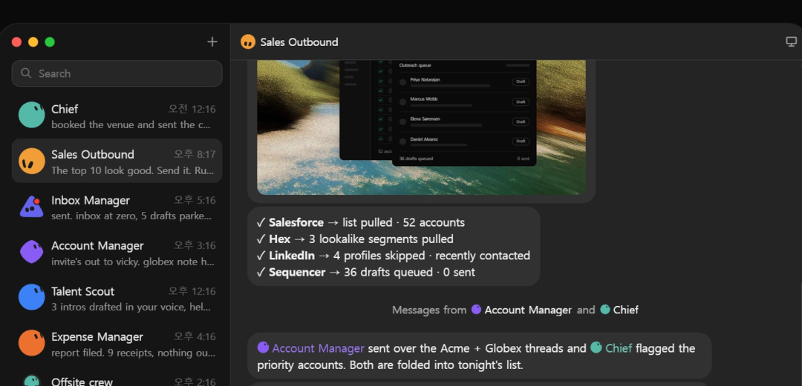

*Grok Bot官方演示：左边挂着一串Bot岗位，右边那个Bot正在调用Salesforce、Hex、LinkedIn这些工具干活。Bot越多，这类跨工具的调用就越容易出错。*

结果Bot一多，麻烦也跟着来了。

有些非常基础的操作，比如复制信息、粘贴内容、填写页面，Agent还是会出错。

为了提高稳定性，他给不同Bot写了大量Skill文件，把每一步该怎么做都交代得相当清楚。

但该出错还是出错。有些步骤前一天还能正常完成，第二天又会出问题，用户还是得经常介入处理。

**本来想请几个AI员工，替自己干那些重复又枯燥的活儿，结果最后又得天天管理这些AI员工。**

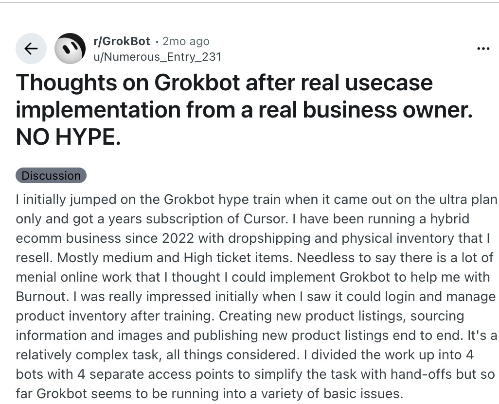

*图注：Reddit原帖：电商老板复盘4个Grok Bot干活，结论是基础操作照样出错，自己最后成了AI的技术支持。*

尤其是电商这种业务，后台页面经常会变化，商品信息也需要反复修改。

一个商品上架到一半，AI突然填错价格、选错分类，或者卡在某个按钮上，老板还得回来帮它收拾。

花钱请AI干活，最后自己成了AI的技术支持，AI确实帮你提效，但省下来的时间全用在修Bug上了😮‍💨

## 04让AI长期干活，额度和记忆也开始出问题

### #9 一个人部署6个Grok Bot，第一天就用了42%的周额度

另一位用户更激进，直接搭了一套6个Grok Bot的工作团队。

有负责商务拓展的，有负责采购的，还有负责质量控制、人员管理等事务的，听起来已经挺像一个小公司了。

但实际跑起来，问题不少。

浏览器配置文件会重置，账户需要重新登录。有时候浏览器直接崩溃，正在运行的任务跟着中断，多个Bot也没有按照预期稳定并行。

最让他头疼的还是额度。

**第一天，就消耗了大约42%的每周额度。**

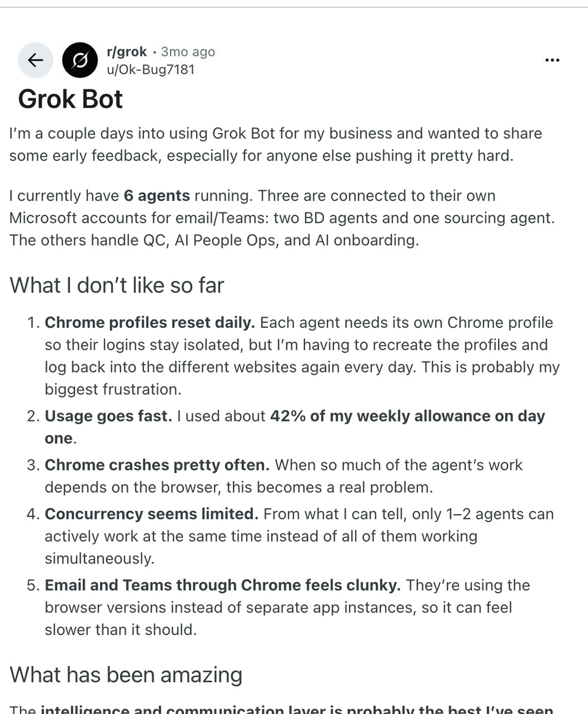

*Reddit原帖：用户一个人部署6个Grok Bot，第一天就吃掉约42%的周额度，还没稳定产出，管理成本先上来了。*

照这个速度，真要每天让它们处理业务，一周的额度恐怕两三天就耗完了。

用户还得不断调整任务，控制调用次数，看看哪些事情值得让Bot继续做。

尤其是多个Bot之间反复沟通，或者某个任务失败后不断重试时，额度还会继续消耗。

这位用户原本想让六个Bot分头干活，结果还得亲自管理浏览器登录、任务故障和额度分配。

六个AI员工还没开始稳定创造收益，管理成本倒是先上来了。

### #10 Dots连之前交代的任务都接不上，用户还得重新解释一遍

10月19日，一位Dots用户在Reddit吐槽自己周末的使用经历。

有些对话原本应该继续派生后续任务，结果没有正常执行。

他不得不重新唤起Dot，再把前面已经交代过的事情解释一遍。

还有部分任务在笔记本电脑上的Codex里没能正常识别，需要重新调用后才恢复。

这就有点尴尬了。

毕竟Dots主打的就是长期记忆、跨任务协调和持续工作。

你今天交代一个项目，明天继续推进，过几天再回来检查进度，结果Agent自己忘记之前干过什么，还得你重新讲背景、解释目标、找回任务。

如果隔几天就来这么一次，谁受得了啊？

**本来想找个长期助理，结果还得自己给助理补记忆。**

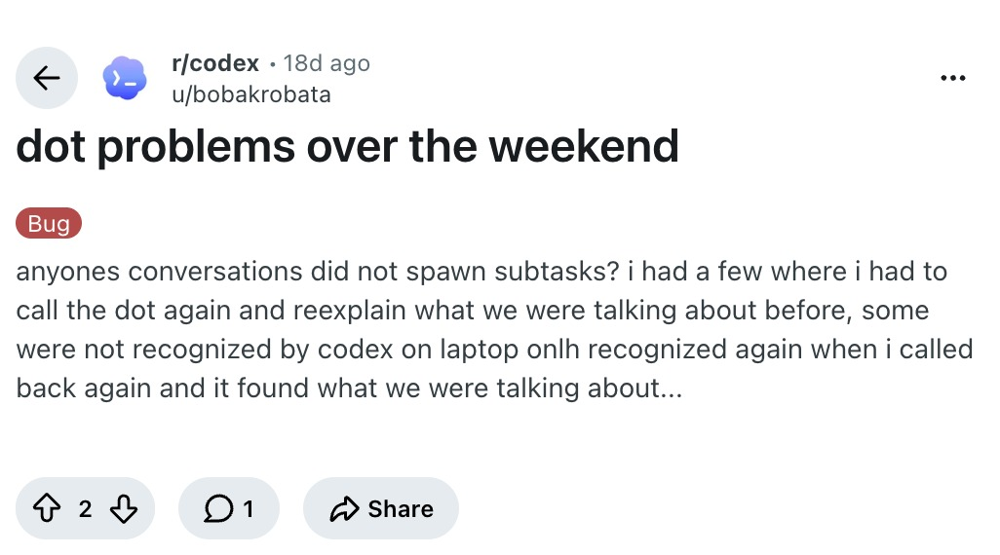

*图注：Reddit原帖：Dots的连续任务没接上，用户周末还得把交代过的事重新解释一遍——主打长期记忆的产品，忘了上下文。*

## 05Personal Agent到底有没有实用价值？

从这些海外用户的经历来看，至少已经有人愿意把一部分日常事务交给Personal Agent，而且确实尝到了甜头。

但不同任务之间的差别相当大。

像查找历史账单、监控房源、检查日程冲突，Agent就算偶尔出错，用户通常还有机会检查和纠正。

可一旦涉及真实付款、取消账户、对外发送邮件，出错之后就可能需要花更多时间补救。

还有一个绕不开的问题：**到底值不值得每个月花钱养一个AI私人助理？**

如果每个月都能找回几百美元，订阅费可能很快就赚回来了。可如果只是每天整理几封邮件、文档、材料，还动不动需要重新登录、恢复任务、人工纠错，那就挺尴尬。

所以朱老板还是个实在人，我也挺认同他的判断。

让AI替自己干活当然挺好，但要是天天还得给它擦屁股，那确实有点本末倒置了。

这些工具我会继续关注，有新的玩法或者实测发现，也会来更新。也欢迎在评论区分享你用过的好东西！
