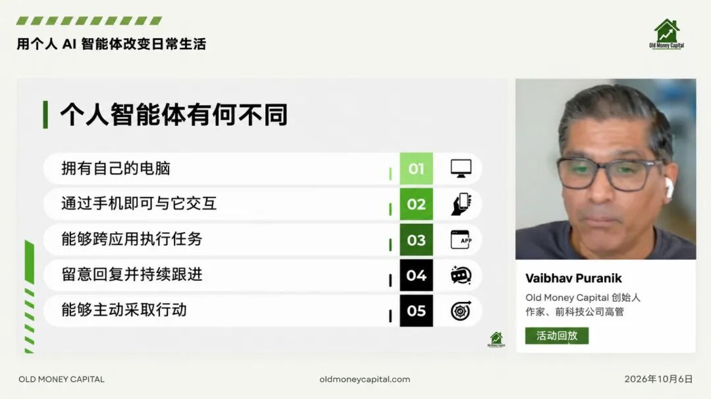
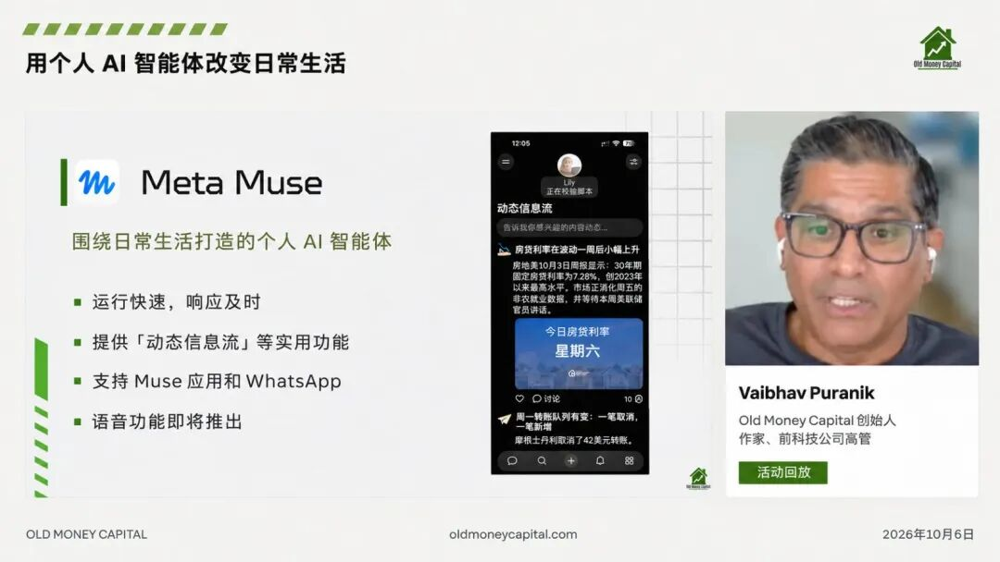
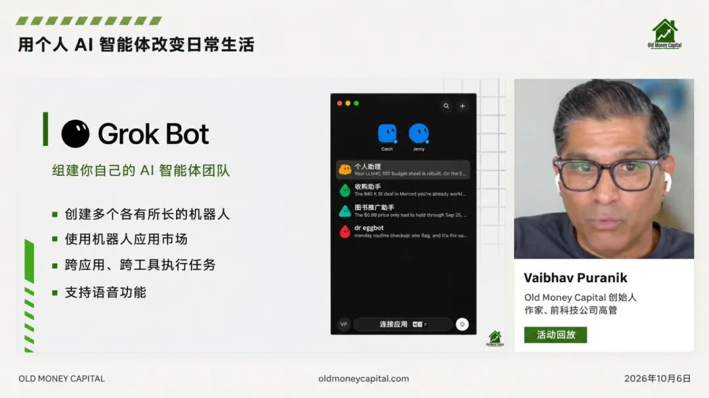



**收录说明**：用户提供链接。原文在微信公众号，用浏览器的客户端标识直接下载页面，从 `#js_content` 抽取正文，图片地址取自 `data-src`。文章整理自房产投资人 Puranik 在 Old Money Capital 的一场线上分享。删去文末「- 完 -」标记。

**内容摘要**：特工宇宙的文章整理了房产投资人 Puranik 在 Old Money Capital 一场 52 分钟线上分享中的使用经验。他用过 Muse、Instinct、ChatGPT Dot、Grok Bot 四款 Personal Agent，其中三款每天在用，把 Muse 排第一，称其整体失败率只有大约 5%；文中列出各家价格档位，如 Grok Bot 30 美元起、下一档 100 美元。文中的例子包括在机场让 Agent 打开邮箱、下载附件填写许可表并发出，以及让 Agent 改 WordPress 首页时把整张表单放进了首页中间的失败案例。他还提到被网站拦截、Gmail 登录状态大约两三天就过期等问题。

**保留理由**：一位重度用户的第一视角，横向比较四款产品的日常用法、价格档位和具体失败案例。

---

想象一下，如果你正在机场候机，然后你孩子的学校发过来一个消息：需要你填一份 PDF 许可表，填好、签名，再发回老师。

这个事情虽然不难，但此时你不方便打开电脑，并且真要在手机上处理也很折腾：需要你下载附件，打开浏览器找个能填 PDF 的工具，然后把信息填进去，再想办法加上签名。

今年 10 月，Puranik 也在机场遇到了这件事，但他把表格交给了自己的 Personal Agent：

Agent 帮他自动打开他的邮箱、下载附件逐项填写、需要签名就从保存的签名文件里贴上去。只有两项信息它不知道，才回头问他。填完直接发给了老师。

**于是，他原本需要自己从头忙到尾的一件事，**有了 Personal Agent，就**变成了仅仅需要回答两个问题。**

Puranik 曾在科技公司担任高管，如今全职从事多户型房产投资。他在 Old Money Capital 一场 52 分钟的线上分享中，讲了过去几个月这些 Agent 帮他办成的事，以下是他的一些个人使用经验分享。

## 它有自己的电脑，也能打开你的邮箱

Puranik 把国外爆火的四款 Personal Agent（Muse、Instinct、ChatGPT Dot、Grok Bot）和 ChatGPT、Claude 这类通用 Agent 分成两类：

这类产品都有一台自己的电脑，不占用他正在用的那台，所以他可以用手机跟它沟通，也可以在手机上接管它的屏幕，自己动手操作。

Personal Agent 会打开邮箱、Google Drive、DoorDash 等应用和网站执行操作，不只调用 API：点按钮、填输入框，走的和人自己用的时候是同一套界面。要让它使用这些应用，他得先授权相应的账号。

它可以持续跟进一件事，比如等一封回信，收到后主动提醒他，甚至有的产品还配了语音，能替他打电话。

Puranik 提到，更早的 OpenClaw 和 Hermes 两个开源项目，已经把手机、电脑和大模型连成了一条链路。但用的人主要是工程师，要自己部署，也要自己判断安全边界。

后来的产品把这些能力做成可以直接用的形态：Meta 的 Muse、Grok 系的 Grok Bot、湾区创业公司 Instinct，还有 OpenAI 发布的 dot，陆续进入可用阶段，也就是最近一两个月的事。

Puranik 认为，判断现阶段 Personal Agent 能干什么，还是主要看它是否能接入邮箱、日历、支付、物业系统这些生活系统的账号。

## 四款 Agent，他更推荐 Muse

这四款 Personal Agent 产品，他每个都实测过，其中三款每天都在用。

**他排第一的是 Meta 的 Muse。**

Muse 的免费档对他已经够用，往上还有 20 美元和 100 美元的档位。App 里有对话框，可以连邮箱和 Drive，也能替他下单买东西：

你的信用卡，可以选择存进 Muse 的保险库，付款时也可以打开它的屏幕，然后在手机上接管一下：自己输入卡号，再交回去。

他最喜欢的是 Muse 的 feed 功能：Muse 可以帮他盯着邮件和日程，有事就主动提醒：

比如，今天 6 点有一场 20 人参加的 webinar，Muse 会提醒他提前 5 分钟到；一栋 94 万美元的房子收到两份报价，它会建议他现在出价；Muse 还会提醒他飞博伊西的航班航站楼从 3 改到 2，登机口是 21B。

Muse 的 Goals 功能盯的是他设的目标：每天联系 3 个经纪人，下午 4 点它会提醒他还差 1 个、只剩 1 小时。

此外，Muse 语音版即将上线，能打电话给保险公司续保。《纽约时报》一档播客提前拿到了这个功能：Agent 打给保险公司，听了等待音乐，留下记者电话，30 分钟后记者接到回电。

总的来说，他认为，Muse 是目前最好的个人 Agent：

Muse 不仅快，而且也主动，并且按他的经验，整体失败率只有大约 5%，如果你想尝试国外的 Agent，他建议从这里开始。

**排第二的是 Grok 系的 Grok bot，也是他最早用的一款。**

它和 Muse 能力相近，能对话，但不能替人打电话。Grok bot 没有免费档，30 美元起，下一档 100 美元。他用着很快撞到 30 美元档的上限，于是升到了 60 美元。

Grok bot 的长处是能建多个 bot，并且每个 Agent 负责一类的事情：他建了个人助理 Jenny，作为每天扫房源的收购助手，还有一个推书 bot 专门推广他刚出版的一本书。

他的用法是给每个 bot 写明职责，持续喂相关领域的信息，让 bot 积累记忆，慢慢熟悉这类任务。

Grok bot 还有一个 bot 市场，几百个 bot，且大多免费：

某个 bot 出了问题，市场里的 doc bot 会看着他和那个 bot 的来往，提出该怎么改。当你说去修一下，这些 bot 就去改描述或者记忆，但它们没有各自独立的电脑，数量一多就会变慢。

**第三款是 OpenAI 的 Agent，能力最全。**

他可以打电话给它，但它不能向外拨号。它既操作你的电脑，也用它自己的电脑。订阅 100 美元起，分 100、200、500 三档；500 档保留 Astra，100 和 200 档在 10 月底之后只能用到次一档模型。

**第四款是 Instinct，免费但邀请制，没有 App，只能通过短信或 WhatsApp 使用。**

四款之中，Puranik 用 Instinct 最少，他觉得只有消息入口限制了自己的使用。不过，在他搭乘只允许发消息的航班上，WhatsApp 反而派上了用场。

## Agent 能帮你填表砍价，但也会改坏首页

除了个人的日程，卖东西这件事，他也直接交给了 Personal Agent：

Puranik 的日用品都是 Agent 帮买的。你只需要给 Agent 一张物品照片，它就能发布信息、回复买家，直到约好交货时间。

他开玩笑说，或许该把行政助理开了：

有人让 Agent 去查订阅，再在网页聊天里跟 Spectrum 客服砍价。于是，在加州一场多户型论坛上，他因为另一处物业的检查要多留一晚，就在听演讲的间隙用手机让 Agent 找酒店；Agent 给了三个选项，他挑中一个，再让它去订。

但是现在的 Personal Agent 也有短板：**开发和改网页这类活，它做不好。**

有一次，他想在 WordPress 上把首页原来的订阅框换成一个指向新订阅表单的链接，交代下去之后，Agent 却把整张表单放进了首页中间，CSS 也跟着乱了。

然后他发截图让它改，它把表单改成了链接，首页还是坏的。最后他自己登录后台，发现 Muse 因为他说过首页很关键，先做了备份；他重命名原页面、恢复备份，才算救回来。之后他给 Muse 立了规矩：先在测试页做，不要上线，动手之前先说方案。

**除了 Personal Agent 自身的问题，各家 SaaS 产品的授权，也卡着 Agent 能干什么。**

比如 LinkedIn 明文禁止 bot，Zillow、亚马逊会直接把它挡回来，回一句「你是 bot，别跟我交互」，Agent 只能照实告诉他。

更麻烦的是 Gmail 登录状态大约两三天就过期，得重新登录。双重验证也需要他配合，有时在应用里确认，有时通过短信验证。

**因此，他预计半年内各家 Saas 产品会出现给 Personal Agent 的特殊权限：bot 被标注为 bot，网站给它受限权限。**

对这类小麻烦，Puranik 的办法有三个。

**第一，别预设它做不到，直接问。**最坏的答案就是做不到。他现在除了跟老婆和孩子互动，几乎什么都交给 bot。

**第二，你需要维护一份很长的 Agent 待办清单。**否则 Agent 没东西可派，效率不会涨。你甚至可以一次给它 10 件事，让它挑容易的做。

**第三，把给 Agent 安排任务变成睡前仪式。把你压在心里的 5 件事告诉它，让它今晚做，或者明早 7 点到 8 点提醒你。**

他也提到自己搭建 Personal Agent 的建议：Agent 跑在自己的电脑上，受本机环境限制，更适合专业、重复的流程。

比如用 Claude Skill 做每季度的投资人更新，从邮件、物业管理系统、收支表和资本开支里取数，取完先让他挑哪些内容给投资人，再成稿发出。

---

从机场的一份许可表，到每季度发给投资人的更新，Puranik 交给 Personal Agent 的事有大有小：**它可以填表、取数、整理初稿，但也会遇到授权和验证，甚至把首页改坏。**

对他来说， Personal Agent 让他的生活确实发生了一些变化：

Agent 并不是自己完全不用管了，而是过去需要从头做到尾的事，现在可以先交给它，然后自己再在关键处补充信息、检查结果。
