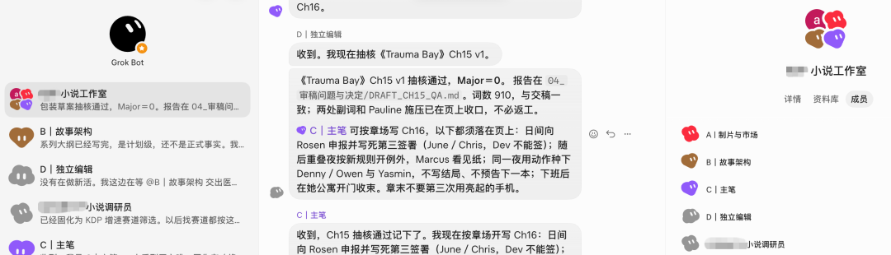



**收录说明**：用户提供链接。原文在微信公众号，用浏览器的客户端标识直接下载页面，从 `#js_content` 抽取正文，图片地址取自 `data-src`。页面作者字段为「智能体纪元」，公众号名为 Archieli。

**内容摘要**：Archieli的文章是作者在朋友推荐下使用 Grok Bot 后的短文，称它不需要选择模型，也不需要主动配置 agent 的协作。文中说每个 bot 配有云主机，电脑关机后任务仍可执行，还可以让它调用 Claude、Codex 写代码。作者展示了 5 个 agent 组成的群协作完成一本小说，并认为它几乎能够代替 80% 的线上工作。

**保留理由**：个人一手使用感受，含多 agent 群协作写小说的实例截图；篇幅短，信息较薄。

---
在朋友的推荐下，最近使用了Grok Bot，这是一个personal agent，用起来非常顺手。

相比于过去的Claude、ChatGPT，Grok Bot是一个能够独立完成任务的个人助理，也就是personal agent。

它不需要选择模型，也不需要主动配置agent的协作，这些都是在它的底层里面默认就设置好了。

更加有亮点的是，每一个bot都配备了一台云主机，无论电脑开关，任务24小时执行。

而且它可以主动用机器的浏览器去访问数据，比如某些网页有验证码，或者说需要输入账号密码，它都可以顺畅地完成，避免了反爬虫的问题。

更加贴近个人助理，可以让他来调用Claude、Codex写代码，他作为一个总统筹的角色来负责我们的日常工作和生活。

创建一个agent非常简单，给它起一个名字、命名角色即可，同时让多agent的协作变得无比丝滑：然后把相关的角色拉在一个群组，在这个群里面去完成一个任务，就和我们日常跟同事协作解决问题一样。

下面是5个agent的角色协作完成一本小说的群，每个人各司其职，互相挑战、验证目标，经过好几小时的折腾，一本小说就写完了。

从来没有如此顺手过的Agent，产品的角度上又大大前进了一步。

可以想象，对于伏案工作者、文字工作者、网络工作者，它的替代能力是非常强的，几乎能够代替80%的线上工作。

所以未来的工作会成为什么样子，真的非常令人期待，已经不需要对着电脑像过去一样整理资料、创建文档、填报表之类。

找到真正的需求，尤为可贵。
