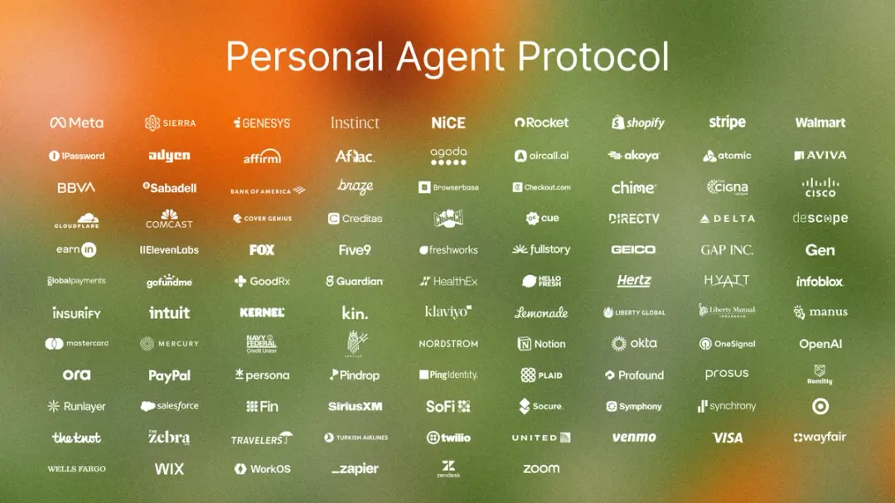



**收录说明**：直接下载。去掉了作者头像、分享与订阅区块；抽取漏掉了文中的 100 家设计合作伙伴图，已按原文位置补回并本地化。原文全文存于本目录的 original.md，网站上不显示，已翻译。

**内容摘要**：Sierra 宣布 Poppy v1.0 已发布，Shopify 已为其平台上所有商家启用 Poppy，Mercury、Synchrony 与土耳其航空等多家设计伙伴正在上线，Muse 现已为所有用户开启 Poppy，会在访问每个网站时优先查找 Poppy。另有 60 家新公司加入设计伙伴，总数超过 100 家。v1.0 吸纳了设计伙伴过去五周用真实网站、API 与智能体测试草案的经验，协议主要基于 MCP、OpenAPI、UCP 等现有标准，通过 OAuth 认证、由客户控制权限。Shopify 覆盖 175 个以上国家的商家，所有 Shopify 商店默认支持 UCP 并自动发布 Poppy 文件，商家无需额外实施；Shopify 还合著了 Poppy 的商务扩展。落地案例包括：Mercury 用户可让个人智能体查余额、交易、分类支出并发起支付或转账（须经账户审批策略）；Synchrony 探索把融资与奖励带入智能体购物，其网络覆盖 500,000 多个商户点位；土耳其航空支持查票价、航班状态、按预订号与姓氏调取订单，Miles&Smiles 会员可让智能体查找升舱。

**保留理由**：Sierra 作为联合制定方的一手公告，提供了 Meta 官方稿没有的落地规模证据（Shopify 全量启用、设计伙伴超 100 家）与三家上线企业的具体做法，是 Poppy 1.0 发布后生态进展的关键记录。

---

[Personal Agent Protocol](https://sierra.ai/blog/introducing-personal-agent-protocol)——简称 Poppy——自从上个月我们与最初的设计伙伴 Meta、Genesys、Instinct、NiCE、Rocket、Shopify、Stripe 和 Walmart 首次宣布这项新标准以来，已经获得了真正的势头。Poppy 让个人智能体能够通过企业智能体、网站和 API 与公司互动，今天我们很高兴宣布：

- 协议的 v1.0 [现已可用](https://personalagentprotocol.org/docs/1.0/spec)。
- Shopify 已为其平台上的每个商家启用 Poppy。
- 多家设计伙伴正在上线 Poppy，包括 Mercury、Synchrony 和土耳其航空。
- Poppy 现已对使用 Meta 的 AI 智能体 Muse 的所有人开启，Muse 会在访问每个网站时自动优先查找 Poppy。
- 60 家新公司加入成为设计伙伴，使总数超过 100 家——包括*Affirm、Aflac、Agoda、Aircall、Akoya、Aviva、Banco Sabadell、Braze、Browserbase、Checkout.com、Cisco、Cover Genius、Creditas、Crunch Fitness、Cue、Delta Air Lines、Descope、EarnIn、Five9、Freshworks、Fullstory、Gen Digital、Global Payments、GoFundMe、GoodRx、Guardian、HealthEx、HelloFresh、Hyatt、Infoblox、Intuit、Kernel、Kin Insurance、Lemonade、Liberty Global、Manus、Mercury、Navy Federal Credit Union、Neptune Flood、Ora、Persona、Pindrop、Ping Identity、Profound、Prosus、Remitly、Runlayer、Salesforce（包括 Fin、Commerce Cloud 和 Agentforce）、Socure、SoFi、Symphony by Wix、The Knot、The Zebra、Travelers、Turkish Airlines、Twilio、Wayfair、Wix、WorkOS 和 Zoom。*

## Poppy v1.0

Poppy 的 1.0 版反映了设计伙伴过去五周用真实网站、API 和智能体测试草案所学到的东西。

协议定义了个人智能体如何与实现它的公司连接，清晰而完整地获得它们所提供的一切访问，主要用 MCP、OpenAPI 和 UCP 等现有标准构建。通过 OAuth 认证，顾客控制个人智能体能做什么、不能做什么，并可以随时间管理其访问权限。

自最初草案以来，我们：

- 让公司更容易分阶段采用该协议，从基础开始，随时间添加能力；
- 改进了协议使用现有标准的方式；
- 扩展了公司提供指引、并从个人智能体收集反馈的能力；
- 引入了扩展，例如由 Shopify 共同编写的商业扩展，让各行业可以在核心协议之上构建，而不必修改它。

有了 v1.0，任何公司都可以自行实施 Poppy，并立即开始为使用 Muse 的顾客交付更好的体验。我们的[实施工具包](https://personalagentprotocol.org/kit/company)会带你完成配置，并包含一个验证器来检查你的成果。

## Sierra 与 Shopify 把 Poppy 带给数百万商家

Shopify 为 175 个以上国家的企业提供动力，而每一家 Shopify 商店都默认支持通用商业协议（Universal Commerce Protocol，UCP）。随着更多购物转移到个人智能体上，每一家 Shopify 商店现在都会自动发布一份 Poppy 文件，因此商家无需做任何额外的实施。

UCP 与 Poppy 互为补充。UCP 处理购物本身，例如寻找商品、填购物车和结账。Poppy 处理在那之前发生的事：当一个智能体来到商店、说明它是谁、并查明它被允许做什么。

Shopify 共同编写了 Poppy 的商业扩展，把两个协议连接起来。它让智能体可以作为访客购物，或用顾客的账户登录，并让智能体在采取某些操作前询问顾客，因此它只在获得许可时行动。它还连接 UCP Ask，让购物者的智能体可以直接与商店的智能体对话。

## Poppy 的实际落地

若干企业现已上线 Poppy：

- **Mercury 让个人智能体在财务上干活：**使用 Mercury 办理企业与个人银行业务的人，现在可以让其个人智能体查看余额、审阅近期交易、对支出分类，或让预算与收据保持最新。顾客甚至可以要求个人智能体发起付款或转账，Mercury 会确保请求先经过账户的审批策略，然后才发送任何东西。
- **Synchrony 将把融资与奖励带入智能体主导的购物：**这项工作探索个人智能体如何帮助顾客找到合适的产品，同时一路考虑可负担性以及 Synchrony 的相关优惠与融资产品。随着时间推移，这可能创造新的方式，把 Synchrony 的能力带入其覆盖 500,000 多个商户点位的网络中的购物体验。
- **土耳其航空从搜索到商务舱欢迎个人智能体：**个人智能体现在可以查看票价、航班状态和经停，也可以凭预订号和姓氏调取预订。Miles&Smiles 会员甚至可以让其智能体查找商务舱升舱，由顾客在付款前批准。它目前正努力让会员无需离开对话就能完成购买。

## 选择、控制、信任

我们非常感谢所有为这项新标准做出贡献的公司，也很高兴欢迎更多公司加入我们的设计伙伴关系。随着个人智能体承担更多我们的日常任务，公司需要清晰、安全的方式与它们合作，同时继续交付值得信赖的体验。Poppy 给了它们这个基础——让公司与个人智能体能为他们共同的顾客把事办成。

*Mercury 不是银行。银行服务通过 Mercury 由 FDIC 承保的合作银行提供。*
