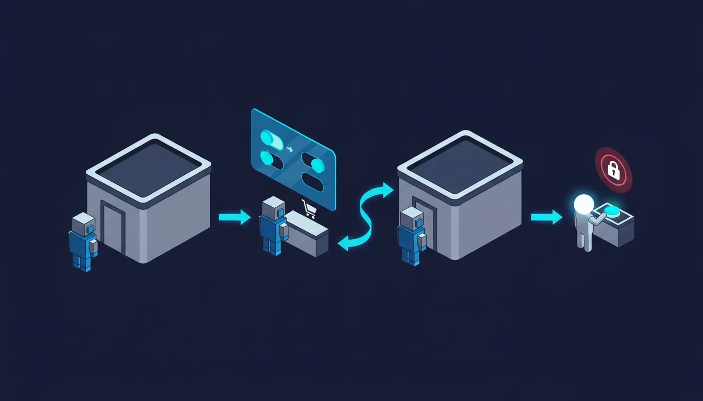
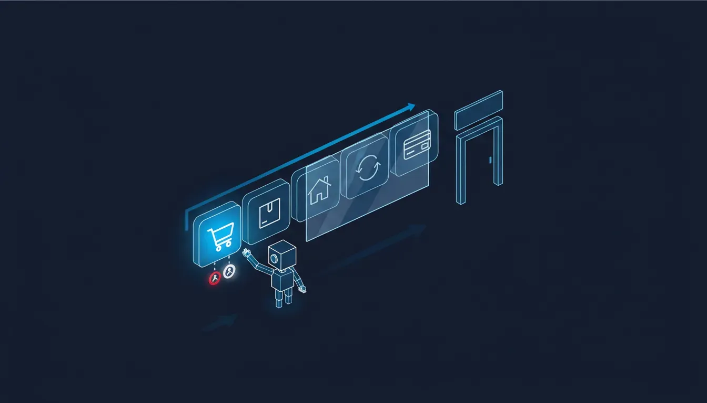



**收录说明**：直接下载全文。删去了文末的自我推广一节与装饰题图，两张说明图已本地化；原文的 Sources 清单保留在 original.md 末尾。文中「同一天，柜台另一边」一节涉及 OpenAI 的 ChatGPT Wallet（dots 产品），照录原文。原文全文存于本目录的 original.md，网站上不显示，已翻译。

**内容摘要**：2026 年 11 月 13 日 Sierra 发布 Personal Agent Protocol 1.0，Shopify 称已为平台全部商家自动启用 Poppy 文件，Meta 的 Muse 访问网站时会优先读取该文件；作者同日检查了 11 家 Shopify 店铺，其中 9 家返回了该文件。9 份文件除品牌名外内容完全相同：protocol_version 为 0.4 而非 1.0；仅授予一个权限 dev.ucp.shopping.checkout:manage，即以登录顾客身份准备结账、由买家完成付款，并标记为 changes: irreversible、personal_data: true；文件指向 /.well-known/ucp 的 UCP 清单（版本 2026-08-25），web 段为空，且不含订单读取、地址、退货、账户等权限。11 家中有 2 家在一台主机名上返回 404、另一台主机名上返回文件，裸域名与 www 主机名各有一例。作者指出，文件未提供查订单、改地址、发起退货等顾客最常需要的操作路径，且空白的 web 段并未禁止智能体用顾客密码登录普通网站这一兜底做法。

**保留理由**：此前已收资料只有 Sierra 的 1.0 发布公告与 Muse 官方稿，本篇是独立实地核查：11 家店铺中 9 家实际返回文件、文件均为 0.4 版、仅一个权限、web 段为空、2 家店铺主机名不一致，并指出密码登录兜底未被文件堵住——这些实测细节是公告稿中没有的。

---

作者：Jeremy Souffir，JTS Tech Services 创始人

直接答案先给。如果你的店铺跑在 Shopify 上，打开你自己的域名，在末尾加上 /.well-known/poppy.json。你很可能会看到一份你从未见过的简短 JSON 文件，是 Shopify 在昨天之前某个时候代表你发布的。它是个人智能体协议（Personal Agent Protocol）的发现文件，顾客的 AI 助理来到你的店铺时会读它，从而知道你是谁、如何与你对话、它被允许做什么。Sierra 于 11 月 13 日发布了该协议的 1.0 版，Meta 的 Muse 智能体现在访问每个网站时都会优先查找该文件，背后有 100 多家设计合作伙伴。Sierra 称，Shopify 已为平台上的每个商家启用它，无需任何实施。我们同一天检查了 11 家 Shopify 店面，其中 9 家提供了该文件。九份文件文本完全相同，只是换上了各自的品牌名。它们声明的协议版本是 0.4，不是 1.0。它们把智能体指向你的店铺自夏天起就已暴露的 UCP 结账端点。而且它们只授予一个权限，文件本身将其描述为允许智能体以登录顾客的身份准备结账，由买家完成购买。10 月我们告诉过你，除非你先做决定，否则你的平台最终会替你决定「写权限」在你的店铺意味着什么。昨天它就这么做了，它选择的答案狭窄、合理，但不是全部答案。

## Sierra 到底发布了什么？

- 一个自称草案的 1.0。Sierra 的帖子说 Personal Agent Protocol 1.0 现已可用。它链接的规范页面标题是 draft 1.0，说明它从 0.4（1.0 的发布候选版）起步，并警告它可能包含不向后兼容的改动。实施工具包用三个词说了同样的事：规范是草案。对一个只有五周大的协议来说这并不稀奇，但这意味着你店铺上的文件会在你脚下变化，而它今天携带的版本号是发布候选版的，不是正式版的。
- 与 Google 结账协议的分工明确。用 Sierra 的话说，UCP 负责购物本身——找商品、填购物车、结账——Poppy 负责那之前的事：智能体出现在一家店铺，说明自己是谁，并弄清它被允许做什么。Shopify 参与合著了把两者连接起来的商务扩展，它让智能体可以以访客身份购物，或是以顾客账户登录，并在某些操作前先询问顾客。
- Shopify，为所有人开启。原话是：Shopify 已为其平台上的每个商家启用 Poppy，因此每家 Shopify 店铺现在都会自动发布一份 Poppy 文件，商家无需做任何额外实施。Shopify 为 175 多个国家的企业提供服务，因此这是迄今所有智能体协议中规模最大的一次部署，而且我们找不到任何设置、邮件或更新日志条目来记录它。
- Meta，首先读取它。Poppy 现已向所有使用 Muse 的用户开放，Muse 是 Meta 的智能体，访问每个网站时都会自动先查找 Poppy。Muse 就是 9 月因用顾客密码登录而被 Amazon 挡在门外的那个智能体。它现在有了一扇被认可的正门，而你的店铺刚刚也配上了一扇与之相称的门。
- 合作伙伴。上个月有八个初始设计合作伙伴：Meta、Genesys、Instinct、NiCE、Rocket、Shopify、Stripe 和 Walmart；昨天又点名了 60 家，其中包括 Salesforce、Delta Air Lines、Hyatt、Wayfair、Intuit 和 Twilio，声称总数超过 100 家。有三家公司被描述为已上线：Mercury、Synchrony 和 Turkish Airlines。名单上仍然缺席的：OpenAI、Anthropic、Google 和 Amazon。

同一天，柜台的另一边

同一天，OpenAI 推出了 ChatGPT Wallet，CNBC 于 11 月 13 日报道。它让 OpenAI 的个人智能体代用户购买，使用由 Visa、Mastercard 或 American Express 发行的一次性支付令牌，因此智能体和店铺都看不到真实卡号，且每笔购买都需要人脸或指纹验证。它仅限美国、仅限成人、仅限 Pro 订阅用户；按 OpenAI 的描述，它通过驱动商家现有网站上的浏览器或通过插件来工作。于是在同一天，交易的两端都动了：买方的智能体得到了钱包，你的店铺得到了一份告诉智能体它在和谁说话的文件。OpenAI 不是 Poppy 合作伙伴，所以带钱包的智能体会以普通方式来到你的网站。这份文件是给读它的智能体用的，而今天这意味着 Muse。

## 你店铺上的文件实际说了什么？

我们从 Allbirds、Gymshark、Knix、Kotn、Mejuri、Frank And Oak、Herschel、Manitobah 和 Kit and Ace 抓取了它，这是 Shopify 上一批美国和加拿大品牌的混合。每份文件形状相同，大部分措辞也一样。从上到下读：

- protocol_version 是 0.4，不是 1.0。Sierra 昨天发布的规范说 1.0 从 0.4 起步，所以这是发布候选版，先于正式版发布。预计它会在你未参与的情况下自动更新。
- organization 携带你的店铺名称和提供该文件的主机名。没有别的：没有 logo，没有描述。它是你 Shopify 后台里的名称，所以如果那里仍写着法人实体或旧品牌，那么每个智能体被告知的就是那个名字。
- auth 恰好声明一个作用域：dev.ucp.shopping.checkout:manage。它的描述原文是：它允许智能体以登录顾客的身份准备结账；由买家完成购买。描述接着告诉智能体，这通常不是购买所必需的，因为大多数店铺允许访客结账；只有在结账要求账户或买家已有账户时才应让买家登录；现有顾客可能获得折扣和其他促销。最后这一句是 Shopify 代表你在给一个机器人写促销文案。
- scope_hints 把那一个作用域标为 changes: irreversible 和 personal_data: true。协议要求每个作用域都带这两个字段，智能体正是用它们来决定是否停下来询问顾客。Shopify 正确地告诉了每个智能体：以顾客名义准备结账不是可以随便做的事。
- agent 列出一个协议：ucp，端点在你域名下的 /.well-known/ucp。顺着它走，你会到达我们 9 月描述过的 UCP 清单，版本 2026-08-25，含购物车、结账、折扣、履约、买家同意和订单能力，并在你的 myshopify.com 主机上有一个 MCP 端点。Poppy 是门童，那份清单才是店铺。
- web 为空。规范用这一节告诉智能体它是否可以使用你的普通网站，以及如何让其浏览器登录。Shopify 把它留空了，按规范的默认值，这意味着网站路径未被禁用，但没有提供浏览器登录端点。实际上，想浏览你页面的智能体从文件中得不到任何指示。
- extensions 声明 ucp 版本 1，别无其他。Shopify 参与合著的那个商务扩展——那个让智能体在行动前询问顾客的扩展——在这里只通过它对 UCP 的钩子被提及。
- 不在这里的东西：没有 orders:read，没有 orders:write，没有 addresses，没有 returns，没有 account。规范自带的示例文件列出了其中好几项。Shopify 的清单一项都没有。我们读的每家店铺还提供规范要求的配套 OAuth 元数据文件，所以登录机制是存在的，尽管文件除了结账之外没有提供任何可登录的东西。

智能体在触碰你的店铺之前读到的东西。它来到店面，发现门边的小小发现文件，读到一个点亮的权限和通往结账柜台的指针，顺着指针走到店铺面向智能体的柜台，在任何付款发生前由顾客按下确认。文件完全没有提到普通网站。

11 家中的 2 家，以及一个主机名

我们试过的店面中有两家，在一个主机名上返回该文件的 404，在另一个主机名上则提供它。有一个品牌是裸域名有、www 主机没有；另一个正相反，那是一个无头店面，裸域名单独提供。规范要求 organization 的域名与提供该文件的主机一致，所以到达没有该文件的主机名的智能体就找不到门。如果你的店铺跑的是无头前端、地区性子域名，或你多年前设置的重定向，两个主机名都要检查。Shopify 的开启覆盖它提供服务的店面；它覆盖不了不由它提供服务的主机。

## 那么 Shopify 替你决定了什么？

10 月，协议提供了一个粗略的选择——只读或写——我们说过真正的问题在于「写」会在你的店铺解锁什么：购物车、订单、改地址、保存的卡、忠诚度余额。1.0 规范悄悄放弃了那套框架。不再有读或写的位。每家公司定义自己的作用域，通常是它已有的 OAuth 作用域，并给每个作用域标注：它是否改变任何东西、该改变能否撤销、是否触及个人数据。Shopify 利用这份自由定义了一个作用域，并诚实地标注了它。智能体可以准备结账。它不能读取订单历史、更改地址、发起退货、兑换积分或触碰已保存的卡，因为文件中不存在任何针对这些的作用域，而规范禁止企业授予智能体未请求的作用域，也禁止智能体获得未被提供的作用域。

这正是我们希望看到的狭窄默认值。它也在某种值得点名的意义上不完整。顾客最希望助理处理的操作——我的订单在哪、发货前改送货地址、为尺码不对的商品发起退货——恰恰是文件不提供的。一个 Muse 用户让智能体查一下 Shopify 订单，从这份文件里得不到通往答案的路径。于是智能体做两件事之一：告诉顾客它做不到，或者退回到整个协议存在就是为了阻止的做法——从云端浏览器用顾客的密码登录你的网站。Shopify 空白的 web 节并不禁止这样做。文件里没有任何东西禁止。本周 United 写了一条合同条款来专门禁止这种行为；你店铺上的文件既不禁止它，也不替代它。

按 Shopify 的方式建起的那堵权限墙。有一块砖亮着，就是结账柜台，标为不可逆且涉及个人信息。玻璃后面、没有点亮、也无法经由这份文件到达的，是顾客最常请助理做的事：订单历史、送货地址、退货、已保存的支付方式。墙的旁边，通往普通网站的那扇门上根本没有标识。

## 这些是谁的说法，以及我们无法核查的部分

四点告诫。关于这次发布的一切都出自 Sierra 自己的说法；我们找到的独立媒体都只是转述，而 Shopify 没有以自家口吻发布过任何关于 Poppy 的内容——没有更新日志条目，没有帮助中心页面，没有开发者文档。文件内容是九家店铺在 11 月 14 日提供给我们时的样子，Shopify 可能在任何时候不经通知任何人就改动它们，而这恰恰是本文的要点。我们全文读了规范第 1 至 5 节，其余部分读的是摘要，因此关于 web 节默认值和商务扩展「先问顾客」行为的叙述来自 Sierra 的描述和规范的字段表，而不是用智能体对店铺做过测试。我们也没有任何数字说明有多少 Muse 用户正通过这份文件到达 Shopify 店铺；Sierra 没给，Meta 也没有。

## 两种都搞错了的结论

Shopify 已经处理了，所以没什么可做

Shopify 处理了它能替中位水平的店铺处理的那部分：一份发现文件、一个安全的作用域、一个指向早已可用的结账柜台的指针。它没有、也无法决定你的店铺希望智能体在订单、地址和退货方面能做什么，因为卖袜子的店和卖定制家具的店在这些决定上并不相同。这份文件是地板。而且今天，它也是 Muse 唯一能读到的关于你的东西，所以地板就是 Muse 认为的你：一个可以搭建结账的地方，仅此而已。

它是 0.4 版的草案，所以在定稿前忽略它

版本号是不让你自己照着它开发的理由，却不是忽略它的理由，因为文件已经上线、已经被读取，并且已经在塑造 Meta 的智能体到达你店铺时的行为。规范和文件都会变。它们背后的问题——访客智能体可以了解什么、登录的智能体能做什么、哪些操作需要顾客回到流程中——在每一版草案里都是同样的问题，而且它们是慢的那部分。一家已经在一页纸上回答过这些问题的店铺，一个下午就能配置好任何版本。

令人鼓舞的部分

五周前这个协议还只是一份新闻稿，我们说过没人能告诉你它在线上会是什么样。今天你可以在自己的域名上读到它，而它所说的正是我们会要求平台先说的那件事：我们是谁，这是你可以使用的那一个柜台，它不可逆且涉及个人信息，所以使用前先问，由买家付款。借用密码的问题并没有被这份文件解决。但首次，一位顾客的智能体到达 Shopify 店铺时，被告知了门在哪里的真相，而那扇门不经过顾客的账户。

## 本周该做什么

- 读你自己的文件。在浏览器中打开 yourdomain/.well-known/poppy.json。确认它存在、organization 名称是你希望智能体向顾客重复的那个、主机名与顾客实际到达你的方式一致。www 和裸域名两个版本都查，以及任何地区性店面。
- 顺着指针走。打开 yourdomain/.well-known/ucp，读你的店铺宣传了哪些能力。那份清单就是 Poppy 文件放行后智能体拿到的东西。如果它列出了你从未配置过的折扣和履约能力，智能体就会尝试使用它们。
- 把缺失的作用域写下来，即使你还不能发布它们。订单读取、履约前改地址、发起退货、兑换忠诚度、已保存的支付方式。对每一项决定：在有顾客同意时对智能体没问题、需要顾客直接确认，还是绝不通过智能体。这就是 Shopify 最终会要求你配置的清单，或者会用一个默认值替你配置。
- 决定你对密码兜底方案的答案。文件不能阻止智能体以顾客身份登录你的网站。你的条款可以，昨天的帖子详细讲了那条条款。把该条款与你的反欺诈规则配合起来，使一次通过双因素验证、随后行为像脚本的登录被标记出来，而不是被放行。
- 让访客层诚实。一个先读你的文件、再读你产品页的智能体，现在就是整个漏斗。库存、发货时间、退货窗口和尺码建议以纯文本放在页面上，而不是放在 PDF 或弹窗里，这决定着文件提供的结账究竟会不会被建立。
- 如果你用的是 WooCommerce，还没有为你发布任何东西。你的域名上没有文件，我们也没见过任何插件。personalagentprotocol.org 上的工具包包含一个验证器，你或你的开发者可以运行；上面的决定清单是一样的，等插件出现时你要自己发布它。
- 为版本变化设个提醒。规范说 1.0 可能破坏与 0.4 的兼容性。当你文件的版本号变化时，重读它。这是三十秒的检查，也是你唯一会得到的通知。

## 资料来源

- Sierra：[发布 Personal Agent Protocol 1.0](https://sierra.ai/blog/releasing-poppy)（2026 年 11 月 13 日；一手公告，包括 Shopify 启用的措辞、Muse 的行为、UCP 的分工、商务扩展和合作伙伴名单）
- Personal Agent Protocol：[规范，草案 1.0](https://personalagentprotocol.org/docs/1.0/spec)（必须在 /.well-known/poppy.json 发布的 MUST 要求、poppy.json 字段表、公司自定义的作用域与作用域提示、发布候选版说明和兼容性警告）
- Personal Agent Protocol：[面向企业的实施工具包](https://personalagentprotocol.org/kit/company)（验证器与草案告诫）
- Allbirds：[/.well-known/poppy.json](https://allbirds.com/.well-known/poppy.json) 与 [/.well-known/ucp](https://allbirds.com/.well-known/ucp)（我们 2026 年 11 月 14 日阅读的九份线上文件之一，以及它指向的 UCP 清单；其余八份在 gymshark.com、knix.com、kotn.com、www.mejuri.com、www.frankandoak.com、www.herschel.com、www.manitobah.ca 和 www.kitandace.com 的相同路径上）
- Universal Commerce Protocol：[ucp.dev](https://ucp.dev/)（文件所指向的结账协议）
- CNBC：[OpenAI 推出 ChatGPT Wallet，允许其「dots」AI 智能体替用户购物](https://www.cnbc.com/2026/11/13/openai-chatgpt-wallet-dot-purchases.html)（Ashley Capoot，2026 年 11 月 13 日；卡组织、一次性支付令牌、仅限美国 Pro 用户的首发，以及早期引述）
- JTS Tech：[智能体有了自己的登录](https://jtstechservices.ca/blog/the-agent-gets-its-own-sign-in)（2026 年 10 月 7 日；该提议，以及本文回答的写权限问题）
- JTS Tech：[「不许智能体」现在是一条合同条款](https://jtstechservices.ca/blog/no-agents-is-now-a-contract-clause)（2026 年 11 月 13 日；United、Wells Fargo 和禁止借用凭据的条款）
- JTS Tech：[你的 Shopify 店铺已经是一个智能体 API](https://jtstechservices.ca/blog/your-shopify-store-is-already-an-agent-api)（2026 年 9 月 29 日；文件所指向的 UCP 清单）
- JTS Tech：[购物智能体正以你的顾客身份登录](https://jtstechservices.ca/blog/the-shopping-agent-is-logging-in-as-your-customer)（2026 年 9 月 22 日；Amazon 挡住 Muse）
