

**收录说明**：依据人人都是产品经理页面存档（作者「沃垠AI」公众号原创授权发布），页面导航、题图（来自 Unsplash）、文末版权声明、推荐和评论未收入；文首的导语引用块照录。一张 GIF 动图下载失败，保留原图地址。比较 WorkBuddy 与豆包工作（字节跳动，未在跟踪清单中）两款产品，放行业综合。

**内容摘要**：作者用 6 个任务、同一提示词和同一模型横评豆包工作与 WorkBuddy；标准版连续包月 WorkBuddy 70 元/月、4000 积分，豆包工作 68 元/月、9000 额度。逐项记录了积分消耗与耗时，例如海报任务中 WorkBuddy 没有调用图像模型、改为写网页再截图，消耗 35.62；SVG 卡片 WorkBuddy 用时 30 分钟、消耗 210；3D 模型 WorkBuddy 用时 26 分钟、消耗 401，豆包工作 428。综合得分豆包工作 170，WorkBuddy 142。

**保留理由**：提供了 WorkBuddy 逐任务的积分消耗、耗时和返工记录，以及与豆包工作的同模型对比，官方文档没有这类数据。

---

> 豆包工作与千问办公先后开放第三方模型，Kimi K3.1 Pro、DeepSeek V4.1 flash、GLM 5.3 都能调用。作者用六个任务、同一提示词和模型，把豆包工作与 WorkBuddy 横评，从效果、速度和性价比比高低，看谁用起来更 Work。

最近豆包工作和千问办公都开放了第三方模型，像**Kimi K3.1 Pro、DeepSeek V4.1 flash**和**GLM 5.3**这些模型都可以用了。这感情好啊，必须安排一期横评，看看到底谁更Work。

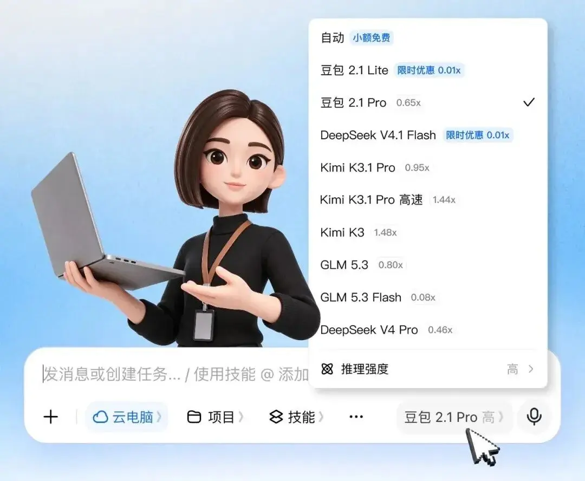

熟悉国内模型的朋友应该很清楚，这三款模型基本代表了三种不同的Work场景。K3.1擅长3D、前端、游戏开发和深度调研；GLM-5.3擅长后端、真实项目开发；V4.1 flash重在性价比，拿来做日常办公、信息检索和内容写作比较合适。

今天，我先拉来了**豆包工作跟WorkBuddy**一起横评，用6个任务、同一提示词、同一个模型进行实测，最后看看谁在**任务效果、速度**和**性价比**方面表现更优。

大家也可以在评论区聊聊看，你用得最多的Work Agent是哪款，以及为什么在用它。

横评前，先来看一下各家的额度消耗情况。WorkBuddy标准版连续包月费用是70元/月，提供4000积分额度。豆包工作标准版连续包月费用是68元/月，提供9000额度。

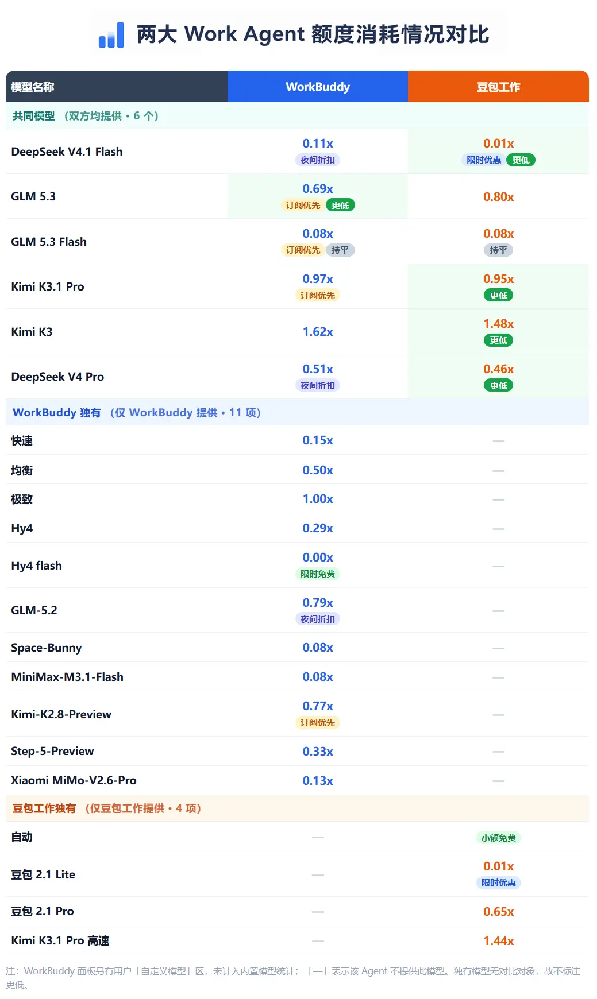

本表格由豆包 2.1 lite生成

额度消耗倍率这块，整体来看豆包工作占优，尤其是V4.1 flash模型0.01×的额度消耗，约等于免费。但实际消耗如何，还得看实测。

下面，我们开始今天的正题。

## 1）小说写作

写作任务，我给了一个命题，让两个Work Agent调用自家最强的模型来完成。豆包工作用的模型是「豆包2.1 Pro」，WorkBuddy用的模型是「Hy4正式版」。

> 小说写作：
>
> 创作一篇武侠小说《天下第一的遗书》
>
> 要求：
>
> 1、主角是公认的天下第一高手，故事开始时他已经死了。
>
> 2、全篇由五封信构成：分别写给仇人、爱人、徒弟、对手、和一个从未出场的陌生人。
>
> 3、五封信必须互相矛盾——每封信里主角对自己的死因说法都不一样。
>
> 4、但读者读完后必须能确定：他到底是怎么死的。
>
> 5、1200字以内。

豆包工作：

> 【豆包工作】
>
> 《天下第一的遗书》
>
> 沈孤鸿死了。
>
> 三十年来，断鸿刀下从无三合之将，“天下第一” 四字像一块铁，压得整个武林喘不过气。而他死在听雨楼的藤椅上，神色安详，周身无血无伤，宝刀仍高悬原处。
>
> 枕下寻出五封信，墨迹淋漓，皆已封好。
>
> 一、致仇人贺长川
>
> 长川吾敌：
>
> 二十年前苍梧峡一战，你中我一刀，我挨你一掌 “玄阴冷”。你以为那掌早被我化去，其实没有。寒毒蛰伏二十载，今春终于攻入心脉。
>
> 我至死不医，是不愿旁人知晓。你我心里清楚便好。
>
> 此仇，你赢了。
>
> 二、致婉娘
>
> 婉娘：
>
> 莫哭。
>
> 十五年前岷江上那一剑，本是刺向你的，我用后背接了。大夫说伤了肺叶，寿不过十载 —— 我多活了五年，已是赚的。
>
> 这些年每咳一夜，便想起当年船头上你回头的样子。
>
> 能为你死，我心甘情愿。
>
> 三、致徒弟长风
>
> 长风吾徒：
>
> 我走了，死于强练《断鸿诀》第九重。真气逆行，经脉寸断，一夜之间，油尽灯枯。
>
> 你切记：武功之险，险在一个 “贪” 字，我便是活生生的例子。
>
> 刀谱留给你，第九重那一页，我已替你撕去。江湖路远，稳着走。
>
> 四、致对手岳重山
>
> 重山兄：
>
> 重阳那日，华山之巅，拆到第七百招，你一剑 “长河落日”，剑尖点在我心口。我当时只退三步，你以为未曾得手。
>
> 其实剑气已断我心脉。我硬撑七日，只为不让你看见我倒下。
>
> 天下第二，从今往后，你是第一了。
>
> 承让。
>
> 五、致陌生人
>
> 有缘人：
>
> 你能读到这封信，必与我素昧平生、无恩无怨。唯有对这样的人，才不必说谎。
>
> 我是自己走的。
>
> 昨夜我磨了墨，写罢前面四封信，然后净手、更衣，自断心脉，坐在藤椅上等天亮。
>
> 我给贺长川一个复仇的快意，给婉娘一段情深的念想，给长风一个敬畏的训诫，给岳重山一场求而不得的胜利。世人各取所需，皆大欢喜。
>
> 而真相是：天下第一，原是一条绝路。刀练到极处，路走到尽头，前面空无一物。
>
> 高处不胜寒。除了自己跳下去，别无去路。
>
> —— 沈孤鸿 绝笔

WorkBuddy：

> 【WorkBuddy】
>
> 《天下第一的遗书》
>
> 〔漆匣盖内墨书：谢无咎遗函五通，腊月十七夜封。〕
>
> 一 与雷破山
>
> 你等了三十年，今夜算你等到。
>
> 酒是你三日前托人送上山的，我没换，也没让人试。饮到第三盏，指尖就麻了——你的药下得比你的刀稳。三十年前雁荡崖上断你一臂，我那时说“留你一命，好教你有个活头”，其实是句漂亮话。人到了天下第一，说什么都像恩典。
>
> 我不怪你，也不许旁人怪你。明日上山的人若问，就说谢无咎死在雷破山的药里，赢得干干净净。山门里已没有第二个会使剑的人，不必再上来。
>
> 烛刚剪过，茶还温着。
>
> 腊月十七夜 谢无咎
>
> 二 与阿檀
>
> 别来。
>
> 旧伤是今冬发的，先是握不住筷，后来连笔也沉。大夫的话我替他说了：油尽灯枯，与人无干。你熬的那包药还在枕边，我没动，动了倒像我信它能留我几年。
>
> 那年说好开春去江南看梅，算我失约。你不必想是不是这些年替我守着山上那间屋子，把我拖成了这样。我这一生只输给过岁月，没输给过谁，也没为谁慢过一步。你把这句记牢，比记我好。
>
> 窗我关了，风进不来。柜子最下一格有件旧披风，是你的，拿回去。
>
> 烛剩三寸，写字要慢些了。
>
> 腊月十七夜 谢无咎
>
> 三 与叶七
>
> 真气我今夜尽数渡与你了，一分没留。你日后觉得胸口那团火不是自己练出来的，不必疑心，也不必还。
>
> 我耗的是命，不是功夫；所以掌门位你接，谁问都别推。推了，倒显得我这一场是白给。
>
> 只有一桩：不许查我怎么死的，不许替我寻人，不许把剑谱第三页改回你原先那个写法。你改过三次，一次比一次像我，也一次比一次不像你。往后照你自己的写。
>
> 护心丹在匣底，留给你，别急着吃。师父没病，只是没了。
>
> 换过一支烛了。
>
> 腊月十七夜 谢无咎
>
> 四 与萧停云
>
> 雁门那一剑，你进了半寸。
>
> 当年不说，是怕你往后不肯再出手；今夜说了，是因为再不说，这世上就没人知道了。回山后伤一直没合，今冬忽然崩开，医不好，也不必医。你大可把那半寸讲出去——天下第一与人过招，从来只有“未败”二字，能落到“略输”，是我替你争来的。
>
> 你别来吊。来了，人家就要写你我如何如何，写得不真。
>
> 药苦得很，兑在茶里才咽得下。门闩落了，今夜不见客。第二支烛也快尽了。
>
> 腊月十七夜 谢无咎
>
> 五 与展信者
>
> 我不认得你，这五函才会落到你手上：前四个人都与我太近，给他们的话，句句都得替他们打算。
>
> 雷破山送的酒我泼了，一滴没沾。阿檀的药我确实没动——动了我今夜就下不了手。叶七的真气是三年前渡的，他早不欠我。萧停云那半寸，是他自己不敢信，我从没让过。
>
> 你若细看落款：五通同是一夜，同一锭墨，烛从初剪写到将尽，换了三回。死因一夜变不得四回，所以前四通都是我编的。各人各得一个说法，也各会替我守到底，谁都不会去问第二个人。
>
> 屋里只我一个：窗从里闩，门从里闩，阶前积雪只一行脚印，是我傍晚担水踩的。茶自己斟的。药是三年前从南边带回、锁在枕箱里的那一包，钥匙方才丢进了炉子。天亮我不会再醒。
>
> 做了三十年天下第一，拔剑要由人请，收剑要由人劝，连怎么死，天下都早替我排好了戏文。只剩这一件还归我。
>
> 你不必告诉谁。
>
> 腊月十七夜 谢无咎

这个写作任务是一个多重叙事，模型需要同时管理五条信息线并保持逻辑闭环，比较考验模型的结构性叙事能力。

豆包版交出了一个合格的答案。它完成了所有硬性要求，语言流畅，故事完整。但它在伏笔设计上做得不够，只做到了表面。

WorkBuddy版则更出色一些。它的五封信是精心设计的，每一封都在为第五封的拆解埋线，每一个细节都在为“自杀”这个真相服务，而且服务得不露痕迹。

成本这块，豆包消耗了2.27额度，WorkBuddy消耗4.75额度。速度方面，大家都差不多。

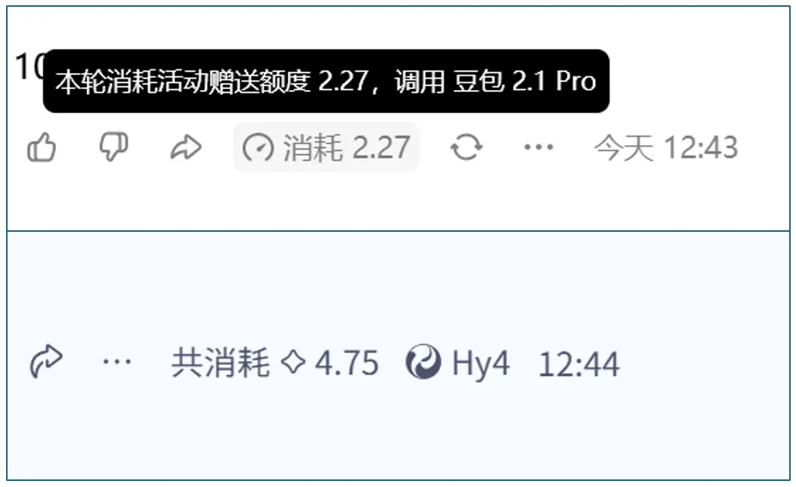

## 2）海报设计

上周，我在「沃垠AI」群里提了几个问题，大家讨论得还挺激烈的。

> 1、人人都是Builder了，那谁是user？是Builder本身就是user（悦己），还是user成长为了Builder（替代）？
>
> 2、demo离生产到底有多远？中间究竟隔着多远的工程？
>
> 3、你的业务离了AI还转不转？既然还能转，那你为什么要AI？
>
> 4、AI时代应该怎么给自己定价？既然你都用AI（新技术）了，为什么还在用旧方法定价？
>
> 5、一定需要用最好的AI吗？

今天，刚好用2个Agent把群聊内容做成图片，分享给大家。模型，依旧是选择自家最强的模型。

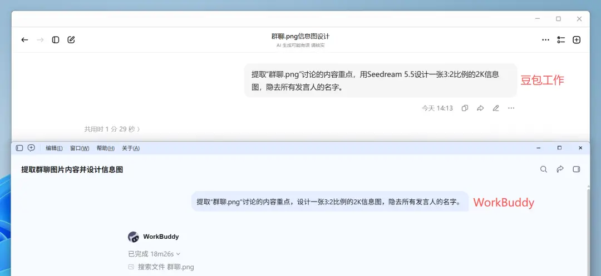

豆包工作：

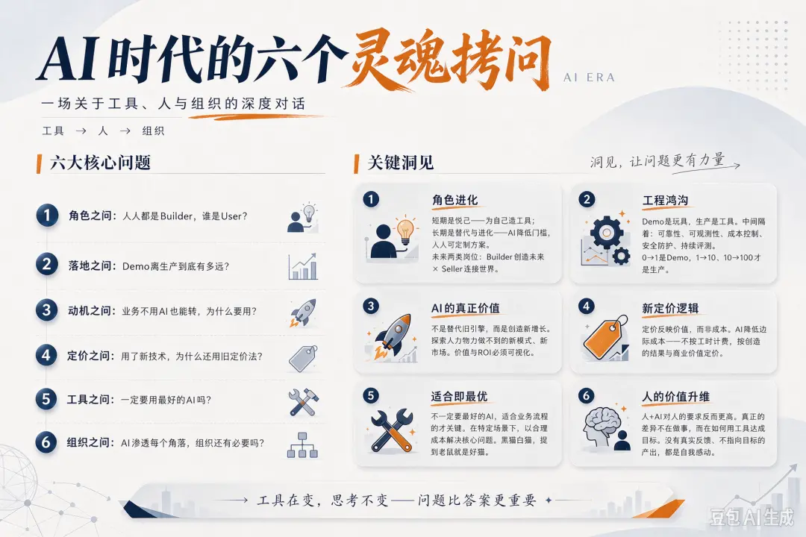

WorkBuddy：

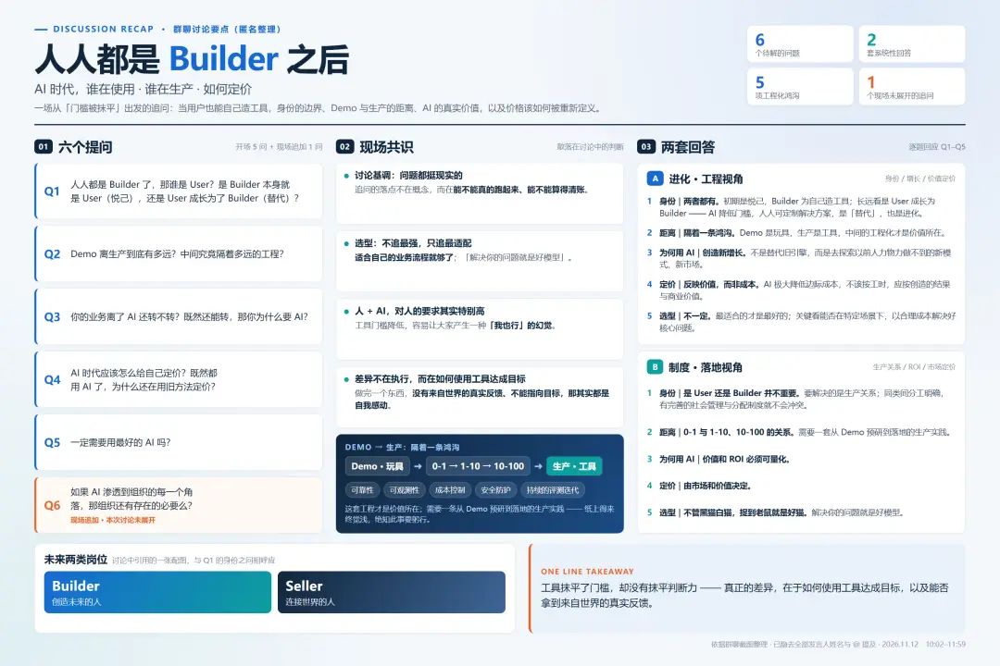

显然，豆包工作是调的Seedream 5.5来生成；WorkBuddy没有调用图像模型，是通过写网页来截图转图片。

从信息可读性和排版美观性上来看，豆包工作表现更好。

额度消耗，豆包工作是12.7，WorkBuddy是35.62，依旧豆包工作占优。这个任务是单纯生图，所以时间上，豆包工作更快。

## 3）群聊信息图

既然WorkBuddy不能直接生图，那我们换一个任务，都用代码写HTML来制作信息图，而且还要回答我这6个问题。模型，都统一用DeepSeek V4.1 flash。

> 提示词：
>
> 根据“群聊.png”写一个适合移动端阅读的HTML信息卡片，可视化总结群聊内容，同时你自己也需要回答这几个问题。信息卡片里，除了“冷逸”以外，不要出现其他人的名字。

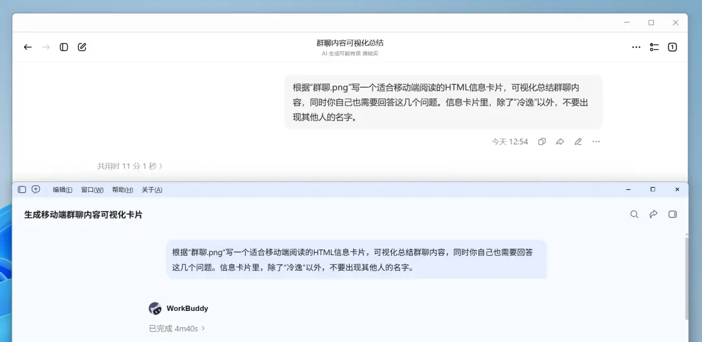

豆包工作：

WorkBuddy：

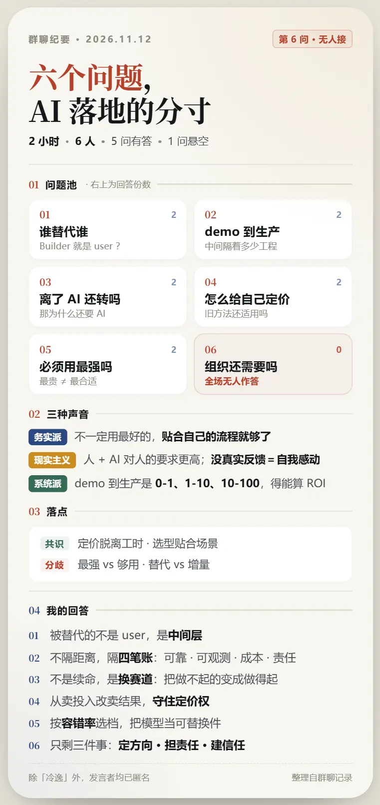

这里面，除了豆包工作One Shot外，WorkBuddy还经历了返工。因为第一版它出来的页面不太好看，是用的多模块混排，不协调，所以进行了返工修改。

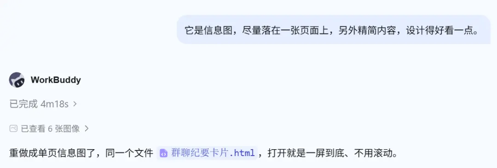

返工后，就好看多了。

额度消耗方面，WorkBuddy是8.49（3.62+4.87），豆包工作则是免费。速度方面，WorkBuddy加上返工的时间，两个Agent都差不多。

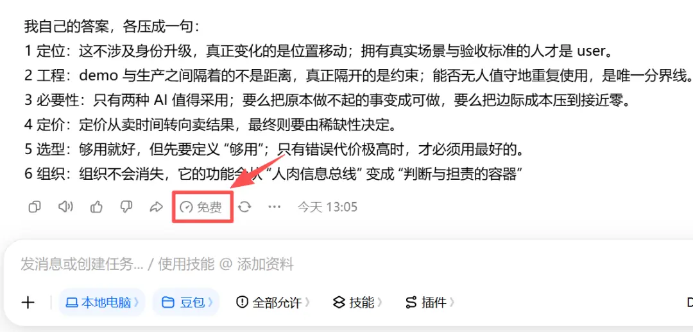

综合来看，这轮任务豆包工作的表现更优。

## 4）Office任务

还是用V4.1 flash模型，测一个打工人最常用的Office场景：让Agent联网检索今年的电影票房，然后出一份调研报告和分析报表。

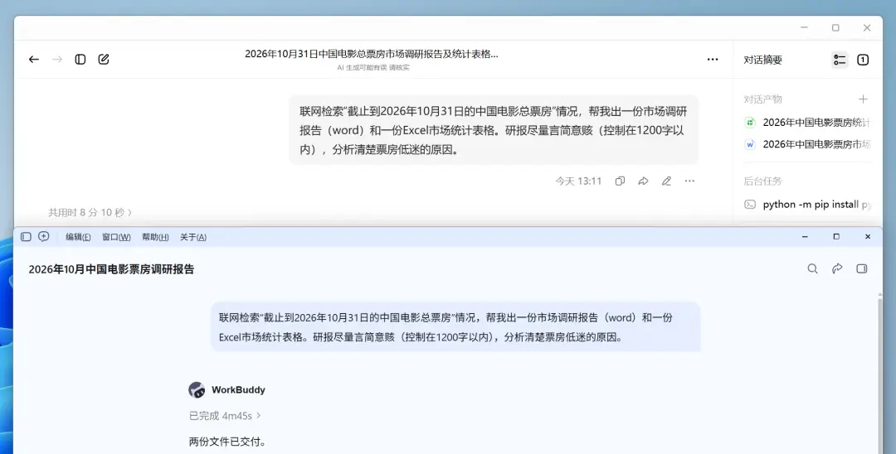

豆包工作：

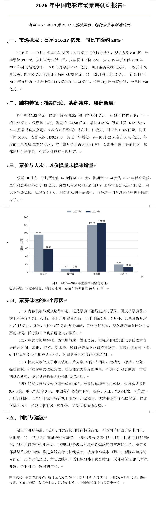

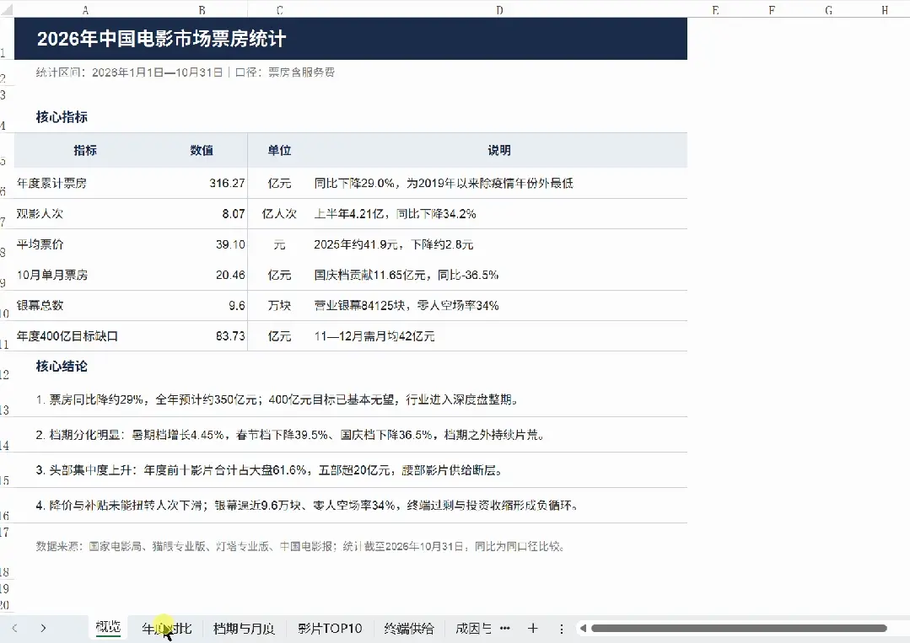

WorkBuddy：

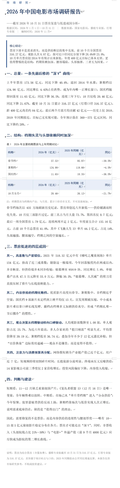

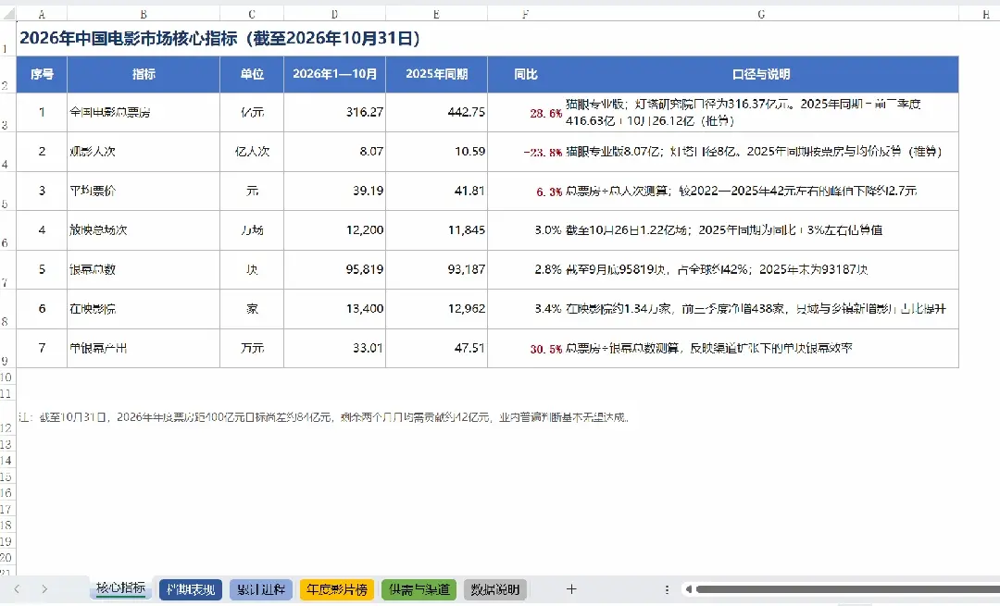

先看数据准确性，我人工核了一遍，两个Agent统计的数据都没有问题。

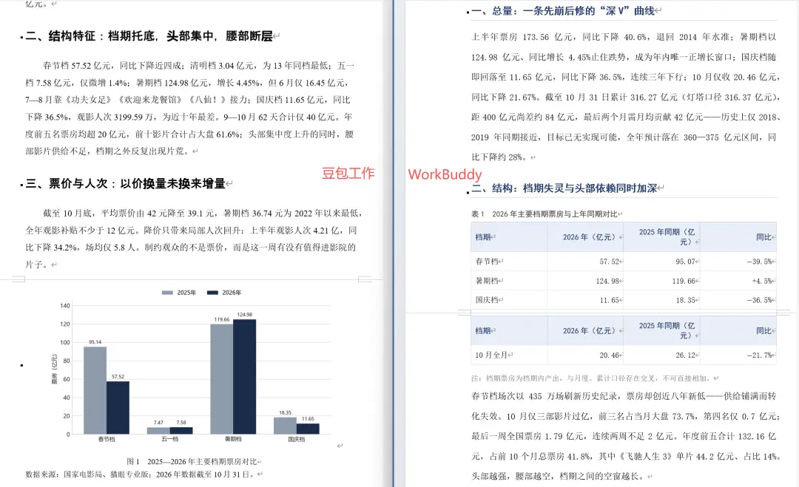

再看分析深度性，左边豆包工作更善于抓重点，找关键；右边WorkBuddy也还不错，但会稍微有点官方，喜欢讲“正确的废话”。

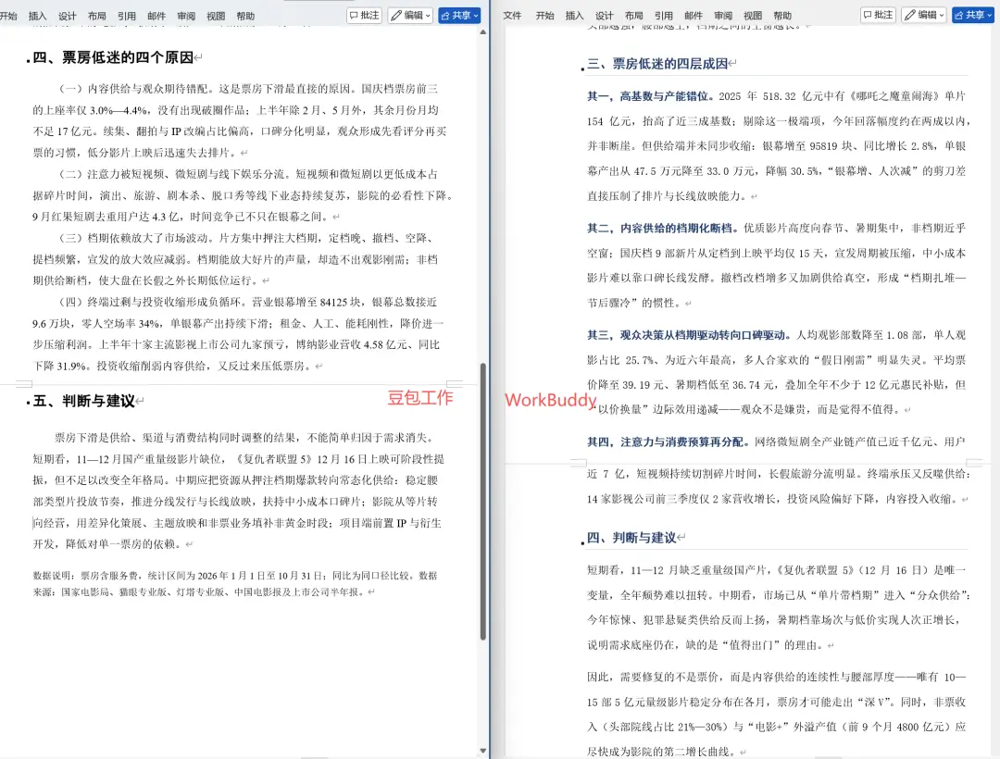

额度消耗方面，WorkBuddy是8.93，豆包工作依旧免费。速度方面，WorkBuddy用了5分钟，豆包工作是8分钟。

## 5）公众号SVG卡片

接着，我测了一个比较有难度的公众号SVG卡片设计，模型统一选GLM-5.3。让他们给我做一个科普「第一性原理」的SVG代码，我要能直接放进公众号里。

> # 目标
>
> 单 HTML 文件承载一张 2:3 SVG 科普图：{{主题：第一性原理}}。页面大幅展示，带实时调节面板、复制、下载；零外链，动画保留；SVG可供用户一键复制、粘贴进公众号，确保复制出去的与屏幕上看到的完全一致。
>
> # 公众号验收线
>
> – 粘进公众号编辑器点保存后效果不掉：成品 id、defs、渐变、filter、clipPath、mask、pattern、url(
>
> #…
>
> ) 计数全为 0，一律展开成纯几何。
>
> – 观感不降级：渐变、光晕、暗角、噪点、斜纹、渐变标题都在，无色阶台阶、无接缝。
>
> – 富文本复制走 ClipboardItem（text/html + text/plain）；外层 section 限宽 677px、font-size:0、带底色；SVG 用 width=”100%” + viewBox，不写 height。
>
> – 走公众号的复制永远输出烘焙版，与预览开关无关。

豆包工作：

WorkBuddy：

两个Agent都完成得不错，也都One Shot就能让SVG代码可以直接复制进公众号编辑器里。画面上，WorkBuddy版有动画演示，会更吸引人一点。

速度方面，豆包工作用了15分钟，WorkBuddy是30分钟。额度消耗方面，豆包工作是300.9，WorkBuddy是210。

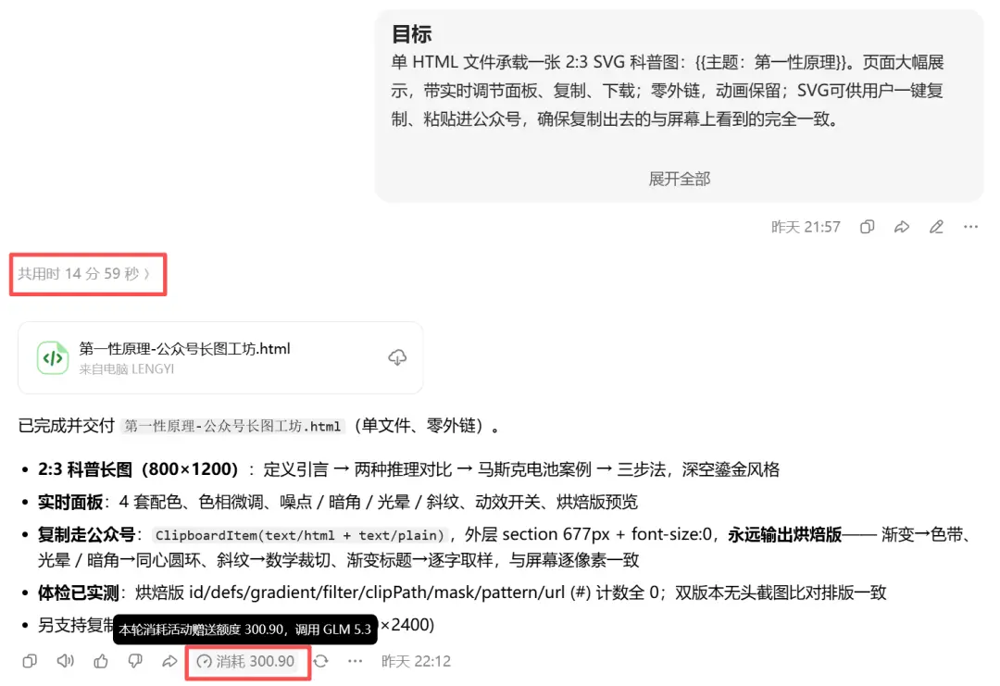

## 6）3D立体模型

最后，来测一个积分消耗大户，用K3.1 Pro生成一个加油站的3D桌面模型 。

> 制作一个桌面立体3D模型：荒野公路旁的一座加油站，深夜大雨。
>
> 【必须具备】
>
> – 一个方形底座，边缘像博物馆模型那样做剖切处理，在侧面以横截面展示沥青层、路基和埋设的管道。
>
> – 加油站雨棚及其便利店。雨棚下的灯管闪烁并投下冷白光，照亮湿滑地面上的倒影；便利店窗户透出暖光，里面隐约有人影。室外是漆黑、潮湿、反光的。
>
> – 暴雨、地面积水与水花、雨棚边缘形成的雨帘、远处公路上的车灯光晕，以及偶尔的闪电短暂照亮整个场景。
>
> – 一辆小轿车停在油泵旁，雨刷在动，车灯亮着。
>
> – 拖动以旋转，滚动或双指捏合以缩放；立体模型始终不会离开画面。没有其他 UI。
>
> 【规则】
>
> – 在笔记本电脑上达到 60 fps，并且在手机 390 px 宽度下仍然流畅。保持低 draw call（实例化、合并几何体），并限制像素比。
>
> – 不要用绘制的背景来伪造 3D。
>
> – 艺术风格（写实、低多边形、风格化）和配色由你决定。它应该看起来像一件你会想摆在架子上的东西。
>
> – 将结果写入当前工作目录下的 index.html：一个可直接运行的单 HTML 文件。你使用的任何库都必须是来自 CDN 的版本固定模块（例如 https://unpkg.com/three@0.169.0/build/three.module.js），通过 import map 加载；你自己的所有 CSS 和 JS 都保持内联。没有构建步骤，没有本地资源文件，没有外部模型或纹理：一切都在代码中构建。
>
> 逐步构建文件：先创建 HTML 骨架和样式，然后在多次单独的工具调用中追加 JavaScript、3D 场景设置、着色器和交互。绝不要试图在单次工具调用中输出整个文件。

两个Agent完成得都不错，依托K3.1设计的3D效果不会太差。但细节方面，豆包工作还是会更丰富一些，比如路过的车辆、立体的雨水以及雨水滴在地面上溅起来的效果，看起来都更真实一些。

速度方面，豆包工作用时31分钟，WorkBuddy是26分钟。额度消耗方面，豆包工作是428，WorkBuddy是401。

6个任务测完了，最后我们从效果、效率和成本方面来总结一下。给表现最优的Agent打10分，另外一个Agent依据对比情况打5-10分，最终详细得分如下。

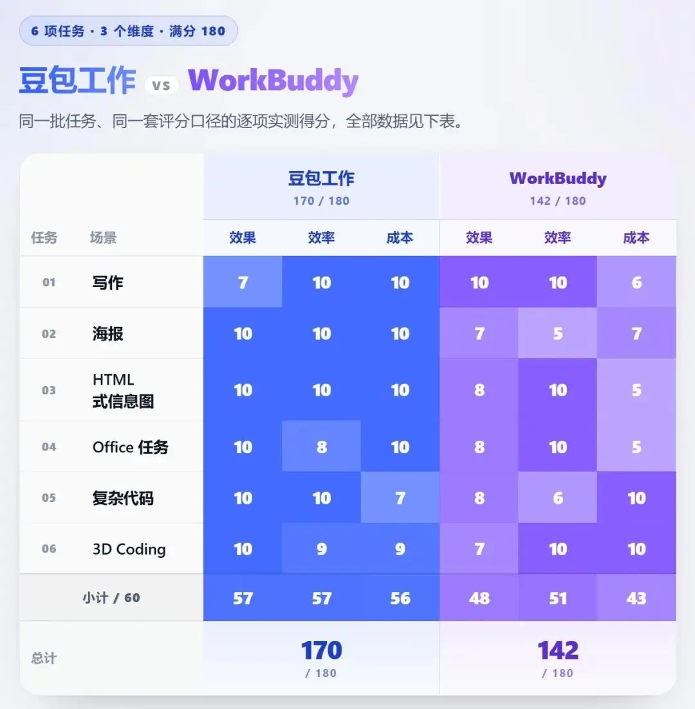

**效率：**各有千秋。日常简单任务、office任务，两个Agent都很快；长程任务和复杂代码上，豆包工作表现也很好。

**效果：**同一模型，两个Agent表现基本都差不多，豆包工作在部分细节上要稍微强一点。

**成本：**整体看，豆包工作表现更优，更省成本。不过复杂代码和Coding场景，豆包工作的额度消耗要比WorkBuddy稍微高一点。但豆包工作标准版的额度是WorkBuddy标准版的两倍多，这么算下来成本就更低了。

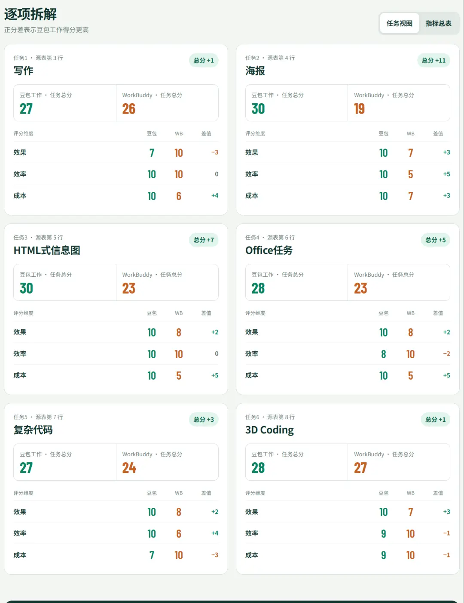

六个任务综合测下来，豆包工作得分170，Workbuddy得分142。豆包工作的整体表现超过WorkBuddy有点让我感到意外，能感受到它的Harness设计是有点东西的，在做到更快的同时还能更省。

现在，豆包工作开放了第三方模型，确实方便了很多。对了，他们logo也同步焕新了。

这豆姐认真工作的样子，一看就很专业。

好了，以上就是今天的横测内容，跟你的体感一致吗？欢迎在评论区聊聊看。

如果有想测的Agent，也可以在评论区告诉我。感谢你的阅读，我们下期再见。
